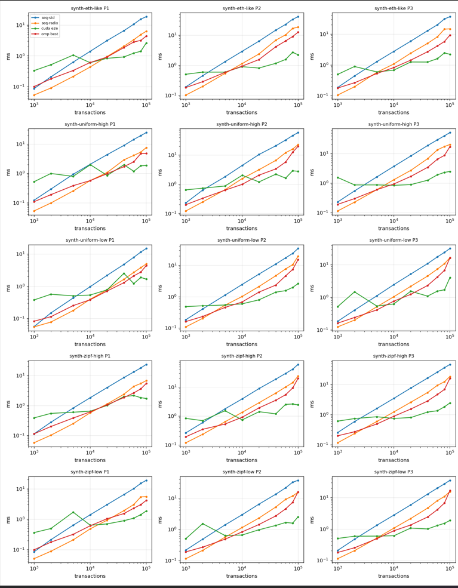
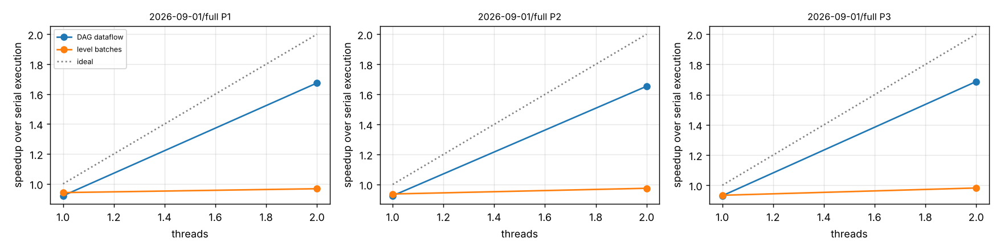

# Conduit: GPU-accelerated conflict detection and parallel transaction execution

**IT 301 Parallel Computing project, NITK Surathkal**

Conduit takes a list of blockchain transactions, works out which ones conflict, builds
their dependency graph, splits them into groups that can safely run at the same time, and
then **actually runs them in parallel** while proving the result is the same as running
them one by one. Everything is implemented three ways (single-threaded C++, OpenMP on CPU
cores, and CUDA on an NVIDIA GPU), so the speedups can be compared on identical input.

We test it on **2,013,158 real Ethereum mainnet transactions** (all of 1 September 2026)
and on synthetic workloads designed to stress the system.

---

## Contents

1. [The problem](#1-the-problem)
2. [How Conduit solves it](#2-how-conduit-solves-it)
3. [Results](#3-results)
4. [Setup (Windows + WSL2 + CUDA)](#4-setup-windows--wsl2--cuda)
5. [Running the project](#5-running-the-project)
6. [Understanding the output](#6-understanding-the-output)
7. [Project structure](#7-project-structure)
8. [Correctness: how we know the answers are right](#8-correctness-how-we-know-the-answers-are-right)
9. [Limitations and honest caveats](#9-limitations-and-honest-caveats)
10. [Troubleshooting](#10-troubleshooting)

---

## 1. The problem

A blockchain executes the transactions of a block **one after another**. That is simple
and safe, but it wastes every core except one. Most transactions have nothing to do with
each other: Alice paying Bob and Carol paying Dave could run at the same time. Two
transactions **conflict** only if they touch the same piece of state and at least one of
them writes it, for example two payments from the same account, or two transfers of the
same token where the balances overlap.

To run a block in parallel, a scheduler first has to:

1. figure out what state each transaction reads and writes,
2. find every conflicting pair,
3. build a **dependency graph** (an edge `A → B` means B must wait for A),
4. turn that graph into an execution plan.

On large inputs (rollup batches, a full day of transactions) this preprocessing is
itself expensive. Conduit makes it fast, and then shows that the plan really speeds up
execution.

## 2. How Conduit solves it

```
 CSV export ──► ingest ──► binary corpus
                              │
         ┌────────────────────┴───────────────────────┐
         ▼            PREPROCESSING (CPU / OpenMP / GPU) │
  Stage 1  extract   each transaction → (state key, read/write) records
  Stage 2  detect    sort records by key; neighbours on the same key conflict
  Stage 3  graph     conflict edges → dependency DAG (CSR format)
  Stage 4  schedule  levels (batches) / Kahn / Jones–Plassmann colouring
         └────────────────────┬───────────────────────┘
                              ▼
                  EXECUTION (CPU threads)
        serial  |  level batches + barriers  |  DAG dataflow
                              │
                              ▼
          final state == serial final state ?  (checked every run)
```

**Read/write sets (stage 1).** Ethereum does not publish what each transaction touches,
so we infer it with three policies of increasing precision:

| Policy | What it locks | Example |
|---|---|---|
| **P1** contract | the whole sender account and the whole called contract | every USDT transfer conflicts with every other |
| **P2** slot | nonce, ETH balance and the exact token balances involved | Alice→Bob USDT doesn't conflict with Carol→Dave USDT |
| **P3** commutative | like P2, but balance additions may happen in any order | two deposits into the same account can run together |

**Conflict detection (stage 2).** Instead of comparing every pair (O(n²)), all records
are radix-sorted by state key; conflicts can then only occur between neighbours. On the
GPU we use CUB's radix sort and scans. For keys touched by thousands of transactions (an
exchange wallet, the USDT contract) a naive "one thread per key" design jams up on one
thread, so the default kernel assigns **one GPU thread per output edge** instead (load-
balanced search). Both versions are kept so the difference can be measured.

**Dependency graph (stage 3).** We keep only the edges that matter: within one key, each
access depends on the previous group of conflicting accesses, not on everything before
it. This gives the same ordering as the full graph with far fewer edges.

**Scheduling (stage 4).** Three ways to turn the graph into batches:

* **Levels** (default): batch number = length of the longest dependency chain ending at
  the transaction. Running batch 0, then 1, then 2 … gives exactly the serial result.
* **Kahn on the GPU**: the same levels computed with atomic counters on the GPU.
* **Jones–Plassmann graph colouring on the GPU**: each round picks an independent set
  of transactions in parallel (a transaction wins if it has the highest priority among the
  transactions it conflicts with). With *index* priorities it reproduces the levels
  exactly; with *random* priorities it is the classic colouring, which may reorder
  transactions (fine for someone *building* a block, not for replaying a fixed one).

**Parallel execution.** The plan is then used to run every transaction:

* **serial**: one thread, block order (the baseline),
* **level batches**: run a batch in parallel, wait for everyone (a barrier), next batch,
* **DAG dataflow** (our improvement): a transaction starts **the moment its own
  predecessors finish**, with no barriers. Atomic counters and a lock-free ready list let
  all threads pull work continuously.

Each transaction does work proportional to its real gas usage and reads/writes its real
state keys. After every parallel run we compare the final state and every transaction's
output with the serial run; if anything differs the program stops.

## 3. Results

### 3.1 Preprocessing: CPU vs OpenMP vs GPU (RTX 4050 laptop, synthetic workloads)



Each panel is one workload (rows) under one policy (columns). X-axis: block size
(1,000 to 100,000 transactions); Y-axis: time in ms, log scale (lower is better). The GPU
line (green) **includes copying data to the GPU and back**.

* Below ~5,000 transactions the GPU is slower: ~0.3–1 ms of fixed overhead (copies,
  kernel launches) while the CPU finishes in ~0.1 ms.
* The lines cross around **5k–20k transactions**.
* At 100k transactions the GPU is clearly ahead (approximate values read from the figure;
  exact numbers are in `summary.md` after a run):

| 100k transactions | seq-std | seq-radix | OpenMP (all cores) | GPU (with transfers) | GPU vs OpenMP |
|---|---:|---:|---:|---:|---:|
| Ethereum-like, P2 | ~40 ms | ~18 ms | ~12 ms | ~2.3 ms | ~5× |
| Ethereum-like, P3 | ~35 ms | ~15 ms | ~9 ms | ~2.2 ms | ~4× |
| Uniform-low, P3 | ~33 ms | ~17 ms | ~16 ms | ~4 ms | ~4× |
| Ethereum-like, P1 | ~20 ms | ~6 ms | ~4.5 ms | ~2.6 ms | ~1.7× |

That is roughly **8–17× faster than the original sequential code** and **4–5× faster than
all CPU cores**, and the gap keeps growing with size. P1 gains least because it produces
only 2 records per transaction, leaving less work to parallelise.

### 3.2 Real data: all 2,013,158 transactions of 1 September 2026

The whole day processed as one block (7,172 Ethereum blocks):

| | P1 | P2 | P3 |
|---|---:|---:|---:|
| transactions executed | 2,013,158 | 2,013,158 | 2,013,158 |
| dependency edges | 3,070,055 | 3,736,831 | 3,233,216 |
| batches (levels) | 401,223 | 401,223 | 392,438 |
| preprocessing, single core | 0.65 s | 0.83 s | 0.80 s |
| preprocessing, OpenMP 2 threads | 0.26 s | 0.31 s | 0.29 s |
| final state identical to serial | ✔ | ✔ | ✔ |

**Execution: level batches vs DAG dataflow.** How much faster than serial could
execution be with W workers? (model weighted by each transaction's real gas)

| Executor | W = 8 | W = 16 | W = 64 | unlimited |
|---|---:|---:|---:|---:|
| level batches + barriers | 1.95× | 1.97× | 1.99× | **1.99×** |
| DAG dataflow (ours) | 7.99× | 10.92× | 10.93× | **10.93×** |

Batch-by-batch execution can **never** exceed ~2× on this day, however many cores you
add: there are 400k batches and each one waits for its slowest transaction. Running the
same dependency graph as dataflow lifts the ceiling to **~11×**, a 5.5× better schedule
from the same information.

Measured on a 2-core machine (execution work proportional to gas):



| | serial | level batches, 2 threads | DAG dataflow, 2 threads |
|---|---:|---:|---:|
| time (P1) | 3.46 s | 3.58 s (0.97×) | 2.07 s (**1.67×**) |

On a laptop with more cores the DAG executor scales further, up to the ~11× ceiling.
Run `tools/run_dataset.sh` to get your machine's numbers.

**Why P2/P3 look like P1 on this file.** The export contains each call's function
selector but not its arguments, so for 725,509 token transfers the recipient is unknown.
To stay correct, every USDT transfer must then be treated as conflicting with every other
USDT transfer. That gives one chain of **388,725 transactions** (19% of the day), which
sets the batch count. Adding the calldata export (see §5.3) splits that chain per holder;
the limit then becomes the busiest sender (an exchange hot wallet, 25,001 transactions),
leaving about 15× more room.

## 4. Setup (Windows + WSL2 + CUDA)

The code is C++17/CUDA with CMake and needs Linux. On Windows use **WSL2**, which
gives Ubuntu full access to your NVIDIA GPU through the normal Windows driver.

**Requirements:** an NVIDIA GPU (tested target: RTX 4050, compute capability 8.9), ~3 GB
free disk, 8 GB+ RAM.

### 4.1 Windows (PowerShell as administrator, once)
```powershell
nvidia-smi                       # must list your GPU; otherwise install the NVIDIA driver
wsl --install -d Ubuntu-22.04    # then reboot and create a Linux user
wsl --update
```
*Low on C: space?* Move Ubuntu to another drive:
```powershell
wsl --shutdown
wsl --export Ubuntu D:\WSL\ubuntu-backup.tar
wsl --unregister Ubuntu
wsl --import Ubuntu D:\WSL\Ubuntu D:\WSL\ubuntu-backup.tar --version 2
```

### 4.2 Ubuntu (once)
```bash
sudo apt update
sudo apt install -y build-essential cmake git wget python3 python3-numpy python3-matplotlib

# CUDA compiler from NVIDIA's WSL repository (no driver inside WSL!)
wget https://developer.download.nvidia.com/compute/cuda/repos/wsl-ubuntu/x86_64/cuda-keyring_1.1-1_all.deb
sudo dpkg -i cuda-keyring_1.1-1_all.deb && rm cuda-keyring_1.1-1_all.deb
sudo apt update
sudo apt install -y --no-install-recommends cuda-nvcc-12-6 cuda-cudart-dev-12-6 cuda-cccl-12-6

echo 'export PATH=/usr/local/cuda-12.6/bin:$PATH' >> ~/.bashrc
echo 'export LD_LIBRARY_PATH=/usr/local/cuda-12.6/lib64:$LD_LIBRARY_PATH' >> ~/.bashrc
source ~/.bashrc
nvcc --version && nvidia-smi
```

### 4.3 Get the code and build
```bash
git clone https://github.com/antonyth18/Conduit-GPU-Detection ~/conduit
cd ~/conduit
cmake -S . -B build -DCMAKE_BUILD_TYPE=Release
cmake --build build -j$(nproc)
build/conduit_tests        # expect: 38 tests, 0 failed checks
build/conduit_gpu info     # expect: NVIDIA GeForce RTX ... backend cuda
```
CMake should print `conduit: CUDA 12.6 enabled, architectures 89`. For another GPU, add
`-DCMAKE_CUDA_ARCHITECTURES=86` (RTX 30xx), `75` (RTX 20xx / GTX 16xx), and so on. Without
CUDA everything still builds; the GPU code then runs through a CPU emulation (correct
but slow, useful for testing).

## 5. Running the project

> Before timing anything on a laptop: plug in the charger, set Windows power mode to
> **Best performance**, and close heavy apps.

### 5.1 On real Ethereum data (one command)
Put your BigQuery transaction export(s) in `data/` (any CSV with at least
`block_number, transaction_index, hash, from_address, to_address`), then:
```bash
bash tools/run_dataset.sh data --quick    # first run, ~10–20 min
bash tools/run_dataset.sh data            # full repetitions, for the report
```
The script stops at the first failing step. In order, it:
1. records the machine (CPU, GPU, driver, CUDA),
2. converts the CSV into a binary corpus (`corpus_eth/`), keeping every transaction,
3. builds and runs the unit tests,
4. checks GPU == CPU on blocks from 10k transactions up to the full day,
5. benchmarks single-core vs OpenMP vs GPU for 10k … 2M transactions,
6. compares level scheduling with Jones–Plassmann colouring,
7. **executes all transactions** serially, in level batches and as DAG dataflow, verifying
   the final state each time,
8. writes `results/dataset/<pc-name>/summary.md` with tables and figures.

### 5.2 On synthetic workloads
```bash
bash tools/run_phase8.sh --synthetic --quick
```
This generates five scenarios (Ethereum-like, uniform low/high conflict, Zipf-skewed
low/high conflict) of 220k transactions each, and writes `results/phase8/...`.

### 5.3 Optional: add calldata for P2/P3 precision
Export the token-call arguments for the same day from BigQuery and save the CSV into
`data/` next to the transaction file:
```sql
SELECT block_number, `hash`,
       SUBSTR(input, 1, 10) AS selector, SUBSTR(input, 11, 64) AS arg1,
       SUBSTR(input, 75, 64) AS arg2, SUBSTR(input, 139, 64) AS arg3,
       LENGTH(input) AS input_len
FROM `bigquery-public-data.crypto_ethereum.transactions`
WHERE DATE(block_timestamp) = '2026-09-01'
  AND SUBSTR(input, 1, 10) IN ('0xa9059cbb', '0x095ea7b3', '0x23b872dd')
```
Then `rm -rf corpus_eth` and rerun `run_dataset.sh`. The calldata file is detected
automatically by its header.

### 5.4 Individual commands
```bash
python3 ingest.py --tx data --out corpus_eth                 # CSV -> corpus
S="--corpus corpus_eth --manifest corpus_eth/superblocks.json"

build/conduit_run  $S --median --impl seq-std                # one core
build/conduit_run  $S --median --impl omp --threads 8        # OpenMP
build/conduit_run  $S --median --impl cuda                   # GPU
build/conduit_run  $S --id 2026-09-01/full --impl cuda       # the whole day on the GPU

build/conduit_gpu verify   $S                                # GPU == CPU checks
build/conduit_gpu bench    $S --csv bench.csv                # timing sweep
build/conduit_gpu schedule $S --csv schedule.csv             # levels vs Jones–Plassmann
build/conduit_gpu execute  $S --full --csv execute.csv       # run every transaction
python3 report_gpu.py <folder with the CSVs>                 # tables + figures
```
Useful flags: `--policy P1|P2|P3`, `--threads 1,2,4,8`, `--target 100000`,
`--backend emu` (CPU emulation of the GPU kernels), `--runs N`.

To look at results from Windows:
```bash
cp -r ~/conduit/results /mnt/d/   # then open D:\results\...\summary.md
```

## 6. Understanding the output

* **`summary.md`**: every table: end-to-end times and speedups against *both* CPU
  baselines and the best OpenMP run, the GPU/CPU crossover size, per-stage GPU breakdown,
  the hot-key experiment, scheduling and execution results.
* **`fig_e2e_vs_size.png`**: time vs block size for each implementation (see §3.1).
* **`fig_execution_speedup.png`**: execution speedup vs threads, levels vs DAG.
* **`execute.txt`**: one line per policy starting `END TO END:`, for example *serial
  3.46 s vs preprocessing + DAG execution X s = Y× faster; all 2013158 transactions
  executed, final state identical*.
* Terms: *batches/levels* = steps of the schedule; *floor* = longest chain from a single
  sender; *bound* = minimum batches any schedule needs; *e2e* = including GPU transfers.

## 7. Project structure

| Path | What it is |
|---|---|
| `ingest.py` | CSV → binary corpus; `--tx` mode for any BigQuery-style export |
| `access_sets.py`, `superblocks.py`, `oracle.py` | Python reference: policies, block grouping, brute-force oracle |
| `include/conduit/`, `src/` | C++ pipeline: `pipeline.cpp` (sequential), `pipeline_omp.cpp` (OpenMP), `radix.cpp` |
| `src/gpu/kernels.hpp` | GPU kernel logic, shared by CUDA and the CPU emulation |
| `src/gpu/cuda_pipeline.cu` | CUDA implementation (CUB sort/scan, persistent kernels) |
| `src/gpu/emu_pipeline.cpp` | CPU emulation of every GPU kernel |
| `src/execute.cpp` | parallel execution engine (serial / level batches / DAG dataflow) |
| `src/schedule.cpp` | schedule checks, lower bound, execution models |
| `tools/conduit_gpu.cpp` | `info`, `verify`, `bench`, `schedule`, `execute` |
| `tools/conduit_run.cpp`, `tools/conduit_bench.cpp` | per-block runs, bit-identity sweep |
| `tools/run_dataset.sh` | one command for real data |
| `tools/run_phase8.sh`, `tools/synth_corpus.py` | one command for synthetic data |
| `report_gpu.py` | builds `summary.md` and figures from the CSVs |
| `tests/` | 38 C++ unit tests |
| `handover.md`, `findings.md`, `GPU_README.md` | design notes, research log, GPU details |

## 8. Correctness: how we know the answers are right

A fast wrong answer is worthless, so no number is reported unless it passes all of these:

* **Bit-identical output.** The GPU and OpenMP versions must produce exactly the same
  records, edges, graph and levels as the sequential version, on every block and policy.
* **Brute-force oracle.** On the first 2,000 transactions of each block, levels are
  recomputed by comparing every pair of transactions directly from the definition.
* **Schedule checks.** Every batch is verified conflict-free from the read/write sets
  alone, and every dependency edge goes forward in the schedule.
* **Execution check.** Every parallel execution must end in the same state, with the
  same output for each of the 2,013,158 transactions, as the serial run.
* **Tests that can fail.** The 38 unit tests were checked by deliberately breaking the
  GPU kernels: the tests caught it.
* `bench` refuses to time any configuration whose output differs from the reference.

## 9. Limitations and honest caveats

* **Read/write sets are inferred**, not traced from real EVM execution. Calls inside
  contracts are invisible, so absolute parallelism figures are upper bounds; contract-level
  fallbacks make some of them conservative.
* **Execution uses a state model**, not a real EVM: each transaction does gas-proportional
  work on its real keys. It measures scheduling quality and checks serial equivalence;
  it is not an Ethereum client.
* **Real blocks are small** (~200 transactions). The GPU pays off from roughly 10k
  transactions, so the setting is batches of many blocks (rollups, replays, a full day),
  not a single block.
* **Synthetic results are labelled synthetic.** Claims about Ethereum come only from the
  real-data runs, for the days we measured.
* **Jones–Plassmann is slow on very deep graphs** (it re-examines all waiting transactions
  every round), so it is skipped above 250k transactions.

## 10. Troubleshooting

| Problem | Fix |
|---|---|
| `nvcc: command not found` | `source ~/.bashrc`, or add `-DCMAKE_CUDA_COMPILER=/usr/local/cuda-12.6/bin/nvcc` to cmake |
| CMake: "no CUDA compiler found" | as above, then `rm -rf build` and configure again |
| `Unsupported gpu architecture 'compute_89'` | use `-DCMAKE_CUDA_ARCHITECTURES=86` or update CUDA |
| `conduit_gpu info` shows no device | run `nvidia-smi` in Ubuntu; update the Windows driver; `wsl --shutdown` in PowerShell |
| `wsl: command not found` inside Ubuntu | `wsl` commands belong in PowerShell (`PS C:\...>`), not Ubuntu |
| "GPU output differs … refusing to time it" | run `build/conduit_tests` and `conduit_gpu verify --backend emu` and report the output |
| very noisy timings | charger in, Best performance mode, `--runs 15` |

---

*Data: Ethereum mainnet transactions from the public BigQuery dataset
`bigquery-public-data.crypto_ethereum`. Built for IT 301 Parallel Computing, NITK Surathkal.*
