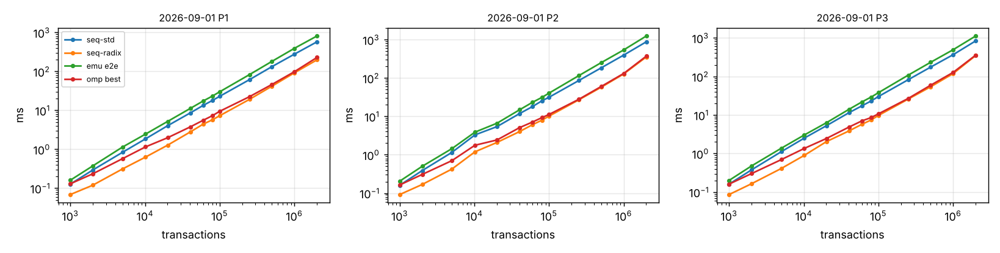
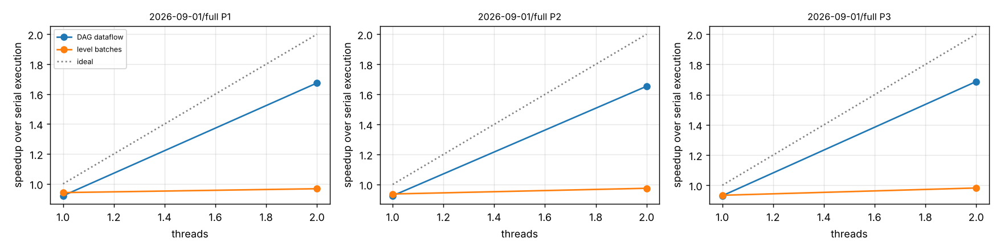

# Phase 8-10 results: GPU preprocessing pipeline

## Machine

```
date: 2026-11-01T10:19:41Z   host: vm   data: data
threads swept: 1,2   runs: 1 warm-up + 2 measured
Linux vm 6.18.44-fc-v185 #1 SMP PREEMPT_DYNAMIC @0 x86_64 x86_64 x86_64 GNU/Linux
CPU(s):                                  2
Model name:                              Intel(R) Xeon(R) Processor
Thread(s) per core:                      1
Core(s) per socket:                      2
               total        used        free      shared  buff/cache   available
Mem:           7.8Gi       410Mi       6.5Gi        15Mi       1.1Gi       7.4Gi
nvidia-smi: not found
nvcc: not found
```

> **WARNING: GPU rows come from the host EMULATION. Their times are not GPU times; only the CPU rows and the counters are meaningful.**

## End-to-end time per super-block (ms, median)

GPU = balanced detection + CPU sweep, transfers included. `k-only` = GPU stages 1-3 kernels without transfers.

| scenario | n | pol | seq-std | seq-radix | omp best (t) | GPU e2e | GPU k-only | vs seq-std | vs seq-radix | vs omp |
|---|---:|---|---:|---:|---:|---:|---:|---:|---:|---:|
| 2026-09-01 | 1000 | P1 | 0.13 | 0.07 | 0.13 (1) | 0.16 | 0.16 | 0.79x | 0.43x | 0.81x |
| 2026-09-01 | 1000 | P2 | 0.16 | 0.09 | 0.16 (1) | 0.20 | 0.20 | 0.78x | 0.45x | 0.80x |
| 2026-09-01 | 1000 | P3 | 0.16 | 0.09 | 0.16 (1) | 0.20 | 0.20 | 0.80x | 0.43x | 0.80x |
| 2026-09-01 | 2000 | P1 | 0.29 | 0.12 | 0.23 (1) | 0.37 | 0.37 | 0.78x | 0.32x | 0.63x |
| 2026-09-01 | 2000 | P2 | 0.39 | 0.17 | 0.31 (1) | 0.50 | 0.49 | 0.77x | 0.34x | 0.61x |
| 2026-09-01 | 2000 | P3 | 0.38 | 0.16 | 0.30 (1) | 0.48 | 0.47 | 0.79x | 0.35x | 0.63x |
| 2026-09-01 | 5000 | P1 | 0.84 | 0.31 | 0.57 (2) | 1.14 | 1.12 | 0.73x | 0.27x | 0.50x |
| 2026-09-01 | 5000 | P2 | 1.15 | 0.42 | 0.70 (2) | 1.44 | 1.42 | 0.80x | 0.29x | 0.49x |
| 2026-09-01 | 5000 | P3 | 1.11 | 0.41 | 0.69 (2) | 1.37 | 1.35 | 0.81x | 0.30x | 0.51x |
| 2026-09-01 | 10176 | P1 | 1.86 | 0.63 | 1.15 (2) | 2.46 | 2.41 | 0.76x | 0.26x | 0.47x |
| 2026-09-01 | 10176 | P2 | 3.29 | 1.19 | 1.77 (2) | 3.88 | 3.83 | 0.85x | 0.31x | 0.46x |
| 2026-09-01 | 10176 | P3 | 2.51 | 0.89 | 1.36 (2) | 3.02 | 2.98 | 0.83x | 0.30x | 0.45x |
| 2026-09-01 | 20101 | P1 | 4.03 | 1.27 | 1.98 (2) | 5.19 | 5.11 | 0.78x | 0.25x | 0.38x |
| 2026-09-01 | 20101 | P2 | 5.42 | 2.10 | 2.43 (2) | 6.64 | 6.53 | 0.82x | 0.32x | 0.37x |
| 2026-09-01 | 20101 | P3 | 5.26 | 2.03 | 2.45 (2) | 6.27 | 6.18 | 0.84x | 0.32x | 0.39x |
| 2026-09-01 | 40366 | P1 | 8.58 | 2.78 | 3.75 (2) | 11.18 | 11.00 | 0.77x | 0.25x | 0.34x |
| 2026-09-01 | 40366 | P2 | 11.85 | 4.02 | 5.10 (2) | 14.87 | 14.67 | 0.80x | 0.27x | 0.34x |
| 2026-09-01 | 40366 | P3 | 11.45 | 3.85 | 4.85 (2) | 14.00 | 13.79 | 0.82x | 0.28x | 0.35x |
| 2026-09-01 | 60044 | P1 | 13.38 | 4.41 | 5.55 (2) | 17.36 | 17.06 | 0.77x | 0.25x | 0.32x |
| 2026-09-01 | 60044 | P2 | 18.05 | 6.07 | 7.13 (2) | 23.29 | 22.97 | 0.77x | 0.26x | 0.31x |
| 2026-09-01 | 60044 | P3 | 17.20 | 5.71 | 7.01 (2) | 21.73 | 21.41 | 0.79x | 0.26x | 0.32x |
| 2026-09-01 | 80100 | P1 | 17.98 | 5.73 | 7.30 (2) | 23.31 | 22.93 | 0.77x | 0.25x | 0.31x |
| 2026-09-01 | 80100 | P2 | 25.36 | 7.95 | 9.26 (2) | 31.18 | 30.77 | 0.81x | 0.26x | 0.30x |
| 2026-09-01 | 80100 | P3 | 23.13 | 7.44 | 8.56 (2) | 29.19 | 28.76 | 0.79x | 0.25x | 0.29x |
| 2026-09-01 | 100098 | P1 | 22.94 | 7.27 | 9.45 (2) | 29.96 | 29.49 | 0.77x | 0.24x | 0.32x |
| 2026-09-01 | 100098 | P2 | 31.58 | 10.17 | 11.24 (2) | 40.40 | 39.86 | 0.78x | 0.25x | 0.28x |
| 2026-09-01 | 100098 | P3 | 30.06 | 9.71 | 10.68 (2) | 37.79 | 37.26 | 0.80x | 0.26x | 0.28x |
| 2026-09-01 | 250058 | P1 | 61.27 | 19.08 | 22.36 (2) | 82.50 | 81.29 | 0.74x | 0.23x | 0.27x |
| 2026-09-01 | 250058 | P2 | 85.80 | 26.94 | 27.81 (2) | 115.04 | 113.62 | 0.75x | 0.23x | 0.24x |
| 2026-09-01 | 250058 | P3 | 81.81 | 25.71 | 26.74 (2) | 107.49 | 106.09 | 0.76x | 0.24x | 0.25x |
| 2026-09-01 | 500117 | P1 | 132.38 | 41.66 | 46.15 (2) | 180.74 | 178.08 | 0.73x | 0.23x | 0.26x |
| 2026-09-01 | 500117 | P2 | 184.25 | 57.58 | 60.20 (2) | 251.79 | 248.48 | 0.73x | 0.23x | 0.24x |
| 2026-09-01 | 500117 | P3 | 174.06 | 53.76 | 58.92 (2) | 232.03 | 228.90 | 0.75x | 0.23x | 0.25x |
| 2026-09-01 | 1000002 | P1 | 276.74 | 91.77 | 98.15 (2) | 391.20 | 384.45 | 0.71x | 0.23x | 0.25x |
| 2026-09-01 | 1000002 | P2 | 395.57 | 127.58 | 131.51 (2) | 539.70 | 532.14 | 0.73x | 0.24x | 0.24x |
| 2026-09-01 | 1000002 | P3 | 364.98 | 118.05 | 126.77 (2) | 491.41 | 484.52 | 0.74x | 0.24x | 0.26x |
| 2026-09-01 | 2013158 | P1 | 576.96 | 198.45 | 228.70 (2) | 814.81 | 799.79 | 0.71x | 0.24x | 0.28x |
| 2026-09-01 | 2013158 | P2 | 881.11 | 355.52 | 373.26 (2) | 1247.73 | 1230.74 | 0.71x | 0.28x | 0.30x |
| 2026-09-01 | 2013158 | P3 | 836.96 | 349.00 | 357.33 (2) | 1120.61 | 1104.43 | 0.75x | 0.31x | 0.32x |

### Crossover (smallest tested n where the GPU, transfers charged, wins)

| scenario | pol | beats seq-radix at n >= | beats best omp at n >= |
|---|---|---:|---:|
| 2026-09-01 | P1 | never | never |
| 2026-09-01 | P2 | never | never |
| 2026-09-01 | P3 | never | never |

## GPU stage breakdown at the largest super-block (ms)

| scenario | pol | n | H2D | extract | sort | detect | csr | D2H | level (sweep) | e2e | wall | launches | syncs | device MB |
|---|---|---:|---:|---:|---:|---:|---:|---:|---:|---:|---:|---:|---:|---:|
| 2026-09-01 | P1 | 2013158 | 0.00 | 79.10 | 286.02 | 177.88 | 256.79 | 0.00 | 15.02 | 814.81 | 814.81 | 17 | 3 | 0.0 |
| 2026-09-01 | P2 | 2013158 | 0.00 | 107.51 | 498.95 | 310.12 | 314.16 | 0.00 | 16.99 | 1247.73 | 1247.73 | 17 | 3 | 0.0 |
| 2026-09-01 | P3 | 2013158 | 0.00 | 106.22 | 478.64 | 257.47 | 262.10 | 0.00 | 16.18 | 1120.61 | 1120.61 | 17 | 3 | 0.0 |

## Phase 9: skew (detection, one thread per key vs one thread per edge)

| scenario | pol | n | largest key group | detect group (ms) | detect balanced (ms) | recovery |
|---|---|---:|---:|---:|---:|---:|
| 2026-09-01 | P1 | 2013158 | 388725 | 52.688 | 177.879 | 0.30x |
| 2026-09-01 | P2 | 2013158 | 388725 | 115.315 | 310.118 | 0.37x |
| 2026-09-01 | P3 | 2013158 | 388725 | 84.504 | 257.470 | 0.33x |

## Stage 4: levelling / batching on the GPU vs the CPU sweep

`rounds` = batches; `tail` = rounds run inside the persistent single block.

| scenario | pol | n | method | batches | rounds | tail | launches | level ms | e2e ms |
|---|---|---:|---|---:|---:|---:|---:|---:|---:|
| 2026-09-01 | P1 | 2013158 | sweep | 401223 | 0 | 0 | 17 | 15.015 | 814.81 |
| 2026-09-01 | P1 | 2013158 | kahn | 401223 | 401223 | 401191 | 84 | 60.689 | 860.01 |
| 2026-09-01 | P2 | 2013158 | sweep | 401223 | 0 | 0 | 17 | 16.995 | 1247.73 |
| 2026-09-01 | P2 | 2013158 | kahn | 401223 | 401223 | 401191 | 84 | 66.758 | 1285.03 |
| 2026-09-01 | P3 | 2013158 | sweep | 392438 | 0 | 0 | 17 | 16.181 | 1120.61 |
| 2026-09-01 | P3 | 2013158 | kahn | 392438 | 392438 | 392374 | 149 | 53.838 | 1146.57 |



## Schedule quality and simulated execution

Speedup = serial gas / simulated makespan on W workers (gas as cost, LPT inside a batch, barrier between batches). `bound` = per-key lower bound on batches for any schedule. `levels` preserve block order; `jp-random` may reorder.

| scenario | n | pol | method | batches | bound | tx/batch | W=8 | W=16 | W=32 | W=64 | W=inf |
|---|---:|---|---|---:|---:|---:|---:|---:|---:|---:|---:|
| 2026-09-01 | 10176 | P1 | levels | 2058 | 2042 | 4.9 | 2.99 | 3.16 | 3.22 | 3.23 | 3.23 |
| 2026-09-01 | 10176 | P1 | jp-random1 | 2042 | 2042 | 5.0 | 3.15 | 3.36 | 3.45 | 3.46 | 3.46 |
| 2026-09-01 | 10176 | P1 | jp-random2 | 2042 | 2042 | 5.0 | 3.30 | 3.55 | 3.63 | 3.64 | 3.64 |
| 2026-09-01 | 10176 | P1 | jp-random3 | 2043 | 2042 | 5.0 | 3.31 | 3.51 | 3.61 | 3.63 | 3.63 |
| 2026-09-01 | 10176 | P2 | levels | 2058 | 2042 | 4.9 | 2.99 | 3.16 | 3.22 | 3.23 | 3.23 |
| 2026-09-01 | 10176 | P2 | jp-random1 | 2042 | 2042 | 5.0 | 3.15 | 3.36 | 3.45 | 3.46 | 3.46 |
| 2026-09-01 | 10176 | P2 | jp-random2 | 2042 | 2042 | 5.0 | 3.30 | 3.55 | 3.63 | 3.64 | 3.64 |
| 2026-09-01 | 10176 | P2 | jp-random3 | 2043 | 2042 | 5.0 | 3.31 | 3.51 | 3.61 | 3.63 | 3.63 |
| 2026-09-01 | 10176 | P3 | levels | 2058 | 2042 | 4.9 | 2.98 | 3.16 | 3.22 | 3.23 | 3.23 |
| 2026-09-01 | 10176 | P3 | jp-random1 | 2042 | 2042 | 5.0 | 3.15 | 3.37 | 3.47 | 3.48 | 3.48 |
| 2026-09-01 | 10176 | P3 | jp-random2 | 2042 | 2042 | 5.0 | 3.29 | 3.54 | 3.63 | 3.64 | 3.64 |
| 2026-09-01 | 10176 | P3 | jp-random3 | 2043 | 2042 | 5.0 | 3.30 | 3.51 | 3.61 | 3.64 | 3.64 |
| 2026-09-01 | 20101 | P1 | levels | 3891 | 3785 | 5.2 | 3.05 | 3.27 | 3.35 | 3.36 | 3.36 |
| 2026-09-01 | 20101 | P2 | levels | 3891 | 3785 | 5.2 | 3.05 | 3.27 | 3.35 | 3.36 | 3.36 |
| 2026-09-01 | 20101 | P3 | levels | 3891 | 3785 | 5.2 | 3.07 | 3.29 | 3.38 | 3.39 | 3.39 |
| 2026-09-01 | 40366 | P1 | levels | 8268 | 8182 | 4.9 | 2.75 | 2.90 | 2.95 | 2.96 | 2.96 |
| 2026-09-01 | 40366 | P2 | levels | 8268 | 8182 | 4.9 | 2.75 | 2.90 | 2.95 | 2.96 | 2.96 |
| 2026-09-01 | 40366 | P3 | levels | 8268 | 8182 | 4.9 | 2.77 | 2.93 | 2.99 | 2.99 | 2.99 |
| 2026-09-01 | 60044 | P1 | levels | 12311 | 12120 | 4.9 | 2.75 | 2.89 | 2.94 | 2.94 | 2.94 |
| 2026-09-01 | 60044 | P2 | levels | 12311 | 12120 | 4.9 | 2.75 | 2.89 | 2.94 | 2.94 | 2.94 |
| 2026-09-01 | 60044 | P3 | levels | 12308 | 12120 | 4.9 | 2.76 | 2.91 | 2.95 | 2.96 | 2.96 |
| 2026-09-01 | 80100 | P1 | levels | 16538 | 16303 | 4.8 | 2.68 | 2.81 | 2.85 | 2.86 | 2.86 |
| 2026-09-01 | 80100 | P2 | levels | 16538 | 16303 | 4.8 | 2.68 | 2.81 | 2.85 | 2.86 | 2.86 |
| 2026-09-01 | 80100 | P3 | levels | 16535 | 16303 | 4.8 | 2.69 | 2.83 | 2.87 | 2.88 | 2.88 |
| 2026-09-01 | 100098 | P1 | levels | 21013 | 20805 | 4.8 | 2.61 | 2.71 | 2.75 | 2.76 | 2.76 |
| 2026-09-01 | 100098 | P2 | levels | 21013 | 20805 | 4.8 | 2.61 | 2.71 | 2.75 | 2.76 | 2.76 |
| 2026-09-01 | 100098 | P3 | levels | 21013 | 20805 | 4.8 | 2.62 | 2.74 | 2.78 | 2.79 | 2.79 |
| 2026-09-01 | 250058 | P1 | levels | 52720 | 52070 | 4.7 | 2.38 | 2.46 | 2.49 | 2.50 | 2.50 |
| 2026-09-01 | 250058 | P2 | levels | 52720 | 52070 | 4.7 | 2.38 | 2.46 | 2.49 | 2.50 | 2.50 |
| 2026-09-01 | 250058 | P3 | levels | 52715 | 52070 | 4.7 | 2.39 | 2.48 | 2.51 | 2.52 | 2.52 |
| 2026-09-01 | 500117 | P1 | levels | 100929 | 99623 | 5.0 | 2.31 | 2.38 | 2.40 | 2.41 | 2.41 |
| 2026-09-01 | 500117 | P2 | levels | 100929 | 99618 | 5.0 | 2.31 | 2.38 | 2.40 | 2.41 | 2.41 |
| 2026-09-01 | 500117 | P3 | levels | 100913 | 99618 | 5.0 | 2.31 | 2.38 | 2.41 | 2.42 | 2.42 |
| 2026-09-01 | 1000002 | P1 | levels | 192745 | 190326 | 5.2 | 2.14 | 2.18 | 2.20 | 2.20 | 2.20 |
| 2026-09-01 | 1000002 | P2 | levels | 192745 | 190320 | 5.2 | 2.14 | 2.18 | 2.20 | 2.20 | 2.20 |
| 2026-09-01 | 1000002 | P3 | levels | 192531 | 190320 | 5.2 | 2.14 | 2.19 | 2.20 | 2.21 | 2.21 |
| 2026-09-01 | 2013158 | P1 | levels | 401223 | 388725 | 5.0 | 1.95 | 1.97 | 1.98 | 1.99 | 1.99 |
| 2026-09-01 | 2013158 | P2 | levels | 401223 | 388715 | 5.0 | 1.95 | 1.97 | 1.98 | 1.99 | 1.99 |
| 2026-09-01 | 2013158 | P3 | levels | 392438 | 388715 | 5.1 | 1.96 | 1.99 | 2.00 | 2.01 | 2.01 |

## Parallel execution of every transaction

Every transaction is executed (state model in `execute.hpp`); each parallel run must end in exactly the serial run's state. `levels` = batch by batch with a barrier; `DAG` = dataflow on the dependency DAG (a transaction starts when its predecessors finish). End-to-end = GPU preprocessing + best parallel execution, against plain serial execution.

| block | pol | n executed | batches | preprocessing seq-std / OpenMP / GPU (ms) | serial exec (s) | best levels (s, x) | best DAG (s, x) | end-to-end x | model levels W=inf | model DAG W=inf |
|---|---|---:|---:|---|---:|---|---|---:|---:|---:|
| 2026-09-01/full | P1 | 2,013,158 | 401,223 | 653 / 256 / 810 | 3.459 | 3.575 (0.97x, 2t) | 2.066 (1.67x, 2t) | 1.20x | 1.99x | 10.93x |
| 2026-09-01/full | P2 | 2,013,158 | 401,223 | 832 / 307 / 1147 | 3.492 | 3.584 (0.97x, 2t) | 2.112 (1.65x, 2t) | 1.07x | 1.99x | 10.93x |
| 2026-09-01/full | P3 | 2,013,158 | 392,438 | 821 / 378 / 1065 | 3.488 | 3.552 (0.98x, 2t) | 2.068 (1.69x, 2t) | 1.11x | 2.01x | 10.94x |


