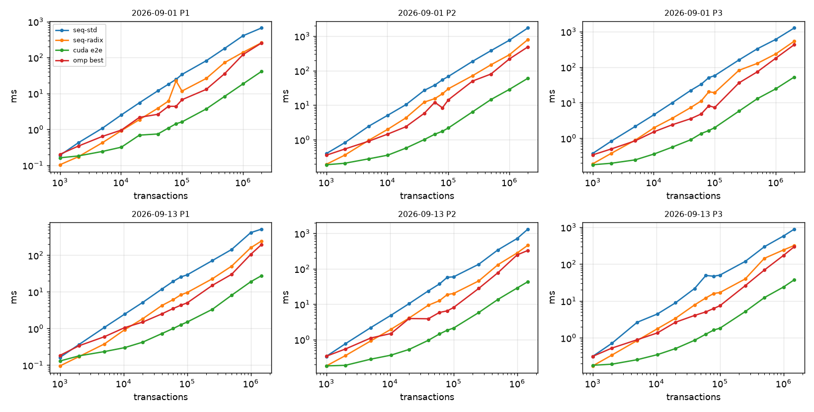
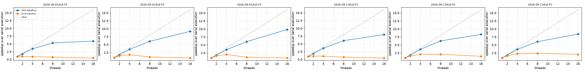

# Phase 8-10 results: GPU preprocessing pipeline

## Machine

```
date: 2026-11-02T13:40:38Z   host: sucheth-katte-ASUS-TUF-Gaming-F15-FX507VU-FX507VU   data: datasets
threads swept: 1,2,4,8,16   runs: 1 warm-up + 2 measured
Linux sucheth-katte-ASUS-TUF-Gaming-F15-FX507VU-FX507VU 7.0.0-42-generic #42~24.04.1-Ubuntu SMP PREEMPT_DYNAMIC Mon Oct 19 14:43:01 UTC 2 x86_64 x86_64 x86_64 GNU/Linux
CPU(s):                                  16
Model name:                              13th Gen Intel(R) Core(TM) i7-13620H
Thread(s) per core:                      2
Core(s) per socket:                      10
CPU(s) scaling MHz:                      66%
               total        used        free      shared  buff/cache   available
Mem:            15Gi       7.8Gi       967Mi       935Mi       7.7Gi       7.4Gi
name, memory.total [MiB], driver_version
NVIDIA GeForce RTX 4050 Laptop GPU, 6141 MiB, 595.99.02
nvcc: not found
```

## End-to-end time per super-block (ms, median)

GPU = balanced detection + CPU sweep, transfers included. `k-only` = GPU stages 1-3 kernels without transfers.

| scenario | n | pol | seq-std | seq-radix | omp best (t) | GPU e2e | GPU k-only | vs seq-std | vs seq-radix | vs omp |
|---|---:|---|---:|---:|---:|---:|---:|---:|---:|---:|
| 2026-09-01 | 1000 | P1 | 0.19 | 0.10 | 0.20 (1) | 0.16 | 0.14 | 1.17x | 0.64x | 1.25x |
| 2026-09-01 | 1000 | P2 | 0.40 | 0.19 | 0.36 (1) | 0.19 | 0.17 | 2.11x | 1.03x | 1.89x |
| 2026-09-01 | 1000 | P3 | 0.37 | 0.19 | 0.34 (1) | 0.18 | 0.17 | 2.08x | 1.06x | 1.89x |
| 2026-09-01 | 2000 | P1 | 0.42 | 0.17 | 0.34 (1) | 0.18 | 0.16 | 2.33x | 0.95x | 1.88x |
| 2026-09-01 | 2000 | P2 | 0.82 | 0.36 | 0.54 (2) | 0.21 | 0.19 | 3.93x | 1.72x | 2.58x |
| 2026-09-01 | 2000 | P3 | 0.82 | 0.37 | 0.50 (4) | 0.20 | 0.18 | 4.15x | 1.89x | 2.52x |
| 2026-09-01 | 5000 | P1 | 1.09 | 0.43 | 0.64 (4) | 0.24 | 0.19 | 4.47x | 1.76x | 2.63x |
| 2026-09-01 | 5000 | P2 | 2.48 | 0.97 | 0.91 (4) | 0.28 | 0.22 | 8.85x | 3.46x | 3.25x |
| 2026-09-01 | 5000 | P3 | 2.15 | 0.88 | 0.85 (4) | 0.25 | 0.20 | 8.74x | 3.60x | 3.44x |
| 2026-09-01 | 10176 | P1 | 2.53 | 0.92 | 0.95 (4) | 0.32 | 0.21 | 7.92x | 2.89x | 2.99x |
| 2026-09-01 | 10176 | P2 | 5.11 | 2.01 | 1.46 (4) | 0.36 | 0.23 | 14.32x | 5.62x | 4.08x |
| 2026-09-01 | 10176 | P3 | 4.61 | 1.97 | 1.52 (4) | 0.36 | 0.23 | 12.82x | 5.48x | 4.23x |
| 2026-09-01 | 20101 | P1 | 5.50 | 1.87 | 2.15 (2) | 0.69 | 0.37 | 7.97x | 2.71x | 3.12x |
| 2026-09-01 | 20101 | P2 | 10.31 | 4.27 | 2.37 (8) | 0.57 | 0.28 | 18.06x | 7.49x | 4.16x |
| 2026-09-01 | 20101 | P3 | 9.90 | 3.63 | 2.38 (4) | 0.56 | 0.29 | 17.69x | 6.49x | 4.26x |
| 2026-09-01 | 40366 | P1 | 11.86 | 3.88 | 2.62 (8) | 0.74 | 0.25 | 15.96x | 5.21x | 3.53x |
| 2026-09-01 | 40366 | P2 | 26.84 | 12.26 | 5.82 (8) | 1.01 | 0.35 | 26.60x | 12.15x | 5.77x |
| 2026-09-01 | 40366 | P3 | 22.09 | 7.26 | 3.53 (8) | 0.90 | 0.34 | 24.46x | 8.04x | 3.91x |
| 2026-09-01 | 60044 | P1 | 18.04 | 6.11 | 4.37 (8) | 1.09 | 0.27 | 16.58x | 5.62x | 4.02x |
| 2026-09-01 | 60044 | P2 | 38.10 | 15.50 | 12.13 (8) | 1.44 | 0.46 | 26.44x | 10.76x | 8.42x |
| 2026-09-01 | 60044 | P3 | 33.08 | 11.16 | 4.80 (8) | 1.35 | 0.46 | 24.49x | 8.26x | 3.55x |
| 2026-09-01 | 80100 | P1 | 24.65 | 22.32 | 4.37 (8) | 1.43 | 0.33 | 17.19x | 15.57x | 3.05x |
| 2026-09-01 | 80100 | P2 | 54.32 | 21.35 | 8.36 (8) | 1.76 | 0.54 | 30.87x | 12.14x | 4.75x |
| 2026-09-01 | 80100 | P3 | 50.64 | 20.19 | 8.19 (8) | 1.64 | 0.52 | 30.87x | 12.31x | 4.99x |
| 2026-09-01 | 100098 | P1 | 33.73 | 11.62 | 6.67 (8) | 1.61 | 0.38 | 20.95x | 7.22x | 4.14x |
| 2026-09-01 | 100098 | P2 | 67.81 | 29.85 | 14.29 (8) | 2.18 | 0.64 | 31.04x | 13.66x | 6.54x |
| 2026-09-01 | 100098 | P3 | 57.72 | 19.11 | 7.32 (8) | 1.98 | 0.60 | 29.11x | 9.64x | 3.69x |
| 2026-09-01 | 250058 | P1 | 81.15 | 26.09 | 12.96 (16) | 3.70 | 0.69 | 21.96x | 7.06x | 3.51x |
| 2026-09-01 | 250058 | P2 | 186.22 | 71.50 | 49.98 (4) | 6.43 | 2.45 | 28.95x | 11.11x | 7.77x |
| 2026-09-01 | 250058 | P3 | 159.05 | 81.36 | 35.99 (16) | 5.77 | 2.30 | 27.55x | 14.09x | 6.24x |
| 2026-09-01 | 500117 | P1 | 178.87 | 71.97 | 35.38 (8) | 8.25 | 2.15 | 21.67x | 8.72x | 4.29x |
| 2026-09-01 | 500117 | P2 | 379.03 | 147.58 | 79.73 (16) | 14.57 | 5.97 | 26.02x | 10.13x | 5.47x |
| 2026-09-01 | 500117 | P3 | 327.83 | 127.35 | 73.70 (16) | 12.94 | 5.59 | 25.34x | 9.84x | 5.70x |
| 2026-09-01 | 1000002 | P1 | 402.34 | 138.98 | 120.08 (16) | 18.38 | 5.92 | 21.89x | 7.56x | 6.53x |
| 2026-09-01 | 1000002 | P2 | 757.65 | 287.40 | 217.44 (16) | 28.61 | 12.73 | 26.48x | 10.05x | 7.60x |
| 2026-09-01 | 1000002 | P3 | 601.53 | 234.44 | 177.65 (16) | 24.42 | 11.39 | 24.63x | 9.60x | 7.27x |
| 2026-09-01 | 2013158 | P1 | 663.72 | 256.84 | 253.15 (16) | 40.92 | 13.50 | 16.22x | 6.28x | 6.19x |
| 2026-09-01 | 2013158 | P2 | 1718.17 | 791.73 | 486.87 (8) | 60.07 | 26.98 | 28.60x | 13.18x | 8.10x |
| 2026-09-01 | 2013158 | P3 | 1262.04 | 536.63 | 427.65 (8) | 52.53 | 24.03 | 24.02x | 10.22x | 8.14x |
| 2026-09-13 | 1000 | P1 | 0.16 | 0.10 | 0.18 (1) | 0.13 | 0.12 | 1.25x | 0.73x | 1.42x |
| 2026-09-13 | 1000 | P2 | 0.34 | 0.18 | 0.34 (1) | 0.18 | 0.17 | 1.86x | 1.00x | 1.88x |
| 2026-09-13 | 1000 | P3 | 0.31 | 0.17 | 0.31 (1) | 0.18 | 0.17 | 1.75x | 0.96x | 1.75x |
| 2026-09-13 | 2000 | P1 | 0.37 | 0.17 | 0.34 (1) | 0.18 | 0.16 | 2.05x | 0.96x | 1.89x |
| 2026-09-13 | 2000 | P2 | 0.76 | 0.35 | 0.54 (4) | 0.19 | 0.17 | 4.08x | 1.88x | 2.90x |
| 2026-09-13 | 2000 | P3 | 0.71 | 0.34 | 0.53 (4) | 0.19 | 0.17 | 3.68x | 1.76x | 2.73x |
| 2026-09-13 | 5000 | P1 | 1.07 | 0.38 | 0.60 (4) | 0.23 | 0.19 | 4.56x | 1.62x | 2.55x |
| 2026-09-13 | 5000 | P2 | 2.17 | 0.91 | 1.10 (2) | 0.28 | 0.22 | 7.80x | 3.28x | 3.96x |
| 2026-09-13 | 5000 | P3 | 2.63 | 0.84 | 0.88 (4) | 0.25 | 0.21 | 10.37x | 3.31x | 3.48x |
| 2026-09-13 | 10396 | P1 | 2.46 | 0.93 | 1.05 (4) | 0.30 | 0.20 | 8.21x | 3.08x | 3.51x |
| 2026-09-13 | 10396 | P2 | 4.85 | 1.95 | 1.48 (4) | 0.36 | 0.22 | 13.39x | 5.38x | 4.08x |
| 2026-09-13 | 10396 | P3 | 4.42 | 1.76 | 1.35 (4) | 0.35 | 0.23 | 12.67x | 5.05x | 3.89x |
| 2026-09-13 | 20096 | P1 | 5.18 | 1.86 | 1.50 (8) | 0.42 | 0.22 | 12.19x | 4.37x | 3.53x |
| 2026-09-13 | 20096 | P2 | 10.38 | 4.06 | 3.93 (16) | 0.53 | 0.26 | 19.71x | 7.71x | 7.46x |
| 2026-09-13 | 20096 | P3 | 8.92 | 3.39 | 2.65 (8) | 0.51 | 0.26 | 17.48x | 6.65x | 5.19x |
| 2026-09-13 | 40085 | P1 | 11.94 | 4.24 | 2.51 (8) | 0.73 | 0.24 | 16.42x | 5.84x | 3.45x |
| 2026-09-13 | 40085 | P2 | 23.63 | 9.30 | 3.86 (8) | 0.95 | 0.35 | 24.92x | 9.81x | 4.07x |
| 2026-09-13 | 40085 | P3 | 21.80 | 7.81 | 4.05 (8) | 0.86 | 0.34 | 25.43x | 9.12x | 4.72x |
| 2026-09-13 | 60129 | P1 | 19.27 | 6.11 | 3.50 (8) | 1.00 | 0.27 | 19.33x | 6.13x | 3.51x |
| 2026-09-13 | 60129 | P2 | 37.18 | 12.52 | 5.83 (8) | 1.44 | 0.47 | 25.86x | 8.71x | 4.05x |
| 2026-09-13 | 60129 | P3 | 49.08 | 12.08 | 5.04 (8) | 1.25 | 0.43 | 39.14x | 9.63x | 4.02x |
| 2026-09-13 | 80029 | P1 | 25.70 | 8.34 | 4.34 (8) | 1.27 | 0.33 | 20.28x | 6.58x | 3.42x |
| 2026-09-13 | 80029 | P2 | 57.62 | 18.74 | 6.47 (8) | 1.84 | 0.56 | 31.32x | 10.18x | 3.52x |
| 2026-09-13 | 80029 | P3 | 46.88 | 15.94 | 6.26 (8) | 1.62 | 0.53 | 28.89x | 9.82x | 3.86x |
| 2026-09-13 | 100174 | P1 | 29.14 | 9.60 | 5.00 (8) | 1.50 | 0.36 | 19.43x | 6.40x | 3.33x |
| 2026-09-13 | 100174 | P2 | 58.91 | 19.98 | 8.03 (8) | 2.11 | 0.63 | 27.98x | 9.49x | 3.81x |
| 2026-09-13 | 100174 | P3 | 50.29 | 16.92 | 7.41 (8) | 1.82 | 0.60 | 27.64x | 9.30x | 4.07x |
| 2026-09-13 | 250017 | P1 | 71.81 | 22.85 | 15.11 (16) | 3.35 | 0.68 | 21.43x | 6.82x | 4.51x |
| 2026-09-13 | 250017 | P2 | 134.35 | 45.42 | 27.91 (8) | 5.80 | 2.36 | 23.15x | 7.83x | 4.81x |
| 2026-09-13 | 250017 | P3 | 118.08 | 39.52 | 25.91 (4) | 5.13 | 2.18 | 23.03x | 7.71x | 5.05x |
| 2026-09-13 | 500110 | P1 | 143.42 | 50.27 | 30.08 (16) | 8.08 | 2.19 | 17.75x | 6.22x | 3.72x |
| 2026-09-13 | 500110 | P2 | 341.92 | 130.24 | 77.35 (8) | 13.61 | 5.83 | 25.12x | 9.57x | 5.68x |
| 2026-09-13 | 500110 | P3 | 295.13 | 143.28 | 68.96 (8) | 12.29 | 5.54 | 24.01x | 11.65x | 5.61x |
| 2026-09-13 | 1000145 | P1 | 414.31 | 160.10 | 105.43 (16) | 18.91 | 5.92 | 21.91x | 8.46x | 5.57x |
| 2026-09-13 | 1000145 | P2 | 714.42 | 279.15 | 246.01 (8) | 28.53 | 12.50 | 25.04x | 9.78x | 8.62x |
| 2026-09-13 | 1000145 | P3 | 578.35 | 241.84 | 171.83 (8) | 23.86 | 11.17 | 24.24x | 10.14x | 7.20x |
| 2026-09-13 | 1476230 | P1 | 515.85 | 244.65 | 195.73 (8) | 27.63 | 9.65 | 18.67x | 8.85x | 7.08x |
| 2026-09-13 | 1476230 | P2 | 1315.60 | 461.40 | 329.30 (16) | 43.16 | 19.36 | 30.48x | 10.69x | 7.63x |
| 2026-09-13 | 1476230 | P3 | 887.49 | 319.26 | 295.58 (8) | 37.42 | 17.05 | 23.72x | 8.53x | 7.90x |

### Crossover (smallest tested n where the GPU, transfers charged, wins)

| scenario | pol | beats seq-radix at n >= | beats best omp at n >= |
|---|---|---:|---:|
| 2026-09-01 | P1 | 5000 | 1000 |
| 2026-09-01 | P2 | 1000 | 1000 |
| 2026-09-01 | P3 | 1000 | 1000 |
| 2026-09-13 | P1 | 5000 | 1000 |
| 2026-09-13 | P2 | 2000 | 1000 |
| 2026-09-13 | P3 | 2000 | 1000 |

## GPU stage breakdown at the largest super-block (ms)

| scenario | pol | n | H2D | extract | sort | detect | csr | D2H | level (sweep) | e2e | wall | launches | syncs | device MB |
|---|---|---:|---:|---:|---:|---:|---:|---:|---:|---:|---:|---:|---:|---:|
| 2026-09-01 | P1 | 2013158 | 7.72 | 1.26 | 6.17 | 3.20 | 2.86 | 3.42 | 16.28 | 40.92 | 51.40 | 17 | 6 | 753.9 |
| 2026-09-01 | P2 | 2013158 | 7.39 | 2.79 | 13.57 | 6.19 | 4.43 | 3.95 | 21.75 | 60.07 | 69.34 | 17 | 6 | 1318.1 |
| 2026-09-01 | P3 | 2013158 | 7.26 | 2.81 | 13.59 | 5.33 | 2.29 | 2.91 | 18.33 | 52.53 | 61.67 | 17 | 6 | 1318.1 |
| 2026-09-13 | P1 | 1476230 | 5.27 | 0.93 | 4.53 | 2.29 | 1.91 | 2.37 | 10.33 | 27.63 | 34.86 | 17 | 6 | 1318.5 |
| 2026-09-13 | P2 | 1476230 | 5.25 | 2.07 | 9.71 | 4.46 | 3.11 | 2.74 | 15.81 | 43.16 | 50.39 | 17 | 6 | 1318.5 |
| 2026-09-13 | P3 | 1476230 | 5.28 | 2.07 | 9.71 | 3.85 | 1.41 | 2.21 | 12.89 | 37.42 | 44.32 | 17 | 6 | 1318.5 |

## Phase 9: skew (detection, one thread per key vs one thread per edge)

| scenario | pol | n | largest key group | detect group (ms) | detect balanced (ms) | recovery |
|---|---|---:|---:|---:|---:|---:|
| 2026-09-01 | P1 | 2013158 | 388725 | 138.866 | 3.198 | 43.42x |
| 2026-09-01 | P2 | 2013158 | 388725 | 130.660 | 6.191 | 21.11x |
| 2026-09-01 | P3 | 2013158 | 388725 | 130.510 | 5.333 | 24.47x |
| 2026-09-13 | P1 | 1476230 | 266865 | 92.674 | 2.289 | 40.48x |
| 2026-09-13 | P2 | 1476230 | 266865 | 86.476 | 4.460 | 19.39x |
| 2026-09-13 | P3 | 1476230 | 266865 | 86.408 | 3.846 | 22.47x |

## Stage 4: levelling / batching on the GPU vs the CPU sweep

`rounds` = batches; `tail` = rounds run inside the persistent single block.

| scenario | pol | n | method | batches | rounds | tail | launches | level ms | e2e ms |
|---|---|---:|---|---:|---:|---:|---:|---:|---:|
| 2026-09-01 | P1 | 2013158 | sweep | 401223 | 0 | 0 | 17 | 16.283 | 40.92 |
| 2026-09-01 | P1 | 2013158 | kahn | 401223 | 401223 | 401191 | 84 | 390.919 | 417.00 |
| 2026-09-01 | P2 | 2013158 | sweep | 89380 | 0 | 0 | 17 | 21.752 | 60.07 |
| 2026-09-01 | P2 | 2013158 | kahn | 89380 | 89380 | 89348 | 84 | 190.484 | 230.50 |
| 2026-09-01 | P3 | 2013158 | sweep | 42309 | 0 | 0 | 17 | 18.334 | 52.53 |
| 2026-09-01 | P3 | 2013158 | kahn | 42309 | 42309 | 42277 | 84 | 135.905 | 173.26 |
| 2026-09-13 | P1 | 1476230 | sweep | 269610 | 0 | 0 | 17 | 10.332 | 27.63 |
| 2026-09-13 | P1 | 1476230 | kahn | 269610 | 269610 | 269578 | 84 | 254.834 | 273.88 |
| 2026-09-13 | P2 | 1476230 | sweep | 30150 | 0 | 0 | 17 | 15.812 | 43.16 |
| 2026-09-13 | P2 | 1476230 | kahn | 30150 | 30150 | 30118 | 84 | 96.943 | 126.15 |
| 2026-09-13 | P3 | 1476230 | sweep | 21378 | 0 | 0 | 17 | 12.887 | 37.42 |
| 2026-09-13 | P3 | 1476230 | kahn | 21378 | 21378 | 21346 | 84 | 80.149 | 105.96 |



## Schedule quality and simulated execution

Speedup = serial gas / simulated makespan on W workers (gas as cost, LPT inside a batch, barrier between batches). `bound` = per-key lower bound on batches for any schedule. `levels` preserve block order; `jp-random` may reorder.

| scenario | n | pol | method | batches | bound | tx/batch | W=8 | W=16 | W=32 | W=64 | W=inf |
|---|---:|---|---|---:|---:|---:|---:|---:|---:|---:|---:|
| 2026-09-01 | 10176 | P1 | levels | 2058 | 2042 | 4.9 | 2.99 | 3.16 | 3.22 | 3.23 | 3.23 |
| 2026-09-01 | 10176 | P1 | jp-random1 | 2042 | 2042 | 5.0 | 3.15 | 3.36 | 3.45 | 3.46 | 3.46 |
| 2026-09-01 | 10176 | P1 | jp-random2 | 2042 | 2042 | 5.0 | 3.30 | 3.55 | 3.63 | 3.64 | 3.64 |
| 2026-09-01 | 10176 | P1 | jp-random3 | 2043 | 2042 | 5.0 | 3.31 | 3.51 | 3.61 | 3.63 | 3.63 |
| 2026-09-01 | 10176 | P2 | levels | 326 | 295 | 31.2 | 5.81 | 6.93 | 7.44 | 7.55 | 7.55 |
| 2026-09-01 | 10176 | P2 | jp-random1 | 295 | 295 | 34.5 | 6.02 | 7.40 | 7.97 | 8.11 | 8.11 |
| 2026-09-01 | 10176 | P2 | jp-random2 | 295 | 295 | 34.5 | 5.98 | 7.42 | 8.04 | 8.17 | 8.17 |
| 2026-09-01 | 10176 | P2 | jp-random3 | 295 | 295 | 34.5 | 5.93 | 7.37 | 7.95 | 8.13 | 8.13 |
| 2026-09-01 | 10176 | P3 | levels | 222 | 222 | 45.8 | 5.97 | 7.25 | 7.88 | 8.11 | 8.11 |
| 2026-09-01 | 10176 | P3 | jp-random1 | 222 | 222 | 45.8 | 6.03 | 7.57 | 8.24 | 8.49 | 8.49 |
| 2026-09-01 | 10176 | P3 | jp-random2 | 222 | 222 | 45.8 | 6.00 | 7.55 | 8.28 | 8.53 | 8.53 |
| 2026-09-01 | 10176 | P3 | jp-random3 | 222 | 222 | 45.8 | 5.97 | 7.55 | 8.22 | 8.54 | 8.54 |
| 2026-09-01 | 20101 | P1 | levels | 3891 | 3785 | 5.2 | 3.05 | 3.27 | 3.35 | 3.36 | 3.36 |
| 2026-09-01 | 20101 | P1 | jp-random1 | 3785 | 3785 | 5.3 | 3.36 | 3.67 | 3.76 | 3.78 | 3.78 |
| 2026-09-01 | 20101 | P1 | jp-random2 | 3785 | 3785 | 5.3 | 3.24 | 3.51 | 3.61 | 3.62 | 3.62 |
| 2026-09-01 | 20101 | P1 | jp-random3 | 3786 | 3785 | 5.3 | 3.26 | 3.51 | 3.59 | 3.61 | 3.61 |
| 2026-09-01 | 20101 | P2 | levels | 432 | 354 | 46.5 | 5.86 | 7.26 | 7.85 | 7.98 | 7.98 |
| 2026-09-01 | 20101 | P2 | jp-random1 | 354 | 354 | 56.8 | 6.36 | 8.42 | 9.28 | 9.48 | 9.48 |
| 2026-09-01 | 20101 | P2 | jp-random2 | 355 | 354 | 56.6 | 6.29 | 8.13 | 8.93 | 9.10 | 9.10 |
| 2026-09-01 | 20101 | P2 | jp-random3 | 355 | 354 | 56.6 | 6.31 | 8.20 | 8.93 | 9.12 | 9.12 |
| 2026-09-01 | 20101 | P3 | levels | 310 | 310 | 64.8 | 6.05 | 7.69 | 8.44 | 8.70 | 8.70 |
| 2026-09-01 | 20101 | P3 | jp-random1 | 310 | 310 | 64.8 | 6.32 | 8.50 | 9.45 | 9.79 | 9.79 |
| 2026-09-01 | 20101 | P3 | jp-random2 | 310 | 310 | 64.8 | 6.24 | 8.15 | 9.05 | 9.36 | 9.36 |
| 2026-09-01 | 20101 | P3 | jp-random3 | 310 | 310 | 64.8 | 6.33 | 8.37 | 9.24 | 9.57 | 9.58 |
| 2026-09-01 | 40366 | P1 | levels | 8268 | 8182 | 4.9 | 2.75 | 2.90 | 2.95 | 2.96 | 2.96 |
| 2026-09-01 | 40366 | P1 | jp-random1 | 8182 | 8182 | 4.9 | 2.89 | 3.06 | 3.11 | 3.12 | 3.12 |
| 2026-09-01 | 40366 | P1 | jp-random2 | 8186 | 8182 | 4.9 | 2.87 | 3.04 | 3.09 | 3.10 | 3.10 |
| 2026-09-01 | 40366 | P1 | jp-random3 | 8182 | 8182 | 4.9 | 2.90 | 3.06 | 3.13 | 3.13 | 3.13 |
| 2026-09-01 | 40366 | P2 | levels | 871 | 858 | 46.3 | 5.66 | 6.78 | 7.22 | 7.30 | 7.30 |
| 2026-09-01 | 40366 | P2 | jp-random1 | 858 | 858 | 47.0 | 5.78 | 7.06 | 7.59 | 7.68 | 7.68 |
| 2026-09-01 | 40366 | P2 | jp-random2 | 858 | 858 | 47.0 | 5.71 | 6.91 | 7.43 | 7.54 | 7.54 |
| 2026-09-01 | 40366 | P2 | jp-random3 | 858 | 858 | 47.0 | 5.72 | 6.92 | 7.43 | 7.54 | 7.54 |
| 2026-09-01 | 40366 | P3 | levels | 671 | 671 | 60.2 | 5.78 | 7.12 | 7.72 | 7.91 | 7.92 |
| 2026-09-01 | 40366 | P3 | jp-random1 | 671 | 671 | 60.2 | 5.89 | 7.37 | 8.06 | 8.26 | 8.27 |
| 2026-09-01 | 40366 | P3 | jp-random2 | 671 | 671 | 60.2 | 5.76 | 7.13 | 7.78 | 7.99 | 7.99 |
| 2026-09-01 | 40366 | P3 | jp-random3 | 671 | 671 | 60.2 | 5.87 | 7.26 | 7.92 | 8.15 | 8.16 |
| 2026-09-01 | 60044 | P1 | levels | 12311 | 12120 | 4.9 | 2.75 | 2.89 | 2.94 | 2.94 | 2.94 |
| 2026-09-01 | 60044 | P1 | jp-random1 | 12122 | 12120 | 5.0 | 2.81 | 2.96 | 3.01 | 3.02 | 3.02 |
| 2026-09-01 | 60044 | P1 | jp-random2 | 12120 | 12120 | 5.0 | 2.82 | 2.97 | 3.01 | 3.02 | 3.02 |
| 2026-09-01 | 60044 | P1 | jp-random3 | 12121 | 12120 | 5.0 | 2.82 | 2.97 | 3.03 | 3.04 | 3.04 |
| 2026-09-01 | 60044 | P2 | levels | 1420 | 1141 | 42.3 | 5.43 | 6.48 | 6.91 | 7.00 | 7.00 |
| 2026-09-01 | 60044 | P2 | jp-random1 | 1143 | 1141 | 52.5 | 5.71 | 6.91 | 7.34 | 7.45 | 7.45 |
| 2026-09-01 | 60044 | P2 | jp-random2 | 1149 | 1141 | 52.3 | 5.73 | 6.90 | 7.31 | 7.41 | 7.42 |
| 2026-09-01 | 60044 | P2 | jp-random3 | 1142 | 1141 | 52.6 | 5.63 | 6.81 | 7.26 | 7.35 | 7.35 |
| 2026-09-01 | 60044 | P3 | levels | 1105 | 1105 | 54.3 | 5.63 | 6.95 | 7.53 | 7.68 | 7.72 |
| 2026-09-01 | 60044 | P3 | jp-random1 | 1105 | 1105 | 54.3 | 5.62 | 6.90 | 7.43 | 7.59 | 7.64 |
| 2026-09-01 | 60044 | P3 | jp-random2 | 1105 | 1105 | 54.3 | 5.73 | 7.04 | 7.54 | 7.71 | 7.76 |
| 2026-09-01 | 60044 | P3 | jp-random3 | 1105 | 1105 | 54.3 | 5.63 | 6.95 | 7.50 | 7.66 | 7.70 |
| 2026-09-01 | 80100 | P1 | levels | 16538 | 16303 | 4.8 | 2.68 | 2.81 | 2.85 | 2.86 | 2.86 |
| 2026-09-01 | 80100 | P1 | jp-random1 | 16303 | 16303 | 4.9 | 2.72 | 2.85 | 2.89 | 2.90 | 2.90 |
| 2026-09-01 | 80100 | P1 | jp-random2 | 16303 | 16303 | 4.9 | 2.79 | 2.95 | 2.99 | 3.01 | 3.01 |
| 2026-09-01 | 80100 | P1 | jp-random3 | 16303 | 16303 | 4.9 | 2.79 | 2.94 | 2.99 | 3.00 | 3.00 |
| 2026-09-01 | 80100 | P2 | levels | 1835 | 1544 | 43.7 | 5.32 | 6.29 | 6.67 | 6.76 | 6.76 |
| 2026-09-01 | 80100 | P2 | jp-random1 | 1544 | 1544 | 51.9 | 5.56 | 6.66 | 7.06 | 7.16 | 7.17 |
| 2026-09-01 | 80100 | P2 | jp-random2 | 1546 | 1544 | 51.8 | 5.61 | 6.77 | 7.19 | 7.32 | 7.33 |
| 2026-09-01 | 80100 | P2 | jp-random3 | 1545 | 1544 | 51.8 | 5.59 | 6.72 | 7.12 | 7.23 | 7.24 |
| 2026-09-01 | 80100 | P3 | levels | 1362 | 1362 | 58.8 | 5.50 | 6.74 | 7.27 | 7.42 | 7.47 |
| 2026-09-01 | 80100 | P3 | jp-random1 | 1362 | 1362 | 58.8 | 5.61 | 6.87 | 7.39 | 7.55 | 7.61 |
| 2026-09-01 | 80100 | P3 | jp-random2 | 1362 | 1362 | 58.8 | 5.60 | 6.90 | 7.43 | 7.61 | 7.67 |
| 2026-09-01 | 80100 | P3 | jp-random3 | 1362 | 1362 | 58.8 | 5.66 | 6.94 | 7.46 | 7.63 | 7.69 |
| 2026-09-01 | 100098 | P1 | levels | 21013 | 20805 | 4.8 | 2.61 | 2.71 | 2.75 | 2.76 | 2.76 |
| 2026-09-01 | 100098 | P1 | jp-random1 | 20805 | 20805 | 4.8 | 2.59 | 2.71 | 2.75 | 2.76 | 2.76 |
| 2026-09-01 | 100098 | P1 | jp-random2 | 20806 | 20805 | 4.8 | 2.68 | 2.80 | 2.84 | 2.85 | 2.85 |
| 2026-09-01 | 100098 | P1 | jp-random3 | 20805 | 20805 | 4.8 | 2.62 | 2.73 | 2.77 | 2.78 | 2.78 |
| 2026-09-01 | 100098 | P2 | levels | 2181 | 2144 | 45.9 | 5.35 | 6.18 | 6.48 | 6.57 | 6.58 |
| 2026-09-01 | 100098 | P2 | jp-random1 | 2144 | 2144 | 46.7 | 5.23 | 6.09 | 6.44 | 6.51 | 6.53 |
| 2026-09-01 | 100098 | P2 | jp-random2 | 2144 | 2144 | 46.7 | 5.21 | 6.06 | 6.37 | 6.45 | 6.46 |
| 2026-09-01 | 100098 | P2 | jp-random3 | 2144 | 2144 | 46.7 | 5.01 | 5.75 | 6.04 | 6.11 | 6.12 |
| 2026-09-01 | 100098 | P3 | levels | 1733 | 1733 | 57.8 | 5.58 | 6.68 | 7.13 | 7.28 | 7.33 |
| 2026-09-01 | 100098 | P3 | jp-random1 | 1733 | 1733 | 57.8 | 5.40 | 6.43 | 6.91 | 7.05 | 7.11 |
| 2026-09-01 | 100098 | P3 | jp-random2 | 1733 | 1733 | 57.8 | 5.36 | 6.41 | 6.84 | 6.97 | 7.02 |
| 2026-09-01 | 100098 | P3 | jp-random3 | 1733 | 1733 | 57.8 | 5.29 | 6.25 | 6.67 | 6.81 | 6.85 |
| 2026-09-01 | 250058 | P1 | levels | 52720 | 52070 | 4.7 | 2.38 | 2.46 | 2.49 | 2.50 | 2.50 |
| 2026-09-01 | 250058 | P2 | levels | 5490 | 5205 | 45.5 | 5.09 | 5.76 | 5.98 | 6.05 | 6.07 |
| 2026-09-01 | 250058 | P3 | levels | 4193 | 4193 | 59.6 | 5.52 | 6.54 | 6.96 | 7.11 | 7.18 |
| 2026-09-01 | 500117 | P1 | levels | 100929 | 99623 | 5.0 | 2.31 | 2.38 | 2.40 | 2.41 | 2.41 |
| 2026-09-01 | 500117 | P2 | levels | 11744 | 9222 | 42.6 | 4.86 | 5.38 | 5.55 | 5.59 | 5.61 |
| 2026-09-01 | 500117 | P3 | levels | 8909 | 8131 | 56.1 | 5.22 | 6.01 | 6.31 | 6.42 | 6.48 |
| 2026-09-01 | 1000002 | P1 | levels | 192745 | 190326 | 5.2 | 2.14 | 2.18 | 2.20 | 2.20 | 2.20 |
| 2026-09-01 | 1000002 | P2 | levels | 25188 | 20293 | 39.7 | 4.10 | 4.39 | 4.47 | 4.50 | 4.51 |
| 2026-09-01 | 1000002 | P3 | levels | 22000 | 20293 | 45.5 | 4.25 | 4.67 | 4.81 | 4.87 | 4.90 |
| 2026-09-01 | 2013158 | P1 | levels | 401223 | 388725 | 5.0 | 1.95 | 1.97 | 1.98 | 1.99 | 1.99 |
| 2026-09-01 | 2013158 | P2 | levels | 89380 | 40031 | 22.5 | 3.36 | 3.52 | 3.56 | 3.57 | 3.58 |
| 2026-09-01 | 2013158 | P3 | levels | 42309 | 36974 | 47.6 | 3.86 | 4.15 | 4.26 | 4.30 | 4.33 |
| 2026-09-13 | 10396 | P1 | levels | 1981 | 1953 | 5.2 | 3.13 | 3.31 | 3.33 | 3.33 | 3.33 |
| 2026-09-13 | 10396 | P1 | jp-random1 | 1954 | 1953 | 5.3 | 3.12 | 3.24 | 3.25 | 3.25 | 3.25 |
| 2026-09-13 | 10396 | P1 | jp-random2 | 1953 | 1953 | 5.3 | 3.26 | 3.42 | 3.45 | 3.45 | 3.45 |
| 2026-09-13 | 10396 | P1 | jp-random3 | 1953 | 1953 | 5.3 | 3.25 | 3.37 | 3.42 | 3.42 | 3.42 |
| 2026-09-13 | 10396 | P2 | levels | 266 | 266 | 39.1 | 5.02 | 5.59 | 5.75 | 5.75 | 5.75 |
| 2026-09-13 | 10396 | P2 | jp-random1 | 266 | 266 | 39.1 | 5.02 | 5.52 | 5.61 | 5.62 | 5.62 |
| 2026-09-13 | 10396 | P2 | jp-random2 | 266 | 266 | 39.1 | 5.07 | 5.65 | 5.83 | 5.83 | 5.83 |
| 2026-09-13 | 10396 | P2 | jp-random3 | 266 | 266 | 39.1 | 5.32 | 5.81 | 6.02 | 6.04 | 6.04 |
| 2026-09-13 | 10396 | P3 | levels | 181 | 181 | 57.4 | 5.05 | 5.72 | 5.96 | 5.96 | 5.96 |
| 2026-09-13 | 10396 | P3 | jp-random1 | 181 | 181 | 57.4 | 5.34 | 5.96 | 6.14 | 6.14 | 6.14 |
| 2026-09-13 | 10396 | P3 | jp-random2 | 181 | 181 | 57.4 | 5.11 | 5.73 | 5.99 | 5.99 | 5.99 |
| 2026-09-13 | 10396 | P3 | jp-random3 | 181 | 181 | 57.4 | 5.37 | 5.92 | 6.18 | 6.25 | 6.25 |
| 2026-09-13 | 20096 | P1 | levels | 3949 | 3915 | 5.1 | 2.77 | 2.86 | 2.88 | 2.88 | 2.88 |
| 2026-09-13 | 20096 | P1 | jp-random1 | 3915 | 3915 | 5.1 | 2.87 | 2.97 | 3.00 | 3.00 | 3.00 |
| 2026-09-13 | 20096 | P1 | jp-random2 | 3915 | 3915 | 5.1 | 2.85 | 2.93 | 2.95 | 2.95 | 2.95 |
| 2026-09-13 | 20096 | P1 | jp-random3 | 3915 | 3915 | 5.1 | 2.86 | 2.94 | 2.97 | 2.97 | 2.97 |
| 2026-09-13 | 20096 | P2 | levels | 529 | 462 | 38.0 | 4.22 | 4.53 | 4.63 | 4.63 | 4.63 |
| 2026-09-13 | 20096 | P2 | jp-random1 | 462 | 462 | 43.5 | 4.36 | 4.73 | 4.83 | 4.83 | 4.83 |
| 2026-09-13 | 20096 | P2 | jp-random2 | 462 | 462 | 43.5 | 4.41 | 4.76 | 4.85 | 4.85 | 4.85 |
| 2026-09-13 | 20096 | P2 | jp-random3 | 462 | 462 | 43.5 | 4.33 | 4.65 | 4.75 | 4.75 | 4.75 |
| 2026-09-13 | 20096 | P3 | levels | 373 | 373 | 53.9 | 4.41 | 4.81 | 4.95 | 4.97 | 4.97 |
| 2026-09-13 | 20096 | P3 | jp-random1 | 373 | 373 | 53.9 | 4.43 | 4.85 | 5.00 | 5.02 | 5.02 |
| 2026-09-13 | 20096 | P3 | jp-random2 | 373 | 373 | 53.9 | 4.50 | 4.91 | 5.06 | 5.07 | 5.07 |
| 2026-09-13 | 20096 | P3 | jp-random3 | 373 | 373 | 53.9 | 4.47 | 4.85 | 4.98 | 5.00 | 5.00 |
| 2026-09-13 | 40085 | P1 | levels | 7609 | 7374 | 5.3 | 2.45 | 2.51 | 2.53 | 2.53 | 2.53 |
| 2026-09-13 | 40085 | P1 | jp-random1 | 7374 | 7374 | 5.4 | 2.81 | 2.90 | 2.93 | 2.94 | 2.94 |
| 2026-09-13 | 40085 | P1 | jp-random2 | 7374 | 7374 | 5.4 | 2.79 | 2.88 | 2.91 | 2.91 | 2.91 |
| 2026-09-13 | 40085 | P1 | jp-random3 | 7375 | 7374 | 5.4 | 2.70 | 2.78 | 2.80 | 2.81 | 2.81 |
| 2026-09-13 | 40085 | P2 | levels | 1300 | 894 | 30.8 | 4.09 | 4.39 | 4.48 | 4.49 | 4.49 |
| 2026-09-13 | 40085 | P2 | jp-random1 | 894 | 894 | 44.8 | 4.24 | 4.56 | 4.68 | 4.70 | 4.70 |
| 2026-09-13 | 40085 | P2 | jp-random2 | 894 | 894 | 44.8 | 4.22 | 4.54 | 4.65 | 4.66 | 4.66 |
| 2026-09-13 | 40085 | P2 | jp-random3 | 894 | 894 | 44.8 | 4.24 | 4.55 | 4.64 | 4.66 | 4.66 |
| 2026-09-13 | 40085 | P3 | levels | 704 | 704 | 56.9 | 4.41 | 4.81 | 4.94 | 4.98 | 4.98 |
| 2026-09-13 | 40085 | P3 | jp-random1 | 704 | 704 | 56.9 | 4.41 | 4.79 | 4.94 | 4.99 | 4.99 |
| 2026-09-13 | 40085 | P3 | jp-random2 | 704 | 704 | 56.9 | 4.36 | 4.74 | 4.88 | 4.92 | 4.92 |
| 2026-09-13 | 40085 | P3 | jp-random3 | 704 | 704 | 56.9 | 4.31 | 4.67 | 4.80 | 4.85 | 4.85 |
| 2026-09-13 | 60129 | P1 | levels | 11328 | 10940 | 5.3 | 2.34 | 2.39 | 2.41 | 2.41 | 2.41 |
| 2026-09-13 | 60129 | P1 | jp-random1 | 10941 | 10940 | 5.5 | 2.73 | 2.81 | 2.84 | 2.84 | 2.84 |
| 2026-09-13 | 60129 | P1 | jp-random2 | 10942 | 10940 | 5.5 | 2.72 | 2.81 | 2.83 | 2.84 | 2.84 |
| 2026-09-13 | 60129 | P1 | jp-random3 | 10943 | 10940 | 5.5 | 2.74 | 2.82 | 2.85 | 2.86 | 2.86 |
| 2026-09-13 | 60129 | P2 | levels | 1874 | 1321 | 32.1 | 3.89 | 4.16 | 4.24 | 4.25 | 4.25 |
| 2026-09-13 | 60129 | P2 | jp-random1 | 1334 | 1321 | 45.1 | 4.17 | 4.47 | 4.57 | 4.59 | 4.59 |
| 2026-09-13 | 60129 | P2 | jp-random2 | 1321 | 1321 | 45.5 | 4.13 | 4.44 | 4.53 | 4.55 | 4.55 |
| 2026-09-13 | 60129 | P2 | jp-random3 | 1322 | 1321 | 45.5 | 4.13 | 4.44 | 4.54 | 4.56 | 4.57 |
| 2026-09-13 | 60129 | P3 | levels | 1037 | 1037 | 58.0 | 4.23 | 4.59 | 4.72 | 4.77 | 4.77 |
| 2026-09-13 | 60129 | P3 | jp-random1 | 1037 | 1037 | 58.0 | 4.29 | 4.65 | 4.78 | 4.83 | 4.83 |
| 2026-09-13 | 60129 | P3 | jp-random2 | 1037 | 1037 | 58.0 | 4.28 | 4.66 | 4.79 | 4.84 | 4.85 |
| 2026-09-13 | 60129 | P3 | jp-random3 | 1037 | 1037 | 58.0 | 4.26 | 4.64 | 4.78 | 4.82 | 4.83 |
| 2026-09-13 | 80029 | P1 | levels | 15001 | 14581 | 5.3 | 2.34 | 2.41 | 2.43 | 2.43 | 2.43 |
| 2026-09-13 | 80029 | P1 | jp-random1 | 14585 | 14581 | 5.5 | 2.73 | 2.82 | 2.85 | 2.86 | 2.86 |
| 2026-09-13 | 80029 | P1 | jp-random2 | 14584 | 14581 | 5.5 | 2.70 | 2.79 | 2.82 | 2.83 | 2.83 |
| 2026-09-13 | 80029 | P1 | jp-random3 | 14582 | 14581 | 5.5 | 2.66 | 2.75 | 2.77 | 2.78 | 2.78 |
| 2026-09-13 | 80029 | P2 | levels | 2305 | 1730 | 34.7 | 3.99 | 4.27 | 4.36 | 4.37 | 4.37 |
| 2026-09-13 | 80029 | P2 | jp-random1 | 1730 | 1730 | 46.3 | 4.26 | 4.59 | 4.71 | 4.74 | 4.74 |
| 2026-09-13 | 80029 | P2 | jp-random2 | 1731 | 1730 | 46.2 | 4.25 | 4.58 | 4.71 | 4.73 | 4.73 |
| 2026-09-13 | 80029 | P2 | jp-random3 | 1730 | 1730 | 46.3 | 4.25 | 4.57 | 4.69 | 4.71 | 4.71 |
| 2026-09-13 | 80029 | P3 | levels | 1374 | 1374 | 58.2 | 4.32 | 4.72 | 4.86 | 4.91 | 4.92 |
| 2026-09-13 | 80029 | P3 | jp-random1 | 1374 | 1374 | 58.2 | 4.42 | 4.83 | 4.99 | 5.04 | 5.05 |
| 2026-09-13 | 80029 | P3 | jp-random2 | 1374 | 1374 | 58.2 | 4.43 | 4.84 | 5.01 | 5.06 | 5.07 |
| 2026-09-13 | 80029 | P3 | jp-random3 | 1374 | 1374 | 58.2 | 4.48 | 4.90 | 5.06 | 5.11 | 5.12 |
| 2026-09-13 | 100174 | P1 | levels | 18678 | 18230 | 5.4 | 2.17 | 2.22 | 2.24 | 2.24 | 2.24 |
| 2026-09-13 | 100174 | P1 | jp-random1 | 18233 | 18230 | 5.5 | 2.64 | 2.72 | 2.74 | 2.75 | 2.75 |
| 2026-09-13 | 100174 | P1 | jp-random2 | 18231 | 18230 | 5.5 | 2.59 | 2.67 | 2.69 | 2.70 | 2.70 |
| 2026-09-13 | 100174 | P1 | jp-random3 | 18231 | 18230 | 5.5 | 2.62 | 2.70 | 2.73 | 2.73 | 2.73 |
| 2026-09-13 | 100174 | P2 | levels | 2766 | 2189 | 36.2 | 3.45 | 3.67 | 3.73 | 3.75 | 3.75 |
| 2026-09-13 | 100174 | P2 | jp-random1 | 2190 | 2189 | 45.7 | 4.08 | 4.36 | 4.45 | 4.48 | 4.48 |
| 2026-09-13 | 100174 | P2 | jp-random2 | 2191 | 2189 | 45.7 | 4.08 | 4.38 | 4.48 | 4.51 | 4.51 |
| 2026-09-13 | 100174 | P2 | jp-random3 | 2191 | 2189 | 45.7 | 4.17 | 4.49 | 4.60 | 4.63 | 4.63 |
| 2026-09-13 | 100174 | P3 | levels | 1741 | 1741 | 57.5 | 4.43 | 4.83 | 4.98 | 5.03 | 5.04 |
| 2026-09-13 | 100174 | P3 | jp-random1 | 1741 | 1741 | 57.5 | 4.32 | 4.70 | 4.84 | 4.88 | 4.89 |
| 2026-09-13 | 100174 | P3 | jp-random2 | 1741 | 1741 | 57.5 | 4.33 | 4.72 | 4.86 | 4.91 | 4.92 |
| 2026-09-13 | 100174 | P3 | jp-random3 | 1741 | 1741 | 57.5 | 4.42 | 4.82 | 4.98 | 5.02 | 5.04 |
| 2026-09-13 | 250017 | P1 | levels | 49991 | 49655 | 5.0 | 2.17 | 2.22 | 2.24 | 2.24 | 2.24 |
| 2026-09-13 | 250017 | P2 | levels | 5528 | 5488 | 45.2 | 3.90 | 4.18 | 4.26 | 4.28 | 4.29 |
| 2026-09-13 | 250017 | P3 | levels | 4495 | 4495 | 55.6 | 4.58 | 5.06 | 5.21 | 5.27 | 5.29 |
| 2026-09-13 | 500110 | P1 | levels | 97360 | 96120 | 5.1 | 2.04 | 2.08 | 2.10 | 2.10 | 2.10 |
| 2026-09-13 | 500110 | P2 | levels | 11625 | 10607 | 43.0 | 3.67 | 3.91 | 3.97 | 3.99 | 4.00 |
| 2026-09-13 | 500110 | P3 | levels | 8714 | 8714 | 57.4 | 4.27 | 4.70 | 4.83 | 4.87 | 4.90 |
| 2026-09-13 | 1000145 | P1 | levels | 186635 | 184744 | 5.4 | 2.01 | 2.05 | 2.06 | 2.06 | 2.06 |
| 2026-09-13 | 1000145 | P2 | levels | 21968 | 20068 | 45.5 | 3.51 | 3.66 | 3.71 | 3.72 | 3.73 |
| 2026-09-13 | 1000145 | P3 | levels | 16290 | 16290 | 61.4 | 4.03 | 4.31 | 4.40 | 4.44 | 4.46 |
| 2026-09-13 | 1476230 | P1 | levels | 269610 | 266865 | 5.5 | 1.93 | 1.96 | 1.97 | 1.97 | 1.97 |
| 2026-09-13 | 1476230 | P2 | levels | 30150 | 26609 | 49.0 | 3.47 | 3.61 | 3.65 | 3.66 | 3.67 |
| 2026-09-13 | 1476230 | P3 | levels | 21378 | 21378 | 69.1 | 4.02 | 4.28 | 4.37 | 4.40 | 4.42 |

## Parallel execution of every transaction

Every transaction is executed (state model in `execute.hpp`); each parallel run must end in exactly the serial run's state. `levels` = batch by batch with a barrier; `DAG` = dataflow on the dependency DAG (a transaction starts when its predecessors finish). End-to-end = GPU preprocessing + best parallel execution, against plain serial execution.

| block | pol | n executed | batches | preprocessing seq-std / OpenMP / GPU (ms) | serial exec (s) | best levels (s, x) | best DAG (s, x) | end-to-end x | model levels W=inf | model DAG W=inf |
|---|---|---:|---:|---|---:|---|---|---:|---:|---:|
| 2026-09-01/full | P1 | 2,013,158 | 401,223 | 627 / 221 / 45 | 3.508 | 3.500 (1.00x, 2t) | 0.592 (5.92x, 16t) | 5.50x | 1.99x | 10.93x |
| 2026-09-01/full | P2 | 2,013,158 | 89,380 | 1252 / 414 / 65 | 3.525 | 1.932 (1.82x, 4t) | 0.383 (9.20x, 16t) | 7.87x | 3.58x | 24.78x |
| 2026-09-01/full | P3 | 2,013,158 | 42,309 | 1088 / 358 / 58 | 3.523 | 1.739 (2.03x, 4t) | 0.359 (9.82x, 16t) | 8.45x | 4.33x | 25.58x |
| 2026-09-13/full | P1 | 1,476,230 | 269,610 | 434 / 126 / 33 | 3.497 | 3.193 (1.10x, 2t) | 0.436 (8.01x, 16t) | 7.45x | 1.97x | 12.94x |
| 2026-09-13/full | P2 | 1,476,230 | 30,150 | 894 / 247 / 49 | 3.510 | 1.678 (2.09x, 8t) | 0.423 (8.30x, 16t) | 7.44x | 3.67x | 13.43x |
| 2026-09-13/full | P3 | 1,476,230 | 21,378 | 782 / 258 / 42 | 3.513 | 1.464 (2.40x, 8t) | 0.418 (8.40x, 16t) | 7.63x | 4.42x | 13.43x |


