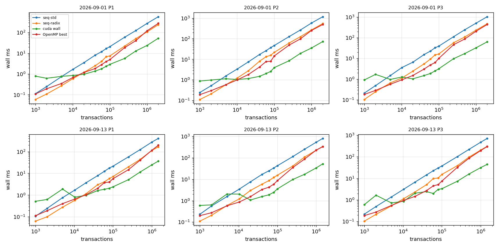
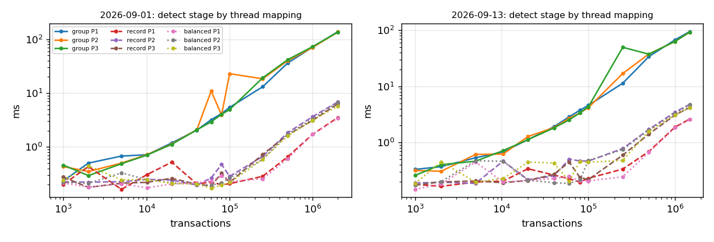
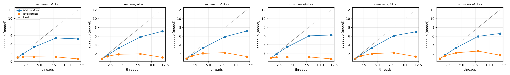

# Phases 8-10 results

## Machine (non-negotiable 4)

```
date: 2026-11-04T03:50:58Z
host: Nikhil-PC
git: unknown
run: run_dataset.sh data=data runs=2+7 threads=1,2,4,8,12 backend=cuda
OMP_PROC_BIND=close OMP_PLACES=cores

## OS
Linux Nikhil-PC 6.18.54.1-microsoft-standard-WSL2 #1 SMP PREEMPT_DYNAMIC Tue Oct  6 19:13:07 UTC 2026 x86_64 x86_64 x86_64 GNU/Linux
WSL2: yes
PRETTY_NAME="Ubuntu 24.04.5 LTS"
NAME="Ubuntu"
VERSION_ID="24.04"
VERSION="24.04.5 LTS (Noble Numbat)"

## CPU
CPU(s):                                  12
Model name:                              13th Gen Intel(R) Core(TM) i5-13420H
Thread(s) per core:                      2
Core(s) per socket:                      6
Socket(s):                               1
L2 cache:                                7.5 MiB (6 instances)
L3 cache:                                12 MiB (1 instance)
SMT active: 1
governor: unknown
current MHz (cpu0): 2611.198

## power (the review asks for performance mode on AC power)
Windows power plan: Power Scheme GUID: 381b4222-f694-41f0-9685-ff5bb260df2e  (Balanced)
Windows AC power: True

## memory
               total        used        free      shared  buff/cache   available
Mem:           7.6Gi       446Mi       6.9Gi       3.6Mi       357Mi       7.1Gi
Swap:          2.0Gi          0B       2.0Gi

## GPU
name, memory.total [MiB], memory.used [MiB], driver_version, pstate, clocks.current.sm [MHz], clocks.max.sm [MHz], pcie.link.gen.current, pcie.link.gen.max, pcie.link.width.current, pcie.link.width.max, power.draw [W], power.limit [W]
NVIDIA GeForce RTX 4050 Laptop GPU, 6141 MiB, 0 MiB, 610.91, P0, 2130 MHz, 3105 MHz, 4, 4, 8, 8, 13.33 W, [N/A]
nvcc: /usr/local/cuda-12.6/bin/nvcc Build cuda_12.6.r12.6/compiler.35059454_0
conduit_gpu info: GPU NVIDIA GeForce RTX 4050 Laptop GPU, 20 SMs, 6140 MiB, cc 8.9, driver 13.3, runtime 12.6; backend cuda; OpenMP on

c++ (Ubuntu 13.3.0-6ubuntu2~24.04.1) 13.3.0
cmake version 3.28.3
```

## Correctness gates (non-negotiable 1: no timing without correctness)

| check | result | last line |
|---|---|---|
| tests.txt | PASS | 39 tests, 0 failed checks |
| stages.txt | PASS | ALL STAGES IDENTICAL TO THE CPU REFERENCE |
| verify.txt | PASS | ALL GPU CHECKS PASSED |
| identical.txt | PASS | ALL IDENTICAL |
| validator.txt | PASS | ALL CHECKS PASSED |

Repetitions: warm-up [1, 2], measured [3, 7] (medians; super-blocks above 250k use at most 1 + 3). 

## Phase 8: end to end, wall time (ms, median)

GPU = balanced detection + sequential sweep for levelling (as the handover asks), transfers and host staging included. `device` = H2D + kernels + D2H on the GPU timeline; `kernels` = stages 1-3 kernels only.

| day | n | pol | seq-std | seq-radix | OpenMP best (threads) | GPU wall | GPU device | GPU kernels | vs seq-std | vs seq-radix | vs OpenMP |
|---|---:|---|---:|---:|---:|---:|---:|---:|---:|---:|---:|
| 2026-09-01 | 1,000 | P1 | 0.11 | 0.06 | 0.11 (1) | 0.79 | 0.56 | 0.48 | 0.14x | 0.07x | 0.14x |
| 2026-09-01 | 2,000 | P1 | 0.25 | 0.11 | 0.19 (4) | 0.63 | 0.54 | 0.49 | 0.40x | 0.17x | 0.31x |
| 2026-09-01 | 5,000 | P1 | 0.75 | 0.27 | 0.35 (4) | 0.77 | 0.66 | 0.58 | 0.97x | 0.35x | 0.45x |
| 2026-09-01 | 10,176 | P1 | 1.70 | 0.60 | 0.68 (8) | 0.86 | 0.67 | 0.54 | 1.98x | 0.71x | 0.80x |
| 2026-09-01 | 20,101 | P1 | 3.55 | 1.21 | 1.19 (8) | 0.97 | 0.80 | 0.60 | 3.64x | 1.24x | 1.22x |
| 2026-09-01 | 40,366 | P1 | 8.14 | 2.52 | 1.85 (8) | 1.39 | 1.02 | 0.63 | 5.85x | 1.81x | 1.33x |
| 2026-09-01 | 60,044 | P1 | 12.01 | 4.13 | 2.85 (8) | 1.80 | 1.22 | 0.67 | 6.69x | 2.30x | 1.59x |
| 2026-09-01 | 80,100 | P1 | 16.90 | 6.88 | 4.01 (8) | 2.38 | 1.75 | 0.99 | 7.11x | 2.89x | 1.69x |
| 2026-09-01 | 100,098 | P1 | 21.02 | 7.51 | 4.98 (8) | 2.93 | 1.87 | 0.80 | 7.17x | 2.56x | 1.70x |
| 2026-09-01 | 250,058 | P1 | 59.66 | 22.23 | 18.84 (8) | 5.66 | 3.44 | 1.04 | 10.55x | 3.93x | 3.33x |
| 2026-09-01 | 500,117 | P1 | 125.44 | 51.46 | 40.85 (8) | 13.01 | 7.93 | 2.59 | 9.64x | 3.96x | 3.14x |
| 2026-09-01 | 1,000,002 | P1 | 277.17 | 107.88 | 121.77 (8) | 23.97 | 16.48 | 6.33 | 11.56x | 4.50x | 5.08x |
| 2026-09-01 | 2,013,158 | P1 | 584.08 | 241.89 | 279.13 (4) | 53.49 | 37.15 | 14.31 | 10.92x | 4.52x | 5.22x |
| 2026-09-01 | 1,000 | P2 | 0.25 | 0.11 | 0.19 (2) | 0.88 | 0.77 | 0.69 | 0.28x | 0.13x | 0.22x |
| 2026-09-01 | 2,000 | P2 | 0.52 | 0.21 | 0.30 (4) | 0.99 | 0.90 | 0.77 | 0.53x | 0.21x | 0.30x |
| 2026-09-01 | 5,000 | P2 | 1.57 | 0.58 | 0.59 (8) | 1.14 | 1.02 | 0.93 | 1.37x | 0.51x | 0.52x |
| 2026-09-01 | 10,176 | P2 | 3.42 | 1.25 | 1.02 (8) | 1.05 | 0.94 | 0.81 | 3.25x | 1.19x | 0.96x |
| 2026-09-01 | 20,101 | P2 | 7.52 | 2.80 | 1.83 (8) | 1.17 | 0.91 | 0.65 | 6.45x | 2.40x | 1.57x |
| 2026-09-01 | 40,366 | P2 | 17.33 | 8.16 | 4.28 (8) | 1.50 | 1.14 | 0.69 | 11.54x | 5.43x | 2.85x |
| 2026-09-01 | 60,044 | P2 | 26.42 | 13.41 | 7.80 (8) | 2.04 | 1.46 | 0.77 | 12.95x | 6.57x | 3.82x |
| 2026-09-01 | 80,100 | P2 | 37.20 | 15.85 | 8.06 (8) | 2.59 | 1.83 | 0.88 | 14.35x | 6.11x | 3.11x |
| 2026-09-01 | 100,098 | P2 | 46.89 | 21.90 | 14.68 (8) | 3.99 | 2.63 | 1.08 | 11.77x | 5.49x | 3.68x |
| 2026-09-01 | 250,058 | P2 | 126.84 | 61.73 | 49.03 (8) | 8.52 | 6.03 | 2.84 | 14.89x | 7.25x | 5.76x |
| 2026-09-01 | 500,117 | P2 | 263.40 | 125.33 | 97.64 (8) | 19.32 | 13.71 | 6.44 | 13.64x | 6.49x | 5.06x |
| 2026-09-01 | 1,000,002 | P2 | 577.83 | 267.92 | 252.39 (4) | 35.47 | 27.24 | 13.51 | 16.29x | 7.55x | 7.12x |
| 2026-09-01 | 2,013,158 | P2 | 1173.35 | 548.30 | 491.46 (8) | 73.18 | 57.05 | 28.07 | 16.03x | 7.49x | 6.72x |
| 2026-09-01 | 1,000 | P3 | 0.21 | 0.10 | 0.18 (2) | 0.91 | 0.79 | 0.72 | 0.23x | 0.11x | 0.20x |
| 2026-09-01 | 2,000 | P3 | 0.49 | 0.25 | 0.29 (2) | 1.70 | 1.56 | 1.38 | 0.29x | 0.14x | 0.17x |
| 2026-09-01 | 5,000 | P3 | 1.49 | 0.66 | 0.57 (4) | 0.97 | 0.88 | 0.81 | 1.53x | 0.68x | 0.58x |
| 2026-09-01 | 10,176 | P3 | 3.62 | 1.13 | 0.92 (8) | 1.26 | 1.12 | 0.91 | 2.86x | 0.89x | 0.73x |
| 2026-09-01 | 20,101 | P3 | 6.56 | 2.43 | 1.50 (8) | 1.04 | 0.86 | 0.64 | 6.33x | 2.35x | 1.45x |
| 2026-09-01 | 40,366 | P3 | 15.36 | 5.47 | 3.06 (8) | 1.49 | 1.11 | 0.71 | 10.33x | 3.68x | 2.06x |
| 2026-09-01 | 60,044 | P3 | 22.75 | 9.35 | 4.89 (8) | 1.89 | 1.37 | 0.69 | 12.06x | 4.96x | 2.59x |
| 2026-09-01 | 80,100 | P3 | 32.89 | 15.07 | 6.34 (8) | 2.50 | 1.69 | 0.81 | 13.13x | 6.02x | 2.53x |
| 2026-09-01 | 100,098 | P3 | 39.09 | 16.33 | 9.98 (8) | 3.16 | 2.05 | 0.97 | 12.38x | 5.17x | 3.16x |
| 2026-09-01 | 250,058 | P3 | 111.72 | 57.23 | 46.00 (8) | 9.69 | 7.30 | 3.59 | 11.53x | 5.91x | 4.75x |
| 2026-09-01 | 500,117 | P3 | 241.80 | 108.95 | 86.68 (8) | 17.19 | 12.74 | 6.22 | 14.07x | 6.34x | 5.04x |
| 2026-09-01 | 1,000,002 | P3 | 501.49 | 231.28 | 204.21 (8) | 32.49 | 23.84 | 12.13 | 15.43x | 7.12x | 6.28x |
| 2026-09-01 | 2,013,158 | P3 | 1037.71 | 475.42 | 438.66 (8) | 63.53 | 49.15 | 24.91 | 16.33x | 7.48x | 6.90x |
| 2026-09-13 | 1,000 | P1 | 0.11 | 0.06 | 0.11 (1) | 0.52 | 0.43 | 0.37 | 0.20x | 0.12x | 0.22x |
| 2026-09-13 | 2,000 | P1 | 0.25 | 0.10 | 0.19 (2) | 0.63 | 0.54 | 0.51 | 0.39x | 0.16x | 0.30x |
| 2026-09-13 | 5,000 | P1 | 0.77 | 0.28 | 0.41 (2) | 1.90 | 1.76 | 1.61 | 0.40x | 0.15x | 0.21x |
| 2026-09-13 | 10,396 | P1 | 1.72 | 0.58 | 0.66 (4) | 0.81 | 0.68 | 0.58 | 2.13x | 0.72x | 0.82x |
| 2026-09-13 | 20,096 | P1 | 3.70 | 1.16 | 1.04 (8) | 0.98 | 0.82 | 0.62 | 3.77x | 1.19x | 1.06x |
| 2026-09-13 | 40,085 | P1 | 7.85 | 3.02 | 2.06 (8) | 1.63 | 1.24 | 0.74 | 4.82x | 1.86x | 1.26x |
| 2026-09-13 | 60,129 | P1 | 12.51 | 4.09 | 3.78 (8) | 1.86 | 1.28 | 0.73 | 6.71x | 2.19x | 2.03x |
| 2026-09-13 | 80,029 | P1 | 17.56 | 5.81 | 3.99 (8) | 2.07 | 1.43 | 0.69 | 8.47x | 2.80x | 1.92x |
| 2026-09-13 | 100,174 | P1 | 21.49 | 7.20 | 5.73 (8) | 2.42 | 1.64 | 0.74 | 8.87x | 2.97x | 2.36x |
| 2026-09-13 | 250,017 | P1 | 57.50 | 20.05 | 14.78 (8) | 5.13 | 3.37 | 1.04 | 11.20x | 3.91x | 2.88x |
| 2026-09-13 | 500,110 | P1 | 123.59 | 43.76 | 40.47 (8) | 11.57 | 7.49 | 2.68 | 10.68x | 3.78x | 3.50x |
| 2026-09-13 | 1,000,145 | P1 | 272.59 | 112.47 | 114.59 (8) | 24.51 | 17.23 | 6.77 | 11.12x | 4.59x | 4.68x |
| 2026-09-13 | 1,476,230 | P1 | 406.61 | 166.66 | 197.07 (8) | 36.80 | 25.66 | 10.43 | 11.05x | 4.53x | 5.35x |
| 2026-09-13 | 1,000 | P2 | 0.23 | 0.11 | 0.20 (2) | 0.60 | 0.51 | 0.48 | 0.39x | 0.18x | 0.33x |
| 2026-09-13 | 2,000 | P2 | 0.57 | 0.21 | 0.28 (4) | 0.64 | 0.53 | 0.49 | 0.89x | 0.33x | 0.43x |
| 2026-09-13 | 5,000 | P2 | 1.56 | 0.60 | 0.58 (4) | 2.05 | 1.84 | 1.70 | 0.76x | 0.29x | 0.28x |
| 2026-09-13 | 10,396 | P2 | 3.49 | 1.22 | 0.87 (8) | 2.04 | 1.85 | 1.63 | 1.71x | 0.60x | 0.43x |
| 2026-09-13 | 20,096 | P2 | 7.61 | 3.02 | 1.56 (8) | 1.08 | 0.90 | 0.68 | 7.06x | 2.80x | 1.44x |
| 2026-09-13 | 40,085 | P2 | 16.99 | 5.94 | 3.37 (8) | 1.57 | 1.17 | 0.68 | 10.81x | 3.78x | 2.14x |
| 2026-09-13 | 60,129 | P2 | 24.89 | 8.69 | 4.27 (8) | 1.89 | 1.41 | 0.72 | 13.20x | 4.61x | 2.26x |
| 2026-09-13 | 80,029 | P2 | 33.61 | 12.19 | 5.86 (8) | 2.47 | 1.80 | 0.88 | 13.62x | 4.94x | 2.37x |
| 2026-09-13 | 100,174 | P2 | 43.19 | 15.62 | 8.71 (8) | 3.58 | 2.80 | 1.60 | 12.06x | 4.36x | 2.43x |
| 2026-09-13 | 250,017 | P2 | 115.39 | 42.07 | 35.76 (8) | 9.84 | 7.71 | 3.71 | 11.72x | 4.28x | 3.63x |
| 2026-09-13 | 500,110 | P2 | 253.27 | 109.49 | 87.56 (8) | 17.12 | 13.01 | 6.37 | 14.79x | 6.39x | 5.11x |
| 2026-09-13 | 1,000,145 | P2 | 537.04 | 228.05 | 231.13 (4) | 34.09 | 26.59 | 13.16 | 15.75x | 6.69x | 6.78x |
| 2026-09-13 | 1,476,230 | P2 | 813.51 | 342.99 | 334.33 (8) | 52.78 | 40.67 | 19.91 | 15.41x | 6.50x | 6.33x |
| 2026-09-13 | 1,000 | P3 | 0.22 | 0.10 | 0.19 (2) | 0.61 | 0.52 | 0.48 | 0.36x | 0.17x | 0.31x |
| 2026-09-13 | 2,000 | P3 | 0.50 | 0.22 | 0.28 (4) | 1.66 | 1.54 | 1.37 | 0.30x | 0.13x | 0.17x |
| 2026-09-13 | 5,000 | P3 | 1.38 | 0.53 | 0.56 (4) | 0.73 | 0.63 | 0.57 | 1.89x | 0.73x | 0.76x |
| 2026-09-13 | 10,396 | P3 | 3.16 | 1.15 | 0.96 (8) | 0.87 | 0.75 | 0.65 | 3.63x | 1.33x | 1.11x |
| 2026-09-13 | 20,096 | P3 | 6.65 | 2.34 | 1.46 (8) | 2.05 | 1.83 | 1.54 | 3.25x | 1.14x | 0.71x |
| 2026-09-13 | 40,085 | P3 | 14.44 | 5.09 | 2.71 (8) | 2.44 | 2.04 | 1.60 | 5.91x | 2.08x | 1.11x |
| 2026-09-13 | 60,129 | P3 | 22.60 | 9.85 | 4.50 (8) | 2.00 | 1.41 | 0.77 | 11.32x | 4.93x | 2.26x |
| 2026-09-13 | 80,029 | P3 | 30.31 | 10.39 | 5.14 (8) | 3.09 | 2.48 | 1.68 | 9.80x | 3.36x | 1.66x |
| 2026-09-13 | 100,174 | P3 | 37.53 | 15.30 | 7.52 (8) | 3.32 | 2.54 | 1.53 | 11.29x | 4.60x | 2.26x |
| 2026-09-13 | 250,017 | P3 | 101.50 | 38.68 | 32.29 (8) | 7.35 | 5.46 | 2.74 | 13.81x | 5.26x | 4.39x |
| 2026-09-13 | 500,110 | P3 | 220.30 | 96.70 | 85.59 (8) | 15.95 | 11.75 | 6.23 | 13.81x | 6.06x | 5.36x |
| 2026-09-13 | 1,000,145 | P3 | 470.36 | 204.02 | 193.92 (8) | 31.45 | 23.52 | 11.93 | 14.95x | 6.49x | 6.17x |
| 2026-09-13 | 1,476,230 | P3 | 711.42 | 307.16 | 298.69 (8) | 44.81 | 34.95 | 17.63 | 15.87x | 6.85x | 6.67x |

### Crossover (wall time, transfers charged)

Measured = smallest tested size where the GPU is faster. Model = least-squares lines t = a + b·n through each implementation's points at n ≤ 20k (the region around the crossover); the model crossover is where the lines meet, n* = (a_gpu − a_cpu) / (b_cpu − b_gpu). a_gpu is the GPU's fixed cost per call (launches, synchronisations, transfer latency), b the cost per transaction.

| day | pol | beats seq-radix at n ≥ (measured) | model n* vs seq-radix | beats OpenMP at n ≥ (measured) | model n* vs OpenMP | GPU fixed cost a (ms) |
|---|---|---:|---:|---:|---:|---:|
| 2026-09-01 | P1 | 20101 | 15,796 | 20101 | 13,809 | 0.692 |
| 2026-09-01 | P2 | 10176 | 8,917 | 20101 | 11,256 | 0.948 |
| 2026-09-01 | P3 | 20101 | 10,661 | 20101 | 13,534 | 1.212 |
| 2026-09-13 | P1 | 20096 | 39,371 | 20096 | 32,384 | 0.803 |
| 2026-09-13 | P2 | 20096 | never | 20096 | never | 0.576 |
| 2026-09-13 | P3 | 10396 | 8,092 | 10396 | 9,119 | 1.067 |

### Transfer-cost arithmetic (largest super-block per day and policy)

Bytes moved: H2D = 40·n (the transaction records); D2H = 8·(n+1) row offsets + 4·m column indices (+ 4·n levels when levelling on the GPU). Measured times are cudaEvent intervals; the share is of GPU wall time. Host prep = id check + copy into the pinned staging buffer; host post = copy out of the pinned buffers.

PCIe probe (pinned, fitted t = latency + bytes / bandwidth on transfers ≥ 1 MB): H2D 10.1 GB/s, latency -76.0 µs, D2H 9.9 GB/s, latency -71.2 µs; empty-kernel launch + sync 34.3 µs, one host round trip 33.1 µs.

| day | pol | n | H2D MB | D2H MB | H2D ms (pred.) | D2H ms (pred.) | transfer % of wall | host prep ms | host post ms | wall − device ms |
|---|---|---:|---:|---:|---:|---:|---:|---:|---:|---:|
| 2026-09-01 | P1 | 2,013,158 | 80.5 | 28.4 | 6.52 (7.89) | 2.80 (2.79) | 17% | 13.33 | 2.24 | 16.34 |
| 2026-09-01 | P2 | 2,013,158 | 80.5 | 31.8 | 6.43 (7.89) | 3.57 (3.13) | 14% | 12.62 | 2.52 | 16.13 |
| 2026-09-01 | P3 | 2,013,158 | 80.5 | 26.6 | 6.37 (7.89) | 2.65 (2.60) | 14% | 11.81 | 1.88 | 14.38 |
| 2026-09-13 | P1 | 1,476,230 | 59.0 | 20.9 | 4.65 (5.76) | 2.20 (2.03) | 19% | 8.99 | 1.45 | 11.15 |
| 2026-09-13 | P2 | 1,476,230 | 59.0 | 23.1 | 4.67 (5.76) | 2.58 (2.26) | 14% | 9.41 | 1.72 | 12.11 |
| 2026-09-13 | P3 | 1,476,230 | 59.0 | 19.5 | 4.62 (5.76) | 1.97 (1.89) | 15% | 8.29 | 1.38 | 9.87 |

## GPU stage breakdown at the largest super-block (ms)

| day | pol | n | H2D | extract | sort | detect | csr | D2H | level (CPU sweep) | device | wall | launches | host syncs | device MB |
|---|---|---:|---:|---:|---:|---:|---:|---:|---:|---:|---:|---:|---:|---:|
| 2026-09-01 | P1 | 2,013,158 | 6.52 | 1.59 | 6.18 | 3.43 | 3.07 | 2.80 | 13.58 | 37.15 | 53.49 | 17 | 6 | 773.2 |
| 2026-09-01 | P2 | 2,013,158 | 6.43 | 3.12 | 13.52 | 6.73 | 4.68 | 3.57 | 19.06 | 57.05 | 73.18 | 17 | 6 | 1318.1 |
| 2026-09-01 | P3 | 2,013,158 | 6.37 | 3.07 | 13.63 | 5.75 | 2.45 | 2.65 | 15.01 | 49.15 | 63.53 | 17 | 6 | 1318.1 |
| 2026-09-13 | P1 | 1,476,230 | 4.65 | 1.31 | 4.46 | 2.58 | 2.02 | 2.20 | 8.92 | 25.66 | 36.80 | 17 | 6 | 1318.5 |
| 2026-09-13 | P2 | 1,476,230 | 4.67 | 2.28 | 9.67 | 4.73 | 3.20 | 2.58 | 13.50 | 40.67 | 52.78 | 17 | 6 | 1318.5 |
| 2026-09-13 | P3 | 1,476,230 | 4.62 | 2.28 | 9.69 | 4.14 | 1.51 | 1.97 | 10.63 | 34.95 | 44.81 | 17 | 6 | 1318.5 |

## Phase 9: skew (detection stage, three thread mappings)

Before = one thread per key group (`group`); `record` = one thread per record; after = one thread per output edge (`balanced`, load-balanced search). Imbalance = max ÷ mean work per thread, computed from the key groups (1.0 = even). Recovery = group time ÷ mapping time.

| super-block | pol | records | hottest key | its records (%) | imbalance group / record / edge | detect ms group (before) | record | balanced (after) | recovery record / balanced |
|---|---|---:|---|---:|---|---:|---:|---:|---|
| 2026-09-01/10k/099 | P1 | 20,300 | `ACCOUNT(0xdac1..1ec7)` | 2,042 (10.1%) | 996 / 1 / 1 | 0.746 | 0.191 | 0.182 | 3.90x / 4.09x |
| 2026-09-01/10k/099 | P2 | 45,096 | `ACCOUNT(0xdac1..1ec7)` | 2,042 (4.5%) | 1089 / 154 / 1 | 0.744 | 0.221 | 0.203 | 3.37x / 3.67x |
| 2026-09-01/10k/099 | P3 | 45,096 | `ACCOUNT(0xdac1..1ec7)` | 2,042 (4.5%) | 1231 / 175 / 1 | 0.937 | 0.445 | 0.426 | 2.10x / 2.20x |
| 2026-09-01/20k/049 | P1 | 40,065 | `ACCOUNT(0xdac1..1ec7)` | 3,785 (9.4%) | 1567 / 1 / 1 | 1.320 | 0.252 | 0.435 | 5.25x / 3.03x |
| 2026-09-01/20k/049 | P2 | 88,262 | `ACCOUNT(0xdac1..1ec7)` | 3,785 (4.3%) | 1795 / 314 / 1 | 1.423 | 0.409 | 0.209 | 3.48x / 6.81x |
| 2026-09-01/20k/049 | P3 | 88,262 | `ACCOUNT(0xdac1..1ec7)` | 3,785 (4.3%) | 2051 / 358 / 1 | 1.275 | 0.205 | 0.465 | 6.22x / 2.74x |
| 2026-09-01/40k/025 | P1 | 80,480 | `ACCOUNT(0xdac1..1ec7)` | 8,182 (10.2%) | 2857 / 1 / 1 | 2.403 | 0.480 | 0.224 | 5.00x / 10.72x |
| 2026-09-01/40k/025 | P2 | 178,685 | `ACCOUNT(0xdac1..1ec7)` | 8,182 (4.6%) | 3428 / 268 / 1 | 2.618 | 0.470 | 0.231 | 5.57x / 11.31x |
| 2026-09-01/40k/025 | P3 | 178,685 | `ACCOUNT(0xdac1..1ec7)` | 8,182 (4.6%) | 3974 / 311 / 1 | 2.627 | 0.482 | 0.200 | 5.45x / 13.16x |
| 2026-09-01/60k/016 | P1 | 119,690 | `ACCOUNT(0xdac1..1ec7)` | 12,120 (10.1%) | 3834 / 1 / 1 | 3.918 | 0.450 | 0.236 | 8.71x / 16.56x |
| 2026-09-01/60k/016 | P2 | 262,782 | `ACCOUNT(0xdac1..1ec7)` | 12,120 (4.6%) | 4536 / 300 / 1 | 3.447 | 0.217 | 0.220 | 15.88x / 15.66x |
| 2026-09-01/60k/016 | P3 | 262,782 | `ACCOUNT(0xdac1..1ec7)` | 12,120 (4.6%) | 5281 / 350 / 1 | 3.076 | 0.256 | 0.220 | 12.02x / 13.97x |
| 2026-09-01/80k/012 | P1 | 159,677 | `ACCOUNT(0xdac1..1ec7)` | 16,303 (10.2%) | 4895 / 1 / 1 | 4.407 | 0.479 | 0.220 | 9.20x / 20.02x |
| 2026-09-01/80k/012 | P2 | 352,164 | `ACCOUNT(0xdac1..1ec7)` | 16,303 (4.6%) | 5854 / 298 / 1 | 3.895 | 0.231 | 0.224 | 16.83x / 17.37x |
| 2026-09-01/80k/012 | P3 | 352,164 | `ACCOUNT(0xdac1..1ec7)` | 16,303 (4.6%) | 6848 / 349 / 1 | 3.829 | 0.231 | 0.208 | 16.54x / 18.42x |
| 2026-09-01/100k/010 | P1 | 199,501 | `ACCOUNT(0xdac1..1ec7)` | 20,805 (10.4%) | 5838 / 1 / 1 | 5.218 | 0.218 | 0.233 | 23.93x / 22.36x |
| 2026-09-01/100k/010 | P2 | 438,424 | `ACCOUNT(0xdac1..1ec7)` | 20,805 (4.7%) | 7146 / 259 / 1 | 4.992 | 0.455 | 0.440 | 10.98x / 11.34x |
| 2026-09-01/100k/010 | P3 | 438,424 | `ACCOUNT(0xdac1..1ec7)` | 20,805 (4.7%) | 8371 / 304 / 1 | 4.900 | 0.242 | 0.227 | 20.27x / 21.55x |
| 2026-09-01/250k/004 | P1 | 498,390 | `ACCOUNT(0xdac1..1ec7)` | 52,070 (10.4%) | 12489 / 1 / 1 | 12.950 | 0.241 | 0.522 | 53.82x / 24.80x |
| 2026-09-01/250k/004 | P2 | 1,098,167 | `ACCOUNT(0xdac1..1ec7)` | 52,070 (4.7%) | 16386 / 536 / 1 | 15.528 | 0.640 | 0.565 | 24.26x / 27.47x |
| 2026-09-01/250k/004 | P3 | 1,098,167 | `ACCOUNT(0xdac1..1ec7)` | 52,070 (4.7%) | 19384 / 635 / 1 | 15.531 | 0.614 | 0.477 | 25.28x / 32.55x |
| 2026-09-01/500k/002 | P1 | 996,609 | `ACCOUNT(0xdac1..1ec7)` | 99,623 (10.0%) | 21203 / 1 / 1 | 30.139 | 0.616 | 0.590 | 48.89x / 51.10x |
| 2026-09-01/500k/002 | P2 | 2,184,854 | `ACCOUNT(0xdac1..1ec7)` | 99,623 (4.6%) | 29292 / 566 / 1 | 36.783 | 1.755 | 1.765 | 20.96x / 20.84x |
| 2026-09-01/500k/002 | P3 | 2,184,854 | `ACCOUNT(0xdac1..1ec7)` | 99,623 (4.6%) | 34802 / 672 / 1 | 36.622 | 1.468 | 1.457 | 24.94x / 25.13x |
| 2026-09-01/1000k/001 | P1 | 1,992,090 | `ACCOUNT(0xdac1..1ec7)` | 190,326 (9.6%) | 36852 / 1 / 1 | 68.885 | 1.659 | 1.672 | 41.52x / 41.20x |
| 2026-09-01/1000k/001 | P2 | 4,325,116 | `ACCOUNT(0xdac1..1ec7)` | 190,326 (4.4%) | 52697 / 559 / 1 | 70.271 | 3.451 | 3.311 | 20.36x / 21.23x |
| 2026-09-01/1000k/001 | P3 | 4,325,116 | `ACCOUNT(0xdac1..1ec7)` | 190,326 (4.4%) | 62807 / 666 / 1 | 70.285 | 3.065 | 2.859 | 22.93x / 24.58x |
| 2026-09-01/full | P1 | 4,011,549 | `ACCOUNT(0xdac1..1ec7)` | 388,725 (9.7%) | 74800 / 1 / 1 | 138.765 | 3.473 | 3.533 | 39.95x / 39.28x |
| 2026-09-01/full | P2 | 8,774,035 | `ACCOUNT(0xdac1..1ec7)` | 388,725 (4.4%) | 94717 / 4702 / 1 | 136.207 | 6.795 | 6.622 | 20.04x / 20.57x |
| 2026-09-01/full | P3 | 8,774,035 | `ACCOUNT(0xdac1..1ec7)` | 388,725 (4.4%) | 113347 / 5627 / 1 | 135.995 | 6.104 | 5.719 | 22.28x / 23.78x |
| 2026-09-13/10k/073 | P1 | 20,706 | `ACCOUNT(0xdac1..1ec7)` | 1,953 (9.4%) | 882 / 1 / 1 | 0.849 | 0.484 | 0.497 | 1.75x / 1.71x |
| 2026-09-13/10k/073 | P2 | 45,232 | `ACCOUNT(0xdac1..1ec7)` | 1,953 (4.3%) | 744 / 232 / 1 | 0.620 | 0.465 | 0.430 | 1.33x / 1.44x |
| 2026-09-13/10k/073 | P3 | 45,232 | `ACCOUNT(0xdac1..1ec7)` | 1,953 (4.3%) | 847 / 264 / 1 | 0.611 | 0.428 | 0.235 | 1.43x / 2.60x |
| 2026-09-13/20k/036 | P1 | 40,020 | `ACCOUNT(0xdac1..1ec7)` | 3,915 (9.8%) | 1417 / 1 / 1 | 1.279 | 0.187 | 0.210 | 6.83x / 6.09x |
| 2026-09-13/20k/036 | P2 | 86,902 | `ACCOUNT(0xdac1..1ec7)` | 3,915 (4.5%) | 1302 / 325 / 1 | 1.049 | 0.209 | 0.214 | 5.02x / 4.90x |
| 2026-09-13/20k/036 | P3 | 86,902 | `ACCOUNT(0xdac1..1ec7)` | 3,915 (4.5%) | 1499 / 374 / 1 | 1.049 | 0.226 | 0.231 | 4.63x / 4.53x |
| 2026-09-13/40k/018 | P1 | 79,850 | `ACCOUNT(0xdac1..1ec7)` | 7,374 (9.2%) | 2241 / 1 / 1 | 2.041 | 0.458 | 0.428 | 4.46x / 4.77x |
| 2026-09-13/40k/018 | P2 | 174,508 | `ACCOUNT(0xdac1..1ec7)` | 7,374 (4.2%) | 2150 / 315 / 1 | 1.796 | 0.221 | 0.446 | 8.12x / 4.03x |
| 2026-09-13/40k/018 | P3 | 174,508 | `ACCOUNT(0xdac1..1ec7)` | 7,374 (4.2%) | 2516 / 369 / 1 | 1.790 | 0.208 | 0.468 | 8.61x / 3.83x |
| 2026-09-13/60k/012 | P1 | 119,768 | `ACCOUNT(0xdac1..1ec7)` | 10,940 (9.1%) | 3017 / 1 / 1 | 2.827 | 0.201 | 0.224 | 14.09x / 12.61x |
| 2026-09-13/60k/012 | P2 | 261,029 | `ACCOUNT(0xdac1..1ec7)` | 10,940 (4.2%) | 2948 / 311 / 1 | 2.667 | 0.506 | 0.448 | 5.27x / 5.96x |
| 2026-09-13/60k/012 | P3 | 261,029 | `ACCOUNT(0xdac1..1ec7)` | 10,940 (4.2%) | 3471 / 366 / 1 | 2.467 | 0.467 | 0.473 | 5.29x / 5.21x |
| 2026-09-13/80k/009 | P1 | 159,395 | `ACCOUNT(0xdac1..1ec7)` | 14,581 (9.1%) | 3759 / 1 / 1 | 3.849 | 0.227 | 0.402 | 16.93x / 9.57x |
| 2026-09-13/80k/009 | P2 | 345,413 | `ACCOUNT(0xdac1..1ec7)` | 14,581 (4.2%) | 3895 / 308 / 1 | 3.371 | 0.466 | 0.331 | 7.24x / 10.19x |
| 2026-09-13/80k/009 | P3 | 345,413 | `ACCOUNT(0xdac1..1ec7)` | 14,581 (4.2%) | 4593 / 363 / 1 | 3.366 | 0.282 | 0.244 | 11.95x / 13.81x |
| 2026-09-13/100k/007 | P1 | 199,530 | `ACCOUNT(0xdac1..1ec7)` | 18,230 (9.1%) | 4480 / 1 / 1 | 4.577 | 0.223 | 0.232 | 20.50x / 19.69x |
| 2026-09-13/100k/007 | P2 | 432,897 | `ACCOUNT(0xdac1..1ec7)` | 18,230 (4.2%) | 4719 / 306 / 1 | 4.188 | 0.252 | 0.246 | 16.63x / 17.04x |
| 2026-09-13/100k/007 | P3 | 432,897 | `ACCOUNT(0xdac1..1ec7)` | 18,230 (4.2%) | 5576 / 362 / 1 | 4.153 | 0.485 | 0.235 | 8.56x / 17.64x |
| 2026-09-13/250k/002 | P1 | 497,861 | `ACCOUNT(0xdac1..1ec7)` | 49,655 (10.0%) | 11193 / 1 / 1 | 11.309 | 0.263 | 0.262 | 42.97x / 43.14x |
| 2026-09-13/250k/002 | P2 | 1,071,800 | `ACCOUNT(0xdac1..1ec7)` | 49,655 (4.6%) | 11045 / 304 / 1 | 13.349 | 0.564 | 0.545 | 23.66x / 24.50x |
| 2026-09-13/250k/002 | P3 | 1,071,800 | `ACCOUNT(0xdac1..1ec7)` | 49,655 (4.6%) | 13040 / 358 / 1 | 13.305 | 0.489 | 0.528 | 27.18x / 25.18x |
| 2026-09-13/500k/001 | P1 | 996,097 | `ACCOUNT(0xdac1..1ec7)` | 96,120 (9.7%) | 18926 / 1 / 1 | 28.267 | 0.632 | 0.567 | 44.74x / 49.83x |
| 2026-09-13/500k/001 | P2 | 2,145,573 | `ACCOUNT(0xdac1..1ec7)` | 96,120 (4.5%) | 20224 / 360 / 1 | 32.196 | 1.697 | 1.634 | 18.98x / 19.70x |
| 2026-09-13/500k/001 | P3 | 2,145,573 | `ACCOUNT(0xdac1..1ec7)` | 96,120 (4.5%) | 24079 / 428 / 1 | 31.976 | 1.500 | 1.383 | 21.32x / 23.11x |
| 2026-09-13/1000k/000 | P1 | 1,992,140 | `ACCOUNT(0xdac1..1ec7)` | 184,744 (9.3%) | 32957 / 1 / 1 | 63.980 | 1.722 | 1.712 | 37.15x / 37.37x |
| 2026-09-13/1000k/000 | P2 | 4,276,373 | `ACCOUNT(0xdac1..1ec7)` | 184,744 (4.3%) | 34119 / 506 / 1 | 60.253 | 3.511 | 3.315 | 17.16x / 18.18x |
| 2026-09-13/1000k/000 | P3 | 4,276,373 | `ACCOUNT(0xdac1..1ec7)` | 184,744 (4.3%) | 40819 / 605 / 1 | 60.309 | 3.076 | 2.969 | 19.61x / 20.32x |
| 2026-09-13/full | P1 | 2,940,463 | `ACCOUNT(0xdac1..1ec7)` | 266,865 (9.1%) | 44762 / 1 / 1 | 93.549 | 2.518 | 2.494 | 37.15x / 37.50x |
| 2026-09-13/full | P2 | 6,283,994 | `ACCOUNT(0xdac1..1ec7)` | 266,865 (4.2%) | 51291 / 979 / 1 | 91.593 | 4.807 | 4.766 | 19.05x / 19.22x |
| 2026-09-13/full | P3 | 6,283,994 | `ACCOUNT(0xdac1..1ec7)` | 266,865 (4.2%) | 61420 / 1173 / 1 | 91.520 | 4.298 | 4.196 | 21.30x / 21.81x |

Detect time across sizes (from the factorial sweep):

| day | pol | n | largest group | group ms | record ms | balanced ms | recovery |
|---|---|---:|---:|---:|---:|---:|---:|
| 2026-09-01 | P1 | 1,000 | 204 | 0.235 | 0.203 | 0.214 | 1.10x |
| 2026-09-01 | P1 | 2,000 | 376 | 0.502 | 0.432 | 0.180 | 2.78x |
| 2026-09-01 | P1 | 5,000 | 1,008 | 0.677 | 0.163 | 0.205 | 3.31x |
| 2026-09-01 | P1 | 10,176 | 2,042 | 0.718 | 0.307 | 0.174 | 4.12x |
| 2026-09-01 | P1 | 20,101 | 3,785 | 1.187 | 0.522 | 0.206 | 5.77x |
| 2026-09-01 | P1 | 40,366 | 8,182 | 2.058 | 0.206 | 0.217 | 9.48x |
| 2026-09-01 | P1 | 60,044 | 12,120 | 3.202 | 0.222 | 0.234 | 13.71x |
| 2026-09-01 | P1 | 80,100 | 16,303 | 4.176 | 0.199 | 0.290 | 14.41x |
| 2026-09-01 | P1 | 100,098 | 20,805 | 5.429 | 0.208 | 0.228 | 23.77x |
| 2026-09-01 | P1 | 250,058 | 52,070 | 13.121 | 0.285 | 0.256 | 51.26x |
| 2026-09-01 | P1 | 500,117 | 99,623 | 36.203 | 0.656 | 0.603 | 60.03x |
| 2026-09-01 | P1 | 1,000,002 | 190,326 | 71.455 | 1.721 | 1.719 | 41.56x |
| 2026-09-01 | P1 | 2,013,158 | 388,725 | 138.793 | 3.527 | 3.427 | 40.50x |
| 2026-09-01 | P2 | 1,000 | 204 | 0.432 | 0.224 | 0.220 | 1.96x |
| 2026-09-01 | P2 | 2,000 | 376 | 0.350 | 0.222 | 0.211 | 1.66x |
| 2026-09-01 | P2 | 5,000 | 1,008 | 0.503 | 0.226 | 0.331 | 1.52x |
| 2026-09-01 | P2 | 10,176 | 2,042 | 0.721 | 0.250 | 0.246 | 2.93x |
| 2026-09-01 | P2 | 20,101 | 3,785 | 1.131 | 0.244 | 0.217 | 5.21x |
| 2026-09-01 | P2 | 40,366 | 8,182 | 2.095 | 0.196 | 0.202 | 10.39x |
| 2026-09-01 | P2 | 60,044 | 12,120 | 10.899 | 0.266 | 0.195 | 56.01x |
| 2026-09-01 | P2 | 80,100 | 16,303 | 3.925 | 0.472 | 0.215 | 18.26x |
| 2026-09-01 | P2 | 100,098 | 20,805 | 22.964 | 0.285 | 0.265 | 86.59x |
| 2026-09-01 | P2 | 250,058 | 52,070 | 18.452 | 0.665 | 0.586 | 31.50x |
| 2026-09-01 | P2 | 500,117 | 99,623 | 39.972 | 1.841 | 1.726 | 23.15x |
| 2026-09-01 | P2 | 1,000,002 | 190,326 | 70.642 | 3.660 | 3.356 | 21.05x |
| 2026-09-01 | P2 | 2,013,158 | 388,725 | 136.413 | 6.878 | 6.732 | 20.26x |
| 2026-09-01 | P3 | 1,000 | 204 | 0.459 | 0.276 | 0.241 | 1.91x |
| 2026-09-01 | P3 | 2,000 | 376 | 0.294 | 0.177 | 0.444 | 0.66x |
| 2026-09-01 | P3 | 5,000 | 1,008 | 0.488 | 0.213 | 0.245 | 2.00x |
| 2026-09-01 | P3 | 10,176 | 2,042 | 0.709 | 0.220 | 0.248 | 2.86x |
| 2026-09-01 | P3 | 20,101 | 3,785 | 1.118 | 0.262 | 0.209 | 5.35x |
| 2026-09-01 | P3 | 40,366 | 8,182 | 2.077 | 0.203 | 0.205 | 10.14x |
| 2026-09-01 | P3 | 60,044 | 12,120 | 2.930 | 0.189 | 0.171 | 17.13x |
| 2026-09-01 | P3 | 80,100 | 16,303 | 4.037 | 0.326 | 0.195 | 20.74x |
| 2026-09-01 | P3 | 100,098 | 20,805 | 4.947 | 0.219 | 0.218 | 22.68x |
| 2026-09-01 | P3 | 250,058 | 52,070 | 19.192 | 0.725 | 0.592 | 32.42x |
| 2026-09-01 | P3 | 500,117 | 99,623 | 41.733 | 1.677 | 1.601 | 26.06x |
| 2026-09-01 | P3 | 1,000,002 | 190,326 | 73.048 | 3.121 | 3.138 | 23.28x |
| 2026-09-01 | P3 | 2,013,158 | 388,725 | 136.174 | 6.351 | 5.753 | 23.67x |
| 2026-09-13 | P1 | 1,000 | 218 | 0.334 | 0.181 | 0.147 | 2.26x |
| 2026-09-13 | P1 | 2,000 | 442 | 0.373 | 0.167 | 0.183 | 2.04x |
| 2026-09-13 | P1 | 5,000 | 953 | 0.538 | 0.199 | 0.451 | 1.19x |
| 2026-09-13 | P1 | 10,396 | 1,953 | 0.684 | 0.207 | 0.200 | 3.43x |
| 2026-09-13 | P1 | 20,096 | 3,915 | 1.129 | 0.343 | 0.213 | 5.30x |
| 2026-09-13 | P1 | 40,085 | 7,374 | 1.912 | 0.265 | 0.229 | 8.33x |
| 2026-09-13 | P1 | 60,129 | 10,940 | 2.874 | 0.227 | 0.250 | 11.50x |
| 2026-09-13 | P1 | 80,029 | 14,581 | 3.760 | 0.199 | 0.209 | 18.00x |
| 2026-09-13 | P1 | 100,174 | 18,230 | 4.584 | 0.232 | 0.208 | 22.05x |
| 2026-09-13 | P1 | 250,017 | 49,655 | 11.355 | 0.338 | 0.247 | 46.01x |
| 2026-09-13 | P1 | 500,110 | 96,120 | 33.741 | 0.693 | 0.672 | 50.23x |
| 2026-09-13 | P1 | 1,000,145 | 184,744 | 66.718 | 1.880 | 1.834 | 36.38x |
| 2026-09-13 | P1 | 1,476,230 | 266,865 | 93.735 | 2.609 | 2.576 | 36.38x |
| 2026-09-13 | P2 | 1,000 | 218 | 0.320 | 0.192 | 0.177 | 1.81x |
| 2026-09-13 | P2 | 2,000 | 442 | 0.309 | 0.198 | 0.203 | 1.52x |
| 2026-09-13 | P2 | 5,000 | 953 | 0.615 | 0.188 | 0.476 | 1.29x |
| 2026-09-13 | P2 | 10,396 | 1,953 | 0.626 | 0.469 | 0.465 | 1.35x |
| 2026-09-13 | P2 | 20,096 | 3,915 | 1.281 | 0.219 | 0.214 | 5.99x |
| 2026-09-13 | P2 | 40,085 | 7,374 | 1.846 | 0.255 | 0.194 | 9.54x |
| 2026-09-13 | P2 | 60,129 | 10,940 | 2.694 | 0.508 | 0.187 | 14.38x |
| 2026-09-13 | P2 | 80,029 | 14,581 | 3.377 | 0.472 | 0.219 | 15.41x |
| 2026-09-13 | P2 | 100,174 | 18,230 | 4.176 | 0.470 | 0.478 | 8.73x |
| 2026-09-13 | P2 | 250,017 | 49,655 | 16.900 | 0.784 | 0.752 | 22.49x |
| 2026-09-13 | P2 | 500,110 | 96,120 | 37.483 | 1.716 | 1.669 | 22.46x |
| 2026-09-13 | P2 | 1,000,145 | 184,744 | 62.471 | 3.466 | 3.236 | 19.31x |
| 2026-09-13 | P2 | 1,476,230 | 266,865 | 91.621 | 4.770 | 4.729 | 19.38x |
| 2026-09-13 | P3 | 1,000 | 218 | 0.261 | 0.176 | 0.187 | 1.39x |
| 2026-09-13 | P3 | 2,000 | 442 | 0.405 | 0.200 | 0.455 | 0.89x |
| 2026-09-13 | P3 | 5,000 | 953 | 0.467 | 0.209 | 0.199 | 2.35x |
| 2026-09-13 | P3 | 10,396 | 1,953 | 0.720 | 0.194 | 0.229 | 3.14x |
| 2026-09-13 | P3 | 20,096 | 3,915 | 1.128 | 0.212 | 0.449 | 2.52x |
| 2026-09-13 | P3 | 40,085 | 7,374 | 1.821 | 0.272 | 0.435 | 4.18x |
| 2026-09-13 | P3 | 60,129 | 10,940 | 2.531 | 0.452 | 0.207 | 12.24x |
| 2026-09-13 | P3 | 80,029 | 14,581 | 3.379 | 0.240 | 0.465 | 7.27x |
| 2026-09-13 | P3 | 100,174 | 18,230 | 4.325 | 0.220 | 0.447 | 9.69x |
| 2026-09-13 | P3 | 250,017 | 49,655 | 49.321 | 0.598 | 0.482 | 102.26x |
| 2026-09-13 | P3 | 500,110 | 96,120 | 37.288 | 1.416 | 1.594 | 23.39x |
| 2026-09-13 | P3 | 1,000,145 | 184,744 | 62.639 | 3.071 | 3.080 | 20.34x |
| 2026-09-13 | P3 | 1,476,230 | 266,865 | 91.530 | 4.222 | 4.138 | 22.12x |

## Stage 4: levelling / batching, GPU methods vs the CPU sweep

`rounds` = batches; `tail` = rounds run inside the persistent single block. Jones-Plassmann is skipped above its size cap.

| day | pol | n | method | batches | rounds | tail | launches | level ms | wall ms |
|---|---|---:|---|---:|---:|---:|---:|---:|---:|
| 2026-09-01 | P1 | 2,013,158 | sweep | 401,223 | 0 | 0 | 17 | 13.580 | 53.49 |
| 2026-09-01 | P1 | 2,013,158 | kahn | 401,223 | 401,223 | 401,191 | 84 | 391.670 | 433.93 |
| 2026-09-01 | P2 | 2,013,158 | sweep | 89,380 | 0 | 0 | 17 | 19.061 | 73.18 |
| 2026-09-01 | P2 | 2,013,158 | kahn | 89,380 | 89,380 | 89,348 | 84 | 192.300 | 250.10 |
| 2026-09-01 | P3 | 2,013,158 | sweep | 42,309 | 0 | 0 | 17 | 15.014 | 63.53 |
| 2026-09-01 | P3 | 2,013,158 | kahn | 42,309 | 42,309 | 42,277 | 84 | 137.478 | 191.84 |
| 2026-09-13 | P1 | 1,476,230 | sweep | 269,610 | 0 | 0 | 17 | 8.921 | 36.80 |
| 2026-09-13 | P1 | 1,476,230 | kahn | 269,610 | 269,610 | 269,578 | 84 | 254.899 | 284.78 |
| 2026-09-13 | P2 | 1,476,230 | sweep | 30,150 | 0 | 0 | 17 | 13.499 | 52.78 |
| 2026-09-13 | P2 | 1,476,230 | kahn | 30,150 | 30,150 | 30,118 | 84 | 97.918 | 138.85 |
| 2026-09-13 | P3 | 1,476,230 | sweep | 21,378 | 0 | 0 | 17 | 10.631 | 44.81 |
| 2026-09-13 | P3 | 1,476,230 | kahn | 21,378 | 21,378 | 21,346 | 84 | 76.212 | 112.43 |





## Schedule quality and the batch-execution model

Speedup = serial gas ÷ modelled makespan on W workers (gas as cost, LPT list scheduling inside a batch, batches in sequence). `bound` = per-key lower bound on batches for any schedule. `levels` preserve block order; `jp-random` may reorder.

| block | n | pol | method | batches | bound | tx/batch | W=8 | W=16 | W=32 | W=64 | W=inf |
|---|---:|---|---|---:|---:|---:|---:|---:|---:|---:|---:|
| 2026-09-01/10k/099 | 10,176 | P1 | levels | 2,058 | 2,042 | 4.9 | 2.99 | 3.16 | 3.22 | 3.23 | 3.23 |
| 2026-09-01/10k/099 | 10,176 | P1 | jp-random1 | 2,042 | 2,042 | 5.0 | 3.15 | 3.36 | 3.45 | 3.46 | 3.46 |
| 2026-09-01/10k/099 | 10,176 | P1 | jp-random2 | 2,042 | 2,042 | 5.0 | 3.30 | 3.55 | 3.63 | 3.64 | 3.64 |
| 2026-09-01/10k/099 | 10,176 | P1 | jp-random3 | 2,043 | 2,042 | 5.0 | 3.31 | 3.51 | 3.61 | 3.63 | 3.63 |
| 2026-09-01/10k/099 | 10,176 | P2 | levels | 326 | 295 | 31.2 | 5.81 | 6.93 | 7.44 | 7.55 | 7.55 |
| 2026-09-01/10k/099 | 10,176 | P2 | jp-random1 | 295 | 295 | 34.5 | 6.02 | 7.40 | 7.97 | 8.11 | 8.11 |
| 2026-09-01/10k/099 | 10,176 | P2 | jp-random2 | 295 | 295 | 34.5 | 5.98 | 7.42 | 8.04 | 8.17 | 8.17 |
| 2026-09-01/10k/099 | 10,176 | P2 | jp-random3 | 295 | 295 | 34.5 | 5.93 | 7.37 | 7.95 | 8.13 | 8.13 |
| 2026-09-01/10k/099 | 10,176 | P3 | levels | 222 | 222 | 45.8 | 5.97 | 7.25 | 7.88 | 8.11 | 8.11 |
| 2026-09-01/10k/099 | 10,176 | P3 | jp-random1 | 222 | 222 | 45.8 | 6.03 | 7.57 | 8.24 | 8.49 | 8.49 |
| 2026-09-01/10k/099 | 10,176 | P3 | jp-random2 | 222 | 222 | 45.8 | 6.00 | 7.55 | 8.28 | 8.53 | 8.53 |
| 2026-09-01/10k/099 | 10,176 | P3 | jp-random3 | 222 | 222 | 45.8 | 5.97 | 7.55 | 8.22 | 8.54 | 8.54 |
| 2026-09-01/20k/049 | 20,101 | P1 | levels | 3,891 | 3,785 | 5.2 | 3.05 | 3.27 | 3.35 | 3.36 | 3.36 |
| 2026-09-01/20k/049 | 20,101 | P1 | jp-random1 | 3,785 | 3,785 | 5.3 | 3.36 | 3.67 | 3.76 | 3.78 | 3.78 |
| 2026-09-01/20k/049 | 20,101 | P1 | jp-random2 | 3,785 | 3,785 | 5.3 | 3.24 | 3.51 | 3.61 | 3.62 | 3.62 |
| 2026-09-01/20k/049 | 20,101 | P1 | jp-random3 | 3,786 | 3,785 | 5.3 | 3.26 | 3.51 | 3.59 | 3.61 | 3.61 |
| 2026-09-01/20k/049 | 20,101 | P2 | levels | 432 | 354 | 46.5 | 5.86 | 7.26 | 7.85 | 7.98 | 7.98 |
| 2026-09-01/20k/049 | 20,101 | P2 | jp-random1 | 354 | 354 | 56.8 | 6.36 | 8.42 | 9.28 | 9.48 | 9.48 |
| 2026-09-01/20k/049 | 20,101 | P2 | jp-random2 | 355 | 354 | 56.6 | 6.29 | 8.13 | 8.93 | 9.10 | 9.10 |
| 2026-09-01/20k/049 | 20,101 | P2 | jp-random3 | 355 | 354 | 56.6 | 6.31 | 8.20 | 8.93 | 9.12 | 9.12 |
| 2026-09-01/20k/049 | 20,101 | P3 | levels | 310 | 310 | 64.8 | 6.05 | 7.69 | 8.44 | 8.70 | 8.70 |
| 2026-09-01/20k/049 | 20,101 | P3 | jp-random1 | 310 | 310 | 64.8 | 6.32 | 8.50 | 9.45 | 9.79 | 9.79 |
| 2026-09-01/20k/049 | 20,101 | P3 | jp-random2 | 310 | 310 | 64.8 | 6.24 | 8.15 | 9.05 | 9.36 | 9.36 |
| 2026-09-01/20k/049 | 20,101 | P3 | jp-random3 | 310 | 310 | 64.8 | 6.33 | 8.37 | 9.24 | 9.57 | 9.58 |
| 2026-09-01/40k/025 | 40,366 | P1 | levels | 8,268 | 8,182 | 4.9 | 2.75 | 2.90 | 2.95 | 2.96 | 2.96 |
| 2026-09-01/40k/025 | 40,366 | P1 | jp-random1 | 8,182 | 8,182 | 4.9 | 2.89 | 3.06 | 3.11 | 3.12 | 3.12 |
| 2026-09-01/40k/025 | 40,366 | P1 | jp-random2 | 8,186 | 8,182 | 4.9 | 2.87 | 3.04 | 3.09 | 3.10 | 3.10 |
| 2026-09-01/40k/025 | 40,366 | P1 | jp-random3 | 8,182 | 8,182 | 4.9 | 2.90 | 3.06 | 3.13 | 3.13 | 3.13 |
| 2026-09-01/40k/025 | 40,366 | P2 | levels | 871 | 858 | 46.3 | 5.66 | 6.78 | 7.22 | 7.30 | 7.30 |
| 2026-09-01/40k/025 | 40,366 | P2 | jp-random1 | 858 | 858 | 47.0 | 5.78 | 7.06 | 7.59 | 7.68 | 7.68 |
| 2026-09-01/40k/025 | 40,366 | P2 | jp-random2 | 858 | 858 | 47.0 | 5.71 | 6.91 | 7.43 | 7.54 | 7.54 |
| 2026-09-01/40k/025 | 40,366 | P2 | jp-random3 | 858 | 858 | 47.0 | 5.72 | 6.92 | 7.43 | 7.54 | 7.54 |
| 2026-09-01/40k/025 | 40,366 | P3 | levels | 671 | 671 | 60.2 | 5.78 | 7.12 | 7.72 | 7.91 | 7.92 |
| 2026-09-01/40k/025 | 40,366 | P3 | jp-random1 | 671 | 671 | 60.2 | 5.89 | 7.37 | 8.06 | 8.26 | 8.27 |
| 2026-09-01/40k/025 | 40,366 | P3 | jp-random2 | 671 | 671 | 60.2 | 5.76 | 7.13 | 7.78 | 7.99 | 7.99 |
| 2026-09-01/40k/025 | 40,366 | P3 | jp-random3 | 671 | 671 | 60.2 | 5.87 | 7.26 | 7.92 | 8.15 | 8.16 |
| 2026-09-01/60k/016 | 60,044 | P1 | levels | 12,311 | 12,120 | 4.9 | 2.75 | 2.89 | 2.94 | 2.94 | 2.94 |
| 2026-09-01/60k/016 | 60,044 | P1 | jp-random1 | 12,122 | 12,120 | 5.0 | 2.81 | 2.96 | 3.01 | 3.02 | 3.02 |
| 2026-09-01/60k/016 | 60,044 | P1 | jp-random2 | 12,120 | 12,120 | 5.0 | 2.82 | 2.97 | 3.01 | 3.02 | 3.02 |
| 2026-09-01/60k/016 | 60,044 | P1 | jp-random3 | 12,121 | 12,120 | 5.0 | 2.82 | 2.97 | 3.03 | 3.04 | 3.04 |
| 2026-09-01/60k/016 | 60,044 | P2 | levels | 1,420 | 1,141 | 42.3 | 5.43 | 6.48 | 6.91 | 7.00 | 7.00 |
| 2026-09-01/60k/016 | 60,044 | P2 | jp-random1 | 1,143 | 1,141 | 52.5 | 5.71 | 6.91 | 7.34 | 7.45 | 7.45 |
| 2026-09-01/60k/016 | 60,044 | P2 | jp-random2 | 1,149 | 1,141 | 52.3 | 5.73 | 6.90 | 7.31 | 7.41 | 7.42 |
| 2026-09-01/60k/016 | 60,044 | P2 | jp-random3 | 1,142 | 1,141 | 52.6 | 5.63 | 6.81 | 7.26 | 7.35 | 7.35 |
| 2026-09-01/60k/016 | 60,044 | P3 | levels | 1,105 | 1,105 | 54.3 | 5.63 | 6.95 | 7.53 | 7.68 | 7.72 |
| 2026-09-01/60k/016 | 60,044 | P3 | jp-random1 | 1,105 | 1,105 | 54.3 | 5.62 | 6.90 | 7.43 | 7.59 | 7.64 |
| 2026-09-01/60k/016 | 60,044 | P3 | jp-random2 | 1,105 | 1,105 | 54.3 | 5.73 | 7.04 | 7.54 | 7.71 | 7.76 |
| 2026-09-01/60k/016 | 60,044 | P3 | jp-random3 | 1,105 | 1,105 | 54.3 | 5.63 | 6.95 | 7.50 | 7.66 | 7.70 |
| 2026-09-01/80k/012 | 80,100 | P1 | levels | 16,538 | 16,303 | 4.8 | 2.68 | 2.81 | 2.85 | 2.86 | 2.86 |
| 2026-09-01/80k/012 | 80,100 | P1 | jp-random1 | 16,303 | 16,303 | 4.9 | 2.72 | 2.85 | 2.89 | 2.90 | 2.90 |
| 2026-09-01/80k/012 | 80,100 | P1 | jp-random2 | 16,303 | 16,303 | 4.9 | 2.79 | 2.95 | 2.99 | 3.01 | 3.01 |
| 2026-09-01/80k/012 | 80,100 | P1 | jp-random3 | 16,303 | 16,303 | 4.9 | 2.79 | 2.94 | 2.99 | 3.00 | 3.00 |
| 2026-09-01/80k/012 | 80,100 | P2 | levels | 1,835 | 1,544 | 43.7 | 5.32 | 6.29 | 6.67 | 6.76 | 6.76 |
| 2026-09-01/80k/012 | 80,100 | P2 | jp-random1 | 1,544 | 1,544 | 51.9 | 5.56 | 6.66 | 7.06 | 7.16 | 7.17 |
| 2026-09-01/80k/012 | 80,100 | P2 | jp-random2 | 1,546 | 1,544 | 51.8 | 5.61 | 6.77 | 7.19 | 7.32 | 7.33 |
| 2026-09-01/80k/012 | 80,100 | P2 | jp-random3 | 1,545 | 1,544 | 51.8 | 5.59 | 6.72 | 7.12 | 7.23 | 7.24 |
| 2026-09-01/80k/012 | 80,100 | P3 | levels | 1,362 | 1,362 | 58.8 | 5.50 | 6.74 | 7.27 | 7.42 | 7.47 |
| 2026-09-01/80k/012 | 80,100 | P3 | jp-random1 | 1,362 | 1,362 | 58.8 | 5.61 | 6.87 | 7.39 | 7.55 | 7.61 |
| 2026-09-01/80k/012 | 80,100 | P3 | jp-random2 | 1,362 | 1,362 | 58.8 | 5.60 | 6.90 | 7.43 | 7.61 | 7.67 |
| 2026-09-01/80k/012 | 80,100 | P3 | jp-random3 | 1,362 | 1,362 | 58.8 | 5.66 | 6.94 | 7.46 | 7.63 | 7.69 |
| 2026-09-01/100k/010 | 100,098 | P1 | levels | 21,013 | 20,805 | 4.8 | 2.61 | 2.71 | 2.75 | 2.76 | 2.76 |
| 2026-09-01/100k/010 | 100,098 | P1 | jp-random1 | 20,805 | 20,805 | 4.8 | 2.59 | 2.71 | 2.75 | 2.76 | 2.76 |
| 2026-09-01/100k/010 | 100,098 | P1 | jp-random2 | 20,806 | 20,805 | 4.8 | 2.68 | 2.80 | 2.84 | 2.85 | 2.85 |
| 2026-09-01/100k/010 | 100,098 | P1 | jp-random3 | 20,805 | 20,805 | 4.8 | 2.62 | 2.73 | 2.77 | 2.78 | 2.78 |
| 2026-09-01/100k/010 | 100,098 | P2 | levels | 2,181 | 2,144 | 45.9 | 5.35 | 6.18 | 6.48 | 6.57 | 6.58 |
| 2026-09-01/100k/010 | 100,098 | P2 | jp-random1 | 2,144 | 2,144 | 46.7 | 5.23 | 6.09 | 6.44 | 6.51 | 6.53 |
| 2026-09-01/100k/010 | 100,098 | P2 | jp-random2 | 2,144 | 2,144 | 46.7 | 5.21 | 6.06 | 6.37 | 6.45 | 6.46 |
| 2026-09-01/100k/010 | 100,098 | P2 | jp-random3 | 2,144 | 2,144 | 46.7 | 5.01 | 5.75 | 6.04 | 6.11 | 6.12 |
| 2026-09-01/100k/010 | 100,098 | P3 | levels | 1,733 | 1,733 | 57.8 | 5.58 | 6.68 | 7.13 | 7.28 | 7.33 |
| 2026-09-01/100k/010 | 100,098 | P3 | jp-random1 | 1,733 | 1,733 | 57.8 | 5.40 | 6.43 | 6.91 | 7.05 | 7.11 |
| 2026-09-01/100k/010 | 100,098 | P3 | jp-random2 | 1,733 | 1,733 | 57.8 | 5.36 | 6.41 | 6.84 | 6.97 | 7.02 |
| 2026-09-01/100k/010 | 100,098 | P3 | jp-random3 | 1,733 | 1,733 | 57.8 | 5.29 | 6.25 | 6.67 | 6.81 | 6.85 |
| 2026-09-01/250k/004 | 250,058 | P1 | levels | 52,720 | 52,070 | 4.7 | 2.38 | 2.46 | 2.49 | 2.50 | 2.50 |
| 2026-09-01/250k/004 | 250,058 | P2 | levels | 5,490 | 5,205 | 45.5 | 5.09 | 5.76 | 5.98 | 6.05 | 6.07 |
| 2026-09-01/250k/004 | 250,058 | P3 | levels | 4,193 | 4,193 | 59.6 | 5.52 | 6.54 | 6.96 | 7.11 | 7.18 |
| 2026-09-01/500k/002 | 500,117 | P1 | levels | 100,929 | 99,623 | 5.0 | 2.31 | 2.38 | 2.40 | 2.41 | 2.41 |
| 2026-09-01/500k/002 | 500,117 | P2 | levels | 11,744 | 9,222 | 42.6 | 4.86 | 5.38 | 5.55 | 5.59 | 5.61 |
| 2026-09-01/500k/002 | 500,117 | P3 | levels | 8,909 | 8,131 | 56.1 | 5.22 | 6.01 | 6.31 | 6.42 | 6.48 |
| 2026-09-01/1000k/001 | 1,000,002 | P1 | levels | 192,745 | 190,326 | 5.2 | 2.14 | 2.18 | 2.20 | 2.20 | 2.20 |
| 2026-09-01/1000k/001 | 1,000,002 | P2 | levels | 25,188 | 20,293 | 39.7 | 4.10 | 4.39 | 4.47 | 4.50 | 4.51 |
| 2026-09-01/1000k/001 | 1,000,002 | P3 | levels | 22,000 | 20,293 | 45.5 | 4.25 | 4.67 | 4.81 | 4.87 | 4.90 |
| 2026-09-01/full | 2,013,158 | P1 | levels | 401,223 | 388,725 | 5.0 | 1.95 | 1.97 | 1.98 | 1.99 | 1.99 |
| 2026-09-01/full | 2,013,158 | P2 | levels | 89,380 | 40,031 | 22.5 | 3.36 | 3.52 | 3.56 | 3.57 | 3.58 |
| 2026-09-01/full | 2,013,158 | P3 | levels | 42,309 | 36,974 | 47.6 | 3.86 | 4.15 | 4.26 | 4.30 | 4.33 |
| 2026-09-13/10k/073 | 10,396 | P1 | levels | 1,981 | 1,953 | 5.2 | 3.13 | 3.31 | 3.33 | 3.33 | 3.33 |
| 2026-09-13/10k/073 | 10,396 | P1 | jp-random1 | 1,954 | 1,953 | 5.3 | 3.12 | 3.24 | 3.25 | 3.25 | 3.25 |
| 2026-09-13/10k/073 | 10,396 | P1 | jp-random2 | 1,953 | 1,953 | 5.3 | 3.26 | 3.42 | 3.45 | 3.45 | 3.45 |
| 2026-09-13/10k/073 | 10,396 | P1 | jp-random3 | 1,953 | 1,953 | 5.3 | 3.25 | 3.37 | 3.42 | 3.42 | 3.42 |
| 2026-09-13/10k/073 | 10,396 | P2 | levels | 266 | 266 | 39.1 | 5.02 | 5.59 | 5.75 | 5.75 | 5.75 |
| 2026-09-13/10k/073 | 10,396 | P2 | jp-random1 | 266 | 266 | 39.1 | 5.02 | 5.52 | 5.61 | 5.62 | 5.62 |
| 2026-09-13/10k/073 | 10,396 | P2 | jp-random2 | 266 | 266 | 39.1 | 5.07 | 5.65 | 5.83 | 5.83 | 5.83 |
| 2026-09-13/10k/073 | 10,396 | P2 | jp-random3 | 266 | 266 | 39.1 | 5.32 | 5.81 | 6.02 | 6.04 | 6.04 |
| 2026-09-13/10k/073 | 10,396 | P3 | levels | 181 | 181 | 57.4 | 5.05 | 5.72 | 5.96 | 5.96 | 5.96 |
| 2026-09-13/10k/073 | 10,396 | P3 | jp-random1 | 181 | 181 | 57.4 | 5.34 | 5.96 | 6.14 | 6.14 | 6.14 |
| 2026-09-13/10k/073 | 10,396 | P3 | jp-random2 | 181 | 181 | 57.4 | 5.11 | 5.73 | 5.99 | 5.99 | 5.99 |
| 2026-09-13/10k/073 | 10,396 | P3 | jp-random3 | 181 | 181 | 57.4 | 5.37 | 5.92 | 6.18 | 6.25 | 6.25 |
| 2026-09-13/20k/036 | 20,096 | P1 | levels | 3,949 | 3,915 | 5.1 | 2.77 | 2.86 | 2.88 | 2.88 | 2.88 |
| 2026-09-13/20k/036 | 20,096 | P1 | jp-random1 | 3,915 | 3,915 | 5.1 | 2.87 | 2.97 | 3.00 | 3.00 | 3.00 |
| 2026-09-13/20k/036 | 20,096 | P1 | jp-random2 | 3,915 | 3,915 | 5.1 | 2.85 | 2.93 | 2.95 | 2.95 | 2.95 |
| 2026-09-13/20k/036 | 20,096 | P1 | jp-random3 | 3,915 | 3,915 | 5.1 | 2.86 | 2.94 | 2.97 | 2.97 | 2.97 |
| 2026-09-13/20k/036 | 20,096 | P2 | levels | 529 | 462 | 38.0 | 4.22 | 4.53 | 4.63 | 4.63 | 4.63 |
| 2026-09-13/20k/036 | 20,096 | P2 | jp-random1 | 462 | 462 | 43.5 | 4.36 | 4.73 | 4.83 | 4.83 | 4.83 |
| 2026-09-13/20k/036 | 20,096 | P2 | jp-random2 | 462 | 462 | 43.5 | 4.41 | 4.76 | 4.85 | 4.85 | 4.85 |
| 2026-09-13/20k/036 | 20,096 | P2 | jp-random3 | 462 | 462 | 43.5 | 4.33 | 4.65 | 4.75 | 4.75 | 4.75 |
| 2026-09-13/20k/036 | 20,096 | P3 | levels | 373 | 373 | 53.9 | 4.41 | 4.81 | 4.95 | 4.97 | 4.97 |
| 2026-09-13/20k/036 | 20,096 | P3 | jp-random1 | 373 | 373 | 53.9 | 4.43 | 4.85 | 5.00 | 5.02 | 5.02 |
| 2026-09-13/20k/036 | 20,096 | P3 | jp-random2 | 373 | 373 | 53.9 | 4.50 | 4.91 | 5.06 | 5.07 | 5.07 |
| 2026-09-13/20k/036 | 20,096 | P3 | jp-random3 | 373 | 373 | 53.9 | 4.47 | 4.85 | 4.98 | 5.00 | 5.00 |
| 2026-09-13/40k/018 | 40,085 | P1 | levels | 7,609 | 7,374 | 5.3 | 2.45 | 2.51 | 2.53 | 2.53 | 2.53 |
| 2026-09-13/40k/018 | 40,085 | P1 | jp-random1 | 7,374 | 7,374 | 5.4 | 2.81 | 2.90 | 2.93 | 2.94 | 2.94 |
| 2026-09-13/40k/018 | 40,085 | P1 | jp-random2 | 7,374 | 7,374 | 5.4 | 2.79 | 2.88 | 2.91 | 2.91 | 2.91 |
| 2026-09-13/40k/018 | 40,085 | P1 | jp-random3 | 7,375 | 7,374 | 5.4 | 2.70 | 2.78 | 2.80 | 2.81 | 2.81 |
| 2026-09-13/40k/018 | 40,085 | P2 | levels | 1,300 | 894 | 30.8 | 4.09 | 4.39 | 4.48 | 4.49 | 4.49 |
| 2026-09-13/40k/018 | 40,085 | P2 | jp-random1 | 894 | 894 | 44.8 | 4.24 | 4.56 | 4.68 | 4.70 | 4.70 |
| 2026-09-13/40k/018 | 40,085 | P2 | jp-random2 | 894 | 894 | 44.8 | 4.22 | 4.54 | 4.65 | 4.66 | 4.66 |
| 2026-09-13/40k/018 | 40,085 | P2 | jp-random3 | 894 | 894 | 44.8 | 4.24 | 4.55 | 4.64 | 4.66 | 4.66 |
| 2026-09-13/40k/018 | 40,085 | P3 | levels | 704 | 704 | 56.9 | 4.41 | 4.81 | 4.94 | 4.98 | 4.98 |
| 2026-09-13/40k/018 | 40,085 | P3 | jp-random1 | 704 | 704 | 56.9 | 4.41 | 4.79 | 4.94 | 4.99 | 4.99 |
| 2026-09-13/40k/018 | 40,085 | P3 | jp-random2 | 704 | 704 | 56.9 | 4.36 | 4.74 | 4.88 | 4.92 | 4.92 |
| 2026-09-13/40k/018 | 40,085 | P3 | jp-random3 | 704 | 704 | 56.9 | 4.31 | 4.67 | 4.80 | 4.85 | 4.85 |
| 2026-09-13/60k/012 | 60,129 | P1 | levels | 11,328 | 10,940 | 5.3 | 2.34 | 2.39 | 2.41 | 2.41 | 2.41 |
| 2026-09-13/60k/012 | 60,129 | P1 | jp-random1 | 10,941 | 10,940 | 5.5 | 2.73 | 2.81 | 2.84 | 2.84 | 2.84 |
| 2026-09-13/60k/012 | 60,129 | P1 | jp-random2 | 10,942 | 10,940 | 5.5 | 2.72 | 2.81 | 2.83 | 2.84 | 2.84 |
| 2026-09-13/60k/012 | 60,129 | P1 | jp-random3 | 10,943 | 10,940 | 5.5 | 2.74 | 2.82 | 2.85 | 2.86 | 2.86 |
| 2026-09-13/60k/012 | 60,129 | P2 | levels | 1,874 | 1,321 | 32.1 | 3.89 | 4.16 | 4.24 | 4.25 | 4.25 |
| 2026-09-13/60k/012 | 60,129 | P2 | jp-random1 | 1,334 | 1,321 | 45.1 | 4.17 | 4.47 | 4.57 | 4.59 | 4.59 |
| 2026-09-13/60k/012 | 60,129 | P2 | jp-random2 | 1,321 | 1,321 | 45.5 | 4.13 | 4.44 | 4.53 | 4.55 | 4.55 |
| 2026-09-13/60k/012 | 60,129 | P2 | jp-random3 | 1,322 | 1,321 | 45.5 | 4.13 | 4.44 | 4.54 | 4.56 | 4.57 |
| 2026-09-13/60k/012 | 60,129 | P3 | levels | 1,037 | 1,037 | 58.0 | 4.23 | 4.59 | 4.72 | 4.77 | 4.77 |
| 2026-09-13/60k/012 | 60,129 | P3 | jp-random1 | 1,037 | 1,037 | 58.0 | 4.29 | 4.65 | 4.78 | 4.83 | 4.83 |
| 2026-09-13/60k/012 | 60,129 | P3 | jp-random2 | 1,037 | 1,037 | 58.0 | 4.28 | 4.66 | 4.79 | 4.84 | 4.85 |
| 2026-09-13/60k/012 | 60,129 | P3 | jp-random3 | 1,037 | 1,037 | 58.0 | 4.26 | 4.64 | 4.78 | 4.82 | 4.83 |
| 2026-09-13/80k/009 | 80,029 | P1 | levels | 15,001 | 14,581 | 5.3 | 2.34 | 2.41 | 2.43 | 2.43 | 2.43 |
| 2026-09-13/80k/009 | 80,029 | P1 | jp-random1 | 14,585 | 14,581 | 5.5 | 2.73 | 2.82 | 2.85 | 2.86 | 2.86 |
| 2026-09-13/80k/009 | 80,029 | P1 | jp-random2 | 14,584 | 14,581 | 5.5 | 2.70 | 2.79 | 2.82 | 2.83 | 2.83 |
| 2026-09-13/80k/009 | 80,029 | P1 | jp-random3 | 14,582 | 14,581 | 5.5 | 2.66 | 2.75 | 2.77 | 2.78 | 2.78 |
| 2026-09-13/80k/009 | 80,029 | P2 | levels | 2,305 | 1,730 | 34.7 | 3.99 | 4.27 | 4.36 | 4.37 | 4.37 |
| 2026-09-13/80k/009 | 80,029 | P2 | jp-random1 | 1,730 | 1,730 | 46.3 | 4.26 | 4.59 | 4.71 | 4.74 | 4.74 |
| 2026-09-13/80k/009 | 80,029 | P2 | jp-random2 | 1,731 | 1,730 | 46.2 | 4.25 | 4.58 | 4.71 | 4.73 | 4.73 |
| 2026-09-13/80k/009 | 80,029 | P2 | jp-random3 | 1,730 | 1,730 | 46.3 | 4.25 | 4.57 | 4.69 | 4.71 | 4.71 |
| 2026-09-13/80k/009 | 80,029 | P3 | levels | 1,374 | 1,374 | 58.2 | 4.32 | 4.72 | 4.86 | 4.91 | 4.92 |
| 2026-09-13/80k/009 | 80,029 | P3 | jp-random1 | 1,374 | 1,374 | 58.2 | 4.42 | 4.83 | 4.99 | 5.04 | 5.05 |
| 2026-09-13/80k/009 | 80,029 | P3 | jp-random2 | 1,374 | 1,374 | 58.2 | 4.43 | 4.84 | 5.01 | 5.06 | 5.07 |
| 2026-09-13/80k/009 | 80,029 | P3 | jp-random3 | 1,374 | 1,374 | 58.2 | 4.48 | 4.90 | 5.06 | 5.11 | 5.12 |
| 2026-09-13/100k/007 | 100,174 | P1 | levels | 18,678 | 18,230 | 5.4 | 2.17 | 2.22 | 2.24 | 2.24 | 2.24 |
| 2026-09-13/100k/007 | 100,174 | P1 | jp-random1 | 18,233 | 18,230 | 5.5 | 2.64 | 2.72 | 2.74 | 2.75 | 2.75 |
| 2026-09-13/100k/007 | 100,174 | P1 | jp-random2 | 18,231 | 18,230 | 5.5 | 2.59 | 2.67 | 2.69 | 2.70 | 2.70 |
| 2026-09-13/100k/007 | 100,174 | P1 | jp-random3 | 18,231 | 18,230 | 5.5 | 2.62 | 2.70 | 2.73 | 2.73 | 2.73 |
| 2026-09-13/100k/007 | 100,174 | P2 | levels | 2,766 | 2,189 | 36.2 | 3.45 | 3.67 | 3.73 | 3.75 | 3.75 |
| 2026-09-13/100k/007 | 100,174 | P2 | jp-random1 | 2,190 | 2,189 | 45.7 | 4.08 | 4.36 | 4.45 | 4.48 | 4.48 |
| 2026-09-13/100k/007 | 100,174 | P2 | jp-random2 | 2,191 | 2,189 | 45.7 | 4.08 | 4.38 | 4.48 | 4.51 | 4.51 |
| 2026-09-13/100k/007 | 100,174 | P2 | jp-random3 | 2,191 | 2,189 | 45.7 | 4.17 | 4.49 | 4.60 | 4.63 | 4.63 |
| 2026-09-13/100k/007 | 100,174 | P3 | levels | 1,741 | 1,741 | 57.5 | 4.43 | 4.83 | 4.98 | 5.03 | 5.04 |
| 2026-09-13/100k/007 | 100,174 | P3 | jp-random1 | 1,741 | 1,741 | 57.5 | 4.32 | 4.70 | 4.84 | 4.88 | 4.89 |
| 2026-09-13/100k/007 | 100,174 | P3 | jp-random2 | 1,741 | 1,741 | 57.5 | 4.33 | 4.72 | 4.86 | 4.91 | 4.92 |
| 2026-09-13/100k/007 | 100,174 | P3 | jp-random3 | 1,741 | 1,741 | 57.5 | 4.42 | 4.82 | 4.98 | 5.02 | 5.04 |
| 2026-09-13/250k/002 | 250,017 | P1 | levels | 49,991 | 49,655 | 5.0 | 2.17 | 2.22 | 2.24 | 2.24 | 2.24 |
| 2026-09-13/250k/002 | 250,017 | P2 | levels | 5,528 | 5,488 | 45.2 | 3.90 | 4.18 | 4.26 | 4.28 | 4.29 |
| 2026-09-13/250k/002 | 250,017 | P3 | levels | 4,495 | 4,495 | 55.6 | 4.58 | 5.06 | 5.21 | 5.27 | 5.29 |
| 2026-09-13/500k/001 | 500,110 | P1 | levels | 97,360 | 96,120 | 5.1 | 2.04 | 2.08 | 2.10 | 2.10 | 2.10 |
| 2026-09-13/500k/001 | 500,110 | P2 | levels | 11,625 | 10,607 | 43.0 | 3.67 | 3.91 | 3.97 | 3.99 | 4.00 |
| 2026-09-13/500k/001 | 500,110 | P3 | levels | 8,714 | 8,714 | 57.4 | 4.27 | 4.70 | 4.83 | 4.87 | 4.90 |
| 2026-09-13/1000k/000 | 1,000,145 | P1 | levels | 186,635 | 184,744 | 5.4 | 2.01 | 2.05 | 2.06 | 2.06 | 2.06 |
| 2026-09-13/1000k/000 | 1,000,145 | P2 | levels | 21,968 | 20,068 | 45.5 | 3.51 | 3.66 | 3.71 | 3.72 | 3.73 |
| 2026-09-13/1000k/000 | 1,000,145 | P3 | levels | 16,290 | 16,290 | 61.4 | 4.03 | 4.31 | 4.40 | 4.44 | 4.46 |
| 2026-09-13/full | 1,476,230 | P1 | levels | 269,610 | 266,865 | 5.5 | 1.93 | 1.96 | 1.97 | 1.97 | 1.97 |
| 2026-09-13/full | 1,476,230 | P2 | levels | 30,150 | 26,609 | 49.0 | 3.47 | 3.61 | 3.65 | 3.66 | 3.67 |
| 2026-09-13/full | 1,476,230 | P3 | levels | 21,378 | 21,378 | 69.1 | 4.02 | 4.28 | 4.37 | 4.40 | 4.42 |

## Execution MODEL: every transaction of the day

**This is a model, not an Ethereum client.** Each transaction does work proportional to its gas on a toy state of one word per state key, over its real read/write set; every parallel run must reproduce the serial run's final state and all outputs. `levels` = batch by batch with a barrier (bulk-synchronous); `DAG` = dataflow list scheduling on the dependency DAG, a standard technique (Kwok & Ahmad 1999; Graham 1969). Times are measured on this machine's CPU threads; the W = ∞ columns are model bounds.

| block | pol | n | batches | preprocessing seq-std / OpenMP / GPU wall (ms) | serial (s) | best levels (s, x) | best DAG (s, x) | preprocessing + DAG vs serial | bound levels W=∞ | bound DAG W=∞ |
|---|---|---:|---:|---|---:|---|---|---:|---:|---:|
| 2026-09-01/full | P1 | 2,013,158 | 401,223 | 560 / 273 / 48 | 3.008 | 2.833 (1.06x, 4t) | 0.554 (5.43x, 8t) | 5.00x | 1.99x | 10.93x |
| 2026-09-01/full | P2 | 2,013,158 | 89,380 | 1120 / 506 / 74 | 3.079 | 1.519 (2.03x, 8t) | 0.432 (7.14x, 12t) | 6.10x | 3.58x | 24.78x |
| 2026-09-01/full | P3 | 2,013,158 | 42,309 | 988 / 424 / 62 | 3.062 | 1.336 (2.29x, 8t) | 0.426 (7.18x, 12t) | 6.27x | 4.33x | 25.58x |
| 2026-09-13/full | P1 | 1,476,230 | 269,610 | 391 / 153 / 37 | 3.008 | 2.601 (1.16x, 4t) | 0.486 (6.19x, 12t) | 5.75x | 1.97x | 12.94x |
| 2026-09-13/full | P2 | 1,476,230 | 30,150 | 809 / 335 / 51 | 3.033 | 1.327 (2.28x, 8t) | 0.433 (7.01x, 12t) | 6.26x | 3.67x | 13.43x |
| 2026-09-13/full | P3 | 1,476,230 | 21,378 | 713 / 280 / 46 | 3.047 | 1.146 (2.66x, 8t) | 0.458 (6.65x, 12t) | 6.04x | 4.42x | 13.43x |


