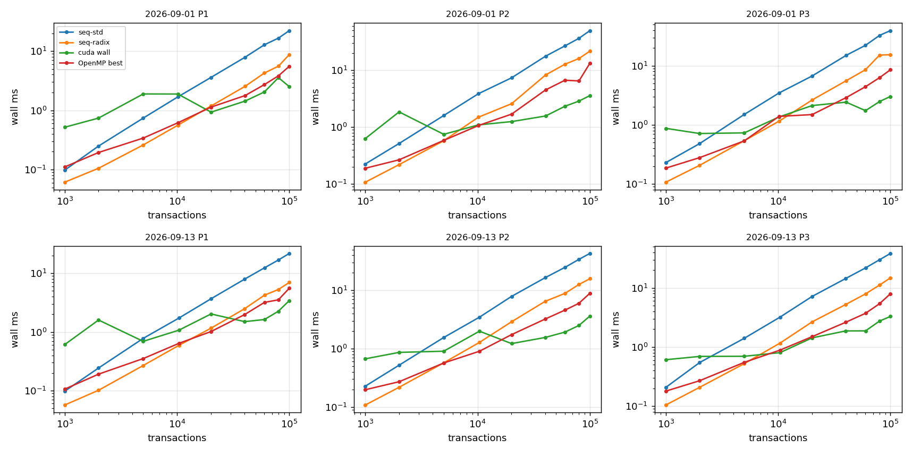
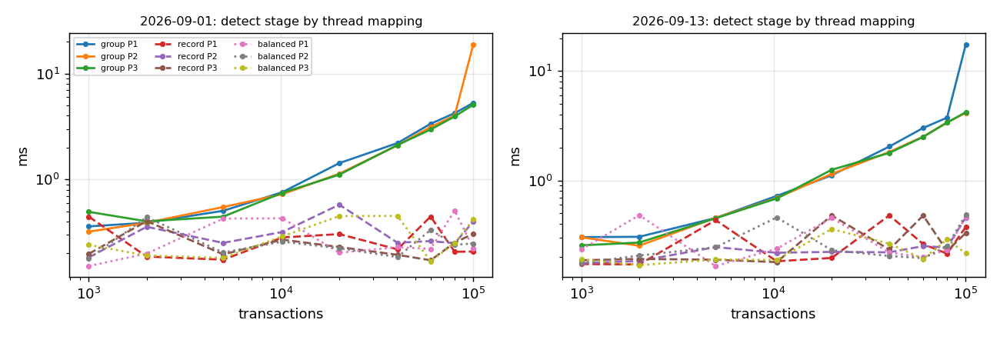

# Phases 8-10 results

## Machine (non-negotiable 4)

```
date: 2026-11-04T03:06:42Z
host: Nikhil-PC
git: unknown
run: run_phase8.sh corpus=corpus runs=2+7 threads=1,2,4,8,12 backend=cuda
OMP_PROC_BIND=close OMP_PLACES=cores

## OS
Linux Nikhil-PC 6.18.54.1-microsoft-standard-WSL2 #1 SMP PREEMPT_DYNAMIC Tue Oct  6 19:13:07 UTC 2026 x86_64 x86_64 x86_64 GNU/Linux
WSL2: yes
PRETTY_NAME="Ubuntu 24.04.5 LTS"
NAME="Ubuntu"
VERSION_ID="24.04"
VERSION="24.04.5 LTS (Noble Numbat)"

## CPU
CPU(s):                                  12
Model name:                              13th Gen Intel(R) Core(TM) i5-13420H
Thread(s) per core:                      2
Core(s) per socket:                      6
Socket(s):                               1
L2 cache:                                7.5 MiB (6 instances)
L3 cache:                                12 MiB (1 instance)
SMT active: 1
governor: unknown
current MHz (cpu0): 2611.198

## power (the review asks for performance mode on AC power)
Windows power plan: Power Scheme GUID: 381b4222-f694-41f0-9685-ff5bb260df2e  (Balanced)
Windows AC power: True

## memory
               total        used        free      shared  buff/cache   available
Mem:           7.6Gi       473Mi       5.6Gi       3.6Mi       1.7Gi       7.1Gi
Swap:          2.0Gi          0B       2.0Gi

## GPU
name, memory.total [MiB], memory.used [MiB], driver_version, pstate, clocks.current.sm [MHz], clocks.max.sm [MHz], pcie.link.gen.current, pcie.link.gen.max, pcie.link.width.current, pcie.link.width.max, power.draw [W], power.limit [W]
NVIDIA GeForce RTX 4050 Laptop GPU, 6141 MiB, 0 MiB, 610.91, P0, 2130 MHz, 3105 MHz, 4, 4, 8, 8, 10.73 W, [N/A]
nvcc: /usr/local/cuda-12.6/bin/nvcc Build cuda_12.6.r12.6/compiler.35059454_0
conduit_gpu info: GPU NVIDIA GeForce RTX 4050 Laptop GPU, 20 SMs, 6140 MiB, cc 8.9, driver 13.3, runtime 12.6; backend cuda; OpenMP on

c++ (Ubuntu 13.3.0-6ubuntu2~24.04.1) 13.3.0
cmake version 3.28.3
```

## Correctness gates (non-negotiable 1: no timing without correctness)

| check | result | last line |
|---|---|---|
| tests.txt | PASS | 39 tests, 0 failed checks |
| stages.txt | PASS | ALL STAGES IDENTICAL TO THE CPU REFERENCE |
| verify.txt | PASS | ALL GPU CHECKS PASSED |
| identical.txt | PASS | ALL IDENTICAL |
| validator.txt | PASS | ALL CHECKS PASSED |

Repetitions: warm-up [2], measured [7] (medians; super-blocks above 250k use at most 1 + 3). 

## Phase 8: end to end, wall time (ms, median)

GPU = balanced detection + sequential sweep for levelling (as the handover asks), transfers and host staging included. `device` = H2D + kernels + D2H on the GPU timeline; `kernels` = stages 1-3 kernels only.

| day | n | pol | seq-std | seq-radix | OpenMP best (threads) | GPU wall | GPU device | GPU kernels | vs seq-std | vs seq-radix | vs OpenMP |
|---|---:|---|---:|---:|---:|---:|---:|---:|---:|---:|---:|
| 2026-09-01 | 1,000 | P1 | 0.10 | 0.06 | 0.11 (1) | 0.52 | 0.41 | 0.36 | 0.19x | 0.12x | 0.21x |
| 2026-09-01 | 2,000 | P1 | 0.25 | 0.11 | 0.19 (2) | 0.74 | 0.57 | 0.53 | 0.34x | 0.14x | 0.26x |
| 2026-09-01 | 5,000 | P1 | 0.74 | 0.26 | 0.34 (4) | 1.89 | 1.75 | 1.57 | 0.39x | 0.14x | 0.18x |
| 2026-09-01 | 10,176 | P1 | 1.68 | 0.56 | 0.62 (8) | 1.88 | 1.73 | 1.55 | 0.89x | 0.30x | 0.33x |
| 2026-09-01 | 20,101 | P1 | 3.60 | 1.18 | 1.13 (8) | 0.93 | 0.75 | 0.57 | 3.86x | 1.27x | 1.22x |
| 2026-09-01 | 40,366 | P1 | 7.87 | 2.54 | 1.77 (8) | 1.43 | 1.03 | 0.66 | 5.51x | 1.78x | 1.24x |
| 2026-09-01 | 60,044 | P1 | 12.77 | 4.26 | 2.72 (8) | 2.04 | 1.40 | 0.74 | 6.26x | 2.09x | 1.33x |
| 2026-09-01 | 80,100 | P1 | 16.55 | 5.56 | 3.82 (8) | 3.56 | 2.62 | 1.71 | 4.65x | 1.56x | 1.07x |
| 2026-09-01 | 100,098 | P1 | 22.16 | 8.75 | 5.54 (8) | 2.51 | 1.68 | 0.73 | 8.84x | 3.49x | 2.21x |
| 2026-09-01 | 1,000 | P2 | 0.23 | 0.11 | 0.19 (2) | 0.63 | 0.54 | 0.49 | 0.36x | 0.17x | 0.30x |
| 2026-09-01 | 2,000 | P2 | 0.52 | 0.22 | 0.27 (4) | 1.85 | 1.74 | 1.58 | 0.28x | 0.12x | 0.14x |
| 2026-09-01 | 5,000 | P2 | 1.60 | 0.58 | 0.58 (4) | 0.75 | 0.65 | 0.59 | 2.14x | 0.77x | 0.78x |
| 2026-09-01 | 10,176 | P2 | 3.86 | 1.49 | 1.07 (8) | 1.09 | 0.97 | 0.84 | 3.53x | 1.37x | 0.97x |
| 2026-09-01 | 20,101 | P2 | 7.35 | 2.58 | 1.69 (8) | 1.25 | 0.99 | 0.69 | 5.87x | 2.06x | 1.35x |
| 2026-09-01 | 40,366 | P2 | 17.62 | 8.24 | 4.50 (8) | 1.57 | 1.13 | 0.66 | 11.24x | 5.26x | 2.87x |
| 2026-09-01 | 60,044 | P2 | 26.69 | 12.73 | 6.66 (8) | 2.32 | 1.83 | 1.07 | 11.48x | 5.47x | 2.86x |
| 2026-09-01 | 80,100 | P2 | 36.27 | 16.04 | 6.47 (8) | 2.87 | 1.95 | 1.00 | 12.65x | 5.60x | 2.26x |
| 2026-09-01 | 100,098 | P2 | 49.51 | 21.60 | 13.22 (8) | 3.58 | 2.23 | 1.03 | 13.85x | 6.04x | 3.70x |
| 2026-09-01 | 1,000 | P3 | 0.23 | 0.11 | 0.19 (2) | 0.87 | 0.75 | 0.67 | 0.26x | 0.12x | 0.21x |
| 2026-09-01 | 2,000 | P3 | 0.48 | 0.21 | 0.28 (4) | 0.71 | 0.61 | 0.57 | 0.68x | 0.29x | 0.39x |
| 2026-09-01 | 5,000 | P3 | 1.50 | 0.54 | 0.54 (4) | 0.73 | 0.62 | 0.56 | 2.05x | 0.74x | 0.73x |
| 2026-09-01 | 10,176 | P3 | 3.46 | 1.15 | 1.39 (4) | 1.36 | 1.09 | 0.94 | 2.55x | 0.85x | 1.02x |
| 2026-09-01 | 20,101 | P3 | 6.71 | 2.64 | 1.49 (8) | 2.12 | 1.89 | 1.58 | 3.17x | 1.24x | 0.70x |
| 2026-09-01 | 40,366 | P3 | 15.00 | 5.57 | 2.89 (8) | 2.42 | 2.04 | 1.58 | 6.20x | 2.30x | 1.19x |
| 2026-09-01 | 60,044 | P3 | 22.16 | 8.58 | 4.42 (8) | 1.74 | 1.26 | 0.67 | 12.75x | 4.94x | 2.54x |
| 2026-09-01 | 80,100 | P3 | 32.63 | 15.15 | 6.29 (8) | 2.48 | 1.77 | 0.96 | 13.16x | 6.11x | 2.54x |
| 2026-09-01 | 100,098 | P3 | 39.32 | 15.39 | 8.55 (8) | 3.02 | 2.19 | 1.17 | 13.01x | 5.09x | 2.83x |
| 2026-09-13 | 1,000 | P1 | 0.10 | 0.06 | 0.11 (1) | 0.61 | 0.50 | 0.45 | 0.16x | 0.09x | 0.17x |
| 2026-09-13 | 2,000 | P1 | 0.24 | 0.10 | 0.19 (2) | 1.60 | 1.47 | 1.33 | 0.15x | 0.06x | 0.12x |
| 2026-09-13 | 5,000 | P1 | 0.78 | 0.27 | 0.35 (4) | 0.69 | 0.59 | 0.53 | 1.12x | 0.39x | 0.51x |
| 2026-09-13 | 10,396 | P1 | 1.72 | 0.59 | 0.64 (8) | 1.07 | 0.92 | 0.81 | 1.61x | 0.55x | 0.60x |
| 2026-09-13 | 20,096 | P1 | 3.68 | 1.16 | 1.02 (8) | 2.03 | 1.82 | 1.54 | 1.81x | 0.57x | 0.50x |
| 2026-09-13 | 40,085 | P1 | 7.96 | 2.49 | 1.98 (8) | 1.50 | 1.10 | 0.72 | 5.31x | 1.66x | 1.32x |
| 2026-09-13 | 60,129 | P1 | 12.38 | 4.23 | 3.19 (8) | 1.63 | 1.16 | 0.61 | 7.61x | 2.60x | 1.96x |
| 2026-09-13 | 80,029 | P1 | 16.84 | 5.30 | 3.53 (8) | 2.26 | 1.58 | 0.84 | 7.46x | 2.35x | 1.56x |
| 2026-09-13 | 100,174 | P1 | 21.81 | 6.98 | 5.57 (8) | 3.43 | 2.59 | 1.63 | 6.36x | 2.04x | 1.63x |
| 2026-09-13 | 1,000 | P2 | 0.23 | 0.11 | 0.20 (4) | 0.67 | 0.57 | 0.52 | 0.34x | 0.16x | 0.29x |
| 2026-09-13 | 2,000 | P2 | 0.52 | 0.22 | 0.27 (4) | 0.86 | 0.76 | 0.70 | 0.60x | 0.25x | 0.31x |
| 2026-09-13 | 5,000 | P2 | 1.56 | 0.57 | 0.57 (4) | 0.91 | 0.78 | 0.66 | 1.72x | 0.63x | 0.63x |
| 2026-09-13 | 10,396 | P2 | 3.47 | 1.28 | 0.90 (8) | 2.00 | 1.83 | 1.61 | 1.74x | 0.64x | 0.45x |
| 2026-09-13 | 20,096 | P2 | 7.89 | 2.90 | 1.74 (8) | 1.22 | 1.07 | 0.77 | 6.45x | 2.37x | 1.42x |
| 2026-09-13 | 40,085 | P2 | 16.53 | 6.50 | 3.23 (8) | 1.56 | 1.14 | 0.67 | 10.61x | 4.17x | 2.07x |
| 2026-09-13 | 60,129 | P2 | 24.86 | 8.88 | 4.59 (8) | 1.93 | 1.42 | 0.73 | 12.90x | 4.61x | 2.38x |
| 2026-09-13 | 80,029 | P2 | 34.03 | 12.64 | 6.00 (8) | 2.50 | 1.87 | 0.96 | 13.59x | 5.05x | 2.40x |
| 2026-09-13 | 100,174 | P2 | 43.06 | 15.84 | 8.93 (8) | 3.62 | 2.79 | 1.58 | 11.88x | 4.37x | 2.46x |
| 2026-09-13 | 1,000 | P3 | 0.21 | 0.10 | 0.18 (2) | 0.61 | 0.52 | 0.48 | 0.34x | 0.17x | 0.29x |
| 2026-09-13 | 2,000 | P3 | 0.55 | 0.21 | 0.27 (4) | 0.69 | 0.59 | 0.55 | 0.79x | 0.30x | 0.39x |
| 2026-09-13 | 5,000 | P3 | 1.40 | 0.52 | 0.55 (8) | 0.70 | 0.60 | 0.54 | 2.02x | 0.75x | 0.79x |
| 2026-09-13 | 10,396 | P3 | 3.20 | 1.16 | 0.88 (8) | 0.80 | 0.68 | 0.58 | 3.98x | 1.45x | 1.10x |
| 2026-09-13 | 20,096 | P3 | 7.16 | 2.66 | 1.49 (8) | 1.43 | 1.14 | 0.87 | 5.02x | 1.87x | 1.05x |
| 2026-09-13 | 40,085 | P3 | 14.42 | 5.24 | 2.62 (8) | 1.87 | 1.23 | 0.79 | 7.71x | 2.80x | 1.40x |
| 2026-09-13 | 60,129 | P3 | 21.76 | 7.92 | 3.71 (8) | 1.87 | 1.32 | 0.72 | 11.62x | 4.23x | 1.98x |
| 2026-09-13 | 80,029 | P3 | 29.82 | 11.12 | 5.39 (8) | 2.74 | 2.07 | 1.23 | 10.88x | 4.06x | 1.97x |
| 2026-09-13 | 100,174 | P3 | 38.24 | 14.77 | 7.94 (8) | 3.28 | 2.15 | 0.95 | 11.64x | 4.50x | 2.42x |

### Crossover (wall time, transfers charged)

Measured = smallest tested size where the GPU is faster. Model = least-squares lines t = a + b·n through each implementation's points at n ≤ 20k (the region around the crossover); the model crossover is where the lines meet, n* = (a_gpu − a_cpu) / (b_cpu − b_gpu). a_gpu is the GPU's fixed cost per call (launches, synchronisations, transfer latency), b the cost per transaction.

| day | pol | beats seq-radix at n ≥ (measured) | model n* vs seq-radix | beats OpenMP at n ≥ (measured) | model n* vs OpenMP | GPU fixed cost a (ms) |
|---|---|---:|---:|---:|---:|---:|
| 2026-09-01 | P1 | 20101 | never | 20101 | never | 0.566 |
| 2026-09-01 | P2 | 10176 | 7,540 | 20101 | 9,809 | 1.120 |
| 2026-09-01 | P3 | 20101 | 12,311 | 10176 | 9,054 | 0.645 |
| 2026-09-13 | P1 | 40085 | 18,121 | 40085 | 17,297 | 0.981 |
| 2026-09-13 | P2 | 20096 | never | 20096 | never | 0.483 |
| 2026-09-13 | P3 | 10396 | 6,704 | 10396 | 8,600 | 0.619 |

### Transfer-cost arithmetic (largest super-block per day and policy)

Bytes moved: H2D = 40·n (the transaction records); D2H = 8·(n+1) row offsets + 4·m column indices (+ 4·n levels when levelling on the GPU). Measured times are cudaEvent intervals; the share is of GPU wall time. Host prep = id check + copy into the pinned staging buffer; host post = copy out of the pinned buffers.

PCIe probe (pinned, fitted t = latency + bytes / bandwidth on transfers ≥ 1 MB): H2D 12.1 GB/s, latency -39.0 µs, D2H 12.7 GB/s, latency -30.2 µs; empty-kernel launch + sync 31.5 µs, one host round trip 31.5 µs.

| day | pol | n | H2D MB | D2H MB | H2D ms (pred.) | D2H ms (pred.) | transfer % of wall | host prep ms | host post ms | wall − device ms |
|---|---|---:|---:|---:|---:|---:|---:|---:|---:|---:|
| 2026-09-01 | P1 | 100,098 | 4.0 | 1.4 | 0.32 (0.29) | 0.14 (0.08) | 18% | 0.57 | 0.11 | 0.83 |
| 2026-09-01 | P2 | 100,098 | 4.0 | 1.5 | 0.33 (0.29) | 0.17 (0.09) | 14% | 0.66 | 0.14 | 1.35 |
| 2026-09-01 | P3 | 100,098 | 4.0 | 1.3 | 0.34 (0.29) | 0.14 (0.07) | 16% | 0.56 | 0.10 | 0.83 |
| 2026-09-13 | P1 | 100,174 | 4.0 | 1.4 | 0.33 (0.29) | 0.16 (0.08) | 14% | 0.55 | 0.10 | 0.84 |
| 2026-09-13 | P2 | 100,174 | 4.0 | 1.5 | 0.32 (0.29) | 0.17 (0.09) | 14% | 0.49 | 0.10 | 0.84 |
| 2026-09-13 | P3 | 100,174 | 4.0 | 1.3 | 0.33 (0.29) | 0.13 (0.07) | 14% | 0.83 | 0.11 | 1.13 |

## GPU stage breakdown at the largest super-block (ms)

| day | pol | n | H2D | extract | sort | detect | csr | D2H | level (CPU sweep) | device | wall | launches | host syncs | device MB |
|---|---|---:|---:|---:|---:|---:|---:|---:|---:|---:|---:|---:|---:|---:|
| 2026-09-01 | P1 | 100,098 | 0.32 | 0.15 | 0.17 | 0.22 | 0.21 | 0.14 | 0.45 | 1.68 | 2.51 | 17 | 6 | 65.6 |
| 2026-09-01 | P2 | 100,098 | 0.33 | 0.28 | 0.24 | 0.25 | 0.19 | 0.17 | 0.71 | 2.23 | 3.58 | 17 | 6 | 67.0 |
| 2026-09-01 | P3 | 100,098 | 0.34 | 0.27 | 0.24 | 0.42 | 0.25 | 0.14 | 0.57 | 2.19 | 3.02 | 17 | 6 | 67.0 |
| 2026-09-13 | P1 | 100,174 | 0.33 | 0.17 | 0.48 | 0.47 | 0.48 | 0.16 | 0.47 | 2.59 | 3.43 | 17 | 6 | 69.1 |
| 2026-09-13 | P2 | 100,174 | 0.32 | 0.31 | 0.30 | 0.48 | 0.51 | 0.17 | 0.70 | 2.79 | 3.62 | 17 | 6 | 69.1 |
| 2026-09-13 | P3 | 100,174 | 0.33 | 0.30 | 0.24 | 0.21 | 0.17 | 0.13 | 0.57 | 2.15 | 3.28 | 17 | 6 | 69.1 |

## Phase 9: skew (detection stage, three thread mappings)

Before = one thread per key group (`group`); `record` = one thread per record; after = one thread per output edge (`balanced`, load-balanced search). Imbalance = max ÷ mean work per thread, computed from the key groups (1.0 = even). Recovery = group time ÷ mapping time.

| super-block | pol | records | hottest key | its records (%) | imbalance group / record / edge | detect ms group (before) | record | balanced (after) | recovery record / balanced |
|---|---|---:|---|---:|---|---:|---:|---:|---|
| 2026-09-01/10k/099 | P1 | 20,300 | `ACCOUNT(0xdac1..1ec7)` | 2,042 (10.1%) | 996 / 1 / 1 | 0.876 | 0.207 | 0.234 | 4.24x / 3.75x |
| 2026-09-01/10k/099 | P2 | 45,096 | `ACCOUNT(0xdac1..1ec7)` | 2,042 (4.5%) | 1089 / 154 / 1 | 0.761 | 0.195 | 0.234 | 3.91x / 3.25x |
| 2026-09-01/10k/099 | P3 | 45,096 | `ACCOUNT(0xdac1..1ec7)` | 2,042 (4.5%) | 1231 / 175 / 1 | 0.774 | 0.309 | 0.309 | 2.50x / 2.50x |
| 2026-09-01/20k/049 | P1 | 40,065 | `ACCOUNT(0xdac1..1ec7)` | 3,785 (9.4%) | 1567 / 1 / 1 | 1.326 | 0.200 | 0.208 | 6.64x / 6.38x |
| 2026-09-01/20k/049 | P2 | 88,262 | `ACCOUNT(0xdac1..1ec7)` | 3,785 (4.3%) | 1795 / 314 / 1 | 1.228 | 0.226 | 0.164 | 5.42x / 7.49x |
| 2026-09-01/20k/049 | P3 | 88,262 | `ACCOUNT(0xdac1..1ec7)` | 3,785 (4.3%) | 2051 / 358 / 1 | 1.435 | 0.279 | 0.304 | 5.15x / 4.72x |
| 2026-09-01/40k/025 | P1 | 80,480 | `ACCOUNT(0xdac1..1ec7)` | 8,182 (10.2%) | 2857 / 1 / 1 | 2.461 | 0.294 | 0.227 | 8.37x / 10.82x |
| 2026-09-01/40k/025 | P2 | 178,685 | `ACCOUNT(0xdac1..1ec7)` | 8,182 (4.6%) | 3428 / 268 / 1 | 2.403 | 0.327 | 0.316 | 7.36x / 7.59x |
| 2026-09-01/40k/025 | P3 | 178,685 | `ACCOUNT(0xdac1..1ec7)` | 8,182 (4.6%) | 3974 / 311 / 1 | 2.414 | 0.324 | 0.166 | 7.46x / 14.55x |
| 2026-09-01/60k/016 | P1 | 119,690 | `ACCOUNT(0xdac1..1ec7)` | 12,120 (10.1%) | 3834 / 1 / 1 | 3.733 | 0.312 | 0.224 | 11.95x / 16.65x |
| 2026-09-01/60k/016 | P2 | 262,782 | `ACCOUNT(0xdac1..1ec7)` | 12,120 (4.6%) | 4536 / 300 / 1 | 2.965 | 0.286 | 0.256 | 10.38x / 11.58x |
| 2026-09-01/60k/016 | P3 | 262,782 | `ACCOUNT(0xdac1..1ec7)` | 12,120 (4.6%) | 5281 / 350 / 1 | 2.912 | 0.252 | 0.264 | 11.56x / 11.02x |
| 2026-09-01/80k/012 | P1 | 159,677 | `ACCOUNT(0xdac1..1ec7)` | 16,303 (10.2%) | 4895 / 1 / 1 | 4.224 | 0.229 | 0.241 | 18.41x / 17.55x |
| 2026-09-01/80k/012 | P2 | 352,164 | `ACCOUNT(0xdac1..1ec7)` | 16,303 (4.6%) | 5854 / 298 / 1 | 3.841 | 0.256 | 0.235 | 15.00x / 16.31x |
| 2026-09-01/80k/012 | P3 | 352,164 | `ACCOUNT(0xdac1..1ec7)` | 16,303 (4.6%) | 6848 / 349 / 1 | 3.950 | 0.226 | 0.207 | 17.45x / 19.09x |
| 2026-09-01/100k/010 | P1 | 199,501 | `ACCOUNT(0xdac1..1ec7)` | 20,805 (10.4%) | 5838 / 1 / 1 | 5.322 | 0.252 | 0.255 | 21.13x / 20.87x |
| 2026-09-01/100k/010 | P2 | 438,424 | `ACCOUNT(0xdac1..1ec7)` | 20,805 (4.7%) | 7146 / 259 / 1 | 4.975 | 0.352 | 0.239 | 14.12x / 20.85x |
| 2026-09-01/100k/010 | P3 | 438,424 | `ACCOUNT(0xdac1..1ec7)` | 20,805 (4.7%) | 8371 / 304 / 1 | 4.934 | 0.376 | 0.254 | 13.13x / 19.43x |
| 2026-09-13/10k/073 | P1 | 20,706 | `ACCOUNT(0xdac1..1ec7)` | 1,953 (9.4%) | 882 / 1 / 1 | 0.712 | 0.242 | 0.219 | 2.94x / 3.25x |
| 2026-09-13/10k/073 | P2 | 45,232 | `ACCOUNT(0xdac1..1ec7)` | 1,953 (4.3%) | 744 / 232 / 1 | 0.669 | 0.309 | 0.292 | 2.16x / 2.29x |
| 2026-09-13/10k/073 | P3 | 45,232 | `ACCOUNT(0xdac1..1ec7)` | 1,953 (4.3%) | 847 / 264 / 1 | 0.581 | 0.296 | 0.293 | 1.96x / 1.98x |
| 2026-09-13/20k/036 | P1 | 40,020 | `ACCOUNT(0xdac1..1ec7)` | 3,915 (9.8%) | 1417 / 1 / 1 | 1.157 | 0.256 | 0.211 | 4.52x / 5.49x |
| 2026-09-13/20k/036 | P2 | 86,902 | `ACCOUNT(0xdac1..1ec7)` | 3,915 (4.5%) | 1302 / 325 / 1 | 1.082 | 0.205 | 0.184 | 5.29x / 5.87x |
| 2026-09-13/20k/036 | P3 | 86,902 | `ACCOUNT(0xdac1..1ec7)` | 3,915 (4.5%) | 1499 / 374 / 1 | 1.059 | 0.192 | 0.191 | 5.53x / 5.56x |
| 2026-09-13/40k/018 | P1 | 79,850 | `ACCOUNT(0xdac1..1ec7)` | 7,374 (9.2%) | 2241 / 1 / 1 | 1.953 | 0.223 | 0.221 | 8.78x / 8.83x |
| 2026-09-13/40k/018 | P2 | 174,508 | `ACCOUNT(0xdac1..1ec7)` | 7,374 (4.2%) | 2150 / 315 / 1 | 1.834 | 0.257 | 0.187 | 7.13x / 9.79x |
| 2026-09-13/40k/018 | P3 | 174,508 | `ACCOUNT(0xdac1..1ec7)` | 7,374 (4.2%) | 2516 / 369 / 1 | 1.883 | 0.330 | 0.292 | 5.71x / 6.45x |
| 2026-09-13/60k/012 | P1 | 119,768 | `ACCOUNT(0xdac1..1ec7)` | 10,940 (9.1%) | 3017 / 1 / 1 | 2.877 | 0.249 | 0.358 | 11.53x / 8.03x |
| 2026-09-13/60k/012 | P2 | 261,029 | `ACCOUNT(0xdac1..1ec7)` | 10,940 (4.2%) | 2948 / 311 / 1 | 2.468 | 0.205 | 0.193 | 12.05x / 12.82x |
| 2026-09-13/60k/012 | P3 | 261,029 | `ACCOUNT(0xdac1..1ec7)` | 10,940 (4.2%) | 3471 / 366 / 1 | 2.674 | 0.207 | 0.254 | 12.93x / 10.53x |
| 2026-09-13/80k/009 | P1 | 159,395 | `ACCOUNT(0xdac1..1ec7)` | 14,581 (9.1%) | 3759 / 1 / 1 | 3.877 | 0.239 | 0.483 | 16.25x / 8.02x |
| 2026-09-13/80k/009 | P2 | 345,413 | `ACCOUNT(0xdac1..1ec7)` | 14,581 (4.2%) | 3895 / 308 / 1 | 3.459 | 0.465 | 0.253 | 7.45x / 13.68x |
| 2026-09-13/80k/009 | P3 | 345,413 | `ACCOUNT(0xdac1..1ec7)` | 14,581 (4.2%) | 4593 / 363 / 1 | 3.452 | 0.339 | 0.392 | 10.18x / 8.80x |
| 2026-09-13/100k/007 | P1 | 199,530 | `ACCOUNT(0xdac1..1ec7)` | 18,230 (9.1%) | 4480 / 1 / 1 | 4.671 | 0.433 | 0.334 | 10.79x / 13.99x |
| 2026-09-13/100k/007 | P2 | 432,897 | `ACCOUNT(0xdac1..1ec7)` | 18,230 (4.2%) | 4719 / 306 / 1 | 4.315 | 0.452 | 0.461 | 9.56x / 9.36x |
| 2026-09-13/100k/007 | P3 | 432,897 | `ACCOUNT(0xdac1..1ec7)` | 18,230 (4.2%) | 5576 / 362 / 1 | 4.275 | 0.255 | 0.459 | 16.77x / 9.32x |

Detect time across sizes (from the factorial sweep):

| day | pol | n | largest group | group ms | record ms | balanced ms | recovery |
|---|---|---:|---:|---:|---:|---:|---:|
| 2026-09-01 | P1 | 1,000 | 204 | 0.359 | 0.444 | 0.152 | 2.37x |
| 2026-09-01 | P1 | 2,000 | 376 | 0.389 | 0.186 | 0.199 | 1.96x |
| 2026-09-01 | P1 | 5,000 | 1,008 | 0.505 | 0.174 | 0.426 | 1.18x |
| 2026-09-01 | P1 | 10,176 | 2,042 | 0.758 | 0.283 | 0.429 | 1.77x |
| 2026-09-01 | P1 | 20,101 | 3,785 | 1.425 | 0.304 | 0.203 | 7.03x |
| 2026-09-01 | P1 | 40,366 | 8,182 | 2.207 | 0.218 | 0.228 | 9.66x |
| 2026-09-01 | P1 | 60,044 | 12,120 | 3.358 | 0.445 | 0.220 | 15.25x |
| 2026-09-01 | P1 | 80,100 | 16,303 | 4.234 | 0.207 | 0.508 | 8.34x |
| 2026-09-01 | P1 | 100,098 | 20,805 | 5.297 | 0.208 | 0.223 | 23.73x |
| 2026-09-01 | P2 | 1,000 | 204 | 0.321 | 0.183 | 0.178 | 1.80x |
| 2026-09-01 | P2 | 2,000 | 376 | 0.389 | 0.356 | 0.439 | 0.89x |
| 2026-09-01 | P2 | 5,000 | 1,008 | 0.548 | 0.251 | 0.204 | 2.69x |
| 2026-09-01 | P2 | 10,176 | 2,042 | 0.725 | 0.318 | 0.258 | 2.81x |
| 2026-09-01 | P2 | 20,101 | 3,785 | 1.132 | 0.577 | 0.223 | 5.07x |
| 2026-09-01 | P2 | 40,366 | 8,182 | 2.100 | 0.252 | 0.184 | 11.40x |
| 2026-09-01 | P2 | 60,044 | 12,120 | 3.127 | 0.261 | 0.333 | 9.40x |
| 2026-09-01 | P2 | 80,100 | 16,303 | 4.017 | 0.249 | 0.241 | 16.70x |
| 2026-09-01 | P2 | 100,098 | 20,805 | 18.909 | 0.399 | 0.248 | 76.31x |
| 2026-09-01 | P3 | 1,000 | 204 | 0.494 | 0.198 | 0.240 | 2.05x |
| 2026-09-01 | P3 | 2,000 | 376 | 0.401 | 0.404 | 0.191 | 2.11x |
| 2026-09-01 | P3 | 5,000 | 1,008 | 0.444 | 0.196 | 0.181 | 2.45x |
| 2026-09-01 | P3 | 10,176 | 2,042 | 0.747 | 0.269 | 0.290 | 2.58x |
| 2026-09-01 | P3 | 20,101 | 3,785 | 1.109 | 0.229 | 0.450 | 2.47x |
| 2026-09-01 | P3 | 40,366 | 8,182 | 2.112 | 0.194 | 0.452 | 4.68x |
| 2026-09-01 | P3 | 60,044 | 12,120 | 2.963 | 0.172 | 0.168 | 17.65x |
| 2026-09-01 | P3 | 80,100 | 16,303 | 3.938 | 0.252 | 0.250 | 15.76x |
| 2026-09-01 | P3 | 100,098 | 20,805 | 5.088 | 0.306 | 0.418 | 12.18x |
| 2026-09-13 | P1 | 1,000 | 218 | 0.303 | 0.172 | 0.234 | 1.30x |
| 2026-09-13 | P1 | 2,000 | 442 | 0.305 | 0.171 | 0.481 | 0.63x |
| 2026-09-13 | P1 | 5,000 | 953 | 0.454 | 0.433 | 0.165 | 2.75x |
| 2026-09-13 | P1 | 10,396 | 1,953 | 0.722 | 0.182 | 0.238 | 3.04x |
| 2026-09-13 | P1 | 20,096 | 3,915 | 1.115 | 0.196 | 0.455 | 2.45x |
| 2026-09-13 | P1 | 40,085 | 7,374 | 2.041 | 0.479 | 0.219 | 9.31x |
| 2026-09-13 | P1 | 60,129 | 10,940 | 3.018 | 0.262 | 0.199 | 15.19x |
| 2026-09-13 | P1 | 80,029 | 14,581 | 3.749 | 0.214 | 0.232 | 16.13x |
| 2026-09-13 | P1 | 100,174 | 18,230 | 17.515 | 0.376 | 0.466 | 37.59x |
| 2026-09-13 | P2 | 1,000 | 218 | 0.302 | 0.175 | 0.175 | 1.73x |
| 2026-09-13 | P2 | 2,000 | 442 | 0.253 | 0.183 | 0.206 | 1.23x |
| 2026-09-13 | P2 | 5,000 | 953 | 0.455 | 0.246 | 0.245 | 1.86x |
| 2026-09-13 | P2 | 10,396 | 1,953 | 0.690 | 0.218 | 0.459 | 1.50x |
| 2026-09-13 | P2 | 20,096 | 3,915 | 1.146 | 0.222 | 0.230 | 4.97x |
| 2026-09-13 | P2 | 40,085 | 7,374 | 1.821 | 0.220 | 0.204 | 8.93x |
| 2026-09-13 | P2 | 60,129 | 10,940 | 2.515 | 0.251 | 0.195 | 12.92x |
| 2026-09-13 | P2 | 80,029 | 14,581 | 3.387 | 0.244 | 0.251 | 13.50x |
| 2026-09-13 | P2 | 100,174 | 18,230 | 4.153 | 0.459 | 0.483 | 8.59x |
| 2026-09-13 | P3 | 1,000 | 218 | 0.255 | 0.186 | 0.189 | 1.35x |
| 2026-09-13 | P3 | 2,000 | 442 | 0.270 | 0.192 | 0.168 | 1.61x |
| 2026-09-13 | P3 | 5,000 | 953 | 0.451 | 0.188 | 0.189 | 2.38x |
| 2026-09-13 | P3 | 10,396 | 1,953 | 0.684 | 0.179 | 0.187 | 3.65x |
| 2026-09-13 | P3 | 20,096 | 3,915 | 1.251 | 0.478 | 0.359 | 3.48x |
| 2026-09-13 | P3 | 40,085 | 7,374 | 1.786 | 0.234 | 0.264 | 6.76x |
| 2026-09-13 | P3 | 60,129 | 10,940 | 2.499 | 0.478 | 0.192 | 13.05x |
| 2026-09-13 | P3 | 80,029 | 14,581 | 3.380 | 0.226 | 0.289 | 11.70x |
| 2026-09-13 | P3 | 100,174 | 18,230 | 4.196 | 0.331 | 0.215 | 19.52x |

## Stage 4: levelling / batching, GPU methods vs the CPU sweep

`rounds` = batches; `tail` = rounds run inside the persistent single block. Jones-Plassmann is skipped above its size cap.

| day | pol | n | method | batches | rounds | tail | launches | level ms | wall ms |
|---|---|---:|---|---:|---:|---:|---:|---:|---:|
| 2026-09-01 | P1 | 100,098 | sweep | 21,013 | 0 | 0 | 17 | 0.446 | 2.51 |
| 2026-09-01 | P1 | 100,098 | kahn | 21,013 | 21,013 | 21,013 | 20 | 15.413 | 18.44 |
| 2026-09-01 | P1 | 100,098 | jp-index | 21,013 | 21,013 | 1,813 | 76,821 | 1446.827 | 1449.73 |
| 2026-09-01 | P1 | 100,098 | jp-random | 20,805 | 20,805 | 1,925 | 75,541 | 1362.934 | 1365.43 |
| 2026-09-01 | P2 | 100,098 | sweep | 2,181 | 0 | 0 | 17 | 0.711 | 3.58 |
| 2026-09-01 | P2 | 100,098 | kahn | 2,181 | 2,181 | 2,149 | 84 | 5.801 | 8.83 |
| 2026-09-01 | P2 | 100,098 | jp-index | 2,181 | 2,181 | 197 | 7,957 | 189.950 | 192.64 |
| 2026-09-01 | P2 | 100,098 | jp-random | 2,144 | 2,144 | 224 | 7,701 | 171.915 | 174.95 |
| 2026-09-01 | P3 | 100,098 | sweep | 1,733 | 0 | 0 | 17 | 0.573 | 3.02 |
| 2026-09-01 | P3 | 100,098 | kahn | 1,733 | 1,733 | 1,701 | 84 | 4.963 | 7.62 |
| 2026-09-01 | P3 | 100,098 | jp-index | 1,733 | 1,733 | 485 | 5,013 | 104.474 | 107.74 |
| 2026-09-01 | P3 | 100,098 | jp-random | 1,733 | 1,733 | 517 | 4,885 | 97.443 | 100.23 |
| 2026-09-13 | P1 | 100,174 | sweep | 18,678 | 0 | 0 | 17 | 0.475 | 3.43 |
| 2026-09-13 | P1 | 100,174 | kahn | 18,678 | 18,678 | 18,678 | 20 | 14.100 | 16.96 |
| 2026-09-13 | P1 | 100,174 | jp-index | 18,678 | 18,678 | 1,686 | 67,989 | 1296.222 | 1298.99 |
| 2026-09-13 | P1 | 100,174 | jp-random | 18,233 | 18,233 | 1,785 | 65,813 | 1171.544 | 1175.76 |
| 2026-09-13 | P2 | 100,174 | sweep | 2,766 | 0 | 0 | 17 | 0.699 | 3.62 |
| 2026-09-13 | P2 | 100,174 | kahn | 2,766 | 2,766 | 2,734 | 84 | 6.034 | 8.79 |
| 2026-09-13 | P2 | 100,174 | jp-index | 2,766 | 2,766 | 206 | 10,261 | 234.647 | 238.04 |
| 2026-09-13 | P2 | 100,174 | jp-random | 2,190 | 2,190 | 206 | 7,957 | 183.868 | 186.69 |
| 2026-09-13 | P3 | 100,174 | sweep | 1,741 | 0 | 0 | 17 | 0.569 | 3.28 |
| 2026-09-13 | P3 | 100,174 | kahn | 1,741 | 1,741 | 1,709 | 84 | 4.690 | 7.73 |
| 2026-09-13 | P3 | 100,174 | jp-index | 1,741 | 1,741 | 397 | 5,397 | 85.370 | 88.16 |
| 2026-09-13 | P3 | 100,174 | jp-random | 1,741 | 1,741 | 589 | 4,629 | 83.279 | 86.01 |





## Schedule quality and the batch-execution model

Speedup = serial gas ÷ modelled makespan on W workers (gas as cost, LPT list scheduling inside a batch, batches in sequence). `bound` = per-key lower bound on batches for any schedule. `levels` preserve block order; `jp-random` may reorder.

| block | n | pol | method | batches | bound | tx/batch | W=8 | W=16 | W=32 | W=64 | W=inf |
|---|---:|---|---|---:|---:|---:|---:|---:|---:|---:|---:|
| 2026-09-01/10k/099 | 10,176 | P1 | levels | 2,058 | 2,042 | 4.9 | 2.99 | 3.16 | 3.22 | 3.23 | 3.23 |
| 2026-09-01/10k/099 | 10,176 | P1 | jp-random1 | 2,042 | 2,042 | 5.0 | 3.15 | 3.36 | 3.45 | 3.46 | 3.46 |
| 2026-09-01/10k/099 | 10,176 | P1 | jp-random2 | 2,042 | 2,042 | 5.0 | 3.30 | 3.55 | 3.63 | 3.64 | 3.64 |
| 2026-09-01/10k/099 | 10,176 | P1 | jp-random3 | 2,043 | 2,042 | 5.0 | 3.31 | 3.51 | 3.61 | 3.63 | 3.63 |
| 2026-09-01/10k/099 | 10,176 | P2 | levels | 326 | 295 | 31.2 | 5.81 | 6.93 | 7.44 | 7.55 | 7.55 |
| 2026-09-01/10k/099 | 10,176 | P2 | jp-random1 | 295 | 295 | 34.5 | 6.02 | 7.40 | 7.97 | 8.11 | 8.11 |
| 2026-09-01/10k/099 | 10,176 | P2 | jp-random2 | 295 | 295 | 34.5 | 5.98 | 7.42 | 8.04 | 8.17 | 8.17 |
| 2026-09-01/10k/099 | 10,176 | P2 | jp-random3 | 295 | 295 | 34.5 | 5.93 | 7.37 | 7.95 | 8.13 | 8.13 |
| 2026-09-01/10k/099 | 10,176 | P3 | levels | 222 | 222 | 45.8 | 5.97 | 7.25 | 7.88 | 8.11 | 8.11 |
| 2026-09-01/10k/099 | 10,176 | P3 | jp-random1 | 222 | 222 | 45.8 | 6.03 | 7.57 | 8.24 | 8.49 | 8.49 |
| 2026-09-01/10k/099 | 10,176 | P3 | jp-random2 | 222 | 222 | 45.8 | 6.00 | 7.55 | 8.28 | 8.53 | 8.53 |
| 2026-09-01/10k/099 | 10,176 | P3 | jp-random3 | 222 | 222 | 45.8 | 5.97 | 7.55 | 8.22 | 8.54 | 8.54 |
| 2026-09-01/20k/049 | 20,101 | P1 | levels | 3,891 | 3,785 | 5.2 | 3.05 | 3.27 | 3.35 | 3.36 | 3.36 |
| 2026-09-01/20k/049 | 20,101 | P1 | jp-random1 | 3,785 | 3,785 | 5.3 | 3.36 | 3.67 | 3.76 | 3.78 | 3.78 |
| 2026-09-01/20k/049 | 20,101 | P1 | jp-random2 | 3,785 | 3,785 | 5.3 | 3.24 | 3.51 | 3.61 | 3.62 | 3.62 |
| 2026-09-01/20k/049 | 20,101 | P1 | jp-random3 | 3,786 | 3,785 | 5.3 | 3.26 | 3.51 | 3.59 | 3.61 | 3.61 |
| 2026-09-01/20k/049 | 20,101 | P2 | levels | 432 | 354 | 46.5 | 5.86 | 7.26 | 7.85 | 7.98 | 7.98 |
| 2026-09-01/20k/049 | 20,101 | P2 | jp-random1 | 354 | 354 | 56.8 | 6.36 | 8.42 | 9.28 | 9.48 | 9.48 |
| 2026-09-01/20k/049 | 20,101 | P2 | jp-random2 | 355 | 354 | 56.6 | 6.29 | 8.13 | 8.93 | 9.10 | 9.10 |
| 2026-09-01/20k/049 | 20,101 | P2 | jp-random3 | 355 | 354 | 56.6 | 6.31 | 8.20 | 8.93 | 9.12 | 9.12 |
| 2026-09-01/20k/049 | 20,101 | P3 | levels | 310 | 310 | 64.8 | 6.05 | 7.69 | 8.44 | 8.70 | 8.70 |
| 2026-09-01/20k/049 | 20,101 | P3 | jp-random1 | 310 | 310 | 64.8 | 6.32 | 8.50 | 9.45 | 9.79 | 9.79 |
| 2026-09-01/20k/049 | 20,101 | P3 | jp-random2 | 310 | 310 | 64.8 | 6.24 | 8.15 | 9.05 | 9.36 | 9.36 |
| 2026-09-01/20k/049 | 20,101 | P3 | jp-random3 | 310 | 310 | 64.8 | 6.33 | 8.37 | 9.24 | 9.57 | 9.58 |
| 2026-09-01/40k/025 | 40,366 | P1 | levels | 8,268 | 8,182 | 4.9 | 2.75 | 2.90 | 2.95 | 2.96 | 2.96 |
| 2026-09-01/40k/025 | 40,366 | P1 | jp-random1 | 8,182 | 8,182 | 4.9 | 2.89 | 3.06 | 3.11 | 3.12 | 3.12 |
| 2026-09-01/40k/025 | 40,366 | P1 | jp-random2 | 8,186 | 8,182 | 4.9 | 2.87 | 3.04 | 3.09 | 3.10 | 3.10 |
| 2026-09-01/40k/025 | 40,366 | P1 | jp-random3 | 8,182 | 8,182 | 4.9 | 2.90 | 3.06 | 3.13 | 3.13 | 3.13 |
| 2026-09-01/40k/025 | 40,366 | P2 | levels | 871 | 858 | 46.3 | 5.66 | 6.78 | 7.22 | 7.30 | 7.30 |
| 2026-09-01/40k/025 | 40,366 | P2 | jp-random1 | 858 | 858 | 47.0 | 5.78 | 7.06 | 7.59 | 7.68 | 7.68 |
| 2026-09-01/40k/025 | 40,366 | P2 | jp-random2 | 858 | 858 | 47.0 | 5.71 | 6.91 | 7.43 | 7.54 | 7.54 |
| 2026-09-01/40k/025 | 40,366 | P2 | jp-random3 | 858 | 858 | 47.0 | 5.72 | 6.92 | 7.43 | 7.54 | 7.54 |
| 2026-09-01/40k/025 | 40,366 | P3 | levels | 671 | 671 | 60.2 | 5.78 | 7.12 | 7.72 | 7.91 | 7.92 |
| 2026-09-01/40k/025 | 40,366 | P3 | jp-random1 | 671 | 671 | 60.2 | 5.89 | 7.37 | 8.06 | 8.26 | 8.27 |
| 2026-09-01/40k/025 | 40,366 | P3 | jp-random2 | 671 | 671 | 60.2 | 5.76 | 7.13 | 7.78 | 7.99 | 7.99 |
| 2026-09-01/40k/025 | 40,366 | P3 | jp-random3 | 671 | 671 | 60.2 | 5.87 | 7.26 | 7.92 | 8.15 | 8.16 |
| 2026-09-01/60k/016 | 60,044 | P1 | levels | 12,311 | 12,120 | 4.9 | 2.75 | 2.89 | 2.94 | 2.94 | 2.94 |
| 2026-09-01/60k/016 | 60,044 | P1 | jp-random1 | 12,122 | 12,120 | 5.0 | 2.81 | 2.96 | 3.01 | 3.02 | 3.02 |
| 2026-09-01/60k/016 | 60,044 | P1 | jp-random2 | 12,120 | 12,120 | 5.0 | 2.82 | 2.97 | 3.01 | 3.02 | 3.02 |
| 2026-09-01/60k/016 | 60,044 | P1 | jp-random3 | 12,121 | 12,120 | 5.0 | 2.82 | 2.97 | 3.03 | 3.04 | 3.04 |
| 2026-09-01/60k/016 | 60,044 | P2 | levels | 1,420 | 1,141 | 42.3 | 5.43 | 6.48 | 6.91 | 7.00 | 7.00 |
| 2026-09-01/60k/016 | 60,044 | P2 | jp-random1 | 1,143 | 1,141 | 52.5 | 5.71 | 6.91 | 7.34 | 7.45 | 7.45 |
| 2026-09-01/60k/016 | 60,044 | P2 | jp-random2 | 1,149 | 1,141 | 52.3 | 5.73 | 6.90 | 7.31 | 7.41 | 7.42 |
| 2026-09-01/60k/016 | 60,044 | P2 | jp-random3 | 1,142 | 1,141 | 52.6 | 5.63 | 6.81 | 7.26 | 7.35 | 7.35 |
| 2026-09-01/60k/016 | 60,044 | P3 | levels | 1,105 | 1,105 | 54.3 | 5.63 | 6.95 | 7.53 | 7.68 | 7.72 |
| 2026-09-01/60k/016 | 60,044 | P3 | jp-random1 | 1,105 | 1,105 | 54.3 | 5.62 | 6.90 | 7.43 | 7.59 | 7.64 |
| 2026-09-01/60k/016 | 60,044 | P3 | jp-random2 | 1,105 | 1,105 | 54.3 | 5.73 | 7.04 | 7.54 | 7.71 | 7.76 |
| 2026-09-01/60k/016 | 60,044 | P3 | jp-random3 | 1,105 | 1,105 | 54.3 | 5.63 | 6.95 | 7.50 | 7.66 | 7.70 |
| 2026-09-01/80k/012 | 80,100 | P1 | levels | 16,538 | 16,303 | 4.8 | 2.68 | 2.81 | 2.85 | 2.86 | 2.86 |
| 2026-09-01/80k/012 | 80,100 | P1 | jp-random1 | 16,303 | 16,303 | 4.9 | 2.72 | 2.85 | 2.89 | 2.90 | 2.90 |
| 2026-09-01/80k/012 | 80,100 | P1 | jp-random2 | 16,303 | 16,303 | 4.9 | 2.79 | 2.95 | 2.99 | 3.01 | 3.01 |
| 2026-09-01/80k/012 | 80,100 | P1 | jp-random3 | 16,303 | 16,303 | 4.9 | 2.79 | 2.94 | 2.99 | 3.00 | 3.00 |
| 2026-09-01/80k/012 | 80,100 | P2 | levels | 1,835 | 1,544 | 43.7 | 5.32 | 6.29 | 6.67 | 6.76 | 6.76 |
| 2026-09-01/80k/012 | 80,100 | P2 | jp-random1 | 1,544 | 1,544 | 51.9 | 5.56 | 6.66 | 7.06 | 7.16 | 7.17 |
| 2026-09-01/80k/012 | 80,100 | P2 | jp-random2 | 1,546 | 1,544 | 51.8 | 5.61 | 6.77 | 7.19 | 7.32 | 7.33 |
| 2026-09-01/80k/012 | 80,100 | P2 | jp-random3 | 1,545 | 1,544 | 51.8 | 5.59 | 6.72 | 7.12 | 7.23 | 7.24 |
| 2026-09-01/80k/012 | 80,100 | P3 | levels | 1,362 | 1,362 | 58.8 | 5.50 | 6.74 | 7.27 | 7.42 | 7.47 |
| 2026-09-01/80k/012 | 80,100 | P3 | jp-random1 | 1,362 | 1,362 | 58.8 | 5.61 | 6.87 | 7.39 | 7.55 | 7.61 |
| 2026-09-01/80k/012 | 80,100 | P3 | jp-random2 | 1,362 | 1,362 | 58.8 | 5.60 | 6.90 | 7.43 | 7.61 | 7.67 |
| 2026-09-01/80k/012 | 80,100 | P3 | jp-random3 | 1,362 | 1,362 | 58.8 | 5.66 | 6.94 | 7.46 | 7.63 | 7.69 |
| 2026-09-01/100k/010 | 100,098 | P1 | levels | 21,013 | 20,805 | 4.8 | 2.61 | 2.71 | 2.75 | 2.76 | 2.76 |
| 2026-09-01/100k/010 | 100,098 | P1 | jp-random1 | 20,805 | 20,805 | 4.8 | 2.59 | 2.71 | 2.75 | 2.76 | 2.76 |
| 2026-09-01/100k/010 | 100,098 | P1 | jp-random2 | 20,806 | 20,805 | 4.8 | 2.68 | 2.80 | 2.84 | 2.85 | 2.85 |
| 2026-09-01/100k/010 | 100,098 | P1 | jp-random3 | 20,805 | 20,805 | 4.8 | 2.62 | 2.73 | 2.77 | 2.78 | 2.78 |
| 2026-09-01/100k/010 | 100,098 | P2 | levels | 2,181 | 2,144 | 45.9 | 5.35 | 6.18 | 6.48 | 6.57 | 6.58 |
| 2026-09-01/100k/010 | 100,098 | P2 | jp-random1 | 2,144 | 2,144 | 46.7 | 5.23 | 6.09 | 6.44 | 6.51 | 6.53 |
| 2026-09-01/100k/010 | 100,098 | P2 | jp-random2 | 2,144 | 2,144 | 46.7 | 5.21 | 6.06 | 6.37 | 6.45 | 6.46 |
| 2026-09-01/100k/010 | 100,098 | P2 | jp-random3 | 2,144 | 2,144 | 46.7 | 5.01 | 5.75 | 6.04 | 6.11 | 6.12 |
| 2026-09-01/100k/010 | 100,098 | P3 | levels | 1,733 | 1,733 | 57.8 | 5.58 | 6.68 | 7.13 | 7.28 | 7.33 |
| 2026-09-01/100k/010 | 100,098 | P3 | jp-random1 | 1,733 | 1,733 | 57.8 | 5.40 | 6.43 | 6.91 | 7.05 | 7.11 |
| 2026-09-01/100k/010 | 100,098 | P3 | jp-random2 | 1,733 | 1,733 | 57.8 | 5.36 | 6.41 | 6.84 | 6.97 | 7.02 |
| 2026-09-01/100k/010 | 100,098 | P3 | jp-random3 | 1,733 | 1,733 | 57.8 | 5.29 | 6.25 | 6.67 | 6.81 | 6.85 |
| 2026-09-13/10k/073 | 10,396 | P1 | levels | 1,981 | 1,953 | 5.2 | 3.13 | 3.31 | 3.33 | 3.33 | 3.33 |
| 2026-09-13/10k/073 | 10,396 | P1 | jp-random1 | 1,954 | 1,953 | 5.3 | 3.12 | 3.24 | 3.25 | 3.25 | 3.25 |
| 2026-09-13/10k/073 | 10,396 | P1 | jp-random2 | 1,953 | 1,953 | 5.3 | 3.26 | 3.42 | 3.45 | 3.45 | 3.45 |
| 2026-09-13/10k/073 | 10,396 | P1 | jp-random3 | 1,953 | 1,953 | 5.3 | 3.25 | 3.37 | 3.42 | 3.42 | 3.42 |
| 2026-09-13/10k/073 | 10,396 | P2 | levels | 266 | 266 | 39.1 | 5.02 | 5.59 | 5.75 | 5.75 | 5.75 |
| 2026-09-13/10k/073 | 10,396 | P2 | jp-random1 | 266 | 266 | 39.1 | 5.02 | 5.52 | 5.61 | 5.62 | 5.62 |
| 2026-09-13/10k/073 | 10,396 | P2 | jp-random2 | 266 | 266 | 39.1 | 5.07 | 5.65 | 5.83 | 5.83 | 5.83 |
| 2026-09-13/10k/073 | 10,396 | P2 | jp-random3 | 266 | 266 | 39.1 | 5.32 | 5.81 | 6.02 | 6.04 | 6.04 |
| 2026-09-13/10k/073 | 10,396 | P3 | levels | 181 | 181 | 57.4 | 5.05 | 5.72 | 5.96 | 5.96 | 5.96 |
| 2026-09-13/10k/073 | 10,396 | P3 | jp-random1 | 181 | 181 | 57.4 | 5.34 | 5.96 | 6.14 | 6.14 | 6.14 |
| 2026-09-13/10k/073 | 10,396 | P3 | jp-random2 | 181 | 181 | 57.4 | 5.11 | 5.73 | 5.99 | 5.99 | 5.99 |
| 2026-09-13/10k/073 | 10,396 | P3 | jp-random3 | 181 | 181 | 57.4 | 5.37 | 5.92 | 6.18 | 6.25 | 6.25 |
| 2026-09-13/20k/036 | 20,096 | P1 | levels | 3,949 | 3,915 | 5.1 | 2.77 | 2.86 | 2.88 | 2.88 | 2.88 |
| 2026-09-13/20k/036 | 20,096 | P1 | jp-random1 | 3,915 | 3,915 | 5.1 | 2.87 | 2.97 | 3.00 | 3.00 | 3.00 |
| 2026-09-13/20k/036 | 20,096 | P1 | jp-random2 | 3,915 | 3,915 | 5.1 | 2.85 | 2.93 | 2.95 | 2.95 | 2.95 |
| 2026-09-13/20k/036 | 20,096 | P1 | jp-random3 | 3,915 | 3,915 | 5.1 | 2.86 | 2.94 | 2.97 | 2.97 | 2.97 |
| 2026-09-13/20k/036 | 20,096 | P2 | levels | 529 | 462 | 38.0 | 4.22 | 4.53 | 4.63 | 4.63 | 4.63 |
| 2026-09-13/20k/036 | 20,096 | P2 | jp-random1 | 462 | 462 | 43.5 | 4.36 | 4.73 | 4.83 | 4.83 | 4.83 |
| 2026-09-13/20k/036 | 20,096 | P2 | jp-random2 | 462 | 462 | 43.5 | 4.41 | 4.76 | 4.85 | 4.85 | 4.85 |
| 2026-09-13/20k/036 | 20,096 | P2 | jp-random3 | 462 | 462 | 43.5 | 4.33 | 4.65 | 4.75 | 4.75 | 4.75 |
| 2026-09-13/20k/036 | 20,096 | P3 | levels | 373 | 373 | 53.9 | 4.41 | 4.81 | 4.95 | 4.97 | 4.97 |
| 2026-09-13/20k/036 | 20,096 | P3 | jp-random1 | 373 | 373 | 53.9 | 4.43 | 4.85 | 5.00 | 5.02 | 5.02 |
| 2026-09-13/20k/036 | 20,096 | P3 | jp-random2 | 373 | 373 | 53.9 | 4.50 | 4.91 | 5.06 | 5.07 | 5.07 |
| 2026-09-13/20k/036 | 20,096 | P3 | jp-random3 | 373 | 373 | 53.9 | 4.47 | 4.85 | 4.98 | 5.00 | 5.00 |
| 2026-09-13/40k/018 | 40,085 | P1 | levels | 7,609 | 7,374 | 5.3 | 2.45 | 2.51 | 2.53 | 2.53 | 2.53 |
| 2026-09-13/40k/018 | 40,085 | P1 | jp-random1 | 7,374 | 7,374 | 5.4 | 2.81 | 2.90 | 2.93 | 2.94 | 2.94 |
| 2026-09-13/40k/018 | 40,085 | P1 | jp-random2 | 7,374 | 7,374 | 5.4 | 2.79 | 2.88 | 2.91 | 2.91 | 2.91 |
| 2026-09-13/40k/018 | 40,085 | P1 | jp-random3 | 7,375 | 7,374 | 5.4 | 2.70 | 2.78 | 2.80 | 2.81 | 2.81 |
| 2026-09-13/40k/018 | 40,085 | P2 | levels | 1,300 | 894 | 30.8 | 4.09 | 4.39 | 4.48 | 4.49 | 4.49 |
| 2026-09-13/40k/018 | 40,085 | P2 | jp-random1 | 894 | 894 | 44.8 | 4.24 | 4.56 | 4.68 | 4.70 | 4.70 |
| 2026-09-13/40k/018 | 40,085 | P2 | jp-random2 | 894 | 894 | 44.8 | 4.22 | 4.54 | 4.65 | 4.66 | 4.66 |
| 2026-09-13/40k/018 | 40,085 | P2 | jp-random3 | 894 | 894 | 44.8 | 4.24 | 4.55 | 4.64 | 4.66 | 4.66 |
| 2026-09-13/40k/018 | 40,085 | P3 | levels | 704 | 704 | 56.9 | 4.41 | 4.81 | 4.94 | 4.98 | 4.98 |
| 2026-09-13/40k/018 | 40,085 | P3 | jp-random1 | 704 | 704 | 56.9 | 4.41 | 4.79 | 4.94 | 4.99 | 4.99 |
| 2026-09-13/40k/018 | 40,085 | P3 | jp-random2 | 704 | 704 | 56.9 | 4.36 | 4.74 | 4.88 | 4.92 | 4.92 |
| 2026-09-13/40k/018 | 40,085 | P3 | jp-random3 | 704 | 704 | 56.9 | 4.31 | 4.67 | 4.80 | 4.85 | 4.85 |
| 2026-09-13/60k/012 | 60,129 | P1 | levels | 11,328 | 10,940 | 5.3 | 2.34 | 2.39 | 2.41 | 2.41 | 2.41 |
| 2026-09-13/60k/012 | 60,129 | P1 | jp-random1 | 10,941 | 10,940 | 5.5 | 2.73 | 2.81 | 2.84 | 2.84 | 2.84 |
| 2026-09-13/60k/012 | 60,129 | P1 | jp-random2 | 10,942 | 10,940 | 5.5 | 2.72 | 2.81 | 2.83 | 2.84 | 2.84 |
| 2026-09-13/60k/012 | 60,129 | P1 | jp-random3 | 10,943 | 10,940 | 5.5 | 2.74 | 2.82 | 2.85 | 2.86 | 2.86 |
| 2026-09-13/60k/012 | 60,129 | P2 | levels | 1,874 | 1,321 | 32.1 | 3.89 | 4.16 | 4.24 | 4.25 | 4.25 |
| 2026-09-13/60k/012 | 60,129 | P2 | jp-random1 | 1,334 | 1,321 | 45.1 | 4.17 | 4.47 | 4.57 | 4.59 | 4.59 |
| 2026-09-13/60k/012 | 60,129 | P2 | jp-random2 | 1,321 | 1,321 | 45.5 | 4.13 | 4.44 | 4.53 | 4.55 | 4.55 |
| 2026-09-13/60k/012 | 60,129 | P2 | jp-random3 | 1,322 | 1,321 | 45.5 | 4.13 | 4.44 | 4.54 | 4.56 | 4.57 |
| 2026-09-13/60k/012 | 60,129 | P3 | levels | 1,037 | 1,037 | 58.0 | 4.23 | 4.59 | 4.72 | 4.77 | 4.77 |
| 2026-09-13/60k/012 | 60,129 | P3 | jp-random1 | 1,037 | 1,037 | 58.0 | 4.29 | 4.65 | 4.78 | 4.83 | 4.83 |
| 2026-09-13/60k/012 | 60,129 | P3 | jp-random2 | 1,037 | 1,037 | 58.0 | 4.28 | 4.66 | 4.79 | 4.84 | 4.85 |
| 2026-09-13/60k/012 | 60,129 | P3 | jp-random3 | 1,037 | 1,037 | 58.0 | 4.26 | 4.64 | 4.78 | 4.82 | 4.83 |
| 2026-09-13/80k/009 | 80,029 | P1 | levels | 15,001 | 14,581 | 5.3 | 2.34 | 2.41 | 2.43 | 2.43 | 2.43 |
| 2026-09-13/80k/009 | 80,029 | P1 | jp-random1 | 14,585 | 14,581 | 5.5 | 2.73 | 2.82 | 2.85 | 2.86 | 2.86 |
| 2026-09-13/80k/009 | 80,029 | P1 | jp-random2 | 14,584 | 14,581 | 5.5 | 2.70 | 2.79 | 2.82 | 2.83 | 2.83 |
| 2026-09-13/80k/009 | 80,029 | P1 | jp-random3 | 14,582 | 14,581 | 5.5 | 2.66 | 2.75 | 2.77 | 2.78 | 2.78 |
| 2026-09-13/80k/009 | 80,029 | P2 | levels | 2,305 | 1,730 | 34.7 | 3.99 | 4.27 | 4.36 | 4.37 | 4.37 |
| 2026-09-13/80k/009 | 80,029 | P2 | jp-random1 | 1,730 | 1,730 | 46.3 | 4.26 | 4.59 | 4.71 | 4.74 | 4.74 |
| 2026-09-13/80k/009 | 80,029 | P2 | jp-random2 | 1,731 | 1,730 | 46.2 | 4.25 | 4.58 | 4.71 | 4.73 | 4.73 |
| 2026-09-13/80k/009 | 80,029 | P2 | jp-random3 | 1,730 | 1,730 | 46.3 | 4.25 | 4.57 | 4.69 | 4.71 | 4.71 |
| 2026-09-13/80k/009 | 80,029 | P3 | levels | 1,374 | 1,374 | 58.2 | 4.32 | 4.72 | 4.86 | 4.91 | 4.92 |
| 2026-09-13/80k/009 | 80,029 | P3 | jp-random1 | 1,374 | 1,374 | 58.2 | 4.42 | 4.83 | 4.99 | 5.04 | 5.05 |
| 2026-09-13/80k/009 | 80,029 | P3 | jp-random2 | 1,374 | 1,374 | 58.2 | 4.43 | 4.84 | 5.01 | 5.06 | 5.07 |
| 2026-09-13/80k/009 | 80,029 | P3 | jp-random3 | 1,374 | 1,374 | 58.2 | 4.48 | 4.90 | 5.06 | 5.11 | 5.12 |
| 2026-09-13/100k/007 | 100,174 | P1 | levels | 18,678 | 18,230 | 5.4 | 2.17 | 2.22 | 2.24 | 2.24 | 2.24 |
| 2026-09-13/100k/007 | 100,174 | P1 | jp-random1 | 18,233 | 18,230 | 5.5 | 2.64 | 2.72 | 2.74 | 2.75 | 2.75 |
| 2026-09-13/100k/007 | 100,174 | P1 | jp-random2 | 18,231 | 18,230 | 5.5 | 2.59 | 2.67 | 2.69 | 2.70 | 2.70 |
| 2026-09-13/100k/007 | 100,174 | P1 | jp-random3 | 18,231 | 18,230 | 5.5 | 2.62 | 2.70 | 2.73 | 2.73 | 2.73 |
| 2026-09-13/100k/007 | 100,174 | P2 | levels | 2,766 | 2,189 | 36.2 | 3.45 | 3.67 | 3.73 | 3.75 | 3.75 |
| 2026-09-13/100k/007 | 100,174 | P2 | jp-random1 | 2,190 | 2,189 | 45.7 | 4.08 | 4.36 | 4.45 | 4.48 | 4.48 |
| 2026-09-13/100k/007 | 100,174 | P2 | jp-random2 | 2,191 | 2,189 | 45.7 | 4.08 | 4.38 | 4.48 | 4.51 | 4.51 |
| 2026-09-13/100k/007 | 100,174 | P2 | jp-random3 | 2,191 | 2,189 | 45.7 | 4.17 | 4.49 | 4.60 | 4.63 | 4.63 |
| 2026-09-13/100k/007 | 100,174 | P3 | levels | 1,741 | 1,741 | 57.5 | 4.43 | 4.83 | 4.98 | 5.03 | 5.04 |
| 2026-09-13/100k/007 | 100,174 | P3 | jp-random1 | 1,741 | 1,741 | 57.5 | 4.32 | 4.70 | 4.84 | 4.88 | 4.89 |
| 2026-09-13/100k/007 | 100,174 | P3 | jp-random2 | 1,741 | 1,741 | 57.5 | 4.33 | 4.72 | 4.86 | 4.91 | 4.92 |
| 2026-09-13/100k/007 | 100,174 | P3 | jp-random3 | 1,741 | 1,741 | 57.5 | 4.42 | 4.82 | 4.98 | 5.02 | 5.04 |
