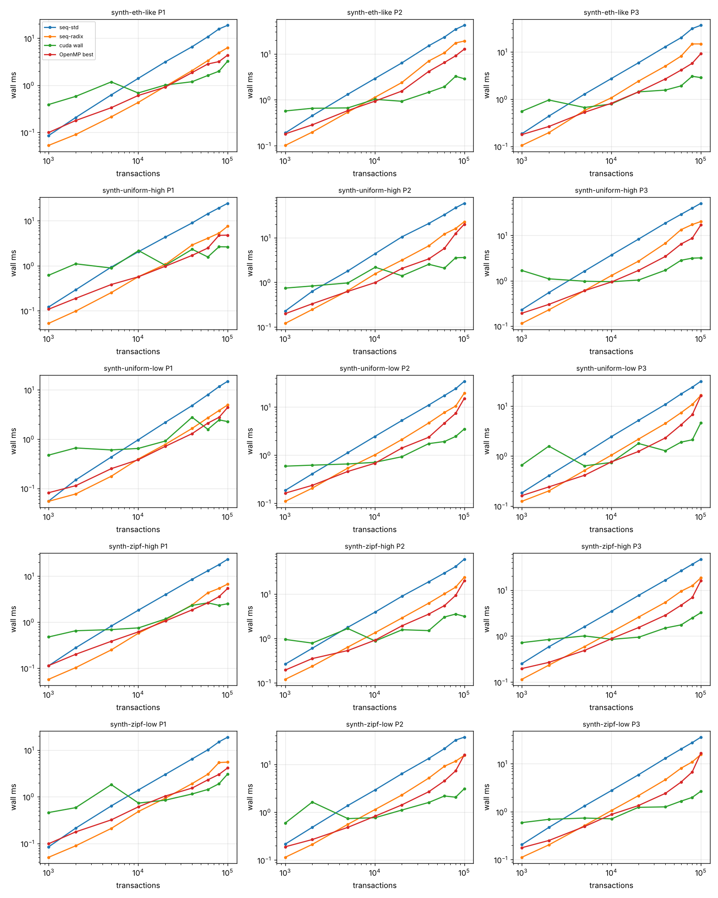
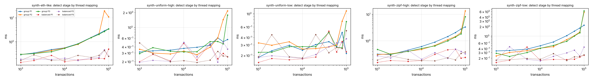

# Phases 8-10 results

## Machine (non-negotiable 4)

```
date: 2026-11-01T09:27:29Z
host: Nikhil-PC   corpus: corpus_synth (synthetic)
git: c72b087
runs: 2 warm-up + 7 measured, median reported; omp threads 1,2,4,8,12
OMP_PROC_BIND=close OMP_PLACES=cores

Linux Nikhil-PC 6.18.54.1-microsoft-standard-WSL2 #1 SMP PREEMPT_DYNAMIC Tue Oct  6 19:13:07 UTC 2026 x86_64 x86_64 x86_64 GNU/Linux
WSL2: yes

PRETTY_NAME="Ubuntu 24.04.5 LTS"
NAME="Ubuntu"
VERSION_ID="24.04"
VERSION="24.04.5 LTS (Noble Numbat)"

CPU(s):                                  12
Model name:                              13th Gen Intel(R) Core(TM) i5-13420H
Thread(s) per core:                      2
Core(s) per socket:                      6
Socket(s):                               1
L2 cache:                                7.5 MiB (6 instances)
L3 cache:                                12 MiB (1 instance)

               total        used        free      shared  buff/cache   available
Mem:           7.6Gi       460Mi       6.2Gi       3.6Mi       1.1Gi       7.1Gi
Swap:          2.0Gi          0B       2.0Gi

name, memory.total [MiB], driver_version, pcie.link.gen.max, pcie.link.width.max, clocks.max.sm [MHz]
NVIDIA GeForce RTX 4050 Laptop GPU, 6141 MiB, 610.91, 4, 8, 3105 MHz

Cuda compilation tools, release 12.6, V12.6.85
Build cuda_12.6.r12.6/compiler.35059454_0

c++ (Ubuntu 13.3.0-6ubuntu2~24.04.1) 13.3.0
cmake version 3.28.3
```

## Correctness gates (non-negotiable 1: no timing without correctness)

| check | result | last line |
|---|---|---|
| tests.txt | PASS | 36 tests, 0 failed checks |
| stages.txt | not run | |
| verify.txt | PASS | ALL GPU CHECKS PASSED |
| identical.txt | not run | |
| validator.txt | not run | |

## Phase 8: end to end, wall time (ms, median)

GPU = balanced detection + sequential sweep for levelling (as the handover asks), transfers and host staging included. `device` = H2D + kernels + D2H on the GPU timeline; `kernels` = stages 1-3 kernels only.

| day | n | pol | seq-std | seq-radix | OpenMP best (threads) | GPU wall | GPU device | GPU kernels | vs seq-std | vs seq-radix | vs OpenMP |
|---|---:|---|---:|---:|---:|---:|---:|---:|---:|---:|---:|
| synth-eth-like | 1,000 | P1 | 0.09 | 0.05 | 0.10 (1) | 0.39 | 0.33 | 0.30 | 0.22x | 0.14x | 0.25x |
| synth-eth-like | 2,000 | P1 | 0.21 | 0.09 | 0.18 (1) | 0.58 | 0.51 | 0.46 | 0.36x | 0.15x | 0.31x |
| synth-eth-like | 5,000 | P1 | 0.63 | 0.21 | 0.33 (4) | 1.18 | 1.06 | 0.94 | 0.53x | 0.18x | 0.28x |
| synth-eth-like | 10,001 | P1 | 1.40 | 0.43 | 0.61 (8) | 0.69 | 0.60 | 0.51 | 2.04x | 0.63x | 0.88x |
| synth-eth-like | 20,031 | P1 | 3.14 | 0.94 | 0.91 (4) | 1.01 | 0.83 | 0.64 | 3.10x | 0.93x | 0.90x |
| synth-eth-like | 40,060 | P1 | 6.60 | 2.05 | 1.86 (8) | 1.19 | 0.92 | 0.56 | 5.55x | 1.73x | 1.57x |
| synth-eth-like | 60,070 | P1 | 10.75 | 3.35 | 2.83 (8) | 1.62 | 1.23 | 0.66 | 6.65x | 2.07x | 1.75x |
| synth-eth-like | 80,001 | P1 | 15.75 | 4.91 | 3.19 (8) | 1.99 | 1.41 | 0.68 | 7.91x | 2.47x | 1.60x |
| synth-eth-like | 100,119 | P1 | 18.83 | 6.32 | 4.39 (8) | 3.26 | 2.62 | 1.69 | 5.78x | 1.94x | 1.35x |
| synth-eth-like | 1,000 | P2 | 0.19 | 0.10 | 0.18 (2) | 0.57 | 0.50 | 0.46 | 0.33x | 0.18x | 0.32x |
| synth-eth-like | 2,000 | P2 | 0.45 | 0.20 | 0.28 (2) | 0.65 | 0.59 | 0.54 | 0.69x | 0.30x | 0.44x |
| synth-eth-like | 5,000 | P2 | 1.32 | 0.54 | 0.58 (8) | 0.66 | 0.59 | 0.51 | 1.98x | 0.81x | 0.87x |
| synth-eth-like | 10,001 | P2 | 2.89 | 1.13 | 0.93 (8) | 1.02 | 0.90 | 0.74 | 2.83x | 1.10x | 0.91x |
| synth-eth-like | 20,031 | P2 | 6.34 | 2.37 | 1.54 (8) | 0.93 | 0.81 | 0.57 | 6.84x | 2.55x | 1.67x |
| synth-eth-like | 40,060 | P2 | 14.98 | 6.97 | 4.13 (8) | 1.46 | 1.16 | 0.68 | 10.29x | 4.79x | 2.84x |
| synth-eth-like | 60,070 | P2 | 23.22 | 10.57 | 6.48 (8) | 1.93 | 1.56 | 0.80 | 12.06x | 5.49x | 3.36x |
| synth-eth-like | 80,001 | P2 | 34.31 | 17.28 | 9.06 (8) | 3.24 | 2.72 | 1.60 | 10.59x | 5.33x | 2.80x |
| synth-eth-like | 100,119 | P2 | 41.91 | 19.00 | 12.66 (8) | 2.87 | 2.24 | 0.96 | 14.61x | 6.62x | 4.41x |
| synth-eth-like | 1,000 | P3 | 0.19 | 0.11 | 0.18 (2) | 0.56 | 0.49 | 0.46 | 0.33x | 0.19x | 0.32x |
| synth-eth-like | 2,000 | P3 | 0.44 | 0.20 | 0.26 (4) | 0.96 | 0.89 | 0.81 | 0.46x | 0.20x | 0.27x |
| synth-eth-like | 5,000 | P3 | 1.28 | 0.58 | 0.53 (4) | 0.67 | 0.59 | 0.52 | 1.92x | 0.86x | 0.79x |
| synth-eth-like | 10,001 | P3 | 2.74 | 1.07 | 0.82 (4) | 0.79 | 0.68 | 0.56 | 3.46x | 1.35x | 1.03x |
| synth-eth-like | 20,031 | P3 | 5.88 | 2.40 | 1.43 (8) | 1.43 | 1.24 | 0.96 | 4.12x | 1.68x | 1.00x |
| synth-eth-like | 40,060 | P3 | 12.88 | 5.01 | 2.68 (8) | 1.56 | 1.24 | 0.75 | 8.27x | 3.22x | 1.72x |
| synth-eth-like | 60,070 | P3 | 20.07 | 8.17 | 4.13 (8) | 1.91 | 1.60 | 0.86 | 10.50x | 4.27x | 2.16x |
| synth-eth-like | 80,001 | P3 | 31.32 | 14.79 | 5.75 (8) | 3.06 | 2.45 | 1.47 | 10.24x | 4.84x | 1.88x |
| synth-eth-like | 100,119 | P3 | 36.71 | 14.80 | 9.25 (8) | 2.86 | 2.21 | 0.99 | 12.83x | 5.17x | 3.23x |
| synth-uniform-high | 1,000 | P1 | 0.12 | 0.05 | 0.11 (1) | 0.62 | 0.52 | 0.48 | 0.20x | 0.09x | 0.18x |
| synth-uniform-high | 2,000 | P1 | 0.29 | 0.10 | 0.19 (2) | 1.10 | 0.99 | 0.94 | 0.26x | 0.09x | 0.17x |
| synth-uniform-high | 5,000 | P1 | 0.93 | 0.25 | 0.38 (4) | 0.89 | 0.79 | 0.69 | 1.05x | 0.28x | 0.43x |
| synth-uniform-high | 10,114 | P1 | 2.05 | 0.57 | 0.57 (4) | 2.17 | 1.97 | 1.67 | 0.95x | 0.26x | 0.26x |
| synth-uniform-high | 20,155 | P1 | 4.33 | 1.07 | 0.98 (4) | 1.02 | 0.85 | 0.67 | 4.25x | 1.05x | 0.96x |
| synth-uniform-high | 40,189 | P1 | 8.95 | 2.89 | 1.70 (8) | 2.32 | 1.97 | 1.57 | 3.86x | 1.25x | 0.73x |
| synth-uniform-high | 60,032 | P1 | 14.27 | 4.09 | 2.47 (8) | 1.57 | 1.18 | 0.69 | 9.12x | 2.61x | 1.58x |
| synth-uniform-high | 80,061 | P1 | 19.25 | 5.29 | 4.73 (8) | 2.64 | 1.81 | 1.00 | 7.29x | 2.01x | 1.79x |
| synth-uniform-high | 100,081 | P1 | 24.38 | 7.54 | 4.78 (8) | 2.62 | 1.85 | 0.85 | 9.30x | 2.88x | 1.82x |
| synth-uniform-high | 1,000 | P2 | 0.23 | 0.12 | 0.20 (2) | 0.74 | 0.64 | 0.60 | 0.31x | 0.16x | 0.27x |
| synth-uniform-high | 2,000 | P2 | 0.63 | 0.25 | 0.33 (4) | 0.83 | 0.73 | 0.69 | 0.76x | 0.30x | 0.40x |
| synth-uniform-high | 5,000 | P2 | 1.80 | 0.65 | 0.63 (8) | 0.97 | 0.87 | 0.76 | 1.85x | 0.67x | 0.64x |
| synth-uniform-high | 10,114 | P2 | 4.42 | 1.56 | 0.99 (8) | 2.18 | 2.03 | 1.75 | 2.03x | 0.72x | 0.45x |
| synth-uniform-high | 20,155 | P2 | 10.51 | 3.16 | 2.06 (8) | 1.41 | 1.20 | 0.87 | 7.48x | 2.25x | 1.46x |
| synth-uniform-high | 40,189 | P2 | 20.95 | 6.60 | 3.36 (8) | 2.54 | 2.22 | 1.60 | 8.24x | 2.60x | 1.32x |
| synth-uniform-high | 60,032 | P2 | 32.97 | 12.13 | 5.78 (8) | 2.09 | 1.62 | 0.78 | 15.81x | 5.82x | 2.77x |
| synth-uniform-high | 80,061 | P2 | 47.00 | 16.13 | 12.48 (8) | 3.57 | 2.90 | 1.64 | 13.17x | 4.52x | 3.50x |
| synth-uniform-high | 100,081 | P2 | 59.35 | 22.91 | 20.14 (8) | 3.61 | 2.79 | 1.35 | 16.45x | 6.35x | 5.58x |
| synth-uniform-high | 1,000 | P3 | 0.23 | 0.11 | 0.19 (2) | 1.68 | 1.56 | 1.39 | 0.14x | 0.07x | 0.11x |
| synth-uniform-high | 2,000 | P3 | 0.55 | 0.23 | 0.30 (4) | 1.10 | 0.87 | 0.81 | 0.50x | 0.21x | 0.27x |
| synth-uniform-high | 5,000 | P3 | 1.63 | 0.60 | 0.60 (4) | 0.98 | 0.88 | 0.76 | 1.67x | 0.62x | 0.62x |
| synth-uniform-high | 10,114 | P3 | 3.74 | 1.32 | 0.95 (4) | 0.95 | 0.85 | 0.69 | 3.94x | 1.39x | 1.00x |
| synth-uniform-high | 20,155 | P3 | 8.33 | 2.72 | 1.70 (8) | 1.04 | 0.89 | 0.63 | 8.04x | 2.62x | 1.64x |
| synth-uniform-high | 40,189 | P3 | 18.83 | 6.76 | 3.45 (8) | 1.71 | 1.26 | 0.72 | 11.01x | 3.95x | 2.02x |
| synth-uniform-high | 60,032 | P3 | 29.31 | 13.45 | 6.47 (8) | 2.83 | 1.92 | 0.95 | 10.35x | 4.75x | 2.29x |
| synth-uniform-high | 80,061 | P3 | 40.12 | 17.40 | 8.71 (8) | 3.15 | 2.32 | 0.98 | 12.73x | 5.52x | 2.76x |
| synth-uniform-high | 100,081 | P3 | 51.45 | 20.33 | 17.13 (8) | 3.20 | 2.49 | 1.04 | 16.06x | 6.35x | 5.35x |
| synth-uniform-low | 1,000 | P1 | 0.06 | 0.05 | 0.08 (1) | 0.47 | 0.38 | 0.34 | 0.12x | 0.12x | 0.17x |
| synth-uniform-low | 2,000 | P1 | 0.15 | 0.08 | 0.11 (1) | 0.66 | 0.56 | 0.48 | 0.22x | 0.12x | 0.17x |
| synth-uniform-low | 5,000 | P1 | 0.43 | 0.18 | 0.25 (2) | 0.60 | 0.51 | 0.45 | 0.72x | 0.29x | 0.42x |
| synth-uniform-low | 10,009 | P1 | 0.97 | 0.39 | 0.38 (4) | 0.65 | 0.53 | 0.46 | 1.50x | 0.61x | 0.59x |
| synth-uniform-low | 20,088 | P1 | 2.19 | 0.78 | 0.71 (8) | 0.91 | 0.77 | 0.65 | 2.39x | 0.85x | 0.78x |
| synth-uniform-low | 40,062 | P1 | 4.79 | 1.65 | 1.29 (8) | 2.78 | 2.53 | 1.77 | 1.73x | 0.59x | 0.47x |
| synth-uniform-low | 60,099 | P1 | 7.98 | 2.70 | 2.11 (8) | 1.58 | 1.21 | 0.81 | 5.05x | 1.71x | 1.34x |
| synth-uniform-low | 80,268 | P1 | 11.64 | 3.81 | 2.77 (8) | 2.45 | 1.88 | 1.14 | 4.75x | 1.55x | 1.13x |
| synth-uniform-low | 100,098 | P1 | 14.94 | 4.94 | 4.39 (8) | 2.27 | 1.67 | 0.91 | 6.58x | 2.17x | 1.93x |
| synth-uniform-low | 1,000 | P2 | 0.18 | 0.11 | 0.16 (2) | 0.59 | 0.48 | 0.45 | 0.31x | 0.19x | 0.27x |
| synth-uniform-low | 2,000 | P2 | 0.41 | 0.20 | 0.23 (4) | 0.62 | 0.52 | 0.48 | 0.66x | 0.33x | 0.38x |
| synth-uniform-low | 5,000 | P2 | 1.12 | 0.54 | 0.46 (4) | 0.65 | 0.54 | 0.50 | 1.72x | 0.82x | 0.70x |
| synth-uniform-low | 10,009 | P2 | 2.44 | 1.01 | 0.68 (4) | 0.71 | 0.59 | 0.52 | 3.45x | 1.43x | 0.96x |
| synth-uniform-low | 20,088 | P2 | 5.24 | 2.11 | 1.40 (8) | 0.92 | 0.79 | 0.68 | 5.67x | 2.28x | 1.52x |
| synth-uniform-low | 40,062 | P2 | 10.97 | 4.65 | 2.35 (8) | 1.73 | 1.40 | 1.14 | 6.34x | 2.69x | 1.35x |
| synth-uniform-low | 60,099 | P2 | 17.33 | 7.70 | 4.63 (8) | 1.91 | 1.56 | 1.23 | 9.06x | 4.03x | 2.42x |
| synth-uniform-low | 80,268 | P2 | 24.04 | 10.48 | 7.41 (8) | 2.44 | 1.98 | 1.51 | 9.84x | 4.29x | 3.03x |
| synth-uniform-low | 100,098 | P2 | 34.36 | 19.42 | 15.13 (8) | 3.49 | 2.61 | 1.95 | 9.84x | 5.56x | 4.33x |
| synth-uniform-low | 1,000 | P3 | 0.18 | 0.12 | 0.16 (1) | 0.66 | 0.52 | 0.48 | 0.28x | 0.19x | 0.24x |
| synth-uniform-low | 2,000 | P3 | 0.41 | 0.20 | 0.24 (4) | 1.58 | 1.48 | 1.32 | 0.26x | 0.13x | 0.15x |
| synth-uniform-low | 5,000 | P3 | 1.12 | 0.52 | 0.41 (4) | 0.64 | 0.54 | 0.49 | 1.75x | 0.81x | 0.65x |
| synth-uniform-low | 10,009 | P3 | 2.45 | 1.04 | 0.76 (8) | 0.75 | 0.63 | 0.55 | 3.29x | 1.40x | 1.03x |
| synth-uniform-low | 20,088 | P3 | 5.19 | 2.19 | 1.24 (8) | 1.79 | 1.54 | 1.35 | 2.90x | 1.22x | 0.69x |
| synth-uniform-low | 40,062 | P3 | 10.85 | 4.50 | 2.31 (8) | 1.28 | 1.09 | 0.87 | 8.48x | 3.52x | 1.81x |
| synth-uniform-low | 60,099 | P3 | 17.56 | 7.41 | 4.23 (8) | 1.90 | 1.56 | 1.21 | 9.23x | 3.89x | 2.22x |
| synth-uniform-low | 80,268 | P3 | 24.05 | 10.85 | 6.76 (8) | 2.12 | 1.71 | 1.22 | 11.34x | 5.12x | 3.19x |
| synth-uniform-low | 100,098 | P3 | 31.58 | 16.45 | 16.28 (8) | 4.67 | 4.02 | 3.06 | 6.76x | 3.52x | 3.48x |
| synth-zipf-high | 1,000 | P1 | 0.11 | 0.06 | 0.11 (1) | 0.48 | 0.39 | 0.35 | 0.24x | 0.12x | 0.24x |
| synth-zipf-high | 2,000 | P1 | 0.28 | 0.10 | 0.20 (1) | 0.65 | 0.55 | 0.49 | 0.43x | 0.16x | 0.31x |
| synth-zipf-high | 5,000 | P1 | 0.82 | 0.25 | 0.38 (4) | 0.69 | 0.60 | 0.54 | 1.19x | 0.36x | 0.56x |
| synth-zipf-high | 10,115 | P1 | 1.83 | 0.58 | 0.62 (8) | 0.75 | 0.65 | 0.54 | 2.44x | 0.77x | 0.82x |
| synth-zipf-high | 20,256 | P1 | 3.98 | 1.13 | 1.06 (8) | 1.17 | 1.01 | 0.76 | 3.39x | 0.96x | 0.90x |
| synth-zipf-high | 40,061 | P1 | 8.50 | 2.37 | 1.84 (8) | 2.31 | 1.98 | 1.55 | 3.68x | 1.03x | 0.80x |
| synth-zipf-high | 60,106 | P1 | 13.08 | 4.34 | 2.63 (8) | 2.62 | 2.15 | 1.57 | 4.99x | 1.66x | 1.00x |
| synth-zipf-high | 80,168 | P1 | 17.80 | 5.41 | 3.59 (8) | 2.31 | 1.82 | 0.82 | 7.69x | 2.34x | 1.55x |
| synth-zipf-high | 100,081 | P1 | 23.29 | 6.71 | 5.40 (8) | 2.51 | 1.71 | 0.85 | 9.28x | 2.68x | 2.15x |
| synth-zipf-high | 1,000 | P2 | 0.26 | 0.12 | 0.19 (2) | 0.95 | 0.83 | 0.77 | 0.28x | 0.13x | 0.20x |
| synth-zipf-high | 2,000 | P2 | 0.60 | 0.24 | 0.35 (4) | 0.78 | 0.70 | 0.66 | 0.76x | 0.30x | 0.45x |
| synth-zipf-high | 5,000 | P2 | 1.78 | 0.64 | 0.53 (4) | 1.67 | 1.53 | 1.33 | 1.07x | 0.38x | 0.32x |
| synth-zipf-high | 10,115 | P2 | 3.92 | 1.35 | 0.92 (8) | 0.87 | 0.74 | 0.61 | 4.49x | 1.55x | 1.05x |
| synth-zipf-high | 20,256 | P2 | 8.95 | 2.91 | 1.93 (8) | 1.57 | 1.42 | 1.06 | 5.71x | 1.86x | 1.23x |
| synth-zipf-high | 40,061 | P2 | 18.78 | 6.20 | 3.52 (8) | 1.50 | 1.20 | 0.72 | 12.55x | 4.14x | 2.35x |
| synth-zipf-high | 60,106 | P2 | 29.68 | 10.09 | 5.47 (8) | 3.03 | 2.54 | 1.76 | 9.80x | 3.33x | 1.81x |
| synth-zipf-high | 80,168 | P2 | 41.52 | 14.24 | 9.31 (8) | 3.53 | 2.61 | 1.25 | 11.75x | 4.03x | 2.63x |
| synth-zipf-high | 100,081 | P2 | 60.64 | 23.87 | 19.94 (8) | 3.14 | 2.44 | 1.18 | 19.34x | 7.61x | 6.36x |
| synth-zipf-high | 1,000 | P3 | 0.25 | 0.12 | 0.20 (4) | 0.72 | 0.61 | 0.56 | 0.35x | 0.16x | 0.27x |
| synth-zipf-high | 2,000 | P3 | 0.59 | 0.23 | 0.27 (4) | 0.84 | 0.74 | 0.71 | 0.70x | 0.28x | 0.32x |
| synth-zipf-high | 5,000 | P3 | 1.60 | 0.59 | 0.49 (4) | 1.01 | 0.85 | 0.64 | 1.59x | 0.59x | 0.48x |
| synth-zipf-high | 10,115 | P3 | 3.51 | 1.24 | 0.89 (4) | 0.85 | 0.74 | 0.62 | 4.12x | 1.45x | 1.04x |
| synth-zipf-high | 20,256 | P3 | 7.72 | 2.60 | 1.54 (8) | 0.95 | 0.80 | 0.58 | 8.16x | 2.75x | 1.63x |
| synth-zipf-high | 40,061 | P3 | 16.50 | 5.43 | 2.84 (8) | 1.50 | 1.22 | 0.80 | 11.00x | 3.62x | 1.90x |
| synth-zipf-high | 60,106 | P3 | 26.27 | 9.48 | 4.69 (8) | 1.75 | 1.34 | 0.75 | 15.00x | 5.41x | 2.68x |
| synth-zipf-high | 80,168 | P3 | 36.49 | 12.46 | 6.90 (8) | 2.48 | 1.82 | 0.99 | 14.69x | 5.01x | 2.78x |
| synth-zipf-high | 100,081 | P3 | 47.02 | 18.56 | 16.18 (8) | 3.23 | 2.45 | 1.40 | 14.56x | 5.75x | 5.01x |
| synth-zipf-low | 1,000 | P1 | 0.08 | 0.05 | 0.10 (1) | 0.46 | 0.36 | 0.33 | 0.18x | 0.11x | 0.22x |
| synth-zipf-low | 2,000 | P1 | 0.21 | 0.09 | 0.18 (2) | 0.58 | 0.49 | 0.46 | 0.36x | 0.15x | 0.30x |
| synth-zipf-low | 5,000 | P1 | 0.64 | 0.21 | 0.32 (4) | 1.82 | 1.70 | 1.54 | 0.35x | 0.12x | 0.18x |
| synth-zipf-low | 10,100 | P1 | 1.40 | 0.48 | 0.61 (8) | 0.73 | 0.63 | 0.54 | 1.92x | 0.66x | 0.83x |
| synth-zipf-low | 20,003 | P1 | 2.99 | 0.93 | 1.03 (8) | 0.84 | 0.70 | 0.54 | 3.55x | 1.10x | 1.23x |
| synth-zipf-low | 40,197 | P1 | 6.46 | 1.92 | 1.54 (8) | 1.15 | 0.89 | 0.58 | 5.63x | 1.67x | 1.34x |
| synth-zipf-low | 60,055 | P1 | 10.09 | 3.03 | 2.30 (8) | 1.43 | 1.08 | 0.60 | 7.05x | 2.12x | 1.61x |
| synth-zipf-low | 80,103 | P1 | 14.98 | 5.40 | 3.01 (8) | 1.90 | 1.41 | 0.74 | 7.89x | 2.84x | 1.59x |
| synth-zipf-low | 100,103 | P1 | 18.85 | 5.51 | 4.14 (8) | 3.07 | 1.86 | 0.86 | 6.14x | 1.79x | 1.35x |
| synth-zipf-low | 1,000 | P2 | 0.22 | 0.11 | 0.19 (2) | 0.59 | 0.50 | 0.47 | 0.36x | 0.19x | 0.32x |
| synth-zipf-low | 2,000 | P2 | 0.48 | 0.21 | 0.27 (4) | 1.62 | 1.51 | 1.36 | 0.30x | 0.13x | 0.17x |
| synth-zipf-low | 5,000 | P2 | 1.38 | 0.56 | 0.48 (4) | 0.73 | 0.63 | 0.56 | 1.87x | 0.76x | 0.66x |
| synth-zipf-low | 10,100 | P2 | 2.92 | 1.14 | 0.83 (8) | 0.77 | 0.66 | 0.56 | 3.81x | 1.48x | 1.08x |
| synth-zipf-low | 20,003 | P2 | 6.32 | 2.27 | 1.41 (8) | 1.11 | 0.96 | 0.79 | 5.72x | 2.06x | 1.28x |
| synth-zipf-low | 40,197 | P2 | 13.26 | 5.16 | 2.68 (8) | 1.60 | 1.33 | 0.98 | 8.31x | 3.23x | 1.68x |
| synth-zipf-low | 60,055 | P2 | 21.17 | 9.08 | 4.50 (8) | 2.17 | 1.65 | 1.08 | 9.73x | 4.17x | 2.07x |
| synth-zipf-low | 80,103 | P2 | 31.97 | 11.61 | 7.28 (8) | 2.05 | 1.58 | 0.90 | 15.57x | 5.65x | 3.54x |
| synth-zipf-low | 100,103 | P2 | 36.77 | 15.32 | 15.69 (8) | 3.09 | 2.48 | 1.57 | 11.90x | 4.96x | 5.08x |
| synth-zipf-low | 1,000 | P3 | 0.21 | 0.11 | 0.18 (2) | 0.59 | 0.50 | 0.47 | 0.35x | 0.19x | 0.30x |
| synth-zipf-low | 2,000 | P3 | 0.47 | 0.20 | 0.25 (4) | 0.69 | 0.59 | 0.54 | 0.68x | 0.29x | 0.36x |
| synth-zipf-low | 5,000 | P3 | 1.32 | 0.51 | 0.49 (4) | 0.74 | 0.59 | 0.52 | 1.79x | 0.69x | 0.66x |
| synth-zipf-low | 10,100 | P3 | 2.79 | 1.07 | 0.88 (4) | 0.71 | 0.61 | 0.53 | 3.93x | 1.50x | 1.24x |
| synth-zipf-low | 20,003 | P3 | 5.88 | 2.15 | 1.34 (4) | 1.23 | 1.07 | 0.90 | 4.77x | 1.75x | 1.09x |
| synth-zipf-low | 40,197 | P3 | 13.06 | 4.66 | 2.42 (8) | 1.26 | 1.00 | 0.72 | 10.36x | 3.70x | 1.92x |
| synth-zipf-low | 60,055 | P3 | 20.33 | 8.09 | 4.15 (8) | 1.66 | 1.29 | 0.81 | 12.23x | 4.86x | 2.50x |
| synth-zipf-low | 80,103 | P3 | 27.67 | 10.93 | 6.76 (8) | 1.99 | 1.52 | 0.88 | 13.92x | 5.50x | 3.40x |
| synth-zipf-low | 100,103 | P3 | 35.94 | 15.67 | 16.82 (8) | 2.68 | 1.87 | 1.08 | 13.43x | 5.85x | 6.28x |

### Crossover (wall time, transfers charged)

Measured = smallest tested size where the GPU is faster. Model = least-squares lines t = a + b·n through each implementation's points at n ≤ 20k (the region around the crossover); the model crossover is where the lines meet, n* = (a_gpu − a_cpu) / (b_cpu − b_gpu). a_gpu is the GPU's fixed cost per call (launches, synchronisations, transfer latency), b the cost per transaction.

| day | pol | beats seq-radix at n ≥ (measured) | model n* vs seq-radix | beats OpenMP at n ≥ (measured) | model n* vs OpenMP | GPU fixed cost a (ms) |
|---|---|---:|---:|---:|---:|---:|
| synth-eth-like | P1 | 40060 | 52,783 | 40060 | 21,625 | 0.567 |
| synth-eth-like | P2 | 10001 | 8,026 | 20031 | 11,068 | 0.513 |
| synth-eth-like | P3 | 10001 | 7,026 | 10001 | 9,127 | 0.712 |
| synth-uniform-high | P1 | 20155 | never | 60032 | never | 0.511 |
| synth-uniform-high | P2 | 20155 | 416,122 | 20155 | never | 0.469 |
| synth-uniform-high | P3 | 10114 | 7,724 | 20155 | 9,267 | 1.444 |
| synth-uniform-low | P1 | 60099 | 20,093 | 60099 | 21,760 | 0.546 |
| synth-uniform-low | P2 | 10009 | 6,505 | 20088 | 10,327 | 0.585 |
| synth-uniform-low | P3 | 10009 | 7,596 | 10009 | 9,432 | 1.077 |
| synth-zipf-high | P1 | 40061 | 16,267 | 60106 | 14,808 | 0.534 |
| synth-zipf-high | P2 | 10115 | 8,257 | 10115 | 12,832 | 1.037 |
| synth-zipf-high | P3 | 10115 | 7,318 | 10115 | 10,647 | 0.805 |
| synth-zipf-low | P1 | 20003 | 67,888 | 20003 | 37,478 | 0.731 |
| synth-zipf-low | P2 | 10100 | 7,459 | 10100 | 9,365 | 1.072 |
| synth-zipf-low | P3 | 10100 | 6,708 | 10100 | 7,968 | 0.639 |

### Transfer-cost arithmetic (largest super-block per day and policy)

Bytes moved: H2D = 40·n (the transaction records); D2H = 8·(n+1) row offsets + 4·m column indices (+ 4·n levels when levelling on the GPU). Measured times are cudaEvent intervals; the share is of GPU wall time. Host prep = id check + copy into the pinned staging buffer; host post = copy out of the pinned buffers.

| day | pol | n | H2D MB | D2H MB | H2D ms (pred.) | D2H ms (pred.) | transfer % of wall | host prep ms | host post ms | wall − device ms |
|---|---|---:|---:|---:|---:|---:|---:|---:|---:|---:|
| synth-eth-like | P1 | 100,119 | 4.0 | 1.2 | 0.33 (–) | 0.15 (–) | 15% | – | – | 0.63 |
| synth-eth-like | P2 | 100,119 | 4.0 | 1.5 | 0.33 (–) | 0.15 (–) | 17% | – | – | 0.63 |
| synth-eth-like | P3 | 100,119 | 4.0 | 1.3 | 0.33 (–) | 0.14 (–) | 16% | – | – | 0.65 |
| synth-uniform-high | P1 | 100,081 | 4.0 | 1.6 | 0.35 (–) | 0.17 (–) | 20% | – | – | 0.77 |
| synth-uniform-high | P2 | 100,081 | 4.0 | 2.3 | 0.33 (–) | 0.22 (–) | 15% | – | – | 0.82 |
| synth-uniform-high | P3 | 100,081 | 4.0 | 2.0 | 0.33 (–) | 0.19 (–) | 16% | – | – | 0.71 |
| synth-uniform-low | P1 | 100,098 | 4.0 | 1.0 | 0.33 (–) | 0.10 (–) | 19% | – | – | 0.60 |
| synth-uniform-low | P2 | 100,098 | 4.0 | 0.9 | 0.34 (–) | 0.11 (–) | 13% | – | – | 0.88 |
| synth-uniform-low | P3 | 100,098 | 4.0 | 0.8 | 0.62 (–) | 0.16 (–) | 17% | – | – | 0.65 |
| synth-zipf-high | P1 | 100,081 | 4.0 | 1.5 | 0.33 (–) | 0.16 (–) | 20% | – | – | 0.80 |
| synth-zipf-high | P2 | 100,081 | 4.0 | 1.9 | 0.33 (–) | 0.21 (–) | 17% | – | – | 0.70 |
| synth-zipf-high | P3 | 100,081 | 4.0 | 1.6 | 0.33 (–) | 0.17 (–) | 15% | – | – | 0.78 |
| synth-zipf-low | P1 | 100,103 | 4.0 | 1.2 | 0.35 (–) | 0.15 (–) | 16% | – | – | 1.21 |
| synth-zipf-low | P2 | 100,103 | 4.0 | 1.2 | 0.33 (–) | 0.14 (–) | 15% | – | – | 0.60 |
| synth-zipf-low | P3 | 100,103 | 4.0 | 1.0 | 0.34 (–) | 0.11 (–) | 17% | – | – | 0.80 |

## GPU stage breakdown at the largest super-block (ms)

| day | pol | n | H2D | extract | sort | detect | csr | D2H | level (CPU sweep) | device | wall | launches | host syncs | device MB |
|---|---|---:|---:|---:|---:|---:|---:|---:|---:|---:|---:|---:|---:|---:|
| synth-eth-like | P1 | 100,119 | 0.33 | 0.15 | 0.55 | 0.49 | 0.48 | 0.15 | 0.45 | 2.62 | 3.26 | 17 | 6 | 68.5 |
| synth-eth-like | P2 | 100,119 | 0.33 | 0.26 | 0.24 | 0.25 | 0.19 | 0.15 | 0.81 | 2.24 | 2.87 | 17 | 6 | 80.5 |
| synth-eth-like | P3 | 100,119 | 0.33 | 0.29 | 0.24 | 0.24 | 0.20 | 0.14 | 0.74 | 2.21 | 2.86 | 17 | 6 | 80.5 |
| synth-uniform-high | P1 | 100,081 | 0.35 | 0.16 | 0.16 | 0.25 | 0.20 | 0.17 | 0.34 | 1.85 | 2.62 | 17 | 6 | 93.5 |
| synth-uniform-high | P2 | 100,081 | 0.33 | 0.34 | 0.33 | 0.36 | 0.27 | 0.22 | 0.87 | 2.79 | 3.61 | 17 | 6 | 96.5 |
| synth-uniform-high | P3 | 100,081 | 0.33 | 0.31 | 0.26 | 0.25 | 0.25 | 0.19 | 0.89 | 2.49 | 3.20 | 17 | 6 | 96.5 |
| synth-uniform-low | P1 | 100,098 | 0.33 | 0.18 | 0.22 | 0.23 | 0.23 | 0.10 | 0.32 | 1.67 | 2.27 | 17 | 6 | 88.7 |
| synth-uniform-low | P2 | 100,098 | 0.34 | 0.47 | 0.57 | 0.38 | 0.52 | 0.11 | 0.21 | 2.61 | 3.49 | 17 | 6 | 88.7 |
| synth-uniform-low | P3 | 100,098 | 0.62 | 0.94 | 1.19 | 0.52 | 0.38 | 0.16 | 0.17 | 4.02 | 4.67 | 17 | 6 | 88.7 |
| synth-zipf-high | P1 | 100,081 | 0.33 | 0.17 | 0.17 | 0.23 | 0.28 | 0.16 | 0.37 | 1.71 | 2.51 | 17 | 6 | 96.5 |
| synth-zipf-high | P2 | 100,081 | 0.33 | 0.30 | 0.26 | 0.32 | 0.29 | 0.21 | 0.71 | 2.44 | 3.14 | 17 | 6 | 96.5 |
| synth-zipf-high | P3 | 100,081 | 0.33 | 0.29 | 0.26 | 0.38 | 0.30 | 0.17 | 0.56 | 2.45 | 3.23 | 17 | 6 | 96.5 |
| synth-zipf-low | P1 | 100,103 | 0.35 | 0.20 | 0.20 | 0.25 | 0.30 | 0.15 | 0.45 | 1.86 | 3.07 | 17 | 6 | 96.5 |
| synth-zipf-low | P2 | 100,103 | 0.33 | 0.28 | 0.33 | 0.45 | 0.50 | 0.14 | 0.40 | 2.48 | 3.09 | 17 | 6 | 96.5 |
| synth-zipf-low | P3 | 100,103 | 0.34 | 0.31 | 0.27 | 0.26 | 0.23 | 0.11 | 0.37 | 1.87 | 2.68 | 17 | 6 | 96.5 |

## Phase 9: skew (detection stage, three thread mappings)

Before = one thread per key group (`group`); `record` = one thread per record; after = one thread per output edge (`balanced`, load-balanced search). Imbalance = max ÷ mean work per thread, computed from the key groups (1.0 = even). Recovery = group time ÷ mapping time.

Detect time across sizes (from the factorial sweep):

| day | pol | n | largest group | group ms | record ms | balanced ms | recovery |
|---|---|---:|---:|---:|---:|---:|---:|
| synth-eth-like | P1 | 1,000 | 142 | 0.289 | – | 0.136 | 2.12x |
| synth-eth-like | P1 | 2,000 | 277 | 0.338 | – | 0.164 | 2.06x |
| synth-eth-like | P1 | 5,000 | 701 | 0.468 | – | 0.269 | 1.74x |
| synth-eth-like | P1 | 10,001 | 1,406 | 0.554 | – | 0.146 | 3.78x |
| synth-eth-like | P1 | 20,031 | 2,891 | 0.820 | – | 0.173 | 4.74x |
| synth-eth-like | P1 | 40,060 | 5,901 | 1.507 | – | 0.184 | 8.18x |
| synth-eth-like | P1 | 60,070 | 8,741 | 2.168 | – | 0.202 | 10.75x |
| synth-eth-like | P1 | 80,001 | 11,664 | 2.845 | – | 0.196 | 14.54x |
| synth-eth-like | P1 | 100,119 | 14,444 | 3.467 | – | 0.490 | 7.07x |
| synth-eth-like | P2 | 1,000 | 142 | 0.295 | – | 0.185 | 1.59x |
| synth-eth-like | P2 | 2,000 | 277 | 0.317 | – | 0.189 | 1.68x |
| synth-eth-like | P2 | 5,000 | 701 | 0.431 | – | 0.180 | 2.39x |
| synth-eth-like | P2 | 10,001 | 1,406 | 0.543 | – | 0.205 | 2.65x |
| synth-eth-like | P2 | 20,031 | 2,891 | 0.773 | – | 0.165 | 4.69x |
| synth-eth-like | P2 | 40,060 | 5,901 | 1.483 | – | 0.208 | 7.13x |
| synth-eth-like | P2 | 60,070 | 8,741 | 2.010 | – | 0.216 | 9.30x |
| synth-eth-like | P2 | 80,001 | 11,664 | 19.334 | – | 0.457 | 42.33x |
| synth-eth-like | P2 | 100,119 | 14,444 | 10.927 | – | 0.251 | 43.55x |
| synth-eth-like | P3 | 1,000 | 142 | 0.295 | – | 0.163 | 1.81x |
| synth-eth-like | P3 | 2,000 | 277 | 0.317 | – | 0.283 | 1.12x |
| synth-eth-like | P3 | 5,000 | 701 | 0.380 | – | 0.164 | 2.32x |
| synth-eth-like | P3 | 10,001 | 1,406 | 0.528 | – | 0.174 | 3.04x |
| synth-eth-like | P3 | 20,031 | 2,891 | 0.806 | – | 0.268 | 3.00x |
| synth-eth-like | P3 | 40,060 | 5,901 | 1.463 | – | 0.220 | 6.65x |
| synth-eth-like | P3 | 60,070 | 8,741 | 2.020 | – | 0.268 | 7.53x |
| synth-eth-like | P3 | 80,001 | 11,664 | 2.687 | – | 0.429 | 6.26x |
| synth-eth-like | P3 | 100,119 | 14,444 | 3.416 | – | 0.244 | 14.02x |
| synth-uniform-high | P1 | 1,000 | 21 | 0.313 | – | 0.199 | 1.58x |
| synth-uniform-high | P1 | 2,000 | 30 | 0.332 | – | 0.281 | 1.18x |
| synth-uniform-high | P1 | 5,000 | 66 | 0.342 | – | 0.207 | 1.65x |
| synth-uniform-high | P1 | 10,114 | 115 | 0.373 | – | 0.472 | 0.79x |
| synth-uniform-high | P1 | 20,155 | 215 | 0.391 | – | 0.217 | 1.80x |
| synth-uniform-high | P1 | 40,189 | 399 | 0.432 | – | 0.457 | 0.95x |
| synth-uniform-high | P1 | 60,032 | 594 | 0.609 | – | 0.228 | 2.67x |
| synth-uniform-high | P1 | 80,061 | 781 | 0.508 | – | 0.294 | 1.73x |
| synth-uniform-high | P1 | 100,081 | 976 | 0.564 | – | 0.250 | 2.26x |
| synth-uniform-high | P2 | 1,000 | 21 | 0.358 | – | 0.194 | 1.85x |
| synth-uniform-high | P2 | 2,000 | 30 | 0.299 | – | 0.212 | 1.41x |
| synth-uniform-high | P2 | 5,000 | 66 | 0.286 | – | 0.202 | 1.42x |
| synth-uniform-high | P2 | 10,114 | 115 | 0.327 | – | 0.491 | 0.66x |
| synth-uniform-high | P2 | 20,155 | 215 | 0.277 | – | 0.251 | 1.10x |
| synth-uniform-high | P2 | 40,189 | 399 | 0.393 | – | 0.466 | 0.84x |
| synth-uniform-high | P2 | 60,032 | 594 | 0.603 | – | 0.195 | 3.10x |
| synth-uniform-high | P2 | 80,061 | 781 | 1.441 | – | 0.497 | 2.90x |
| synth-uniform-high | P2 | 100,081 | 976 | 2.156 | – | 0.361 | 5.97x |
| synth-uniform-high | P3 | 1,000 | 21 | 0.291 | – | 0.482 | 0.60x |
| synth-uniform-high | P3 | 2,000 | 30 | 0.385 | – | 0.289 | 1.33x |
| synth-uniform-high | P3 | 5,000 | 66 | 0.326 | – | 0.199 | 1.64x |
| synth-uniform-high | P3 | 10,114 | 115 | 0.315 | – | 0.209 | 1.51x |
| synth-uniform-high | P3 | 20,155 | 215 | 0.317 | – | 0.193 | 1.65x |
| synth-uniform-high | P3 | 40,189 | 399 | 0.511 | – | 0.214 | 2.39x |
| synth-uniform-high | P3 | 60,032 | 594 | 0.514 | – | 0.323 | 1.59x |
| synth-uniform-high | P3 | 80,061 | 781 | 0.462 | – | 0.260 | 1.78x |
| synth-uniform-high | P3 | 100,081 | 976 | 1.783 | – | 0.252 | 7.08x |
| synth-uniform-low | P1 | 1,000 | 3 | 0.185 | – | 0.153 | 1.21x |
| synth-uniform-low | P1 | 2,000 | 4 | 0.239 | – | 0.177 | 1.35x |
| synth-uniform-low | P1 | 5,000 | 4 | 0.295 | – | 0.169 | 1.74x |
| synth-uniform-low | P1 | 10,009 | 4 | 0.245 | – | 0.175 | 1.40x |
| synth-uniform-low | P1 | 20,088 | 5 | 0.304 | – | 0.188 | 1.61x |
| synth-uniform-low | P1 | 40,062 | 7 | 0.340 | – | 0.511 | 0.67x |
| synth-uniform-low | P1 | 60,099 | 8 | 0.282 | – | 0.228 | 1.23x |
| synth-uniform-low | P1 | 80,268 | 9 | 0.486 | – | 0.342 | 1.42x |
| synth-uniform-low | P1 | 100,098 | 10 | 0.216 | – | 0.229 | 0.94x |
| synth-uniform-low | P2 | 1,000 | 3 | 0.325 | – | 0.184 | 1.76x |
| synth-uniform-low | P2 | 2,000 | 4 | 0.296 | – | 0.198 | 1.50x |
| synth-uniform-low | P2 | 5,000 | 4 | 0.339 | – | 0.187 | 1.81x |
| synth-uniform-low | P2 | 10,009 | 4 | 0.255 | – | 0.177 | 1.44x |
| synth-uniform-low | P2 | 20,088 | 5 | 0.260 | – | 0.207 | 1.26x |
| synth-uniform-low | P2 | 40,062 | 7 | 0.278 | – | 0.281 | 0.99x |
| synth-uniform-low | P2 | 60,099 | 8 | 0.299 | – | 0.325 | 0.92x |
| synth-uniform-low | P2 | 80,268 | 9 | 0.748 | – | 0.329 | 2.27x |
| synth-uniform-low | P2 | 100,098 | 10 | 1.113 | – | 0.380 | 2.93x |
| synth-uniform-low | P3 | 1,000 | 3 | 0.225 | – | 0.191 | 1.18x |
| synth-uniform-low | P3 | 2,000 | 4 | 0.226 | – | 0.444 | 0.51x |
| synth-uniform-low | P3 | 5,000 | 4 | 0.280 | – | 0.189 | 1.48x |
| synth-uniform-low | P3 | 10,009 | 4 | 0.281 | – | 0.181 | 1.55x |
| synth-uniform-low | P3 | 20,088 | 5 | 0.280 | – | 0.445 | 0.63x |
| synth-uniform-low | P3 | 40,062 | 7 | 0.485 | – | 0.222 | 2.18x |
| synth-uniform-low | P3 | 60,099 | 8 | 0.272 | – | 0.272 | 1.00x |
| synth-uniform-low | P3 | 80,268 | 9 | 0.268 | – | 0.260 | 1.03x |
| synth-uniform-low | P3 | 100,098 | 10 | 0.739 | – | 0.519 | 1.42x |
| synth-zipf-high | P1 | 1,000 | 142 | 0.314 | – | 0.153 | 2.06x |
| synth-zipf-high | P1 | 2,000 | 280 | 0.301 | – | 0.180 | 1.67x |
| synth-zipf-high | P1 | 5,000 | 715 | 0.445 | – | 0.168 | 2.65x |
| synth-zipf-high | P1 | 10,115 | 1,418 | 0.607 | – | 0.179 | 3.39x |
| synth-zipf-high | P1 | 20,256 | 2,833 | 0.891 | – | 0.306 | 2.91x |
| synth-zipf-high | P1 | 40,061 | 5,559 | 1.446 | – | 0.461 | 3.14x |
| synth-zipf-high | P1 | 60,106 | 8,278 | 2.048 | – | 0.478 | 4.28x |
| synth-zipf-high | P1 | 80,168 | 11,151 | 2.775 | – | 0.220 | 12.60x |
| synth-zipf-high | P1 | 100,081 | 13,864 | 3.345 | – | 0.234 | 14.27x |
| synth-zipf-high | P2 | 1,000 | 142 | 0.301 | – | 0.272 | 1.11x |
| synth-zipf-high | P2 | 2,000 | 280 | 0.320 | – | 0.225 | 1.42x |
| synth-zipf-high | P2 | 5,000 | 715 | 0.402 | – | 0.436 | 0.92x |
| synth-zipf-high | P2 | 10,115 | 1,418 | 0.469 | – | 0.202 | 2.33x |
| synth-zipf-high | P2 | 20,256 | 2,833 | 0.662 | – | 0.357 | 1.85x |
| synth-zipf-high | P2 | 40,061 | 5,559 | 1.112 | – | 0.217 | 5.12x |
| synth-zipf-high | P2 | 60,106 | 8,278 | 1.445 | – | 0.485 | 2.98x |
| synth-zipf-high | P2 | 80,168 | 11,151 | 2.048 | – | 0.397 | 5.15x |
| synth-zipf-high | P2 | 100,081 | 13,864 | 13.423 | – | 0.325 | 41.35x |
| synth-zipf-high | P3 | 1,000 | 142 | 0.475 | – | 0.187 | 2.53x |
| synth-zipf-high | P3 | 2,000 | 280 | 0.309 | – | 0.270 | 1.14x |
| synth-zipf-high | P3 | 5,000 | 715 | 0.398 | – | 0.199 | 2.00x |
| synth-zipf-high | P3 | 10,115 | 1,418 | 0.513 | – | 0.179 | 2.86x |
| synth-zipf-high | P3 | 20,256 | 2,833 | 0.638 | – | 0.174 | 3.66x |
| synth-zipf-high | P3 | 40,061 | 5,559 | 0.992 | – | 0.228 | 4.34x |
| synth-zipf-high | P3 | 60,106 | 8,278 | 1.384 | – | 0.189 | 7.31x |
| synth-zipf-high | P3 | 80,168 | 11,151 | 1.825 | – | 0.334 | 5.47x |
| synth-zipf-high | P3 | 100,081 | 13,864 | 8.195 | – | 0.380 | 21.57x |
| synth-zipf-low | P1 | 1,000 | 86 | 0.338 | – | 0.146 | 2.31x |
| synth-zipf-low | P1 | 2,000 | 180 | 0.350 | – | 0.172 | 2.04x |
| synth-zipf-low | P1 | 5,000 | 445 | 0.385 | – | 0.448 | 0.86x |
| synth-zipf-low | P1 | 10,100 | 888 | 0.494 | – | 0.170 | 2.91x |
| synth-zipf-low | P1 | 20,003 | 1,790 | 0.652 | – | 0.182 | 3.58x |
| synth-zipf-low | P1 | 40,197 | 3,663 | 1.028 | – | 0.179 | 5.74x |
| synth-zipf-low | P1 | 60,055 | 5,476 | 1.427 | – | 0.186 | 7.67x |
| synth-zipf-low | P1 | 80,103 | 7,183 | 1.808 | – | 0.217 | 8.33x |
| synth-zipf-low | P1 | 100,103 | 9,009 | 2.208 | – | 0.249 | 8.87x |
| synth-zipf-low | P2 | 1,000 | 86 | 0.235 | – | 0.171 | 1.38x |
| synth-zipf-low | P2 | 2,000 | 180 | 0.302 | – | 0.459 | 0.66x |
| synth-zipf-low | P2 | 5,000 | 445 | 0.344 | – | 0.183 | 1.88x |
| synth-zipf-low | P2 | 10,100 | 888 | 0.415 | – | 0.164 | 2.53x |
| synth-zipf-low | P2 | 20,003 | 1,790 | 0.461 | – | 0.227 | 2.03x |
| synth-zipf-low | P2 | 40,197 | 3,663 | 0.774 | – | 0.293 | 2.64x |
| synth-zipf-low | P2 | 60,055 | 5,476 | 1.032 | – | 0.359 | 2.87x |
| synth-zipf-low | P2 | 80,103 | 7,183 | 1.340 | – | 0.232 | 5.77x |
| synth-zipf-low | P2 | 100,103 | 9,009 | 5.744 | – | 0.449 | 12.81x |
| synth-zipf-low | P3 | 1,000 | 86 | 0.288 | – | 0.174 | 1.65x |
| synth-zipf-low | P3 | 2,000 | 180 | 0.226 | – | 0.178 | 1.27x |
| synth-zipf-low | P3 | 5,000 | 445 | 0.300 | – | 0.195 | 1.54x |
| synth-zipf-low | P3 | 10,100 | 888 | 0.411 | – | 0.184 | 2.23x |
| synth-zipf-low | P3 | 20,003 | 1,790 | 0.506 | – | 0.278 | 1.82x |
| synth-zipf-low | P3 | 40,197 | 3,663 | 0.684 | – | 0.169 | 4.05x |
| synth-zipf-low | P3 | 60,055 | 5,476 | 1.002 | – | 0.219 | 4.58x |
| synth-zipf-low | P3 | 80,103 | 7,183 | 1.282 | – | 0.229 | 5.59x |
| synth-zipf-low | P3 | 100,103 | 9,009 | 6.287 | – | 0.255 | 24.66x |

## Stage 4: levelling / batching, GPU methods vs the CPU sweep

`rounds` = batches; `tail` = rounds run inside the persistent single block. Jones-Plassmann is skipped above its size cap.

| day | pol | n | method | batches | rounds | tail | launches | level ms | wall ms |
|---|---|---:|---|---:|---:|---:|---:|---:|---:|
| synth-eth-like | P1 | 100,119 | sweep | 14,444 | 0 | 0 | 17 | 0.452 | 3.26 |
| synth-eth-like | P1 | 100,119 | kahn | 14,444 | 14,444 | 14,412 | 84 | 11.461 | 13.91 |
| synth-eth-like | P1 | 100,119 | jp-index | 14,444 | 14,444 | 1,388 | 52,245 | 903.278 | 906.38 |
| synth-eth-like | P1 | 100,119 | jp-random | 14,444 | 14,444 | 1,388 | 52,245 | 874.630 | 876.93 |
| synth-eth-like | P2 | 100,119 | sweep | 3,163 | 0 | 0 | 17 | 0.808 | 2.87 |
| synth-eth-like | P2 | 100,119 | kahn | 3,163 | 3,163 | 3,131 | 84 | 9.474 | 12.00 |
| synth-eth-like | P2 | 100,119 | jp-index | 3,163 | 3,163 | 123 | 12,181 | 305.169 | 307.53 |
| synth-eth-like | P2 | 100,119 | jp-random | 3,170 | 3,170 | 130 | 12,181 | 309.895 | 312.53 |
| synth-eth-like | P3 | 100,119 | sweep | 2,717 | 0 | 0 | 17 | 0.739 | 2.86 |
| synth-eth-like | P3 | 100,119 | kahn | 2,717 | 2,717 | 2,685 | 84 | 8.683 | 11.09 |
| synth-eth-like | P3 | 100,119 | jp-index | 2,717 | 2,717 | 125 | 10,389 | 242.524 | 245.51 |
| synth-eth-like | P3 | 100,119 | jp-random | 2,723 | 2,723 | 131 | 10,389 | 234.016 | 238.16 |
| synth-uniform-high | P1 | 100,081 | sweep | 1,245 | 0 | 0 | 17 | 0.341 | 2.62 |
| synth-uniform-high | P1 | 100,081 | kahn | 1,245 | 1,245 | 1,245 | 20 | 1.487 | 5.22 |
| synth-uniform-high | P1 | 100,081 | jp-index | 1,245 | 1,245 | 61 | 4,757 | 97.170 | 99.68 |
| synth-uniform-high | P1 | 100,081 | jp-random | 1,249 | 1,249 | 65 | 4,757 | 93.479 | 95.69 |
| synth-uniform-high | P2 | 100,081 | sweep | 412 | 0 | 0 | 17 | 0.874 | 3.61 |
| synth-uniform-high | P2 | 100,081 | kahn | 412 | 412 | 412 | 20 | 2.247 | 4.91 |
| synth-uniform-high | P2 | 100,081 | jp-index | 412 | 412 | 0 | 1,684 | 52.742 | 55.55 |
| synth-uniform-high | P2 | 100,081 | jp-random | 412 | 412 | 0 | 1,684 | 53.294 | 56.40 |
| synth-uniform-high | P3 | 100,081 | sweep | 399 | 0 | 0 | 17 | 0.886 | 3.20 |
| synth-uniform-high | P3 | 100,081 | kahn | 399 | 399 | 399 | 20 | 2.163 | 4.68 |
| synth-uniform-high | P3 | 100,081 | jp-index | 399 | 399 | 15 | 1,557 | 49.097 | 52.33 |
| synth-uniform-high | P3 | 100,081 | jp-random | 401 | 401 | 17 | 1,557 | 50.258 | 53.56 |
| synth-uniform-low | P1 | 100,098 | sweep | 10 | 0 | 0 | 17 | 0.323 | 2.27 |
| synth-uniform-low | P1 | 100,098 | kahn | 10 | 10 | 0 | 83 | 0.588 | 2.67 |
| synth-uniform-low | P1 | 100,098 | jp-index | 10 | 10 | 0 | 148 | 1.063 | 2.94 |
| synth-uniform-low | P1 | 100,098 | jp-random | 10 | 10 | 0 | 148 | 1.023 | 2.92 |
| synth-uniform-low | P2 | 100,098 | sweep | 6 | 0 | 0 | 17 | 0.215 | 3.49 |
| synth-uniform-low | P2 | 100,098 | kahn | 6 | 6 | 0 | 83 | 0.616 | 3.60 |
| synth-uniform-low | P2 | 100,098 | jp-index | 6 | 6 | 0 | 148 | 1.443 | 4.46 |
| synth-uniform-low | P2 | 100,098 | jp-random | 6 | 6 | 0 | 148 | 1.511 | 4.52 |
| synth-uniform-low | P3 | 100,098 | sweep | 5 | 0 | 0 | 17 | 0.170 | 4.67 |
| synth-uniform-low | P3 | 100,098 | kahn | 5 | 5 | 0 | 83 | 1.734 | 5.80 |
| synth-uniform-low | P3 | 100,098 | jp-index | 5 | 5 | 0 | 148 | 2.325 | 6.16 |
| synth-uniform-low | P3 | 100,098 | jp-random | 6 | 6 | 0 | 148 | 1.862 | 5.70 |
| synth-zipf-high | P1 | 100,081 | sweep | 13,875 | 0 | 0 | 17 | 0.374 | 2.51 |
| synth-zipf-high | P1 | 100,081 | kahn | 13,875 | 13,875 | 13,875 | 20 | 11.448 | 14.06 |
| synth-zipf-high | P1 | 100,081 | jp-index | 13,875 | 13,875 | 659 | 52,885 | 1094.340 | 1096.46 |
| synth-zipf-high | P1 | 100,081 | jp-random | 13,881 | 13,881 | 665 | 52,885 | 1152.398 | 1155.11 |
| synth-zipf-high | P2 | 100,081 | sweep | 8,292 | 0 | 0 | 17 | 0.713 | 3.14 |
| synth-zipf-high | P2 | 100,081 | kahn | 8,292 | 8,292 | 8,292 | 20 | 14.729 | 17.83 |
| synth-zipf-high | P2 | 100,081 | jp-index | 8,292 | 8,292 | 228 | 32,277 | 1091.563 | 1094.14 |
| synth-zipf-high | P2 | 100,081 | jp-random | 8,280 | 8,280 | 248 | 32,149 | 1104.247 | 1107.01 |
| synth-zipf-high | P3 | 100,081 | sweep | 7,543 | 0 | 0 | 17 | 0.561 | 3.23 |
| synth-zipf-high | P3 | 100,081 | kahn | 7,543 | 7,543 | 7,511 | 84 | 13.634 | 16.22 |
| synth-zipf-high | P3 | 100,081 | jp-index | 7,543 | 7,543 | 407 | 28,565 | 724.317 | 727.17 |
| synth-zipf-high | P3 | 100,081 | jp-random | 7,543 | 7,543 | 407 | 28,565 | 754.401 | 757.21 |
| synth-zipf-low | P1 | 100,103 | sweep | 9,009 | 0 | 0 | 17 | 0.450 | 3.07 |
| synth-zipf-low | P1 | 100,103 | kahn | 9,009 | 9,009 | 8,977 | 84 | 7.649 | 10.28 |
| synth-zipf-low | P1 | 100,103 | jp-index | 9,009 | 9,009 | 1,201 | 31,253 | 530.531 | 533.19 |
| synth-zipf-low | P1 | 100,103 | jp-random | 9,009 | 9,009 | 1,073 | 31,765 | 545.669 | 548.83 |
| synth-zipf-low | P2 | 100,103 | sweep | 5,680 | 0 | 0 | 17 | 0.397 | 3.09 |
| synth-zipf-low | P2 | 100,103 | kahn | 5,680 | 5,680 | 5,648 | 84 | 5.508 | 7.85 |
| synth-zipf-low | P2 | 100,103 | jp-index | 5,680 | 5,680 | 592 | 20,373 | 385.989 | 388.16 |
| synth-zipf-low | P2 | 100,103 | jp-random | 5,680 | 5,680 | 688 | 19,989 | 385.254 | 388.44 |
| synth-zipf-low | P3 | 100,103 | sweep | 5,045 | 0 | 0 | 17 | 0.369 | 2.68 |
| synth-zipf-low | P3 | 100,103 | kahn | 5,045 | 5,045 | 5,013 | 84 | 4.399 | 6.98 |
| synth-zipf-low | P3 | 100,103 | jp-index | 5,045 | 5,045 | 1,589 | 13,845 | 181.514 | 183.95 |
| synth-zipf-low | P3 | 100,103 | jp-random | 5,045 | 5,045 | 1,589 | 13,845 | 199.277 | 201.76 |





## Schedule quality and the batch-execution model

Speedup = serial gas ÷ modelled makespan on W workers (gas as cost, LPT list scheduling inside a batch, batches in sequence). `bound` = per-key lower bound on batches for any schedule. `levels` preserve block order; `jp-random` may reorder.

| block | n | pol | method | batches | bound | tx/batch | W=8 | W=16 | W=32 | W=64 | W=inf |
|---|---:|---|---|---:|---:|---:|---:|---:|---:|---:|---:|
| synth-eth-like/10k/010 | 10,001 | P1 | levels | 1,406 | 1,406 | 7.1 | 4.12 | 4.97 | 5.50 | 5.75 | 5.90 |
| synth-eth-like/10k/010 | 10,001 | P1 | jp-random1 | 1,407 | 1,406 | 7.1 | 4.07 | 4.91 | 5.43 | 5.68 | 5.83 |
| synth-eth-like/10k/010 | 10,001 | P1 | jp-random2 | 1,406 | 1,406 | 7.1 | 4.13 | 5.00 | 5.56 | 5.83 | 6.00 |
| synth-eth-like/10k/010 | 10,001 | P1 | jp-random3 | 1,406 | 1,406 | 7.1 | 3.99 | 4.79 | 5.27 | 5.51 | 5.65 |
| synth-eth-like/10k/010 | 10,001 | P2 | levels | 325 | 195 | 30.8 | 5.97 | 8.32 | 10.09 | 11.00 | 11.63 |
| synth-eth-like/10k/010 | 10,001 | P2 | jp-random1 | 327 | 195 | 30.6 | 5.85 | 8.05 | 9.70 | 10.58 | 11.15 |
| synth-eth-like/10k/010 | 10,001 | P2 | jp-random2 | 319 | 195 | 31.4 | 5.94 | 8.20 | 9.91 | 10.87 | 11.49 |
| synth-eth-like/10k/010 | 10,001 | P2 | jp-random3 | 332 | 195 | 30.1 | 5.66 | 7.67 | 9.10 | 9.85 | 10.35 |
| synth-eth-like/10k/010 | 10,001 | P3 | levels | 286 | 137 | 35.0 | 6.05 | 8.54 | 10.47 | 11.51 | 12.26 |
| synth-eth-like/10k/010 | 10,001 | P3 | jp-random1 | 283 | 137 | 35.3 | 6.05 | 8.48 | 10.42 | 11.51 | 12.25 |
| synth-eth-like/10k/010 | 10,001 | P3 | jp-random2 | 275 | 137 | 36.4 | 6.18 | 8.80 | 10.90 | 12.13 | 12.96 |
| synth-eth-like/10k/010 | 10,001 | P3 | jp-random3 | 284 | 137 | 35.2 | 5.84 | 8.09 | 9.79 | 10.71 | 11.35 |
| synth-eth-like/20k/005 | 20,031 | P1 | levels | 2,891 | 2,891 | 6.9 | 3.77 | 4.39 | 4.77 | 4.97 | 5.09 |
| synth-eth-like/20k/005 | 20,031 | P1 | jp-random1 | 2,891 | 2,891 | 6.9 | 3.76 | 4.37 | 4.74 | 4.95 | 5.08 |
| synth-eth-like/20k/005 | 20,031 | P1 | jp-random2 | 2,891 | 2,891 | 6.9 | 3.74 | 4.35 | 4.73 | 4.92 | 5.04 |
| synth-eth-like/20k/005 | 20,031 | P1 | jp-random3 | 2,891 | 2,891 | 6.9 | 3.67 | 4.24 | 4.57 | 4.74 | 4.86 |
| synth-eth-like/20k/005 | 20,031 | P2 | levels | 646 | 393 | 31.0 | 5.65 | 7.47 | 8.72 | 9.45 | 9.93 |
| synth-eth-like/20k/005 | 20,031 | P2 | jp-random1 | 633 | 393 | 31.6 | 5.72 | 7.56 | 8.85 | 9.62 | 10.17 |
| synth-eth-like/20k/005 | 20,031 | P2 | jp-random2 | 640 | 393 | 31.3 | 5.63 | 7.41 | 8.66 | 9.35 | 9.82 |
| synth-eth-like/20k/005 | 20,031 | P2 | jp-random3 | 644 | 393 | 31.1 | 5.45 | 7.06 | 8.10 | 8.68 | 9.10 |
| synth-eth-like/20k/005 | 20,031 | P3 | levels | 556 | 271 | 36.0 | 5.85 | 7.92 | 9.41 | 10.25 | 10.86 |
| synth-eth-like/20k/005 | 20,031 | P3 | jp-random1 | 532 | 271 | 37.7 | 5.88 | 7.97 | 9.49 | 10.44 | 11.14 |
| synth-eth-like/20k/005 | 20,031 | P3 | jp-random2 | 533 | 271 | 37.6 | 5.86 | 7.89 | 9.39 | 10.26 | 10.88 |
| synth-eth-like/20k/005 | 20,031 | P3 | jp-random3 | 549 | 271 | 36.5 | 5.68 | 7.49 | 8.73 | 9.45 | 9.98 |
| synth-eth-like/40k/002 | 40,060 | P1 | levels | 5,901 | 5,901 | 6.8 | 3.37 | 3.78 | 4.02 | 4.14 | 4.23 |
| synth-eth-like/40k/002 | 40,060 | P1 | jp-random1 | 5,901 | 5,901 | 6.8 | 3.37 | 3.78 | 4.01 | 4.14 | 4.23 |
| synth-eth-like/40k/002 | 40,060 | P1 | jp-random2 | 5,901 | 5,901 | 6.8 | 3.38 | 3.78 | 4.01 | 4.13 | 4.22 |
| synth-eth-like/40k/002 | 40,060 | P1 | jp-random3 | 5,901 | 5,901 | 6.8 | 3.36 | 3.76 | 3.98 | 4.10 | 4.18 |
| synth-eth-like/40k/002 | 40,060 | P2 | levels | 1,311 | 780 | 30.6 | 5.27 | 6.56 | 7.35 | 7.79 | 8.12 |
| synth-eth-like/40k/002 | 40,060 | P2 | jp-random1 | 1,296 | 780 | 30.9 | 5.35 | 6.68 | 7.52 | 7.99 | 8.33 |
| synth-eth-like/40k/002 | 40,060 | P2 | jp-random2 | 1,309 | 780 | 30.6 | 5.33 | 6.60 | 7.39 | 7.85 | 8.18 |
| synth-eth-like/40k/002 | 40,060 | P2 | jp-random3 | 1,309 | 780 | 30.6 | 5.27 | 6.52 | 7.28 | 7.69 | 8.01 |
| synth-eth-like/40k/002 | 40,060 | P3 | levels | 1,118 | 554 | 35.8 | 5.53 | 7.06 | 8.04 | 8.61 | 9.04 |
| synth-eth-like/40k/002 | 40,060 | P3 | jp-random1 | 1,115 | 554 | 35.9 | 5.54 | 7.06 | 8.06 | 8.64 | 9.08 |
| synth-eth-like/40k/002 | 40,060 | P3 | jp-random2 | 1,101 | 554 | 36.4 | 5.56 | 7.10 | 8.07 | 8.64 | 9.10 |
| synth-eth-like/40k/002 | 40,060 | P3 | jp-random3 | 1,120 | 554 | 35.8 | 5.48 | 6.95 | 7.89 | 8.41 | 8.82 |
| synth-eth-like/60k/001 | 60,070 | P1 | levels | 8,741 | 8,741 | 6.9 | 3.21 | 3.53 | 3.72 | 3.81 | 3.88 |
| synth-eth-like/60k/001 | 60,070 | P1 | jp-random1 | 8,742 | 8,741 | 6.9 | 3.17 | 3.48 | 3.66 | 3.75 | 3.81 |
| synth-eth-like/60k/001 | 60,070 | P1 | jp-random2 | 8,741 | 8,741 | 6.9 | 3.26 | 3.60 | 3.80 | 3.89 | 3.97 |
| synth-eth-like/60k/001 | 60,070 | P1 | jp-random3 | 8,741 | 8,741 | 6.9 | 3.22 | 3.55 | 3.73 | 3.82 | 3.89 |
| synth-eth-like/60k/001 | 60,070 | P2 | levels | 1,943 | 1,175 | 30.9 | 5.18 | 6.28 | 6.91 | 7.25 | 7.52 |
| synth-eth-like/60k/001 | 60,070 | P2 | jp-random1 | 1,941 | 1,175 | 30.9 | 5.15 | 6.22 | 6.84 | 7.16 | 7.43 |
| synth-eth-like/60k/001 | 60,070 | P2 | jp-random2 | 1,946 | 1,175 | 30.9 | 5.28 | 6.42 | 7.10 | 7.46 | 7.75 |
| synth-eth-like/60k/001 | 60,070 | P2 | jp-random3 | 1,952 | 1,175 | 30.8 | 5.25 | 6.35 | 7.01 | 7.36 | 7.64 |
| synth-eth-like/60k/001 | 60,070 | P3 | levels | 1,658 | 826 | 36.2 | 5.46 | 6.80 | 7.61 | 8.06 | 8.42 |
| synth-eth-like/60k/001 | 60,070 | P3 | jp-random1 | 1,622 | 826 | 37.0 | 5.41 | 6.71 | 7.49 | 7.92 | 8.28 |
| synth-eth-like/60k/001 | 60,070 | P3 | jp-random2 | 1,654 | 826 | 36.3 | 5.48 | 6.84 | 7.67 | 8.14 | 8.52 |
| synth-eth-like/60k/001 | 60,070 | P3 | jp-random3 | 1,643 | 826 | 36.6 | 5.50 | 6.87 | 7.71 | 8.18 | 8.56 |
| synth-eth-like/80k/001 | 80,001 | P1 | levels | 11,664 | 11,664 | 6.9 | 3.13 | 3.41 | 3.56 | 3.64 | 3.70 |
| synth-eth-like/80k/001 | 80,001 | P1 | jp-random1 | 11,664 | 11,664 | 6.9 | 3.10 | 3.38 | 3.53 | 3.61 | 3.67 |
| synth-eth-like/80k/001 | 80,001 | P1 | jp-random2 | 11,665 | 11,664 | 6.9 | 3.13 | 3.40 | 3.55 | 3.63 | 3.69 |
| synth-eth-like/80k/001 | 80,001 | P1 | jp-random3 | 11,665 | 11,664 | 6.9 | 3.11 | 3.38 | 3.54 | 3.61 | 3.67 |
| synth-eth-like/80k/001 | 80,001 | P2 | levels | 2,582 | 1,651 | 31.0 | 5.15 | 6.14 | 6.70 | 6.99 | 7.23 |
| synth-eth-like/80k/001 | 80,001 | P2 | jp-random1 | 2,592 | 1,651 | 30.9 | 5.18 | 6.17 | 6.73 | 7.03 | 7.27 |
| synth-eth-like/80k/001 | 80,001 | P2 | jp-random2 | 2,605 | 1,651 | 30.7 | 5.20 | 6.20 | 6.76 | 7.05 | 7.29 |
| synth-eth-like/80k/001 | 80,001 | P2 | jp-random3 | 2,595 | 1,651 | 30.8 | 5.17 | 6.15 | 6.70 | 6.99 | 7.23 |
| synth-eth-like/80k/001 | 80,001 | P3 | levels | 2,220 | 1,105 | 36.0 | 5.40 | 6.62 | 7.33 | 7.71 | 8.03 |
| synth-eth-like/80k/001 | 80,001 | P3 | jp-random1 | 2,213 | 1,105 | 36.1 | 5.45 | 6.68 | 7.42 | 7.82 | 8.15 |
| synth-eth-like/80k/001 | 80,001 | P3 | jp-random2 | 2,247 | 1,105 | 35.6 | 5.41 | 6.62 | 7.33 | 7.71 | 8.04 |
| synth-eth-like/80k/001 | 80,001 | P3 | jp-random3 | 2,238 | 1,105 | 35.7 | 5.41 | 6.61 | 7.32 | 7.71 | 8.04 |
| synth-eth-like/100k/001 | 100,119 | P1 | levels | 14,444 | 14,444 | 6.9 | 3.06 | 3.30 | 3.44 | 3.50 | 3.56 |
| synth-eth-like/100k/001 | 100,119 | P1 | jp-random1 | 14,444 | 14,444 | 6.9 | 3.03 | 3.27 | 3.40 | 3.47 | 3.52 |
| synth-eth-like/100k/001 | 100,119 | P1 | jp-random2 | 14,445 | 14,444 | 6.9 | 3.02 | 3.26 | 3.38 | 3.45 | 3.50 |
| synth-eth-like/100k/001 | 100,119 | P1 | jp-random3 | 14,447 | 14,444 | 6.9 | 3.03 | 3.26 | 3.39 | 3.45 | 3.50 |
| synth-eth-like/100k/001 | 100,119 | P2 | levels | 3,163 | 2,127 | 31.7 | 5.10 | 6.00 | 6.48 | 6.73 | 6.94 |
| synth-eth-like/100k/001 | 100,119 | P2 | jp-random1 | 3,170 | 2,127 | 31.6 | 5.13 | 6.02 | 6.50 | 6.75 | 6.95 |
| synth-eth-like/100k/001 | 100,119 | P2 | jp-random2 | 3,148 | 2,127 | 31.8 | 5.08 | 5.95 | 6.41 | 6.65 | 6.85 |
| synth-eth-like/100k/001 | 100,119 | P2 | jp-random3 | 3,162 | 2,127 | 31.7 | 5.11 | 6.00 | 6.49 | 6.73 | 6.93 |
| synth-eth-like/100k/001 | 100,119 | P3 | levels | 2,717 | 1,341 | 36.8 | 5.30 | 6.40 | 7.02 | 7.34 | 7.63 |
| synth-eth-like/100k/001 | 100,119 | P3 | jp-random1 | 2,723 | 1,341 | 36.8 | 5.38 | 6.49 | 7.11 | 7.44 | 7.72 |
| synth-eth-like/100k/001 | 100,119 | P3 | jp-random2 | 2,683 | 1,341 | 37.3 | 5.34 | 6.41 | 7.01 | 7.34 | 7.61 |
| synth-eth-like/100k/001 | 100,119 | P3 | jp-random3 | 2,714 | 1,341 | 36.9 | 5.39 | 6.50 | 7.12 | 7.45 | 7.74 |
| synth-uniform-low/10k/010 | 10,009 | P1 | levels | 4 | 4 | 2502.2 | 7.99 | 15.97 | 31.87 | 61.12 | 294.73 |
| synth-uniform-low/10k/010 | 10,009 | P1 | jp-random1 | 4 | 4 | 2502.2 | 7.99 | 15.97 | 31.72 | 59.63 | 270.21 |
| synth-uniform-low/10k/010 | 10,009 | P1 | jp-random2 | 4 | 4 | 2502.2 | 7.99 | 15.98 | 31.87 | 61.07 | 292.10 |
| synth-uniform-low/10k/010 | 10,009 | P1 | jp-random3 | 4 | 4 | 2502.2 | 7.99 | 15.96 | 31.70 | 60.92 | 293.19 |
| synth-uniform-low/10k/010 | 10,009 | P2 | levels | 3 | 3 | 3336.3 | 7.99 | 15.94 | 31.12 | 59.35 | 301.13 |
| synth-uniform-low/10k/010 | 10,009 | P2 | jp-random1 | 3 | 3 | 3336.3 | 7.99 | 15.83 | 30.73 | 57.97 | 276.45 |
| synth-uniform-low/10k/010 | 10,009 | P2 | jp-random2 | 3 | 3 | 3336.3 | 7.99 | 15.94 | 31.10 | 59.26 | 297.76 |
| synth-uniform-low/10k/010 | 10,009 | P2 | jp-random3 | 3 | 3 | 3336.3 | 7.98 | 15.89 | 31.02 | 59.15 | 299.52 |
| synth-uniform-low/10k/010 | 10,009 | P3 | levels | 3 | 3 | 3336.3 | 7.99 | 15.93 | 31.08 | 59.34 | 301.13 |
| synth-uniform-low/10k/010 | 10,009 | P3 | jp-random1 | 3 | 3 | 3336.3 | 7.99 | 15.82 | 30.69 | 57.95 | 276.45 |
| synth-uniform-low/10k/010 | 10,009 | P3 | jp-random2 | 3 | 3 | 3336.3 | 7.99 | 15.93 | 31.07 | 59.24 | 297.76 |
| synth-uniform-low/10k/010 | 10,009 | P3 | jp-random3 | 3 | 3 | 3336.3 | 7.98 | 15.88 | 30.98 | 59.13 | 299.52 |
| synth-uniform-low/20k/005 | 20,088 | P1 | levels | 5 | 5 | 4017.6 | 8.00 | 15.98 | 31.93 | 62.07 | 294.79 |
| synth-uniform-low/20k/005 | 20,088 | P1 | jp-random1 | 5 | 5 | 4017.6 | 8.00 | 15.97 | 31.83 | 61.59 | 284.19 |
| synth-uniform-low/20k/005 | 20,088 | P1 | jp-random2 | 5 | 5 | 4017.6 | 8.00 | 15.98 | 31.92 | 62.05 | 293.94 |
| synth-uniform-low/20k/005 | 20,088 | P1 | jp-random3 | 5 | 5 | 4017.6 | 8.00 | 15.89 | 31.19 | 60.17 | 245.31 |
| synth-uniform-low/20k/005 | 20,088 | P2 | levels | 3 | 3 | 6696.0 | 8.00 | 15.97 | 31.50 | 59.41 | 317.77 |
| synth-uniform-low/20k/005 | 20,088 | P2 | jp-random1 | 3 | 3 | 6696.0 | 7.99 | 15.94 | 31.32 | 58.84 | 301.09 |
| synth-uniform-low/20k/005 | 20,088 | P2 | jp-random2 | 3 | 3 | 6696.0 | 7.99 | 15.94 | 31.30 | 58.81 | 301.09 |
| synth-uniform-low/20k/005 | 20,088 | P2 | jp-random3 | 3 | 3 | 6696.0 | 7.95 | 15.78 | 31.09 | 58.61 | 259.03 |
| synth-uniform-low/20k/005 | 20,088 | P3 | levels | 3 | 3 | 6696.0 | 7.99 | 15.97 | 31.44 | 59.34 | 317.77 |
| synth-uniform-low/20k/005 | 20,088 | P3 | jp-random1 | 3 | 3 | 6696.0 | 7.99 | 15.94 | 31.27 | 58.72 | 301.09 |
| synth-uniform-low/20k/005 | 20,088 | P3 | jp-random2 | 3 | 3 | 6696.0 | 7.99 | 15.93 | 31.24 | 58.68 | 301.09 |
| synth-uniform-low/20k/005 | 20,088 | P3 | jp-random3 | 3 | 3 | 6696.0 | 7.95 | 15.78 | 31.09 | 58.49 | 259.03 |
| synth-uniform-low/40k/002 | 40,062 | P1 | levels | 7 | 7 | 5723.1 | 7.99 | 15.87 | 31.27 | 60.34 | 350.63 |
| synth-uniform-low/40k/002 | 40,062 | P1 | jp-random1 | 7 | 7 | 5723.1 | 8.00 | 15.99 | 31.94 | 63.05 | 394.40 |
| synth-uniform-low/40k/002 | 40,062 | P1 | jp-random2 | 7 | 7 | 5723.1 | 8.00 | 15.97 | 31.83 | 61.35 | 375.06 |
| synth-uniform-low/40k/002 | 40,062 | P1 | jp-random3 | 7 | 7 | 5723.1 | 8.00 | 15.98 | 31.93 | 61.78 | 387.08 |
| synth-uniform-low/40k/002 | 40,062 | P2 | levels | 4 | 4 | 10015.5 | 7.95 | 15.79 | 31.06 | 60.06 | 396.20 |
| synth-uniform-low/40k/002 | 40,062 | P2 | jp-random1 | 4 | 4 | 10015.5 | 7.99 | 15.89 | 31.41 | 61.36 | 406.60 |
| synth-uniform-low/40k/002 | 40,062 | P2 | jp-random2 | 5 | 4 | 8012.4 | 7.98 | 15.81 | 31.05 | 60.00 | 395.93 |
| synth-uniform-low/40k/002 | 40,062 | P2 | jp-random3 | 4 | 4 | 10015.5 | 7.98 | 15.82 | 31.11 | 60.20 | 399.51 |
| synth-uniform-low/40k/002 | 40,062 | P3 | levels | 4 | 4 | 10015.5 | 7.95 | 15.79 | 31.05 | 60.04 | 396.20 |
| synth-uniform-low/40k/002 | 40,062 | P3 | jp-random1 | 4 | 4 | 10015.5 | 7.99 | 15.88 | 31.39 | 61.34 | 406.60 |
| synth-uniform-low/40k/002 | 40,062 | P3 | jp-random2 | 4 | 4 | 10015.5 | 7.98 | 15.82 | 31.10 | 60.16 | 403.97 |
| synth-uniform-low/40k/002 | 40,062 | P3 | jp-random3 | 4 | 4 | 10015.5 | 7.98 | 15.82 | 31.11 | 60.18 | 399.51 |
| synth-uniform-low/60k/001 | 60,099 | P1 | levels | 8 | 8 | 7512.4 | 8.00 | 15.99 | 31.85 | 62.45 | 457.99 |
| synth-uniform-low/60k/001 | 60,099 | P1 | jp-random1 | 8 | 8 | 7512.4 | 8.00 | 15.99 | 31.96 | 63.81 | 675.96 |
| synth-uniform-low/60k/001 | 60,099 | P1 | jp-random2 | 8 | 8 | 7512.4 | 8.00 | 15.99 | 31.84 | 62.42 | 491.85 |
| synth-uniform-low/60k/001 | 60,099 | P1 | jp-random3 | 8 | 8 | 7512.4 | 8.00 | 15.99 | 31.95 | 63.80 | 564.25 |
| synth-uniform-low/60k/001 | 60,099 | P2 | levels | 7 | 7 | 8585.6 | 7.97 | 15.85 | 31.37 | 61.05 | 484.76 |
| synth-uniform-low/60k/001 | 60,099 | P2 | jp-random1 | 7 | 7 | 8585.6 | 8.00 | 15.97 | 31.83 | 62.91 | 700.73 |
| synth-uniform-low/60k/001 | 60,099 | P2 | jp-random2 | 7 | 7 | 8585.6 | 7.97 | 15.85 | 31.35 | 60.65 | 496.76 |
| synth-uniform-low/60k/001 | 60,099 | P2 | jp-random3 | 7 | 7 | 8585.6 | 8.00 | 15.97 | 31.79 | 62.46 | 584.93 |
| synth-uniform-low/60k/001 | 60,099 | P3 | levels | 7 | 7 | 8585.6 | 7.97 | 15.85 | 31.37 | 61.01 | 484.76 |
| synth-uniform-low/60k/001 | 60,099 | P3 | jp-random1 | 7 | 7 | 8585.6 | 8.00 | 15.97 | 31.83 | 62.88 | 700.73 |
| synth-uniform-low/60k/001 | 60,099 | P3 | jp-random2 | 7 | 7 | 8585.6 | 7.97 | 15.85 | 31.33 | 60.63 | 496.76 |
| synth-uniform-low/60k/001 | 60,099 | P3 | jp-random3 | 7 | 7 | 8585.6 | 7.99 | 15.97 | 31.76 | 62.41 | 585.04 |
| synth-uniform-low/80k/001 | 80,268 | P1 | levels | 9 | 9 | 8918.7 | 8.00 | 15.99 | 31.93 | 63.41 | 579.91 |
| synth-uniform-low/80k/001 | 80,268 | P1 | jp-random1 | 9 | 9 | 8918.7 | 8.00 | 15.99 | 31.97 | 63.49 | 592.49 |
| synth-uniform-low/80k/001 | 80,268 | P1 | jp-random2 | 9 | 9 | 8918.7 | 8.00 | 15.99 | 31.96 | 63.50 | 571.64 |
| synth-uniform-low/80k/001 | 80,268 | P1 | jp-random3 | 9 | 9 | 8918.7 | 8.00 | 15.99 | 31.93 | 63.40 | 584.61 |
| synth-uniform-low/80k/001 | 80,268 | P2 | levels | 5 | 5 | 16053.6 | 7.98 | 15.89 | 31.50 | 61.90 | 652.78 |
| synth-uniform-low/80k/001 | 80,268 | P2 | jp-random1 | 5 | 5 | 16053.6 | 7.99 | 15.93 | 31.66 | 61.87 | 614.43 |
| synth-uniform-low/80k/001 | 80,268 | P2 | jp-random2 | 5 | 5 | 16053.6 | 7.98 | 15.90 | 31.51 | 61.66 | 609.41 |
| synth-uniform-low/80k/001 | 80,268 | P2 | jp-random3 | 5 | 5 | 16053.6 | 7.98 | 15.90 | 31.52 | 61.97 | 632.51 |
| synth-uniform-low/80k/001 | 80,268 | P3 | levels | 5 | 5 | 16053.6 | 7.98 | 15.89 | 31.50 | 61.91 | 652.78 |
| synth-uniform-low/80k/001 | 80,268 | P3 | jp-random1 | 5 | 5 | 16053.6 | 7.99 | 15.94 | 31.70 | 62.03 | 637.67 |
| synth-uniform-low/80k/001 | 80,268 | P3 | jp-random2 | 5 | 5 | 16053.6 | 7.98 | 15.90 | 31.51 | 61.61 | 609.41 |
| synth-uniform-low/80k/001 | 80,268 | P3 | jp-random3 | 5 | 5 | 16053.6 | 7.98 | 15.90 | 31.51 | 61.95 | 632.51 |
| synth-uniform-low/100k/001 | 100,098 | P1 | levels | 10 | 10 | 10009.8 | 8.00 | 15.98 | 31.93 | 63.62 | 824.76 |
| synth-uniform-low/100k/001 | 100,098 | P1 | jp-random1 | 10 | 10 | 10009.8 | 8.00 | 15.99 | 31.93 | 63.57 | 694.49 |
| synth-uniform-low/100k/001 | 100,098 | P1 | jp-random2 | 10 | 10 | 10009.8 | 8.00 | 15.99 | 31.95 | 63.67 | 773.98 |
| synth-uniform-low/100k/001 | 100,098 | P1 | jp-random3 | 10 | 10 | 10009.8 | 8.00 | 15.99 | 31.89 | 63.40 | 696.61 |
| synth-uniform-low/100k/001 | 100,098 | P2 | levels | 6 | 5 | 16683.0 | 8.00 | 15.98 | 31.91 | 63.41 | 992.95 |
| synth-uniform-low/100k/001 | 100,098 | P2 | jp-random1 | 6 | 5 | 16683.0 | 8.00 | 15.99 | 31.86 | 63.23 | 849.95 |
| synth-uniform-low/100k/001 | 100,098 | P2 | jp-random2 | 6 | 5 | 16683.0 | 8.00 | 15.99 | 31.95 | 63.60 | 955.76 |
| synth-uniform-low/100k/001 | 100,098 | P2 | jp-random3 | 5 | 5 | 20019.6 | 8.00 | 15.98 | 31.83 | 63.08 | 839.13 |
| synth-uniform-low/100k/001 | 100,098 | P3 | levels | 5 | 5 | 20019.6 | 8.00 | 15.98 | 31.91 | 63.42 | 998.75 |
| synth-uniform-low/100k/001 | 100,098 | P3 | jp-random1 | 6 | 5 | 16683.0 | 8.00 | 15.99 | 31.86 | 63.22 | 849.95 |
| synth-uniform-low/100k/001 | 100,098 | P3 | jp-random2 | 6 | 5 | 16683.0 | 8.00 | 15.99 | 31.95 | 63.61 | 955.76 |
| synth-uniform-low/100k/001 | 100,098 | P3 | jp-random3 | 5 | 5 | 20019.6 | 8.00 | 15.98 | 31.83 | 63.08 | 839.13 |
| synth-uniform-high/10k/010 | 10,114 | P1 | levels | 131 | 115 | 77.2 | 7.40 | 9.69 | 9.89 | 9.89 | 9.89 |
| synth-uniform-high/10k/010 | 10,114 | P1 | jp-random1 | 136 | 115 | 74.4 | 7.33 | 9.51 | 9.68 | 9.68 | 9.68 |
| synth-uniform-high/10k/010 | 10,114 | P1 | jp-random2 | 129 | 115 | 78.4 | 7.59 | 9.73 | 9.83 | 9.83 | 9.83 |
| synth-uniform-high/10k/010 | 10,114 | P1 | jp-random3 | 128 | 115 | 79.0 | 7.42 | 9.73 | 9.93 | 9.93 | 9.93 |
| synth-uniform-high/10k/010 | 10,114 | P2 | levels | 47 | 40 | 215.2 | 7.76 | 13.97 | 18.38 | 19.22 | 19.28 |
| synth-uniform-high/10k/010 | 10,114 | P2 | jp-random1 | 46 | 40 | 219.9 | 7.81 | 14.31 | 19.25 | 19.98 | 20.11 |
| synth-uniform-high/10k/010 | 10,114 | P2 | jp-random2 | 48 | 40 | 210.7 | 7.83 | 14.83 | 20.37 | 20.84 | 20.84 |
| synth-uniform-high/10k/010 | 10,114 | P2 | jp-random3 | 46 | 40 | 219.9 | 7.81 | 14.28 | 19.09 | 20.11 | 20.17 |
| synth-uniform-high/10k/010 | 10,114 | P3 | levels | 47 | 40 | 215.2 | 7.76 | 13.92 | 18.09 | 19.32 | 19.51 |
| synth-uniform-high/10k/010 | 10,114 | P3 | jp-random1 | 46 | 40 | 219.9 | 7.79 | 14.08 | 18.56 | 19.63 | 19.88 |
| synth-uniform-high/10k/010 | 10,114 | P3 | jp-random2 | 47 | 40 | 215.2 | 7.83 | 14.60 | 20.31 | 20.85 | 20.98 |
| synth-uniform-high/10k/010 | 10,114 | P3 | jp-random3 | 45 | 40 | 224.8 | 7.85 | 14.42 | 19.37 | 20.74 | 20.97 |
| synth-uniform-high/20k/005 | 20,155 | P1 | levels | 257 | 215 | 78.4 | 7.37 | 9.63 | 9.78 | 9.78 | 9.78 |
| synth-uniform-high/20k/005 | 20,155 | P1 | jp-random1 | 256 | 215 | 78.7 | 7.35 | 9.57 | 9.70 | 9.70 | 9.70 |
| synth-uniform-high/20k/005 | 20,155 | P1 | jp-random2 | 249 | 215 | 80.9 | 7.41 | 9.95 | 10.12 | 10.13 | 10.13 |
| synth-uniform-high/20k/005 | 20,155 | P1 | jp-random3 | 257 | 215 | 78.4 | 7.35 | 9.65 | 9.82 | 9.82 | 9.82 |
| synth-uniform-high/20k/005 | 20,155 | P2 | levels | 86 | 71 | 234.4 | 7.90 | 14.54 | 19.67 | 20.30 | 20.34 |
| synth-uniform-high/20k/005 | 20,155 | P2 | jp-random1 | 89 | 71 | 226.5 | 7.81 | 14.59 | 19.62 | 20.07 | 20.09 |
| synth-uniform-high/20k/005 | 20,155 | P2 | jp-random2 | 86 | 71 | 234.4 | 7.92 | 14.71 | 20.08 | 20.90 | 20.96 |
| synth-uniform-high/20k/005 | 20,155 | P2 | jp-random3 | 93 | 71 | 216.7 | 7.85 | 14.09 | 18.88 | 19.48 | 19.53 |
| synth-uniform-high/20k/005 | 20,155 | P3 | levels | 85 | 71 | 237.1 | 7.89 | 14.43 | 19.04 | 19.90 | 20.08 |
| synth-uniform-high/20k/005 | 20,155 | P3 | jp-random1 | 89 | 71 | 226.5 | 7.80 | 14.40 | 19.10 | 19.72 | 19.81 |
| synth-uniform-high/20k/005 | 20,155 | P3 | jp-random2 | 86 | 71 | 234.4 | 7.89 | 14.37 | 19.11 | 20.04 | 20.16 |
| synth-uniform-high/20k/005 | 20,155 | P3 | jp-random3 | 92 | 71 | 219.1 | 7.88 | 14.14 | 19.35 | 20.25 | 20.42 |
| synth-uniform-high/40k/002 | 40,189 | P1 | levels | 507 | 399 | 79.3 | 7.34 | 9.49 | 9.60 | 9.60 | 9.60 |
| synth-uniform-high/40k/002 | 40,189 | P1 | jp-random1 | 493 | 399 | 81.5 | 7.44 | 9.84 | 9.99 | 9.99 | 9.99 |
| synth-uniform-high/40k/002 | 40,189 | P1 | jp-random2 | 515 | 399 | 78.0 | 7.43 | 9.68 | 9.78 | 9.78 | 9.78 |
| synth-uniform-high/40k/002 | 40,189 | P1 | jp-random3 | 515 | 399 | 78.0 | 7.36 | 9.68 | 9.82 | 9.82 | 9.82 |
| synth-uniform-high/40k/002 | 40,189 | P2 | levels | 169 | 127 | 237.8 | 7.92 | 14.77 | 19.87 | 20.23 | 20.23 |
| synth-uniform-high/40k/002 | 40,189 | P2 | jp-random1 | 181 | 127 | 222.0 | 7.89 | 14.64 | 19.33 | 19.78 | 19.80 |
| synth-uniform-high/40k/002 | 40,189 | P2 | jp-random2 | 172 | 127 | 233.7 | 7.91 | 14.87 | 20.13 | 20.44 | 20.45 |
| synth-uniform-high/40k/002 | 40,189 | P2 | jp-random3 | 175 | 127 | 229.7 | 7.92 | 14.82 | 19.79 | 20.28 | 20.30 |
| synth-uniform-high/40k/002 | 40,189 | P3 | levels | 168 | 127 | 239.2 | 7.93 | 14.82 | 20.23 | 20.80 | 20.84 |
| synth-uniform-high/40k/002 | 40,189 | P3 | jp-random1 | 180 | 127 | 223.3 | 7.88 | 14.56 | 19.39 | 19.96 | 20.05 |
| synth-uniform-high/40k/002 | 40,189 | P3 | jp-random2 | 172 | 127 | 233.7 | 7.90 | 14.79 | 20.22 | 20.76 | 20.78 |
| synth-uniform-high/40k/002 | 40,189 | P3 | jp-random3 | 160 | 127 | 251.2 | 7.92 | 14.93 | 20.71 | 21.46 | 21.57 |
| synth-uniform-high/60k/001 | 60,032 | P1 | levels | 747 | 594 | 80.4 | 7.42 | 9.78 | 9.90 | 9.90 | 9.90 |
| synth-uniform-high/60k/001 | 60,032 | P1 | jp-random1 | 754 | 594 | 79.6 | 7.40 | 9.62 | 9.74 | 9.74 | 9.74 |
| synth-uniform-high/60k/001 | 60,032 | P1 | jp-random2 | 752 | 594 | 79.8 | 7.41 | 9.80 | 9.92 | 9.92 | 9.92 |
| synth-uniform-high/60k/001 | 60,032 | P1 | jp-random3 | 763 | 594 | 78.7 | 7.41 | 9.65 | 9.76 | 9.76 | 9.76 |
| synth-uniform-high/60k/001 | 60,032 | P2 | levels | 254 | 177 | 236.3 | 7.93 | 14.90 | 20.20 | 20.58 | 20.58 |
| synth-uniform-high/60k/001 | 60,032 | P2 | jp-random1 | 247 | 177 | 243.0 | 7.93 | 15.03 | 20.67 | 21.11 | 21.13 |
| synth-uniform-high/60k/001 | 60,032 | P2 | jp-random2 | 255 | 177 | 235.4 | 7.94 | 14.99 | 20.57 | 20.99 | 21.00 |
| synth-uniform-high/60k/001 | 60,032 | P2 | jp-random3 | 243 | 177 | 247.0 | 7.95 | 15.15 | 20.95 | 21.40 | 21.43 |
| synth-uniform-high/60k/001 | 60,032 | P3 | levels | 242 | 177 | 248.1 | 7.93 | 14.96 | 20.78 | 21.35 | 21.37 |
| synth-uniform-high/60k/001 | 60,032 | P3 | jp-random1 | 237 | 177 | 253.3 | 7.95 | 15.15 | 20.99 | 21.59 | 21.66 |
| synth-uniform-high/60k/001 | 60,032 | P3 | jp-random2 | 248 | 177 | 242.1 | 7.95 | 14.95 | 20.38 | 20.91 | 20.98 |
| synth-uniform-high/60k/001 | 60,032 | P3 | jp-random3 | 242 | 177 | 248.1 | 7.93 | 15.13 | 20.86 | 21.38 | 21.46 |
| synth-uniform-high/80k/001 | 80,061 | P1 | levels | 999 | 781 | 80.1 | 7.33 | 9.42 | 9.52 | 9.52 | 9.52 |
| synth-uniform-high/80k/001 | 80,061 | P1 | jp-random1 | 970 | 781 | 82.5 | 7.38 | 9.66 | 9.76 | 9.76 | 9.76 |
| synth-uniform-high/80k/001 | 80,061 | P1 | jp-random2 | 1,032 | 781 | 77.6 | 7.31 | 9.34 | 9.42 | 9.42 | 9.42 |
| synth-uniform-high/80k/001 | 80,061 | P1 | jp-random3 | 998 | 781 | 80.2 | 7.32 | 9.48 | 9.58 | 9.58 | 9.58 |
| synth-uniform-high/80k/001 | 80,061 | P2 | levels | 330 | 233 | 242.6 | 7.93 | 14.80 | 19.74 | 20.00 | 20.00 |
| synth-uniform-high/80k/001 | 80,061 | P2 | jp-random1 | 334 | 233 | 239.7 | 7.93 | 14.81 | 19.71 | 19.96 | 19.97 |
| synth-uniform-high/80k/001 | 80,061 | P2 | jp-random2 | 337 | 233 | 237.6 | 7.93 | 14.79 | 19.51 | 19.72 | 19.74 |
| synth-uniform-high/80k/001 | 80,061 | P2 | jp-random3 | 329 | 233 | 243.3 | 7.93 | 14.88 | 19.85 | 20.21 | 20.22 |
| synth-uniform-high/80k/001 | 80,061 | P3 | levels | 329 | 233 | 243.3 | 7.92 | 14.81 | 19.84 | 20.22 | 20.24 |
| synth-uniform-high/80k/001 | 80,061 | P3 | jp-random1 | 325 | 233 | 246.3 | 7.92 | 14.84 | 20.25 | 20.68 | 20.72 |
| synth-uniform-high/80k/001 | 80,061 | P3 | jp-random2 | 330 | 233 | 242.6 | 7.93 | 14.85 | 19.99 | 20.36 | 20.41 |
| synth-uniform-high/80k/001 | 80,061 | P3 | jp-random3 | 315 | 233 | 254.2 | 7.92 | 14.91 | 20.27 | 20.72 | 20.76 |
| synth-uniform-high/100k/001 | 100,081 | P1 | levels | 1,245 | 976 | 80.4 | 7.37 | 9.60 | 9.70 | 9.70 | 9.70 |
| synth-uniform-high/100k/001 | 100,081 | P1 | jp-random1 | 1,249 | 976 | 80.1 | 7.35 | 9.55 | 9.64 | 9.64 | 9.64 |
| synth-uniform-high/100k/001 | 100,081 | P1 | jp-random2 | 1,239 | 976 | 80.8 | 7.38 | 9.66 | 9.76 | 9.76 | 9.76 |
| synth-uniform-high/100k/001 | 100,081 | P1 | jp-random3 | 1,227 | 976 | 81.6 | 7.40 | 9.67 | 9.76 | 9.76 | 9.76 |
| synth-uniform-high/100k/001 | 100,081 | P2 | levels | 412 | 291 | 242.9 | 7.94 | 14.94 | 20.19 | 20.48 | 20.50 |
| synth-uniform-high/100k/001 | 100,081 | P2 | jp-random1 | 412 | 291 | 242.9 | 7.95 | 14.93 | 20.04 | 20.35 | 20.36 |
| synth-uniform-high/100k/001 | 100,081 | P2 | jp-random2 | 411 | 291 | 243.5 | 7.94 | 14.92 | 19.99 | 20.27 | 20.28 |
| synth-uniform-high/100k/001 | 100,081 | P2 | jp-random3 | 411 | 291 | 243.5 | 7.95 | 15.00 | 20.51 | 20.87 | 20.87 |
| synth-uniform-high/100k/001 | 100,081 | P3 | levels | 399 | 291 | 250.8 | 7.93 | 14.94 | 20.40 | 20.75 | 20.80 |
| synth-uniform-high/100k/001 | 100,081 | P3 | jp-random1 | 401 | 291 | 249.6 | 7.94 | 14.94 | 20.42 | 20.83 | 20.87 |
| synth-uniform-high/100k/001 | 100,081 | P3 | jp-random2 | 398 | 291 | 251.5 | 7.95 | 15.01 | 20.44 | 20.86 | 20.89 |
| synth-uniform-high/100k/001 | 100,081 | P3 | jp-random3 | 403 | 291 | 248.3 | 7.95 | 15.01 | 20.71 | 21.17 | 21.19 |
| synth-zipf-low/10k/010 | 10,100 | P1 | levels | 888 | 888 | 11.4 | 3.81 | 4.34 | 4.59 | 4.70 | 4.74 |
| synth-zipf-low/10k/010 | 10,100 | P1 | jp-random1 | 888 | 888 | 11.4 | 4.03 | 4.62 | 4.90 | 5.01 | 5.06 |
| synth-zipf-low/10k/010 | 10,100 | P1 | jp-random2 | 888 | 888 | 11.4 | 3.98 | 4.57 | 4.85 | 4.96 | 5.02 |
| synth-zipf-low/10k/010 | 10,100 | P1 | jp-random3 | 888 | 888 | 11.4 | 3.91 | 4.44 | 4.70 | 4.79 | 4.84 |
| synth-zipf-low/10k/010 | 10,100 | P2 | levels | 560 | 560 | 18.0 | 4.19 | 5.00 | 5.46 | 5.69 | 5.83 |
| synth-zipf-low/10k/010 | 10,100 | P2 | jp-random1 | 560 | 560 | 18.0 | 4.27 | 5.13 | 5.61 | 5.83 | 5.98 |
| synth-zipf-low/10k/010 | 10,100 | P2 | jp-random2 | 560 | 560 | 18.0 | 4.27 | 5.15 | 5.64 | 5.88 | 6.03 |
| synth-zipf-low/10k/010 | 10,100 | P2 | jp-random3 | 560 | 560 | 18.0 | 4.20 | 4.99 | 5.45 | 5.66 | 5.80 |
| synth-zipf-low/10k/010 | 10,100 | P3 | levels | 450 | 450 | 22.4 | 4.09 | 4.96 | 5.50 | 5.80 | 6.04 |
| synth-zipf-low/10k/010 | 10,100 | P3 | jp-random1 | 450 | 450 | 22.4 | 4.18 | 5.10 | 5.66 | 5.96 | 6.21 |
| synth-zipf-low/10k/010 | 10,100 | P3 | jp-random2 | 450 | 450 | 22.4 | 4.20 | 5.13 | 5.70 | 6.00 | 6.26 |
| synth-zipf-low/10k/010 | 10,100 | P3 | jp-random3 | 450 | 450 | 22.4 | 4.13 | 5.01 | 5.56 | 5.84 | 6.08 |
| synth-zipf-low/20k/005 | 20,003 | P1 | levels | 1,790 | 1,790 | 11.2 | 3.69 | 4.13 | 4.35 | 4.44 | 4.49 |
| synth-zipf-low/20k/005 | 20,003 | P1 | jp-random1 | 1,790 | 1,790 | 11.2 | 3.75 | 4.18 | 4.40 | 4.49 | 4.54 |
| synth-zipf-low/20k/005 | 20,003 | P1 | jp-random2 | 1,790 | 1,790 | 11.2 | 3.68 | 4.10 | 4.31 | 4.40 | 4.45 |
| synth-zipf-low/20k/005 | 20,003 | P1 | jp-random3 | 1,790 | 1,790 | 11.2 | 3.78 | 4.22 | 4.44 | 4.53 | 4.58 |
| synth-zipf-low/20k/005 | 20,003 | P2 | levels | 1,123 | 1,123 | 17.8 | 4.07 | 4.78 | 5.19 | 5.39 | 5.53 |
| synth-zipf-low/20k/005 | 20,003 | P2 | jp-random1 | 1,123 | 1,123 | 17.8 | 4.10 | 4.83 | 5.23 | 5.43 | 5.58 |
| synth-zipf-low/20k/005 | 20,003 | P2 | jp-random2 | 1,123 | 1,123 | 17.8 | 4.07 | 4.77 | 5.16 | 5.35 | 5.50 |
| synth-zipf-low/20k/005 | 20,003 | P2 | jp-random3 | 1,123 | 1,123 | 17.8 | 4.03 | 4.72 | 5.10 | 5.29 | 5.43 |
| synth-zipf-low/20k/005 | 20,003 | P3 | levels | 971 | 971 | 20.6 | 4.01 | 4.83 | 5.35 | 5.62 | 5.86 |
| synth-zipf-low/20k/005 | 20,003 | P3 | jp-random1 | 971 | 971 | 20.6 | 4.00 | 4.82 | 5.31 | 5.59 | 5.83 |
| synth-zipf-low/20k/005 | 20,003 | P3 | jp-random2 | 971 | 971 | 20.6 | 3.98 | 4.78 | 5.27 | 5.53 | 5.76 |
| synth-zipf-low/20k/005 | 20,003 | P3 | jp-random3 | 971 | 971 | 20.6 | 4.04 | 4.86 | 5.36 | 5.63 | 5.88 |
| synth-zipf-low/40k/002 | 40,197 | P1 | levels | 3,663 | 3,663 | 11.0 | 3.52 | 3.84 | 4.00 | 4.07 | 4.10 |
| synth-zipf-low/40k/002 | 40,197 | P1 | jp-random1 | 3,663 | 3,663 | 11.0 | 3.40 | 3.70 | 3.84 | 3.90 | 3.93 |
| synth-zipf-low/40k/002 | 40,197 | P1 | jp-random2 | 3,663 | 3,663 | 11.0 | 3.53 | 3.85 | 4.01 | 4.08 | 4.12 |
| synth-zipf-low/40k/002 | 40,197 | P1 | jp-random3 | 3,663 | 3,663 | 11.0 | 3.48 | 3.78 | 3.94 | 4.01 | 4.05 |
| synth-zipf-low/40k/002 | 40,197 | P2 | levels | 2,322 | 2,322 | 17.3 | 3.88 | 4.44 | 4.76 | 4.92 | 5.03 |
| synth-zipf-low/40k/002 | 40,197 | P2 | jp-random1 | 2,322 | 2,322 | 17.3 | 3.84 | 4.39 | 4.70 | 4.84 | 4.95 |
| synth-zipf-low/40k/002 | 40,197 | P2 | jp-random2 | 2,322 | 2,322 | 17.3 | 3.91 | 4.48 | 4.80 | 4.96 | 5.07 |
| synth-zipf-low/40k/002 | 40,197 | P2 | jp-random3 | 2,322 | 2,322 | 17.3 | 3.93 | 4.51 | 4.83 | 5.00 | 5.12 |
| synth-zipf-low/40k/002 | 40,197 | P3 | levels | 1,995 | 1,995 | 20.1 | 3.85 | 4.55 | 4.99 | 5.22 | 5.43 |
| synth-zipf-low/40k/002 | 40,197 | P3 | jp-random1 | 1,995 | 1,995 | 20.1 | 3.90 | 4.63 | 5.07 | 5.30 | 5.52 |
| synth-zipf-low/40k/002 | 40,197 | P3 | jp-random2 | 1,995 | 1,995 | 20.1 | 3.88 | 4.60 | 5.04 | 5.27 | 5.49 |
| synth-zipf-low/40k/002 | 40,197 | P3 | jp-random3 | 1,995 | 1,995 | 20.1 | 3.85 | 4.55 | 4.98 | 5.21 | 5.42 |
| synth-zipf-low/60k/001 | 60,055 | P1 | levels | 5,476 | 5,476 | 11.0 | 3.45 | 3.72 | 3.85 | 3.92 | 3.95 |
| synth-zipf-low/60k/001 | 60,055 | P1 | jp-random1 | 5,476 | 5,476 | 11.0 | 3.39 | 3.65 | 3.78 | 3.83 | 3.87 |
| synth-zipf-low/60k/001 | 60,055 | P1 | jp-random2 | 5,476 | 5,476 | 11.0 | 3.42 | 3.69 | 3.82 | 3.88 | 3.91 |
| synth-zipf-low/60k/001 | 60,055 | P1 | jp-random3 | 5,476 | 5,476 | 11.0 | 3.37 | 3.64 | 3.77 | 3.83 | 3.86 |
| synth-zipf-low/60k/001 | 60,055 | P2 | levels | 3,446 | 3,446 | 17.4 | 3.83 | 4.33 | 4.61 | 4.75 | 4.86 |
| synth-zipf-low/60k/001 | 60,055 | P2 | jp-random1 | 3,446 | 3,446 | 17.4 | 3.83 | 4.33 | 4.60 | 4.74 | 4.84 |
| synth-zipf-low/60k/001 | 60,055 | P2 | jp-random2 | 3,446 | 3,446 | 17.4 | 3.82 | 4.33 | 4.60 | 4.74 | 4.85 |
| synth-zipf-low/60k/001 | 60,055 | P2 | jp-random3 | 3,446 | 3,446 | 17.4 | 3.87 | 4.38 | 4.67 | 4.81 | 4.92 |
| synth-zipf-low/60k/001 | 60,055 | P3 | levels | 2,968 | 2,968 | 20.2 | 3.83 | 4.51 | 4.92 | 5.14 | 5.34 |
| synth-zipf-low/60k/001 | 60,055 | P3 | jp-random1 | 2,968 | 2,968 | 20.2 | 3.83 | 4.51 | 4.92 | 5.14 | 5.34 |
| synth-zipf-low/60k/001 | 60,055 | P3 | jp-random2 | 2,968 | 2,968 | 20.2 | 3.85 | 4.53 | 4.94 | 5.17 | 5.37 |
| synth-zipf-low/60k/001 | 60,055 | P3 | jp-random3 | 2,968 | 2,968 | 20.2 | 3.81 | 4.47 | 4.88 | 5.10 | 5.30 |
| synth-zipf-low/80k/001 | 80,103 | P1 | levels | 7,183 | 7,183 | 11.2 | 3.39 | 3.62 | 3.74 | 3.79 | 3.82 |
| synth-zipf-low/80k/001 | 80,103 | P1 | jp-random1 | 7,183 | 7,183 | 11.2 | 3.36 | 3.59 | 3.69 | 3.74 | 3.78 |
| synth-zipf-low/80k/001 | 80,103 | P1 | jp-random2 | 7,183 | 7,183 | 11.2 | 3.33 | 3.56 | 3.67 | 3.72 | 3.75 |
| synth-zipf-low/80k/001 | 80,103 | P1 | jp-random3 | 7,183 | 7,183 | 11.2 | 3.34 | 3.57 | 3.68 | 3.73 | 3.76 |
| synth-zipf-low/80k/001 | 80,103 | P2 | levels | 4,607 | 4,607 | 17.4 | 3.78 | 4.23 | 4.47 | 4.59 | 4.69 |
| synth-zipf-low/80k/001 | 80,103 | P2 | jp-random1 | 4,607 | 4,607 | 17.4 | 3.77 | 4.21 | 4.45 | 4.56 | 4.66 |
| synth-zipf-low/80k/001 | 80,103 | P2 | jp-random2 | 4,607 | 4,607 | 17.4 | 3.75 | 4.19 | 4.43 | 4.55 | 4.64 |
| synth-zipf-low/80k/001 | 80,103 | P2 | jp-random3 | 4,607 | 4,607 | 17.4 | 3.74 | 4.18 | 4.42 | 4.54 | 4.63 |
| synth-zipf-low/80k/001 | 80,103 | P3 | levels | 4,005 | 4,005 | 20.0 | 3.74 | 4.35 | 4.72 | 4.92 | 5.11 |
| synth-zipf-low/80k/001 | 80,103 | P3 | jp-random1 | 4,005 | 4,005 | 20.0 | 3.73 | 4.35 | 4.71 | 4.90 | 5.09 |
| synth-zipf-low/80k/001 | 80,103 | P3 | jp-random2 | 4,005 | 4,005 | 20.0 | 3.77 | 4.39 | 4.77 | 4.97 | 5.16 |
| synth-zipf-low/80k/001 | 80,103 | P3 | jp-random3 | 4,005 | 4,005 | 20.0 | 3.76 | 4.38 | 4.76 | 4.96 | 5.15 |
| synth-zipf-low/100k/001 | 100,103 | P1 | levels | 9,009 | 9,009 | 11.1 | 3.34 | 3.55 | 3.65 | 3.70 | 3.73 |
| synth-zipf-low/100k/001 | 100,103 | P1 | jp-random1 | 9,009 | 9,009 | 11.1 | 3.27 | 3.46 | 3.56 | 3.60 | 3.63 |
| synth-zipf-low/100k/001 | 100,103 | P1 | jp-random2 | 9,009 | 9,009 | 11.1 | 3.32 | 3.53 | 3.63 | 3.68 | 3.71 |
| synth-zipf-low/100k/001 | 100,103 | P1 | jp-random3 | 9,009 | 9,009 | 11.1 | 3.30 | 3.49 | 3.59 | 3.63 | 3.67 |
| synth-zipf-low/100k/001 | 100,103 | P2 | levels | 5,680 | 5,680 | 17.6 | 3.78 | 4.18 | 4.41 | 4.52 | 4.62 |
| synth-zipf-low/100k/001 | 100,103 | P2 | jp-random1 | 5,680 | 5,680 | 17.6 | 3.80 | 4.22 | 4.45 | 4.57 | 4.66 |
| synth-zipf-low/100k/001 | 100,103 | P2 | jp-random2 | 5,680 | 5,680 | 17.6 | 3.72 | 4.12 | 4.34 | 4.45 | 4.54 |
| synth-zipf-low/100k/001 | 100,103 | P2 | jp-random3 | 5,680 | 5,680 | 17.6 | 3.74 | 4.14 | 4.36 | 4.48 | 4.57 |
| synth-zipf-low/100k/001 | 100,103 | P3 | levels | 5,045 | 5,045 | 19.8 | 3.69 | 4.27 | 4.62 | 4.81 | 4.99 |
| synth-zipf-low/100k/001 | 100,103 | P3 | jp-random1 | 5,045 | 5,045 | 19.8 | 3.69 | 4.26 | 4.61 | 4.80 | 4.97 |
| synth-zipf-low/100k/001 | 100,103 | P3 | jp-random2 | 5,045 | 5,045 | 19.8 | 3.68 | 4.26 | 4.61 | 4.80 | 4.97 |
| synth-zipf-low/100k/001 | 100,103 | P3 | jp-random3 | 5,045 | 5,045 | 19.8 | 3.71 | 4.30 | 4.65 | 4.84 | 5.02 |
| synth-zipf-high/10k/010 | 10,115 | P1 | levels | 1,426 | 1,418 | 7.1 | 2.56 | 2.59 | 2.61 | 2.61 | 2.61 |
| synth-zipf-high/10k/010 | 10,115 | P1 | jp-random1 | 1,419 | 1,418 | 7.1 | 2.62 | 2.66 | 2.67 | 2.67 | 2.67 |
| synth-zipf-high/10k/010 | 10,115 | P1 | jp-random2 | 1,425 | 1,418 | 7.1 | 2.63 | 2.67 | 2.69 | 2.69 | 2.69 |
| synth-zipf-high/10k/010 | 10,115 | P1 | jp-random3 | 1,420 | 1,418 | 7.1 | 2.61 | 2.64 | 2.65 | 2.66 | 2.66 |
| synth-zipf-high/10k/010 | 10,115 | P2 | levels | 825 | 813 | 12.3 | 3.20 | 3.32 | 3.38 | 3.40 | 3.40 |
| synth-zipf-high/10k/010 | 10,115 | P2 | jp-random1 | 857 | 813 | 11.8 | 3.16 | 3.28 | 3.33 | 3.35 | 3.36 |
| synth-zipf-high/10k/010 | 10,115 | P2 | jp-random2 | 844 | 813 | 12.0 | 3.25 | 3.38 | 3.43 | 3.45 | 3.45 |
| synth-zipf-high/10k/010 | 10,115 | P2 | jp-random3 | 828 | 813 | 12.2 | 3.22 | 3.34 | 3.39 | 3.41 | 3.42 |
| synth-zipf-high/10k/010 | 10,115 | P3 | levels | 718 | 716 | 14.1 | 3.18 | 3.43 | 3.56 | 3.61 | 3.64 |
| synth-zipf-high/10k/010 | 10,115 | P3 | jp-random1 | 724 | 716 | 14.0 | 3.20 | 3.45 | 3.58 | 3.63 | 3.66 |
| synth-zipf-high/10k/010 | 10,115 | P3 | jp-random2 | 722 | 716 | 14.0 | 3.31 | 3.60 | 3.74 | 3.80 | 3.83 |
| synth-zipf-high/10k/010 | 10,115 | P3 | jp-random3 | 722 | 716 | 14.0 | 3.18 | 3.41 | 3.54 | 3.59 | 3.62 |
| synth-zipf-high/20k/005 | 20,256 | P1 | levels | 2,843 | 2,833 | 7.1 | 2.52 | 2.55 | 2.56 | 2.56 | 2.56 |
| synth-zipf-high/20k/005 | 20,256 | P1 | jp-random1 | 2,837 | 2,833 | 7.1 | 2.54 | 2.55 | 2.56 | 2.56 | 2.56 |
| synth-zipf-high/20k/005 | 20,256 | P1 | jp-random2 | 2,835 | 2,833 | 7.1 | 2.51 | 2.53 | 2.53 | 2.54 | 2.54 |
| synth-zipf-high/20k/005 | 20,256 | P1 | jp-random3 | 2,835 | 2,833 | 7.1 | 2.50 | 2.51 | 2.52 | 2.52 | 2.52 |
| synth-zipf-high/20k/005 | 20,256 | P2 | levels | 1,666 | 1,637 | 12.2 | 3.12 | 3.20 | 3.23 | 3.25 | 3.25 |
| synth-zipf-high/20k/005 | 20,256 | P2 | jp-random1 | 1,680 | 1,637 | 12.1 | 3.13 | 3.20 | 3.23 | 3.25 | 3.25 |
| synth-zipf-high/20k/005 | 20,256 | P2 | jp-random2 | 1,695 | 1,637 | 11.9 | 3.09 | 3.17 | 3.20 | 3.22 | 3.22 |
| synth-zipf-high/20k/005 | 20,256 | P2 | jp-random3 | 1,679 | 1,637 | 12.1 | 3.07 | 3.13 | 3.17 | 3.18 | 3.19 |
| synth-zipf-high/20k/005 | 20,256 | P3 | levels | 1,507 | 1,499 | 13.4 | 3.09 | 3.28 | 3.38 | 3.43 | 3.46 |
| synth-zipf-high/20k/005 | 20,256 | P3 | jp-random1 | 1,506 | 1,499 | 13.4 | 3.10 | 3.30 | 3.40 | 3.45 | 3.47 |
| synth-zipf-high/20k/005 | 20,256 | P3 | jp-random2 | 1,506 | 1,499 | 13.4 | 3.09 | 3.27 | 3.37 | 3.41 | 3.45 |
| synth-zipf-high/20k/005 | 20,256 | P3 | jp-random3 | 1,503 | 1,499 | 13.5 | 3.10 | 3.29 | 3.39 | 3.44 | 3.47 |
| synth-zipf-high/40k/002 | 40,061 | P1 | levels | 5,568 | 5,559 | 7.2 | 2.52 | 2.53 | 2.53 | 2.53 | 2.53 |
| synth-zipf-high/40k/002 | 40,061 | P1 | jp-random1 | 5,569 | 5,559 | 7.2 | 2.53 | 2.54 | 2.55 | 2.55 | 2.55 |
| synth-zipf-high/40k/002 | 40,061 | P1 | jp-random2 | 5,570 | 5,559 | 7.2 | 2.54 | 2.55 | 2.56 | 2.56 | 2.56 |
| synth-zipf-high/40k/002 | 40,061 | P1 | jp-random3 | 5,564 | 5,559 | 7.2 | 2.52 | 2.54 | 2.54 | 2.54 | 2.54 |
| synth-zipf-high/40k/002 | 40,061 | P2 | levels | 3,302 | 3,222 | 12.1 | 3.14 | 3.19 | 3.21 | 3.22 | 3.22 |
| synth-zipf-high/40k/002 | 40,061 | P2 | jp-random1 | 3,361 | 3,222 | 11.9 | 3.13 | 3.18 | 3.20 | 3.21 | 3.21 |
| synth-zipf-high/40k/002 | 40,061 | P2 | jp-random2 | 3,307 | 3,222 | 12.1 | 3.13 | 3.19 | 3.21 | 3.22 | 3.22 |
| synth-zipf-high/40k/002 | 40,061 | P2 | jp-random3 | 3,374 | 3,222 | 11.9 | 3.14 | 3.19 | 3.21 | 3.22 | 3.22 |
| synth-zipf-high/40k/002 | 40,061 | P3 | levels | 2,970 | 2,955 | 13.5 | 3.12 | 3.28 | 3.36 | 3.40 | 3.42 |
| synth-zipf-high/40k/002 | 40,061 | P3 | jp-random1 | 2,967 | 2,955 | 13.5 | 3.11 | 3.27 | 3.35 | 3.39 | 3.41 |
| synth-zipf-high/40k/002 | 40,061 | P3 | jp-random2 | 2,958 | 2,955 | 13.5 | 3.13 | 3.29 | 3.37 | 3.41 | 3.43 |
| synth-zipf-high/40k/002 | 40,061 | P3 | jp-random3 | 2,978 | 2,955 | 13.5 | 3.12 | 3.27 | 3.35 | 3.39 | 3.41 |
| synth-zipf-high/60k/001 | 60,106 | P1 | levels | 8,295 | 8,278 | 7.2 | 2.50 | 2.51 | 2.51 | 2.51 | 2.51 |
| synth-zipf-high/60k/001 | 60,106 | P1 | jp-random1 | 8,292 | 8,278 | 7.2 | 2.53 | 2.53 | 2.54 | 2.54 | 2.54 |
| synth-zipf-high/60k/001 | 60,106 | P1 | jp-random2 | 8,289 | 8,278 | 7.3 | 2.53 | 2.54 | 2.54 | 2.54 | 2.54 |
| synth-zipf-high/60k/001 | 60,106 | P1 | jp-random3 | 8,293 | 8,278 | 7.2 | 2.50 | 2.51 | 2.51 | 2.51 | 2.51 |
| synth-zipf-high/60k/001 | 60,106 | P2 | levels | 5,000 | 4,865 | 12.0 | 3.11 | 3.15 | 3.16 | 3.17 | 3.17 |
| synth-zipf-high/60k/001 | 60,106 | P2 | jp-random1 | 5,042 | 4,865 | 11.9 | 3.11 | 3.14 | 3.16 | 3.17 | 3.17 |
| synth-zipf-high/60k/001 | 60,106 | P2 | jp-random2 | 4,981 | 4,865 | 12.1 | 3.13 | 3.17 | 3.19 | 3.19 | 3.20 |
| synth-zipf-high/60k/001 | 60,106 | P2 | jp-random3 | 5,031 | 4,865 | 11.9 | 3.10 | 3.14 | 3.15 | 3.16 | 3.16 |
| synth-zipf-high/60k/001 | 60,106 | P3 | levels | 4,473 | 4,455 | 13.4 | 3.10 | 3.23 | 3.30 | 3.33 | 3.35 |
| synth-zipf-high/60k/001 | 60,106 | P3 | jp-random1 | 4,478 | 4,455 | 13.4 | 3.13 | 3.27 | 3.34 | 3.37 | 3.39 |
| synth-zipf-high/60k/001 | 60,106 | P3 | jp-random2 | 4,472 | 4,455 | 13.4 | 3.11 | 3.25 | 3.32 | 3.35 | 3.37 |
| synth-zipf-high/60k/001 | 60,106 | P3 | jp-random3 | 4,477 | 4,455 | 13.4 | 3.11 | 3.24 | 3.31 | 3.34 | 3.36 |
| synth-zipf-high/80k/001 | 80,168 | P1 | levels | 11,164 | 11,151 | 7.2 | 2.50 | 2.50 | 2.50 | 2.50 | 2.50 |
| synth-zipf-high/80k/001 | 80,168 | P1 | jp-random1 | 11,163 | 11,151 | 7.2 | 2.51 | 2.51 | 2.52 | 2.52 | 2.52 |
| synth-zipf-high/80k/001 | 80,168 | P1 | jp-random2 | 11,173 | 11,151 | 7.2 | 2.51 | 2.52 | 2.52 | 2.52 | 2.52 |
| synth-zipf-high/80k/001 | 80,168 | P1 | jp-random3 | 11,163 | 11,151 | 7.2 | 2.50 | 2.51 | 2.51 | 2.51 | 2.51 |
| synth-zipf-high/80k/001 | 80,168 | P2 | levels | 6,648 | 6,407 | 12.1 | 3.12 | 3.15 | 3.16 | 3.17 | 3.17 |
| synth-zipf-high/80k/001 | 80,168 | P2 | jp-random1 | 6,711 | 6,407 | 11.9 | 3.10 | 3.13 | 3.14 | 3.15 | 3.15 |
| synth-zipf-high/80k/001 | 80,168 | P2 | jp-random2 | 6,624 | 6,407 | 12.1 | 3.11 | 3.14 | 3.15 | 3.16 | 3.16 |
| synth-zipf-high/80k/001 | 80,168 | P2 | jp-random3 | 6,641 | 6,407 | 12.1 | 3.11 | 3.15 | 3.16 | 3.16 | 3.17 |
| synth-zipf-high/80k/001 | 80,168 | P3 | levels | 6,053 | 6,030 | 13.2 | 3.09 | 3.21 | 3.27 | 3.30 | 3.32 |
| synth-zipf-high/80k/001 | 80,168 | P3 | jp-random1 | 6,044 | 6,030 | 13.3 | 3.10 | 3.22 | 3.28 | 3.31 | 3.33 |
| synth-zipf-high/80k/001 | 80,168 | P3 | jp-random2 | 6,050 | 6,030 | 13.3 | 3.11 | 3.23 | 3.29 | 3.31 | 3.34 |
| synth-zipf-high/80k/001 | 80,168 | P3 | jp-random3 | 6,045 | 6,030 | 13.3 | 3.10 | 3.21 | 3.27 | 3.30 | 3.32 |
| synth-zipf-high/100k/001 | 100,081 | P1 | levels | 13,875 | 13,864 | 7.2 | 2.50 | 2.51 | 2.51 | 2.51 | 2.51 |
| synth-zipf-high/100k/001 | 100,081 | P1 | jp-random1 | 13,881 | 13,864 | 7.2 | 2.50 | 2.51 | 2.51 | 2.51 | 2.51 |
| synth-zipf-high/100k/001 | 100,081 | P1 | jp-random2 | 13,886 | 13,864 | 7.2 | 2.50 | 2.50 | 2.50 | 2.50 | 2.50 |
| synth-zipf-high/100k/001 | 100,081 | P1 | jp-random3 | 13,891 | 13,864 | 7.2 | 2.50 | 2.50 | 2.51 | 2.51 | 2.51 |
| synth-zipf-high/100k/001 | 100,081 | P2 | levels | 8,292 | 7,971 | 12.1 | 3.12 | 3.14 | 3.15 | 3.16 | 3.16 |
| synth-zipf-high/100k/001 | 100,081 | P2 | jp-random1 | 8,280 | 7,971 | 12.1 | 3.12 | 3.15 | 3.16 | 3.16 | 3.17 |
| synth-zipf-high/100k/001 | 100,081 | P2 | jp-random2 | 8,256 | 7,971 | 12.1 | 3.13 | 3.16 | 3.17 | 3.17 | 3.18 |
| synth-zipf-high/100k/001 | 100,081 | P2 | jp-random3 | 8,310 | 7,971 | 12.0 | 3.11 | 3.13 | 3.14 | 3.15 | 3.15 |
| synth-zipf-high/100k/001 | 100,081 | P3 | levels | 7,543 | 7,516 | 13.3 | 3.11 | 3.22 | 3.27 | 3.29 | 3.31 |
| synth-zipf-high/100k/001 | 100,081 | P3 | jp-random1 | 7,543 | 7,516 | 13.3 | 3.11 | 3.21 | 3.27 | 3.29 | 3.31 |
| synth-zipf-high/100k/001 | 100,081 | P3 | jp-random2 | 7,531 | 7,516 | 13.3 | 3.13 | 3.24 | 3.29 | 3.32 | 3.34 |
| synth-zipf-high/100k/001 | 100,081 | P3 | jp-random3 | 7,530 | 7,516 | 13.3 | 3.12 | 3.23 | 3.29 | 3.31 | 3.33 |
