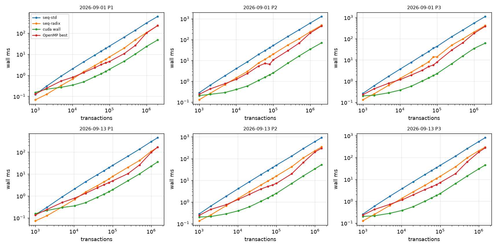
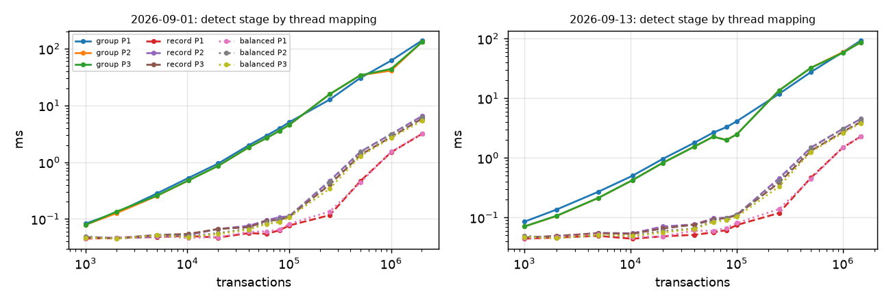

# Phases 8-10 results

## Machine (non-negotiable 4)

```
date: 2026-11-04T11:51:36Z
host: sucheth-katte-ASUS-TUF-Gaming-F15-FX507VU-FX507VU
git: 063a3d0
run: run_phase8.sh corpus=corpus runs=2+7 threads=1,2,4,8,16 backend=cuda
OMP_PROC_BIND=close OMP_PLACES=cores

## OS
Linux sucheth-katte-ASUS-TUF-Gaming-F15-FX507VU-FX507VU 7.0.0-42-generic #42~24.04.1-Ubuntu SMP PREEMPT_DYNAMIC Mon Oct 19 14:43:01 UTC 2 x86_64 x86_64 x86_64 GNU/Linux
PRETTY_NAME="Ubuntu 24.04.4 LTS"
NAME="Ubuntu"
VERSION_ID="24.04"
VERSION="24.04.4 LTS (Noble Numbat)"

## CPU
CPU(s):                                  16
Model name:                              13th Gen Intel(R) Core(TM) i7-13620H
Thread(s) per core:                      2
Core(s) per socket:                      10
Socket(s):                               1
CPU(s) scaling MHz:                      27%
CPU max MHz:                             4900.0000
CPU min MHz:                             400.0000
L2 cache:                                9.5 MiB (7 instances)
L3 cache:                                24 MiB (1 instance)
SMT active: 1
governor: powersave
current MHz (cpu0): 517.061

## power (the review asks for performance mode on AC power)
/sys/class/power_supply/ADP0/online: 1
/sys/class/power_supply/ucsi-source-psy-USBC000:001/online: 0
platform_profile: balanced

## memory
               total        used        free      shared  buff/cache   available
Mem:            15Gi       4.8Gi       3.8Gi       559Mi       7.4Gi        10Gi
Swap:          4.0Gi          0B       4.0Gi

## GPU
name, memory.total [MiB], memory.used [MiB], driver_version, pstate, clocks.current.sm [MHz], clocks.max.sm [MHz], pcie.link.gen.current, pcie.link.gen.max, pcie.link.width.current, pcie.link.width.max, power.draw [W], power.limit [W]
NVIDIA GeForce RTX 4050 Laptop GPU, 6141 MiB, 15 MiB, 595.99.02, P8, 210 MHz, 3105 MHz, 2, 4, 8, 8, 3.98 W, [N/A]
nvcc: not on PATH 
conduit_gpu info: GPU NVIDIA GeForce RTX 4050 Laptop GPU, 20 SMs, 5772 MiB, cc 8.9, driver 13.2, runtime 13.2; backend cuda; OpenMP on

c++ (Ubuntu 14.2.0-4ubuntu2~24.04.1) 14.2.0
cmake version 3.28.3
```

## Correctness gates (non-negotiable 1: no timing without correctness)

| check | result | last line |
|---|---|---|
| tests.txt | PASS | 39 tests, 0 failed checks |
| stages.txt | PASS | ALL STAGES IDENTICAL TO THE CPU REFERENCE |
| verify.txt | PASS | ALL GPU CHECKS PASSED |
| identical.txt | PASS | ALL IDENTICAL |
| validator.txt | PASS | ALL CHECKS PASSED |

Repetitions: warm-up [1, 2], measured [3, 7] (medians; super-blocks above 250k use at most 1 + 3). 

## Phase 8: end to end, wall time (ms, median)

GPU = balanced detection + sequential sweep for levelling (as the handover asks), transfers and host staging included. `device` = H2D + kernels + D2H on the GPU timeline; `kernels` = stages 1-3 kernels only.

| day | n | pol | seq-std | seq-radix | OpenMP best (threads) | GPU wall | GPU device | GPU kernels | vs seq-std | vs seq-radix | vs OpenMP |
|---|---:|---|---:|---:|---:|---:|---:|---:|---:|---:|---:|
| 2026-09-01 | 1,000 | P1 | 0.12 | 0.07 | 0.13 (1) | 0.15 | 0.13 | 0.11 | 0.79x | 0.45x | 0.84x |
| 2026-09-01 | 2,000 | P1 | 0.30 | 0.12 | 0.24 (1) | 0.22 | 0.19 | 0.15 | 1.38x | 0.57x | 1.10x |
| 2026-09-01 | 5,000 | P1 | 0.92 | 0.33 | 0.54 (4) | 0.27 | 0.24 | 0.18 | 3.40x | 1.22x | 2.00x |
| 2026-09-01 | 10,176 | P1 | 2.05 | 0.66 | 0.81 (4) | 0.34 | 0.29 | 0.19 | 5.96x | 1.93x | 2.34x |
| 2026-09-01 | 20,101 | P1 | 4.32 | 1.48 | 1.34 (4) | 0.48 | 0.38 | 0.20 | 8.92x | 3.05x | 2.76x |
| 2026-09-01 | 40,366 | P1 | 9.08 | 2.90 | 2.30 (8) | 0.86 | 0.67 | 0.24 | 10.53x | 3.36x | 2.67x |
| 2026-09-01 | 60,044 | P1 | 13.98 | 4.35 | 3.23 (4) | 1.17 | 0.89 | 0.27 | 11.90x | 3.70x | 2.74x |
| 2026-09-01 | 80,100 | P1 | 18.90 | 5.79 | 3.91 (8) | 1.53 | 1.16 | 0.32 | 12.31x | 3.77x | 2.55x |
| 2026-09-01 | 100,098 | P1 | 24.23 | 7.42 | 4.50 (8) | 1.93 | 1.44 | 0.38 | 12.54x | 3.84x | 2.33x |
| 2026-09-01 | 250,058 | P1 | 64.45 | 19.50 | 10.69 (16) | 4.63 | 3.27 | 0.68 | 13.92x | 4.21x | 2.31x |
| 2026-09-01 | 500,117 | P1 | 137.45 | 47.87 | 26.11 (16) | 10.17 | 7.34 | 2.15 | 13.52x | 4.71x | 2.57x |
| 2026-09-01 | 1,000,002 | P1 | 302.30 | 105.82 | 100.86 (16) | 23.17 | 16.48 | 5.91 | 13.05x | 4.57x | 4.35x |
| 2026-09-01 | 2,013,158 | P1 | 616.97 | 226.79 | 229.97 (16) | 47.56 | 34.75 | 13.52 | 12.97x | 4.77x | 4.84x |
| 2026-09-01 | 1,000 | P2 | 0.28 | 0.13 | 0.24 (1) | 0.20 | 0.19 | 0.16 | 1.37x | 0.63x | 1.15x |
| 2026-09-01 | 2,000 | P2 | 0.65 | 0.27 | 0.43 (4) | 0.24 | 0.21 | 0.18 | 2.75x | 1.12x | 1.82x |
| 2026-09-01 | 5,000 | P2 | 1.85 | 0.69 | 0.77 (4) | 0.29 | 0.25 | 0.20 | 6.41x | 2.40x | 2.67x |
| 2026-09-01 | 10,176 | P2 | 4.08 | 1.47 | 1.24 (4) | 0.41 | 0.34 | 0.21 | 10.06x | 3.63x | 3.06x |
| 2026-09-01 | 20,101 | P2 | 8.56 | 2.95 | 2.37 (4) | 0.59 | 0.49 | 0.26 | 14.52x | 5.00x | 4.03x |
| 2026-09-01 | 40,366 | P2 | 19.43 | 7.52 | 5.36 (8) | 1.09 | 0.90 | 0.35 | 17.75x | 6.88x | 4.89x |
| 2026-09-01 | 60,044 | P2 | 29.41 | 11.27 | 7.19 (16) | 1.56 | 1.25 | 0.45 | 18.87x | 7.23x | 4.61x |
| 2026-09-01 | 80,100 | P2 | 40.20 | 15.40 | 6.54 (8) | 2.04 | 1.65 | 0.55 | 19.67x | 7.53x | 3.20x |
| 2026-09-01 | 100,098 | P2 | 51.78 | 19.95 | 10.55 (16) | 2.50 | 2.03 | 0.65 | 20.67x | 7.97x | 4.21x |
| 2026-09-01 | 250,058 | P2 | 140.87 | 54.45 | 29.43 (16) | 7.42 | 5.92 | 2.40 | 18.99x | 7.34x | 3.97x |
| 2026-09-01 | 500,117 | P2 | 292.07 | 109.56 | 67.07 (16) | 16.14 | 13.14 | 5.97 | 18.09x | 6.79x | 4.15x |
| 2026-09-01 | 1,000,002 | P2 | 616.50 | 234.49 | 205.56 (16) | 34.44 | 27.60 | 12.70 | 17.90x | 6.81x | 5.97x |
| 2026-09-01 | 2,013,158 | P2 | 1271.56 | 482.68 | 443.50 (16) | 69.08 | 56.32 | 26.91 | 18.41x | 6.99x | 6.42x |
| 2026-09-01 | 1,000 | P3 | 0.26 | 0.13 | 0.23 (1) | 0.20 | 0.18 | 0.16 | 1.30x | 0.66x | 1.14x |
| 2026-09-01 | 2,000 | P3 | 0.61 | 0.25 | 0.43 (4) | 0.22 | 0.19 | 0.16 | 2.82x | 1.17x | 2.01x |
| 2026-09-01 | 5,000 | P3 | 1.71 | 0.64 | 0.80 (4) | 0.28 | 0.25 | 0.19 | 6.06x | 2.27x | 2.83x |
| 2026-09-01 | 10,176 | P3 | 3.72 | 1.35 | 1.18 (4) | 0.38 | 0.32 | 0.21 | 9.78x | 3.56x | 3.11x |
| 2026-09-01 | 20,101 | P3 | 7.71 | 2.65 | 1.92 (4) | 0.57 | 0.48 | 0.26 | 13.47x | 4.62x | 3.36x |
| 2026-09-01 | 40,366 | P3 | 16.54 | 5.37 | 3.26 (8) | 1.02 | 0.83 | 0.34 | 16.24x | 5.27x | 3.20x |
| 2026-09-01 | 60,044 | P3 | 24.98 | 8.15 | 4.87 (8) | 1.42 | 1.15 | 0.43 | 17.55x | 5.72x | 3.42x |
| 2026-09-01 | 80,100 | P3 | 35.99 | 13.91 | 5.79 (16) | 1.84 | 1.46 | 0.52 | 19.60x | 7.58x | 3.16x |
| 2026-09-01 | 100,098 | P3 | 43.40 | 14.02 | 7.94 (8) | 2.27 | 1.80 | 0.60 | 19.13x | 6.18x | 3.50x |
| 2026-09-01 | 250,058 | P3 | 124.37 | 49.44 | 29.06 (16) | 6.60 | 5.26 | 2.25 | 18.84x | 7.49x | 4.40x |
| 2026-09-01 | 500,117 | P3 | 256.34 | 98.05 | 64.54 (16) | 15.37 | 11.82 | 5.57 | 16.68x | 6.38x | 4.20x |
| 2026-09-01 | 1,000,002 | P3 | 542.52 | 206.69 | 178.53 (16) | 34.67 | 25.20 | 11.35 | 15.65x | 5.96x | 5.15x |
| 2026-09-01 | 2,013,158 | P3 | 1114.42 | 416.24 | 383.90 (16) | 61.64 | 48.92 | 24.10 | 18.08x | 6.75x | 6.23x |
| 2026-09-13 | 1,000 | P1 | 0.14 | 0.07 | 0.14 (1) | 0.16 | 0.13 | 0.11 | 0.90x | 0.47x | 0.87x |
| 2026-09-13 | 2,000 | P1 | 0.30 | 0.13 | 0.24 (1) | 0.22 | 0.19 | 0.16 | 1.39x | 0.58x | 1.11x |
| 2026-09-13 | 5,000 | P1 | 0.92 | 0.32 | 0.51 (4) | 0.30 | 0.25 | 0.19 | 3.08x | 1.07x | 1.71x |
| 2026-09-13 | 10,396 | P1 | 2.10 | 0.69 | 0.80 (4) | 0.35 | 0.30 | 0.19 | 5.93x | 1.95x | 2.24x |
| 2026-09-13 | 20,096 | P1 | 4.46 | 1.53 | 1.32 (4) | 0.50 | 0.38 | 0.20 | 9.01x | 3.08x | 2.67x |
| 2026-09-13 | 40,085 | P1 | 9.28 | 2.93 | 2.35 (4) | 0.87 | 0.68 | 0.24 | 10.70x | 3.38x | 2.70x |
| 2026-09-13 | 60,129 | P1 | 14.20 | 4.43 | 3.27 (8) | 1.21 | 0.91 | 0.27 | 11.78x | 3.67x | 2.71x |
| 2026-09-13 | 80,029 | P1 | 19.45 | 5.91 | 4.06 (8) | 1.56 | 1.17 | 0.32 | 12.48x | 3.79x | 2.61x |
| 2026-09-13 | 100,174 | P1 | 24.79 | 7.76 | 4.87 (8) | 1.93 | 1.45 | 0.37 | 12.86x | 4.02x | 2.53x |
| 2026-09-13 | 250,017 | P1 | 64.89 | 20.24 | 10.38 (16) | 4.94 | 3.31 | 0.69 | 13.13x | 4.10x | 2.10x |
| 2026-09-13 | 500,110 | P1 | 136.92 | 41.54 | 25.98 (16) | 10.11 | 7.35 | 2.14 | 13.54x | 4.11x | 2.57x |
| 2026-09-13 | 1,000,145 | P1 | 299.95 | 108.29 | 96.56 (16) | 22.96 | 16.49 | 5.92 | 13.06x | 4.72x | 4.20x |
| 2026-09-13 | 1,476,230 | P1 | 455.02 | 166.38 | 169.75 (16) | 35.62 | 25.88 | 9.62 | 12.77x | 4.67x | 4.77x |
| 2026-09-13 | 1,000 | P2 | 0.28 | 0.13 | 0.24 (1) | 0.20 | 0.18 | 0.16 | 1.38x | 0.66x | 1.19x |
| 2026-09-13 | 2,000 | P2 | 0.65 | 0.25 | 0.46 (4) | 0.22 | 0.19 | 0.16 | 3.02x | 1.18x | 2.13x |
| 2026-09-13 | 5,000 | P2 | 1.84 | 0.68 | 0.75 (4) | 0.29 | 0.25 | 0.19 | 6.46x | 2.37x | 2.64x |
| 2026-09-13 | 10,396 | P2 | 4.16 | 1.48 | 1.33 (4) | 0.40 | 0.34 | 0.21 | 10.52x | 3.74x | 3.36x |
| 2026-09-13 | 20,096 | P2 | 8.63 | 2.98 | 2.25 (8) | 0.60 | 0.50 | 0.26 | 14.31x | 4.94x | 3.73x |
| 2026-09-13 | 40,085 | P2 | 18.40 | 6.08 | 3.99 (8) | 1.08 | 0.89 | 0.34 | 17.03x | 5.62x | 3.69x |
| 2026-09-13 | 60,129 | P2 | 28.40 | 9.22 | 5.20 (8) | 1.55 | 1.26 | 0.45 | 18.37x | 5.97x | 3.37x |
| 2026-09-13 | 80,029 | P2 | 38.68 | 12.35 | 6.13 (16) | 2.05 | 1.65 | 0.55 | 18.88x | 6.03x | 2.99x |
| 2026-09-13 | 100,174 | P2 | 49.57 | 15.72 | 7.21 (16) | 2.51 | 2.03 | 0.63 | 19.78x | 6.27x | 2.88x |
| 2026-09-13 | 250,017 | P2 | 130.00 | 42.11 | 19.91 (16) | 7.14 | 5.75 | 2.29 | 18.22x | 5.90x | 2.79x |
| 2026-09-13 | 500,110 | P2 | 288.15 | 107.12 | 65.92 (16) | 15.87 | 12.83 | 5.83 | 18.15x | 6.75x | 4.15x |
| 2026-09-13 | 1,000,145 | P2 | 606.75 | 228.33 | 200.99 (16) | 33.72 | 27.11 | 12.61 | 17.99x | 6.77x | 5.96x |
| 2026-09-13 | 1,476,230 | P2 | 915.33 | 341.79 | 299.56 (16) | 51.84 | 40.90 | 19.40 | 17.66x | 6.59x | 5.78x |
| 2026-09-13 | 1,000 | P3 | 0.26 | 0.13 | 0.23 (1) | 0.20 | 0.18 | 0.16 | 1.27x | 0.62x | 1.16x |
| 2026-09-13 | 2,000 | P3 | 0.60 | 0.25 | 0.42 (4) | 0.22 | 0.19 | 0.16 | 2.77x | 1.17x | 1.96x |
| 2026-09-13 | 5,000 | P3 | 1.70 | 0.64 | 0.72 (4) | 0.28 | 0.25 | 0.20 | 6.04x | 2.29x | 2.57x |
| 2026-09-13 | 10,396 | P3 | 3.79 | 1.38 | 1.16 (4) | 0.38 | 0.32 | 0.21 | 9.95x | 3.62x | 3.04x |
| 2026-09-13 | 20,096 | P3 | 7.76 | 2.70 | 1.96 (4) | 0.56 | 0.47 | 0.26 | 13.75x | 4.79x | 3.47x |
| 2026-09-13 | 40,085 | P3 | 16.36 | 5.30 | 3.39 (8) | 0.99 | 0.81 | 0.34 | 16.47x | 5.33x | 3.42x |
| 2026-09-13 | 60,129 | P3 | 25.19 | 8.10 | 4.56 (8) | 1.41 | 1.13 | 0.43 | 17.81x | 5.73x | 3.22x |
| 2026-09-13 | 80,029 | P3 | 34.25 | 10.94 | 5.70 (16) | 1.83 | 1.45 | 0.52 | 18.70x | 5.97x | 3.11x |
| 2026-09-13 | 100,174 | P3 | 43.58 | 13.73 | 7.14 (8) | 2.25 | 1.78 | 0.60 | 19.40x | 6.11x | 3.18x |
| 2026-09-13 | 250,017 | P3 | 114.64 | 37.38 | 18.16 (16) | 6.39 | 5.05 | 2.17 | 17.94x | 5.85x | 2.84x |
| 2026-09-13 | 500,110 | P3 | 253.08 | 95.86 | 62.42 (16) | 14.10 | 11.34 | 5.47 | 17.94x | 6.80x | 4.43x |
| 2026-09-13 | 1,000,145 | P3 | 532.76 | 203.02 | 175.30 (16) | 30.11 | 23.43 | 11.23 | 17.70x | 6.74x | 5.82x |
| 2026-09-13 | 1,476,230 | P3 | 803.34 | 300.45 | 275.67 (16) | 45.15 | 35.41 | 16.98 | 17.79x | 6.65x | 6.11x |

### Crossover (wall time, transfers charged)

Measured = smallest tested size where the GPU is faster. Model = least-squares lines t = a + b·n through each implementation's points at n ≤ 20k (the region around the crossover); the model crossover is where the lines meet, n* = (a_gpu − a_cpu) / (b_cpu − b_gpu). a_gpu is the GPU's fixed cost per call (launches, synchronisations, transfer latency), b the cost per transaction.

| day | pol | beats seq-radix at n ≥ (measured) | model n* vs seq-radix | beats OpenMP at n ≥ (measured) | model n* vs OpenMP | GPU fixed cost a (ms) |
|---|---|---:|---:|---:|---:|---:|
| 2026-09-01 | P1 | 5000 | 3,475 | 2000 | 1,174 | 0.162 |
| 2026-09-01 | P2 | 2000 | 1,703 | 1000 | 0 | 0.187 |
| 2026-09-01 | P3 | 2000 | 1,688 | 1000 | 0 | 0.180 |
| 2026-09-13 | P1 | 5000 | 3,632 | 2000 | 1,291 | 0.167 |
| 2026-09-13 | P2 | 2000 | 1,661 | 1000 | 0 | 0.179 |
| 2026-09-13 | P3 | 2000 | 1,710 | 1000 | 0 | 0.182 |

### Transfer-cost arithmetic (largest super-block per day and policy)

Bytes moved: H2D = 40·n (the transaction records); D2H = 8·(n+1) row offsets + 4·m column indices (+ 4·n levels when levelling on the GPU). Measured times are cudaEvent intervals; the share is of GPU wall time. Host prep = id check + copy into the pinned staging buffer; host post = copy out of the pinned buffers.

PCIe probe (pinned, fitted t = latency + bytes / bandwidth on transfers ≥ 1 MB): H2D 11.3 GB/s, latency -2.8 µs, D2H 10.1 GB/s, latency -12.4 µs; empty-kernel launch + sync 4.6 µs, one host round trip 4.5 µs.

| day | pol | n | H2D MB | D2H MB | H2D ms (pred.) | D2H ms (pred.) | transfer % of wall | host prep ms | host post ms | wall − device ms |
|---|---|---:|---:|---:|---:|---:|---:|---:|---:|---:|
| 2026-09-01 | P1 | 2,013,158 | 80.5 | 28.4 | 7.08 (7.13) | 3.59 (2.80) | 22% | 10.63 | 2.16 | 12.81 |
| 2026-09-01 | P2 | 2,013,158 | 80.5 | 31.8 | 7.08 (7.13) | 4.59 (3.14) | 17% | 10.47 | 2.27 | 12.76 |
| 2026-09-01 | P3 | 2,013,158 | 80.5 | 26.6 | 7.08 (7.13) | 3.26 (2.62) | 17% | 10.63 | 1.91 | 12.73 |
| 2026-09-13 | P1 | 1,476,230 | 59.0 | 20.9 | 5.21 (5.23) | 2.77 (2.06) | 22% | 7.90 | 1.91 | 9.75 |
| 2026-09-13 | P2 | 1,476,230 | 59.0 | 23.1 | 5.29 (5.23) | 2.61 (2.28) | 15% | 7.90 | 2.33 | 10.93 |
| 2026-09-13 | P3 | 1,476,230 | 59.0 | 19.5 | 5.21 (5.23) | 2.55 (1.92) | 17% | 7.91 | 1.76 | 9.74 |

## GPU stage breakdown at the largest super-block (ms)

| day | pol | n | H2D | extract | sort | detect | csr | D2H | level (CPU sweep) | device | wall | launches | host syncs | device MB |
|---|---|---:|---:|---:|---:|---:|---:|---:|---:|---:|---:|---:|---:|---:|
| 2026-09-01 | P1 | 2,013,158 | 7.08 | 1.26 | 6.23 | 3.19 | 2.86 | 3.59 | 10.57 | 34.75 | 47.56 | 17 | 6 | 773.2 |
| 2026-09-01 | P2 | 2,013,158 | 7.08 | 2.80 | 13.50 | 6.20 | 4.41 | 4.59 | 17.71 | 56.32 | 69.08 | 17 | 6 | 1318.1 |
| 2026-09-01 | P3 | 2,013,158 | 7.08 | 2.80 | 13.67 | 5.34 | 2.28 | 3.26 | 14.53 | 48.92 | 61.64 | 17 | 6 | 1318.1 |
| 2026-09-13 | P1 | 1,476,230 | 5.21 | 0.92 | 4.53 | 2.27 | 1.90 | 2.77 | 8.32 | 25.88 | 35.62 | 17 | 6 | 1318.5 |
| 2026-09-13 | P2 | 1,476,230 | 5.29 | 2.07 | 9.76 | 4.45 | 3.13 | 2.61 | 13.69 | 40.90 | 51.84 | 17 | 6 | 1318.5 |
| 2026-09-13 | P3 | 1,476,230 | 5.21 | 2.07 | 9.67 | 3.83 | 1.42 | 2.55 | 10.59 | 35.41 | 45.15 | 17 | 6 | 1318.5 |

## Phase 9: skew (detection stage, three thread mappings)

Before = one thread per key group (`group`); `record` = one thread per record; after = one thread per output edge (`balanced`, load-balanced search). Imbalance = max ÷ mean work per thread, computed from the key groups (1.0 = even). Recovery = group time ÷ mapping time.

| super-block | pol | records | hottest key | its records (%) | imbalance group / record / edge | detect ms group (before) | record | balanced (after) | recovery record / balanced |
|---|---|---:|---|---:|---|---:|---:|---:|---|
| 2026-09-01/10k/099 | P1 | 20,300 | `ACCOUNT(0xdac1..1ec7)` | 2,042 (10.1%) | 996 / 1 / 1 | 0.527 | 0.051 | 0.051 | 10.29x / 10.30x |
| 2026-09-01/10k/099 | P2 | 45,096 | `ACCOUNT(0xdac1..1ec7)` | 2,042 (4.5%) | 1089 / 154 / 1 | 0.476 | 0.053 | 0.048 | 8.95x / 9.89x |
| 2026-09-01/10k/099 | P3 | 45,096 | `ACCOUNT(0xdac1..1ec7)` | 2,042 (4.5%) | 1231 / 175 / 1 | 0.474 | 0.052 | 0.054 | 9.08x / 8.74x |
| 2026-09-01/20k/049 | P1 | 40,065 | `ACCOUNT(0xdac1..1ec7)` | 3,785 (9.4%) | 1567 / 1 / 1 | 0.957 | 0.046 | 0.048 | 20.83x / 19.85x |
| 2026-09-01/20k/049 | P2 | 88,262 | `ACCOUNT(0xdac1..1ec7)` | 3,785 (4.3%) | 1795 / 314 / 1 | 0.874 | 0.067 | 0.056 | 13.09x / 15.51x |
| 2026-09-01/20k/049 | P3 | 88,262 | `ACCOUNT(0xdac1..1ec7)` | 3,785 (4.3%) | 2051 / 358 / 1 | 0.875 | 0.066 | 0.052 | 13.37x / 16.77x |
| 2026-09-01/40k/025 | P1 | 80,480 | `ACCOUNT(0xdac1..1ec7)` | 8,182 (10.2%) | 2857 / 1 / 1 | 2.020 | 0.055 | 0.057 | 36.54x / 35.39x |
| 2026-09-01/40k/025 | P2 | 178,685 | `ACCOUNT(0xdac1..1ec7)` | 8,182 (4.6%) | 3428 / 268 / 1 | 1.846 | 0.078 | 0.076 | 23.72x / 24.36x |
| 2026-09-01/40k/025 | P3 | 178,685 | `ACCOUNT(0xdac1..1ec7)` | 8,182 (4.6%) | 3974 / 311 / 1 | 1.841 | 0.076 | 0.064 | 24.30x / 29.00x |
| 2026-09-01/60k/016 | P1 | 119,690 | `ACCOUNT(0xdac1..1ec7)` | 12,120 (10.1%) | 3834 / 1 / 1 | 2.953 | 0.057 | 0.063 | 51.50x / 46.66x |
| 2026-09-01/60k/016 | P2 | 262,782 | `ACCOUNT(0xdac1..1ec7)` | 12,120 (4.6%) | 4536 / 300 / 1 | 2.664 | 0.093 | 0.087 | 28.59x / 30.61x |
| 2026-09-01/60k/016 | P3 | 262,782 | `ACCOUNT(0xdac1..1ec7)` | 12,120 (4.6%) | 5281 / 350 / 1 | 2.667 | 0.092 | 0.083 | 28.93x / 32.15x |
| 2026-09-01/80k/012 | P1 | 159,677 | `ACCOUNT(0xdac1..1ec7)` | 16,303 (10.2%) | 4895 / 1 / 1 | 3.949 | 0.061 | 0.067 | 64.27x / 58.70x |
| 2026-09-01/80k/012 | P2 | 352,164 | `ACCOUNT(0xdac1..1ec7)` | 16,303 (4.6%) | 5854 / 298 / 1 | 3.571 | 0.095 | 0.097 | 37.49x / 36.70x |
| 2026-09-01/80k/012 | P3 | 352,164 | `ACCOUNT(0xdac1..1ec7)` | 16,303 (4.6%) | 6848 / 349 / 1 | 3.569 | 0.095 | 0.086 | 37.47x / 41.49x |
| 2026-09-01/100k/010 | P1 | 199,501 | `ACCOUNT(0xdac1..1ec7)` | 20,805 (10.4%) | 5838 / 1 / 1 | 5.058 | 0.074 | 0.082 | 68.60x / 61.74x |
| 2026-09-01/100k/010 | P2 | 438,424 | `ACCOUNT(0xdac1..1ec7)` | 20,805 (4.7%) | 7146 / 259 / 1 | 4.545 | 0.113 | 0.114 | 40.35x / 39.99x |
| 2026-09-01/100k/010 | P3 | 438,424 | `ACCOUNT(0xdac1..1ec7)` | 20,805 (4.7%) | 8371 / 304 / 1 | 4.551 | 0.112 | 0.108 | 40.77x / 41.92x |
| 2026-09-01/250k/004 | P1 | 498,390 | `ACCOUNT(0xdac1..1ec7)` | 52,070 (10.4%) | 12489 / 1 / 1 | 12.690 | 0.119 | 0.130 | 106.84x / 97.58x |
| 2026-09-01/250k/004 | P2 | 1,098,167 | `ACCOUNT(0xdac1..1ec7)` | 52,070 (4.7%) | 16386 / 536 / 1 | 14.661 | 0.473 | 0.441 | 31.01x / 33.22x |
| 2026-09-01/250k/004 | P3 | 1,098,167 | `ACCOUNT(0xdac1..1ec7)` | 52,070 (4.7%) | 19384 / 635 / 1 | 14.656 | 0.404 | 0.344 | 36.33x / 42.60x |
| 2026-09-01/500k/002 | P1 | 996,609 | `ACCOUNT(0xdac1..1ec7)` | 99,623 (10.0%) | 21203 / 1 / 1 | 30.316 | 0.464 | 0.440 | 65.35x / 68.85x |
| 2026-09-01/500k/002 | P2 | 2,184,854 | `ACCOUNT(0xdac1..1ec7)` | 99,623 (4.6%) | 29292 / 566 / 1 | 34.066 | 1.528 | 1.498 | 22.29x / 22.74x |
| 2026-09-01/500k/002 | P3 | 2,184,854 | `ACCOUNT(0xdac1..1ec7)` | 99,623 (4.6%) | 34802 / 672 / 1 | 34.041 | 1.339 | 1.284 | 25.42x / 26.51x |
| 2026-09-01/1000k/001 | P1 | 1,992,090 | `ACCOUNT(0xdac1..1ec7)` | 190,326 (9.6%) | 36852 / 1 / 1 | 57.438 | 1.484 | 1.515 | 38.69x / 37.92x |
| 2026-09-01/1000k/001 | P2 | 4,325,116 | `ACCOUNT(0xdac1..1ec7)` | 190,326 (4.4%) | 52697 / 559 / 1 | 41.042 | 3.131 | 3.098 | 13.11x / 13.25x |
| 2026-09-01/1000k/001 | P3 | 4,325,116 | `ACCOUNT(0xdac1..1ec7)` | 190,326 (4.4%) | 62807 / 666 / 1 | 40.934 | 2.782 | 2.672 | 14.71x / 15.32x |
| 2026-09-01/full | P1 | 4,011,549 | `ACCOUNT(0xdac1..1ec7)` | 388,725 (9.7%) | 74800 / 1 / 1 | 138.843 | 3.144 | 3.185 | 44.16x / 43.60x |
| 2026-09-01/full | P2 | 8,774,035 | `ACCOUNT(0xdac1..1ec7)` | 388,725 (4.4%) | 94717 / 4702 / 1 | 131.157 | 6.466 | 6.194 | 20.29x / 21.17x |
| 2026-09-01/full | P3 | 8,774,035 | `ACCOUNT(0xdac1..1ec7)` | 388,725 (4.4%) | 113347 / 5627 / 1 | 131.020 | 5.855 | 5.337 | 22.38x / 24.55x |
| 2026-09-13/10k/073 | P1 | 20,706 | `ACCOUNT(0xdac1..1ec7)` | 1,953 (9.4%) | 882 / 1 / 1 | 0.503 | 0.050 | 0.051 | 9.98x / 9.82x |
| 2026-09-13/10k/073 | P2 | 45,232 | `ACCOUNT(0xdac1..1ec7)` | 1,953 (4.3%) | 744 / 232 / 1 | 0.426 | 0.053 | 0.053 | 8.00x / 8.00x |
| 2026-09-13/10k/073 | P3 | 45,232 | `ACCOUNT(0xdac1..1ec7)` | 1,953 (4.3%) | 847 / 264 / 1 | 0.427 | 0.057 | 0.053 | 7.55x / 8.02x |
| 2026-09-13/20k/036 | P1 | 40,020 | `ACCOUNT(0xdac1..1ec7)` | 3,915 (9.8%) | 1417 / 1 / 1 | 0.960 | 0.047 | 0.047 | 20.37x / 20.37x |
| 2026-09-13/20k/036 | P2 | 86,902 | `ACCOUNT(0xdac1..1ec7)` | 3,915 (4.5%) | 1302 / 325 / 1 | 0.824 | 0.067 | 0.057 | 12.38x / 14.56x |
| 2026-09-13/20k/036 | P3 | 86,902 | `ACCOUNT(0xdac1..1ec7)` | 3,915 (4.5%) | 1499 / 374 / 1 | 0.824 | 0.066 | 0.054 | 12.59x / 15.19x |
| 2026-09-13/40k/018 | P1 | 79,850 | `ACCOUNT(0xdac1..1ec7)` | 7,374 (9.2%) | 2241 / 1 / 1 | 1.804 | 0.056 | 0.058 | 32.15x / 30.91x |
| 2026-09-13/40k/018 | P2 | 174,508 | `ACCOUNT(0xdac1..1ec7)` | 7,374 (4.2%) | 2150 / 315 / 1 | 1.547 | 0.075 | 0.069 | 20.70x / 22.57x |
| 2026-09-13/40k/018 | P3 | 174,508 | `ACCOUNT(0xdac1..1ec7)` | 7,374 (4.2%) | 2516 / 369 / 1 | 1.548 | 0.076 | 0.061 | 20.45x / 25.20x |
| 2026-09-13/60k/012 | P1 | 119,768 | `ACCOUNT(0xdac1..1ec7)` | 10,940 (9.1%) | 3017 / 1 / 1 | 2.646 | 0.055 | 0.057 | 47.85x / 46.80x |
| 2026-09-13/60k/012 | P2 | 261,029 | `ACCOUNT(0xdac1..1ec7)` | 10,940 (4.2%) | 2948 / 311 / 1 | 2.266 | 0.094 | 0.089 | 24.05x / 25.44x |
| 2026-09-13/60k/012 | P3 | 261,029 | `ACCOUNT(0xdac1..1ec7)` | 10,940 (4.2%) | 3471 / 366 / 1 | 2.267 | 0.094 | 0.081 | 24.06x / 28.02x |
| 2026-09-13/80k/009 | P1 | 159,395 | `ACCOUNT(0xdac1..1ec7)` | 14,581 (9.1%) | 3759 / 1 / 1 | 3.274 | 0.064 | 0.069 | 51.56x / 47.23x |
| 2026-09-13/80k/009 | P2 | 345,413 | `ACCOUNT(0xdac1..1ec7)` | 14,581 (4.2%) | 3895 / 308 / 1 | 1.989 | 0.097 | 0.095 | 20.48x / 20.90x |
| 2026-09-13/80k/009 | P3 | 345,413 | `ACCOUNT(0xdac1..1ec7)` | 14,581 (4.2%) | 4593 / 363 / 1 | 1.989 | 0.098 | 0.088 | 20.23x / 22.58x |
| 2026-09-13/100k/007 | P1 | 199,530 | `ACCOUNT(0xdac1..1ec7)` | 18,230 (9.1%) | 4480 / 1 / 1 | 4.106 | 0.077 | 0.084 | 53.47x / 48.98x |
| 2026-09-13/100k/007 | P2 | 432,897 | `ACCOUNT(0xdac1..1ec7)` | 18,230 (4.2%) | 4719 / 306 / 1 | 2.478 | 0.113 | 0.115 | 22.00x / 21.61x |
| 2026-09-13/100k/007 | P3 | 432,897 | `ACCOUNT(0xdac1..1ec7)` | 18,230 (4.2%) | 5576 / 362 / 1 | 2.475 | 0.111 | 0.106 | 22.38x / 23.26x |
| 2026-09-13/250k/002 | P1 | 497,861 | `ACCOUNT(0xdac1..1ec7)` | 49,655 (10.0%) | 11193 / 1 / 1 | 11.796 | 0.119 | 0.134 | 99.30x / 87.93x |
| 2026-09-13/250k/002 | P2 | 1,071,800 | `ACCOUNT(0xdac1..1ec7)` | 49,655 (4.6%) | 11045 / 304 / 1 | 12.487 | 0.455 | 0.417 | 27.46x / 29.96x |
| 2026-09-13/250k/002 | P3 | 1,071,800 | `ACCOUNT(0xdac1..1ec7)` | 49,655 (4.6%) | 13040 / 358 / 1 | 12.479 | 0.389 | 0.333 | 32.07x / 37.52x |
| 2026-09-13/500k/001 | P1 | 996,097 | `ACCOUNT(0xdac1..1ec7)` | 96,120 (9.7%) | 18926 / 1 / 1 | 25.554 | 0.467 | 0.440 | 54.73x / 58.03x |
| 2026-09-13/500k/001 | P2 | 2,145,573 | `ACCOUNT(0xdac1..1ec7)` | 96,120 (4.5%) | 20224 / 360 / 1 | 30.208 | 1.485 | 1.464 | 20.34x / 20.63x |
| 2026-09-13/500k/001 | P3 | 2,145,573 | `ACCOUNT(0xdac1..1ec7)` | 96,120 (4.5%) | 24079 / 428 / 1 | 30.171 | 1.298 | 1.247 | 23.24x / 24.19x |
| 2026-09-13/1000k/000 | P1 | 1,992,140 | `ACCOUNT(0xdac1..1ec7)` | 184,744 (9.3%) | 32957 / 1 / 1 | 56.441 | 1.490 | 1.516 | 37.88x / 37.22x |
| 2026-09-13/1000k/000 | P2 | 4,276,373 | `ACCOUNT(0xdac1..1ec7)` | 184,744 (4.3%) | 34119 / 506 / 1 | 57.652 | 3.079 | 3.044 | 18.72x / 18.94x |
| 2026-09-13/1000k/000 | P3 | 4,276,373 | `ACCOUNT(0xdac1..1ec7)` | 184,744 (4.3%) | 40819 / 605 / 1 | 57.605 | 2.731 | 2.628 | 21.09x / 21.92x |
| 2026-09-13/full | P1 | 2,940,463 | `ACCOUNT(0xdac1..1ec7)` | 266,865 (9.1%) | 44762 / 1 / 1 | 92.637 | 2.297 | 2.279 | 40.34x / 40.64x |
| 2026-09-13/full | P2 | 6,283,994 | `ACCOUNT(0xdac1..1ec7)` | 266,865 (4.2%) | 51291 / 979 / 1 | 86.813 | 4.506 | 4.456 | 19.27x / 19.48x |
| 2026-09-13/full | P3 | 6,283,994 | `ACCOUNT(0xdac1..1ec7)` | 266,865 (4.2%) | 61420 / 1173 / 1 | 86.716 | 3.990 | 3.822 | 21.74x / 22.69x |

Detect time across sizes (from the factorial sweep):

| day | pol | n | largest group | group ms | record ms | balanced ms | recovery |
|---|---|---:|---:|---:|---:|---:|---:|
| 2026-09-01 | P1 | 1,000 | 204 | 0.083 | 0.045 | 0.045 | 1.84x |
| 2026-09-01 | P1 | 2,000 | 376 | 0.129 | 0.046 | 0.047 | 2.74x |
| 2026-09-01 | P1 | 5,000 | 1,008 | 0.281 | 0.048 | 0.051 | 5.56x |
| 2026-09-01 | P1 | 10,176 | 2,042 | 0.525 | 0.050 | 0.046 | 11.39x |
| 2026-09-01 | P1 | 20,101 | 3,785 | 0.949 | 0.047 | 0.048 | 19.73x |
| 2026-09-01 | P1 | 40,366 | 8,182 | 2.006 | 0.056 | 0.059 | 33.77x |
| 2026-09-01 | P1 | 60,044 | 12,120 | 2.950 | 0.054 | 0.060 | 48.84x |
| 2026-09-01 | P1 | 80,100 | 16,303 | 3.949 | 0.063 | 0.066 | 60.10x |
| 2026-09-01 | P1 | 100,098 | 20,805 | 5.059 | 0.077 | 0.082 | 61.77x |
| 2026-09-01 | P1 | 250,058 | 52,070 | 12.694 | 0.117 | 0.135 | 93.89x |
| 2026-09-01 | P1 | 500,117 | 99,623 | 30.510 | 0.465 | 0.438 | 69.63x |
| 2026-09-01 | P1 | 1,000,002 | 190,326 | 61.397 | 1.491 | 1.522 | 40.33x |
| 2026-09-01 | P1 | 2,013,158 | 388,725 | 139.022 | 3.154 | 3.188 | 43.61x |
| 2026-09-01 | P2 | 1,000 | 204 | 0.079 | 0.048 | 0.049 | 1.60x |
| 2026-09-01 | P2 | 2,000 | 376 | 0.126 | 0.046 | 0.045 | 2.79x |
| 2026-09-01 | P2 | 5,000 | 1,008 | 0.254 | 0.049 | 0.052 | 4.86x |
| 2026-09-01 | P2 | 10,176 | 2,042 | 0.474 | 0.052 | 0.050 | 9.44x |
| 2026-09-01 | P2 | 20,101 | 3,785 | 0.863 | 0.067 | 0.056 | 15.33x |
| 2026-09-01 | P2 | 40,366 | 8,182 | 1.842 | 0.076 | 0.068 | 27.25x |
| 2026-09-01 | P2 | 60,044 | 12,120 | 2.664 | 0.095 | 0.088 | 30.24x |
| 2026-09-01 | P2 | 80,100 | 16,303 | 3.569 | 0.107 | 0.099 | 35.94x |
| 2026-09-01 | P2 | 100,098 | 20,805 | 4.549 | 0.112 | 0.114 | 40.01x |
| 2026-09-01 | P2 | 250,058 | 52,070 | 15.802 | 0.472 | 0.442 | 35.79x |
| 2026-09-01 | P2 | 500,117 | 99,623 | 34.024 | 1.528 | 1.495 | 22.76x |
| 2026-09-01 | P2 | 1,000,002 | 190,326 | 40.991 | 3.126 | 3.102 | 13.22x |
| 2026-09-01 | P2 | 2,013,158 | 388,725 | 131.264 | 6.484 | 6.199 | 21.17x |
| 2026-09-01 | P3 | 1,000 | 204 | 0.079 | 0.047 | 0.047 | 1.67x |
| 2026-09-01 | P3 | 2,000 | 376 | 0.134 | 0.046 | 0.045 | 2.99x |
| 2026-09-01 | P3 | 5,000 | 1,008 | 0.257 | 0.052 | 0.051 | 5.00x |
| 2026-09-01 | P3 | 10,176 | 2,042 | 0.475 | 0.055 | 0.048 | 9.88x |
| 2026-09-01 | P3 | 20,101 | 3,785 | 0.864 | 0.067 | 0.054 | 15.90x |
| 2026-09-01 | P3 | 40,366 | 8,182 | 1.840 | 0.072 | 0.066 | 28.09x |
| 2026-09-01 | P3 | 60,044 | 12,120 | 2.662 | 0.093 | 0.082 | 32.51x |
| 2026-09-01 | P3 | 80,100 | 16,303 | 3.577 | 0.096 | 0.088 | 40.60x |
| 2026-09-01 | P3 | 100,098 | 20,805 | 4.550 | 0.110 | 0.106 | 42.72x |
| 2026-09-01 | P3 | 250,058 | 52,070 | 15.786 | 0.404 | 0.342 | 46.16x |
| 2026-09-01 | P3 | 500,117 | 99,623 | 34.019 | 1.341 | 1.282 | 26.54x |
| 2026-09-01 | P3 | 1,000,002 | 190,326 | 43.850 | 2.785 | 2.679 | 16.37x |
| 2026-09-01 | P3 | 2,013,158 | 388,725 | 130.462 | 5.845 | 5.340 | 24.43x |
| 2026-09-13 | P1 | 1,000 | 218 | 0.085 | 0.044 | 0.045 | 1.88x |
| 2026-09-13 | P1 | 2,000 | 442 | 0.135 | 0.046 | 0.047 | 2.87x |
| 2026-09-13 | P1 | 5,000 | 953 | 0.271 | 0.049 | 0.052 | 5.17x |
| 2026-09-13 | P1 | 10,396 | 1,953 | 0.500 | 0.044 | 0.047 | 10.63x |
| 2026-09-13 | P1 | 20,096 | 3,915 | 0.960 | 0.048 | 0.048 | 19.95x |
| 2026-09-13 | P1 | 40,085 | 7,374 | 1.796 | 0.051 | 0.060 | 29.74x |
| 2026-09-13 | P1 | 60,129 | 10,940 | 2.650 | 0.056 | 0.059 | 44.54x |
| 2026-09-13 | P1 | 80,029 | 14,581 | 3.273 | 0.061 | 0.067 | 49.00x |
| 2026-09-13 | P1 | 100,174 | 18,230 | 4.109 | 0.075 | 0.081 | 50.92x |
| 2026-09-13 | P1 | 250,017 | 49,655 | 11.796 | 0.119 | 0.138 | 85.36x |
| 2026-09-13 | P1 | 500,110 | 96,120 | 27.415 | 0.464 | 0.442 | 62.00x |
| 2026-09-13 | P1 | 1,000,145 | 184,744 | 59.274 | 1.485 | 1.507 | 39.33x |
| 2026-09-13 | P1 | 1,476,230 | 266,865 | 92.677 | 2.284 | 2.270 | 40.82x |
| 2026-09-13 | P2 | 1,000 | 218 | 0.071 | 0.046 | 0.049 | 1.44x |
| 2026-09-13 | P2 | 2,000 | 442 | 0.105 | 0.048 | 0.045 | 2.34x |
| 2026-09-13 | P2 | 5,000 | 953 | 0.214 | 0.055 | 0.050 | 4.26x |
| 2026-09-13 | P2 | 10,396 | 1,953 | 0.421 | 0.054 | 0.049 | 8.55x |
| 2026-09-13 | P2 | 20,096 | 3,915 | 0.823 | 0.071 | 0.059 | 13.86x |
| 2026-09-13 | P2 | 40,085 | 7,374 | 1.549 | 0.077 | 0.066 | 23.65x |
| 2026-09-13 | P2 | 60,129 | 10,940 | 2.267 | 0.097 | 0.088 | 25.73x |
| 2026-09-13 | P2 | 80,029 | 14,581 | 1.992 | 0.099 | 0.099 | 20.06x |
| 2026-09-13 | P2 | 100,174 | 18,230 | 2.485 | 0.111 | 0.113 | 22.07x |
| 2026-09-13 | P2 | 250,017 | 49,655 | 13.451 | 0.454 | 0.413 | 32.59x |
| 2026-09-13 | P2 | 500,110 | 96,120 | 32.345 | 1.490 | 1.462 | 22.12x |
| 2026-09-13 | P2 | 1,000,145 | 184,744 | 59.052 | 3.070 | 3.050 | 19.36x |
| 2026-09-13 | P2 | 1,476,230 | 266,865 | 86.836 | 4.499 | 4.451 | 19.51x |
| 2026-09-13 | P3 | 1,000 | 218 | 0.071 | 0.046 | 0.047 | 1.50x |
| 2026-09-13 | P3 | 2,000 | 442 | 0.106 | 0.049 | 0.045 | 2.37x |
| 2026-09-13 | P3 | 5,000 | 953 | 0.214 | 0.054 | 0.051 | 4.19x |
| 2026-09-13 | P3 | 10,396 | 1,953 | 0.422 | 0.053 | 0.049 | 8.58x |
| 2026-09-13 | P3 | 20,096 | 3,915 | 0.823 | 0.066 | 0.056 | 14.68x |
| 2026-09-13 | P3 | 40,085 | 7,374 | 1.549 | 0.076 | 0.065 | 24.02x |
| 2026-09-13 | P3 | 60,129 | 10,940 | 2.262 | 0.092 | 0.084 | 26.96x |
| 2026-09-13 | P3 | 80,029 | 14,581 | 1.990 | 0.098 | 0.090 | 22.09x |
| 2026-09-13 | P3 | 100,174 | 18,230 | 2.475 | 0.110 | 0.102 | 24.17x |
| 2026-09-13 | P3 | 250,017 | 49,655 | 13.442 | 0.383 | 0.330 | 40.76x |
| 2026-09-13 | P3 | 500,110 | 96,120 | 32.298 | 1.309 | 1.258 | 25.68x |
| 2026-09-13 | P3 | 1,000,145 | 184,744 | 57.575 | 2.729 | 2.622 | 21.96x |
| 2026-09-13 | P3 | 1,476,230 | 266,865 | 86.700 | 3.993 | 3.830 | 22.64x |

## Stage 4: levelling / batching, GPU methods vs the CPU sweep

`rounds` = batches; `tail` = rounds run inside the persistent single block. Jones-Plassmann is skipped above its size cap.

| day | pol | n | method | batches | rounds | tail | launches | level ms | wall ms |
|---|---|---:|---|---:|---:|---:|---:|---:|---:|
| 2026-09-01 | P1 | 2,013,158 | sweep | 401,223 | 0 | 0 | 17 | 10.566 | 47.56 |
| 2026-09-01 | P1 | 2,013,158 | kahn | 401,223 | 401,223 | 401,191 | 84 | 390.648 | 431.10 |
| 2026-09-01 | P2 | 2,013,158 | sweep | 89,380 | 0 | 0 | 17 | 17.709 | 69.08 |
| 2026-09-01 | P2 | 2,013,158 | kahn | 89,380 | 89,380 | 89,348 | 84 | 191.255 | 245.34 |
| 2026-09-01 | P3 | 2,013,158 | sweep | 42,309 | 0 | 0 | 17 | 14.534 | 61.64 |
| 2026-09-01 | P3 | 2,013,158 | kahn | 42,309 | 42,309 | 42,277 | 84 | 135.824 | 185.61 |
| 2026-09-13 | P1 | 1,476,230 | sweep | 269,610 | 0 | 0 | 17 | 8.323 | 35.62 |
| 2026-09-13 | P1 | 1,476,230 | kahn | 269,610 | 269,610 | 269,578 | 84 | 254.796 | 284.85 |
| 2026-09-13 | P2 | 1,476,230 | sweep | 30,150 | 0 | 0 | 17 | 13.685 | 51.84 |
| 2026-09-13 | P2 | 1,476,230 | kahn | 30,150 | 30,150 | 30,118 | 84 | 97.287 | 136.89 |
| 2026-09-13 | P3 | 1,476,230 | sweep | 21,378 | 0 | 0 | 17 | 10.587 | 45.15 |
| 2026-09-13 | P3 | 1,476,230 | kahn | 21,378 | 21,378 | 21,346 | 84 | 75.547 | 112.46 |





## Schedule quality and the batch-execution model

Speedup = serial gas ÷ modelled makespan on W workers (gas as cost, LPT list scheduling inside a batch, batches in sequence). `bound` = per-key lower bound on batches for any schedule. `levels` preserve block order; `jp-random` may reorder.

| block | n | pol | method | batches | bound | tx/batch | W=8 | W=16 | W=32 | W=64 | W=inf |
|---|---:|---|---|---:|---:|---:|---:|---:|---:|---:|---:|
| 2026-09-01/10k/099 | 10,176 | P1 | levels | 2,058 | 2,042 | 4.9 | 2.99 | 3.16 | 3.22 | 3.23 | 3.23 |
| 2026-09-01/10k/099 | 10,176 | P1 | jp-random1 | 2,042 | 2,042 | 5.0 | 3.15 | 3.36 | 3.45 | 3.46 | 3.46 |
| 2026-09-01/10k/099 | 10,176 | P1 | jp-random2 | 2,042 | 2,042 | 5.0 | 3.30 | 3.55 | 3.63 | 3.64 | 3.64 |
| 2026-09-01/10k/099 | 10,176 | P1 | jp-random3 | 2,043 | 2,042 | 5.0 | 3.31 | 3.51 | 3.61 | 3.63 | 3.63 |
| 2026-09-01/10k/099 | 10,176 | P2 | levels | 326 | 295 | 31.2 | 5.81 | 6.93 | 7.44 | 7.55 | 7.55 |
| 2026-09-01/10k/099 | 10,176 | P2 | jp-random1 | 295 | 295 | 34.5 | 6.02 | 7.40 | 7.97 | 8.11 | 8.11 |
| 2026-09-01/10k/099 | 10,176 | P2 | jp-random2 | 295 | 295 | 34.5 | 5.98 | 7.42 | 8.04 | 8.17 | 8.17 |
| 2026-09-01/10k/099 | 10,176 | P2 | jp-random3 | 295 | 295 | 34.5 | 5.93 | 7.37 | 7.95 | 8.13 | 8.13 |
| 2026-09-01/10k/099 | 10,176 | P3 | levels | 222 | 222 | 45.8 | 5.97 | 7.25 | 7.88 | 8.11 | 8.11 |
| 2026-09-01/10k/099 | 10,176 | P3 | jp-random1 | 222 | 222 | 45.8 | 6.03 | 7.57 | 8.24 | 8.49 | 8.49 |
| 2026-09-01/10k/099 | 10,176 | P3 | jp-random2 | 222 | 222 | 45.8 | 6.00 | 7.55 | 8.28 | 8.53 | 8.53 |
| 2026-09-01/10k/099 | 10,176 | P3 | jp-random3 | 222 | 222 | 45.8 | 5.97 | 7.55 | 8.22 | 8.54 | 8.54 |
| 2026-09-01/20k/049 | 20,101 | P1 | levels | 3,891 | 3,785 | 5.2 | 3.05 | 3.27 | 3.35 | 3.36 | 3.36 |
| 2026-09-01/20k/049 | 20,101 | P1 | jp-random1 | 3,785 | 3,785 | 5.3 | 3.36 | 3.67 | 3.76 | 3.78 | 3.78 |
| 2026-09-01/20k/049 | 20,101 | P1 | jp-random2 | 3,785 | 3,785 | 5.3 | 3.24 | 3.51 | 3.61 | 3.62 | 3.62 |
| 2026-09-01/20k/049 | 20,101 | P1 | jp-random3 | 3,786 | 3,785 | 5.3 | 3.26 | 3.51 | 3.59 | 3.61 | 3.61 |
| 2026-09-01/20k/049 | 20,101 | P2 | levels | 432 | 354 | 46.5 | 5.86 | 7.26 | 7.85 | 7.98 | 7.98 |
| 2026-09-01/20k/049 | 20,101 | P2 | jp-random1 | 354 | 354 | 56.8 | 6.36 | 8.42 | 9.28 | 9.48 | 9.48 |
| 2026-09-01/20k/049 | 20,101 | P2 | jp-random2 | 355 | 354 | 56.6 | 6.29 | 8.13 | 8.93 | 9.10 | 9.10 |
| 2026-09-01/20k/049 | 20,101 | P2 | jp-random3 | 355 | 354 | 56.6 | 6.31 | 8.20 | 8.93 | 9.12 | 9.12 |
| 2026-09-01/20k/049 | 20,101 | P3 | levels | 310 | 310 | 64.8 | 6.05 | 7.69 | 8.44 | 8.70 | 8.70 |
| 2026-09-01/20k/049 | 20,101 | P3 | jp-random1 | 310 | 310 | 64.8 | 6.32 | 8.50 | 9.45 | 9.79 | 9.79 |
| 2026-09-01/20k/049 | 20,101 | P3 | jp-random2 | 310 | 310 | 64.8 | 6.24 | 8.15 | 9.05 | 9.36 | 9.36 |
| 2026-09-01/20k/049 | 20,101 | P3 | jp-random3 | 310 | 310 | 64.8 | 6.33 | 8.37 | 9.24 | 9.57 | 9.58 |
| 2026-09-01/40k/025 | 40,366 | P1 | levels | 8,268 | 8,182 | 4.9 | 2.75 | 2.90 | 2.95 | 2.96 | 2.96 |
| 2026-09-01/40k/025 | 40,366 | P1 | jp-random1 | 8,182 | 8,182 | 4.9 | 2.89 | 3.06 | 3.11 | 3.12 | 3.12 |
| 2026-09-01/40k/025 | 40,366 | P1 | jp-random2 | 8,186 | 8,182 | 4.9 | 2.87 | 3.04 | 3.09 | 3.10 | 3.10 |
| 2026-09-01/40k/025 | 40,366 | P1 | jp-random3 | 8,182 | 8,182 | 4.9 | 2.90 | 3.06 | 3.13 | 3.13 | 3.13 |
| 2026-09-01/40k/025 | 40,366 | P2 | levels | 871 | 858 | 46.3 | 5.66 | 6.78 | 7.22 | 7.30 | 7.30 |
| 2026-09-01/40k/025 | 40,366 | P2 | jp-random1 | 858 | 858 | 47.0 | 5.78 | 7.06 | 7.59 | 7.68 | 7.68 |
| 2026-09-01/40k/025 | 40,366 | P2 | jp-random2 | 858 | 858 | 47.0 | 5.71 | 6.91 | 7.43 | 7.54 | 7.54 |
| 2026-09-01/40k/025 | 40,366 | P2 | jp-random3 | 858 | 858 | 47.0 | 5.72 | 6.92 | 7.43 | 7.54 | 7.54 |
| 2026-09-01/40k/025 | 40,366 | P3 | levels | 671 | 671 | 60.2 | 5.78 | 7.12 | 7.72 | 7.91 | 7.92 |
| 2026-09-01/40k/025 | 40,366 | P3 | jp-random1 | 671 | 671 | 60.2 | 5.89 | 7.37 | 8.06 | 8.26 | 8.27 |
| 2026-09-01/40k/025 | 40,366 | P3 | jp-random2 | 671 | 671 | 60.2 | 5.76 | 7.13 | 7.78 | 7.99 | 7.99 |
| 2026-09-01/40k/025 | 40,366 | P3 | jp-random3 | 671 | 671 | 60.2 | 5.87 | 7.26 | 7.92 | 8.15 | 8.16 |
| 2026-09-01/60k/016 | 60,044 | P1 | levels | 12,311 | 12,120 | 4.9 | 2.75 | 2.89 | 2.94 | 2.94 | 2.94 |
| 2026-09-01/60k/016 | 60,044 | P1 | jp-random1 | 12,122 | 12,120 | 5.0 | 2.81 | 2.96 | 3.01 | 3.02 | 3.02 |
| 2026-09-01/60k/016 | 60,044 | P1 | jp-random2 | 12,120 | 12,120 | 5.0 | 2.82 | 2.97 | 3.01 | 3.02 | 3.02 |
| 2026-09-01/60k/016 | 60,044 | P1 | jp-random3 | 12,121 | 12,120 | 5.0 | 2.82 | 2.97 | 3.03 | 3.04 | 3.04 |
| 2026-09-01/60k/016 | 60,044 | P2 | levels | 1,420 | 1,141 | 42.3 | 5.43 | 6.48 | 6.91 | 7.00 | 7.00 |
| 2026-09-01/60k/016 | 60,044 | P2 | jp-random1 | 1,143 | 1,141 | 52.5 | 5.71 | 6.91 | 7.34 | 7.45 | 7.45 |
| 2026-09-01/60k/016 | 60,044 | P2 | jp-random2 | 1,149 | 1,141 | 52.3 | 5.73 | 6.90 | 7.31 | 7.41 | 7.42 |
| 2026-09-01/60k/016 | 60,044 | P2 | jp-random3 | 1,142 | 1,141 | 52.6 | 5.63 | 6.81 | 7.26 | 7.35 | 7.35 |
| 2026-09-01/60k/016 | 60,044 | P3 | levels | 1,105 | 1,105 | 54.3 | 5.63 | 6.95 | 7.53 | 7.68 | 7.72 |
| 2026-09-01/60k/016 | 60,044 | P3 | jp-random1 | 1,105 | 1,105 | 54.3 | 5.62 | 6.90 | 7.43 | 7.59 | 7.64 |
| 2026-09-01/60k/016 | 60,044 | P3 | jp-random2 | 1,105 | 1,105 | 54.3 | 5.73 | 7.04 | 7.54 | 7.71 | 7.76 |
| 2026-09-01/60k/016 | 60,044 | P3 | jp-random3 | 1,105 | 1,105 | 54.3 | 5.63 | 6.95 | 7.50 | 7.66 | 7.70 |
| 2026-09-01/80k/012 | 80,100 | P1 | levels | 16,538 | 16,303 | 4.8 | 2.68 | 2.81 | 2.85 | 2.86 | 2.86 |
| 2026-09-01/80k/012 | 80,100 | P1 | jp-random1 | 16,303 | 16,303 | 4.9 | 2.72 | 2.85 | 2.89 | 2.90 | 2.90 |
| 2026-09-01/80k/012 | 80,100 | P1 | jp-random2 | 16,303 | 16,303 | 4.9 | 2.79 | 2.95 | 2.99 | 3.01 | 3.01 |
| 2026-09-01/80k/012 | 80,100 | P1 | jp-random3 | 16,303 | 16,303 | 4.9 | 2.79 | 2.94 | 2.99 | 3.00 | 3.00 |
| 2026-09-01/80k/012 | 80,100 | P2 | levels | 1,835 | 1,544 | 43.7 | 5.32 | 6.29 | 6.67 | 6.76 | 6.76 |
| 2026-09-01/80k/012 | 80,100 | P2 | jp-random1 | 1,544 | 1,544 | 51.9 | 5.56 | 6.66 | 7.06 | 7.16 | 7.17 |
| 2026-09-01/80k/012 | 80,100 | P2 | jp-random2 | 1,546 | 1,544 | 51.8 | 5.61 | 6.77 | 7.19 | 7.32 | 7.33 |
| 2026-09-01/80k/012 | 80,100 | P2 | jp-random3 | 1,545 | 1,544 | 51.8 | 5.59 | 6.72 | 7.12 | 7.23 | 7.24 |
| 2026-09-01/80k/012 | 80,100 | P3 | levels | 1,362 | 1,362 | 58.8 | 5.50 | 6.74 | 7.27 | 7.42 | 7.47 |
| 2026-09-01/80k/012 | 80,100 | P3 | jp-random1 | 1,362 | 1,362 | 58.8 | 5.61 | 6.87 | 7.39 | 7.55 | 7.61 |
| 2026-09-01/80k/012 | 80,100 | P3 | jp-random2 | 1,362 | 1,362 | 58.8 | 5.60 | 6.90 | 7.43 | 7.61 | 7.67 |
| 2026-09-01/80k/012 | 80,100 | P3 | jp-random3 | 1,362 | 1,362 | 58.8 | 5.66 | 6.94 | 7.46 | 7.63 | 7.69 |
| 2026-09-01/100k/010 | 100,098 | P1 | levels | 21,013 | 20,805 | 4.8 | 2.61 | 2.71 | 2.75 | 2.76 | 2.76 |
| 2026-09-01/100k/010 | 100,098 | P1 | jp-random1 | 20,805 | 20,805 | 4.8 | 2.59 | 2.71 | 2.75 | 2.76 | 2.76 |
| 2026-09-01/100k/010 | 100,098 | P1 | jp-random2 | 20,806 | 20,805 | 4.8 | 2.68 | 2.80 | 2.84 | 2.85 | 2.85 |
| 2026-09-01/100k/010 | 100,098 | P1 | jp-random3 | 20,805 | 20,805 | 4.8 | 2.62 | 2.73 | 2.77 | 2.78 | 2.78 |
| 2026-09-01/100k/010 | 100,098 | P2 | levels | 2,181 | 2,144 | 45.9 | 5.35 | 6.18 | 6.48 | 6.57 | 6.58 |
| 2026-09-01/100k/010 | 100,098 | P2 | jp-random1 | 2,144 | 2,144 | 46.7 | 5.23 | 6.09 | 6.44 | 6.51 | 6.53 |
| 2026-09-01/100k/010 | 100,098 | P2 | jp-random2 | 2,144 | 2,144 | 46.7 | 5.21 | 6.06 | 6.37 | 6.45 | 6.46 |
| 2026-09-01/100k/010 | 100,098 | P2 | jp-random3 | 2,144 | 2,144 | 46.7 | 5.01 | 5.75 | 6.04 | 6.11 | 6.12 |
| 2026-09-01/100k/010 | 100,098 | P3 | levels | 1,733 | 1,733 | 57.8 | 5.58 | 6.68 | 7.13 | 7.28 | 7.33 |
| 2026-09-01/100k/010 | 100,098 | P3 | jp-random1 | 1,733 | 1,733 | 57.8 | 5.40 | 6.43 | 6.91 | 7.05 | 7.11 |
| 2026-09-01/100k/010 | 100,098 | P3 | jp-random2 | 1,733 | 1,733 | 57.8 | 5.36 | 6.41 | 6.84 | 6.97 | 7.02 |
| 2026-09-01/100k/010 | 100,098 | P3 | jp-random3 | 1,733 | 1,733 | 57.8 | 5.29 | 6.25 | 6.67 | 6.81 | 6.85 |
| 2026-09-01/250k/004 | 250,058 | P1 | levels | 52,720 | 52,070 | 4.7 | 2.38 | 2.46 | 2.49 | 2.50 | 2.50 |
| 2026-09-01/250k/004 | 250,058 | P2 | levels | 5,490 | 5,205 | 45.5 | 5.09 | 5.76 | 5.98 | 6.05 | 6.07 |
| 2026-09-01/250k/004 | 250,058 | P3 | levels | 4,193 | 4,193 | 59.6 | 5.52 | 6.54 | 6.96 | 7.11 | 7.18 |
| 2026-09-01/500k/002 | 500,117 | P1 | levels | 100,929 | 99,623 | 5.0 | 2.31 | 2.38 | 2.40 | 2.41 | 2.41 |
| 2026-09-01/500k/002 | 500,117 | P2 | levels | 11,744 | 9,222 | 42.6 | 4.86 | 5.38 | 5.55 | 5.59 | 5.61 |
| 2026-09-01/500k/002 | 500,117 | P3 | levels | 8,909 | 8,131 | 56.1 | 5.22 | 6.01 | 6.31 | 6.42 | 6.48 |
| 2026-09-01/1000k/001 | 1,000,002 | P1 | levels | 192,745 | 190,326 | 5.2 | 2.14 | 2.18 | 2.20 | 2.20 | 2.20 |
| 2026-09-01/1000k/001 | 1,000,002 | P2 | levels | 25,188 | 20,293 | 39.7 | 4.10 | 4.39 | 4.47 | 4.50 | 4.51 |
| 2026-09-01/1000k/001 | 1,000,002 | P3 | levels | 22,000 | 20,293 | 45.5 | 4.25 | 4.67 | 4.81 | 4.87 | 4.90 |
| 2026-09-01/full | 2,013,158 | P1 | levels | 401,223 | 388,725 | 5.0 | 1.95 | 1.97 | 1.98 | 1.99 | 1.99 |
| 2026-09-01/full | 2,013,158 | P2 | levels | 89,380 | 40,031 | 22.5 | 3.36 | 3.52 | 3.56 | 3.57 | 3.58 |
| 2026-09-01/full | 2,013,158 | P3 | levels | 42,309 | 36,974 | 47.6 | 3.86 | 4.15 | 4.26 | 4.30 | 4.33 |
| 2026-09-13/10k/073 | 10,396 | P1 | levels | 1,981 | 1,953 | 5.2 | 3.13 | 3.31 | 3.33 | 3.33 | 3.33 |
| 2026-09-13/10k/073 | 10,396 | P1 | jp-random1 | 1,954 | 1,953 | 5.3 | 3.12 | 3.24 | 3.25 | 3.25 | 3.25 |
| 2026-09-13/10k/073 | 10,396 | P1 | jp-random2 | 1,953 | 1,953 | 5.3 | 3.26 | 3.42 | 3.45 | 3.45 | 3.45 |
| 2026-09-13/10k/073 | 10,396 | P1 | jp-random3 | 1,953 | 1,953 | 5.3 | 3.25 | 3.37 | 3.42 | 3.42 | 3.42 |
| 2026-09-13/10k/073 | 10,396 | P2 | levels | 266 | 266 | 39.1 | 5.02 | 5.59 | 5.75 | 5.75 | 5.75 |
| 2026-09-13/10k/073 | 10,396 | P2 | jp-random1 | 266 | 266 | 39.1 | 5.02 | 5.52 | 5.61 | 5.62 | 5.62 |
| 2026-09-13/10k/073 | 10,396 | P2 | jp-random2 | 266 | 266 | 39.1 | 5.07 | 5.65 | 5.83 | 5.83 | 5.83 |
| 2026-09-13/10k/073 | 10,396 | P2 | jp-random3 | 266 | 266 | 39.1 | 5.32 | 5.81 | 6.02 | 6.04 | 6.04 |
| 2026-09-13/10k/073 | 10,396 | P3 | levels | 181 | 181 | 57.4 | 5.05 | 5.72 | 5.96 | 5.96 | 5.96 |
| 2026-09-13/10k/073 | 10,396 | P3 | jp-random1 | 181 | 181 | 57.4 | 5.34 | 5.96 | 6.14 | 6.14 | 6.14 |
| 2026-09-13/10k/073 | 10,396 | P3 | jp-random2 | 181 | 181 | 57.4 | 5.11 | 5.73 | 5.99 | 5.99 | 5.99 |
| 2026-09-13/10k/073 | 10,396 | P3 | jp-random3 | 181 | 181 | 57.4 | 5.37 | 5.92 | 6.18 | 6.25 | 6.25 |
| 2026-09-13/20k/036 | 20,096 | P1 | levels | 3,949 | 3,915 | 5.1 | 2.77 | 2.86 | 2.88 | 2.88 | 2.88 |
| 2026-09-13/20k/036 | 20,096 | P1 | jp-random1 | 3,915 | 3,915 | 5.1 | 2.87 | 2.97 | 3.00 | 3.00 | 3.00 |
| 2026-09-13/20k/036 | 20,096 | P1 | jp-random2 | 3,915 | 3,915 | 5.1 | 2.85 | 2.93 | 2.95 | 2.95 | 2.95 |
| 2026-09-13/20k/036 | 20,096 | P1 | jp-random3 | 3,915 | 3,915 | 5.1 | 2.86 | 2.94 | 2.97 | 2.97 | 2.97 |
| 2026-09-13/20k/036 | 20,096 | P2 | levels | 529 | 462 | 38.0 | 4.22 | 4.53 | 4.63 | 4.63 | 4.63 |
| 2026-09-13/20k/036 | 20,096 | P2 | jp-random1 | 462 | 462 | 43.5 | 4.36 | 4.73 | 4.83 | 4.83 | 4.83 |
| 2026-09-13/20k/036 | 20,096 | P2 | jp-random2 | 462 | 462 | 43.5 | 4.41 | 4.76 | 4.85 | 4.85 | 4.85 |
| 2026-09-13/20k/036 | 20,096 | P2 | jp-random3 | 462 | 462 | 43.5 | 4.33 | 4.65 | 4.75 | 4.75 | 4.75 |
| 2026-09-13/20k/036 | 20,096 | P3 | levels | 373 | 373 | 53.9 | 4.41 | 4.81 | 4.95 | 4.97 | 4.97 |
| 2026-09-13/20k/036 | 20,096 | P3 | jp-random1 | 373 | 373 | 53.9 | 4.43 | 4.85 | 5.00 | 5.02 | 5.02 |
| 2026-09-13/20k/036 | 20,096 | P3 | jp-random2 | 373 | 373 | 53.9 | 4.50 | 4.91 | 5.06 | 5.07 | 5.07 |
| 2026-09-13/20k/036 | 20,096 | P3 | jp-random3 | 373 | 373 | 53.9 | 4.47 | 4.85 | 4.98 | 5.00 | 5.00 |
| 2026-09-13/40k/018 | 40,085 | P1 | levels | 7,609 | 7,374 | 5.3 | 2.45 | 2.51 | 2.53 | 2.53 | 2.53 |
| 2026-09-13/40k/018 | 40,085 | P1 | jp-random1 | 7,374 | 7,374 | 5.4 | 2.81 | 2.90 | 2.93 | 2.94 | 2.94 |
| 2026-09-13/40k/018 | 40,085 | P1 | jp-random2 | 7,374 | 7,374 | 5.4 | 2.79 | 2.88 | 2.91 | 2.91 | 2.91 |
| 2026-09-13/40k/018 | 40,085 | P1 | jp-random3 | 7,375 | 7,374 | 5.4 | 2.70 | 2.78 | 2.80 | 2.81 | 2.81 |
| 2026-09-13/40k/018 | 40,085 | P2 | levels | 1,300 | 894 | 30.8 | 4.09 | 4.39 | 4.48 | 4.49 | 4.49 |
| 2026-09-13/40k/018 | 40,085 | P2 | jp-random1 | 894 | 894 | 44.8 | 4.24 | 4.56 | 4.68 | 4.70 | 4.70 |
| 2026-09-13/40k/018 | 40,085 | P2 | jp-random2 | 894 | 894 | 44.8 | 4.22 | 4.54 | 4.65 | 4.66 | 4.66 |
| 2026-09-13/40k/018 | 40,085 | P2 | jp-random3 | 894 | 894 | 44.8 | 4.24 | 4.55 | 4.64 | 4.66 | 4.66 |
| 2026-09-13/40k/018 | 40,085 | P3 | levels | 704 | 704 | 56.9 | 4.41 | 4.81 | 4.94 | 4.98 | 4.98 |
| 2026-09-13/40k/018 | 40,085 | P3 | jp-random1 | 704 | 704 | 56.9 | 4.41 | 4.79 | 4.94 | 4.99 | 4.99 |
| 2026-09-13/40k/018 | 40,085 | P3 | jp-random2 | 704 | 704 | 56.9 | 4.36 | 4.74 | 4.88 | 4.92 | 4.92 |
| 2026-09-13/40k/018 | 40,085 | P3 | jp-random3 | 704 | 704 | 56.9 | 4.31 | 4.67 | 4.80 | 4.85 | 4.85 |
| 2026-09-13/60k/012 | 60,129 | P1 | levels | 11,328 | 10,940 | 5.3 | 2.34 | 2.39 | 2.41 | 2.41 | 2.41 |
| 2026-09-13/60k/012 | 60,129 | P1 | jp-random1 | 10,941 | 10,940 | 5.5 | 2.73 | 2.81 | 2.84 | 2.84 | 2.84 |
| 2026-09-13/60k/012 | 60,129 | P1 | jp-random2 | 10,942 | 10,940 | 5.5 | 2.72 | 2.81 | 2.83 | 2.84 | 2.84 |
| 2026-09-13/60k/012 | 60,129 | P1 | jp-random3 | 10,943 | 10,940 | 5.5 | 2.74 | 2.82 | 2.85 | 2.86 | 2.86 |
| 2026-09-13/60k/012 | 60,129 | P2 | levels | 1,874 | 1,321 | 32.1 | 3.89 | 4.16 | 4.24 | 4.25 | 4.25 |
| 2026-09-13/60k/012 | 60,129 | P2 | jp-random1 | 1,334 | 1,321 | 45.1 | 4.17 | 4.47 | 4.57 | 4.59 | 4.59 |
| 2026-09-13/60k/012 | 60,129 | P2 | jp-random2 | 1,321 | 1,321 | 45.5 | 4.13 | 4.44 | 4.53 | 4.55 | 4.55 |
| 2026-09-13/60k/012 | 60,129 | P2 | jp-random3 | 1,322 | 1,321 | 45.5 | 4.13 | 4.44 | 4.54 | 4.56 | 4.57 |
| 2026-09-13/60k/012 | 60,129 | P3 | levels | 1,037 | 1,037 | 58.0 | 4.23 | 4.59 | 4.72 | 4.77 | 4.77 |
| 2026-09-13/60k/012 | 60,129 | P3 | jp-random1 | 1,037 | 1,037 | 58.0 | 4.29 | 4.65 | 4.78 | 4.83 | 4.83 |
| 2026-09-13/60k/012 | 60,129 | P3 | jp-random2 | 1,037 | 1,037 | 58.0 | 4.28 | 4.66 | 4.79 | 4.84 | 4.85 |
| 2026-09-13/60k/012 | 60,129 | P3 | jp-random3 | 1,037 | 1,037 | 58.0 | 4.26 | 4.64 | 4.78 | 4.82 | 4.83 |
| 2026-09-13/80k/009 | 80,029 | P1 | levels | 15,001 | 14,581 | 5.3 | 2.34 | 2.41 | 2.43 | 2.43 | 2.43 |
| 2026-09-13/80k/009 | 80,029 | P1 | jp-random1 | 14,585 | 14,581 | 5.5 | 2.73 | 2.82 | 2.85 | 2.86 | 2.86 |
| 2026-09-13/80k/009 | 80,029 | P1 | jp-random2 | 14,584 | 14,581 | 5.5 | 2.70 | 2.79 | 2.82 | 2.83 | 2.83 |
| 2026-09-13/80k/009 | 80,029 | P1 | jp-random3 | 14,582 | 14,581 | 5.5 | 2.66 | 2.75 | 2.77 | 2.78 | 2.78 |
| 2026-09-13/80k/009 | 80,029 | P2 | levels | 2,305 | 1,730 | 34.7 | 3.99 | 4.27 | 4.36 | 4.37 | 4.37 |
| 2026-09-13/80k/009 | 80,029 | P2 | jp-random1 | 1,730 | 1,730 | 46.3 | 4.26 | 4.59 | 4.71 | 4.74 | 4.74 |
| 2026-09-13/80k/009 | 80,029 | P2 | jp-random2 | 1,731 | 1,730 | 46.2 | 4.25 | 4.58 | 4.71 | 4.73 | 4.73 |
| 2026-09-13/80k/009 | 80,029 | P2 | jp-random3 | 1,730 | 1,730 | 46.3 | 4.25 | 4.57 | 4.69 | 4.71 | 4.71 |
| 2026-09-13/80k/009 | 80,029 | P3 | levels | 1,374 | 1,374 | 58.2 | 4.32 | 4.72 | 4.86 | 4.91 | 4.92 |
| 2026-09-13/80k/009 | 80,029 | P3 | jp-random1 | 1,374 | 1,374 | 58.2 | 4.42 | 4.83 | 4.99 | 5.04 | 5.05 |
| 2026-09-13/80k/009 | 80,029 | P3 | jp-random2 | 1,374 | 1,374 | 58.2 | 4.43 | 4.84 | 5.01 | 5.06 | 5.07 |
| 2026-09-13/80k/009 | 80,029 | P3 | jp-random3 | 1,374 | 1,374 | 58.2 | 4.48 | 4.90 | 5.06 | 5.11 | 5.12 |
| 2026-09-13/100k/007 | 100,174 | P1 | levels | 18,678 | 18,230 | 5.4 | 2.17 | 2.22 | 2.24 | 2.24 | 2.24 |
| 2026-09-13/100k/007 | 100,174 | P1 | jp-random1 | 18,233 | 18,230 | 5.5 | 2.64 | 2.72 | 2.74 | 2.75 | 2.75 |
| 2026-09-13/100k/007 | 100,174 | P1 | jp-random2 | 18,231 | 18,230 | 5.5 | 2.59 | 2.67 | 2.69 | 2.70 | 2.70 |
| 2026-09-13/100k/007 | 100,174 | P1 | jp-random3 | 18,231 | 18,230 | 5.5 | 2.62 | 2.70 | 2.73 | 2.73 | 2.73 |
| 2026-09-13/100k/007 | 100,174 | P2 | levels | 2,766 | 2,189 | 36.2 | 3.45 | 3.67 | 3.73 | 3.75 | 3.75 |
| 2026-09-13/100k/007 | 100,174 | P2 | jp-random1 | 2,190 | 2,189 | 45.7 | 4.08 | 4.36 | 4.45 | 4.48 | 4.48 |
| 2026-09-13/100k/007 | 100,174 | P2 | jp-random2 | 2,191 | 2,189 | 45.7 | 4.08 | 4.38 | 4.48 | 4.51 | 4.51 |
| 2026-09-13/100k/007 | 100,174 | P2 | jp-random3 | 2,191 | 2,189 | 45.7 | 4.17 | 4.49 | 4.60 | 4.63 | 4.63 |
| 2026-09-13/100k/007 | 100,174 | P3 | levels | 1,741 | 1,741 | 57.5 | 4.43 | 4.83 | 4.98 | 5.03 | 5.04 |
| 2026-09-13/100k/007 | 100,174 | P3 | jp-random1 | 1,741 | 1,741 | 57.5 | 4.32 | 4.70 | 4.84 | 4.88 | 4.89 |
| 2026-09-13/100k/007 | 100,174 | P3 | jp-random2 | 1,741 | 1,741 | 57.5 | 4.33 | 4.72 | 4.86 | 4.91 | 4.92 |
| 2026-09-13/100k/007 | 100,174 | P3 | jp-random3 | 1,741 | 1,741 | 57.5 | 4.42 | 4.82 | 4.98 | 5.02 | 5.04 |
| 2026-09-13/250k/002 | 250,017 | P1 | levels | 49,991 | 49,655 | 5.0 | 2.17 | 2.22 | 2.24 | 2.24 | 2.24 |
| 2026-09-13/250k/002 | 250,017 | P2 | levels | 5,528 | 5,488 | 45.2 | 3.90 | 4.18 | 4.26 | 4.28 | 4.29 |
| 2026-09-13/250k/002 | 250,017 | P3 | levels | 4,495 | 4,495 | 55.6 | 4.58 | 5.06 | 5.21 | 5.27 | 5.29 |
| 2026-09-13/500k/001 | 500,110 | P1 | levels | 97,360 | 96,120 | 5.1 | 2.04 | 2.08 | 2.10 | 2.10 | 2.10 |
| 2026-09-13/500k/001 | 500,110 | P2 | levels | 11,625 | 10,607 | 43.0 | 3.67 | 3.91 | 3.97 | 3.99 | 4.00 |
| 2026-09-13/500k/001 | 500,110 | P3 | levels | 8,714 | 8,714 | 57.4 | 4.27 | 4.70 | 4.83 | 4.87 | 4.90 |
| 2026-09-13/1000k/000 | 1,000,145 | P1 | levels | 186,635 | 184,744 | 5.4 | 2.01 | 2.05 | 2.06 | 2.06 | 2.06 |
| 2026-09-13/1000k/000 | 1,000,145 | P2 | levels | 21,968 | 20,068 | 45.5 | 3.51 | 3.66 | 3.71 | 3.72 | 3.73 |
| 2026-09-13/1000k/000 | 1,000,145 | P3 | levels | 16,290 | 16,290 | 61.4 | 4.03 | 4.31 | 4.40 | 4.44 | 4.46 |
| 2026-09-13/full | 1,476,230 | P1 | levels | 269,610 | 266,865 | 5.5 | 1.93 | 1.96 | 1.97 | 1.97 | 1.97 |
| 2026-09-13/full | 1,476,230 | P2 | levels | 30,150 | 26,609 | 49.0 | 3.47 | 3.61 | 3.65 | 3.66 | 3.67 |
| 2026-09-13/full | 1,476,230 | P3 | levels | 21,378 | 21,378 | 69.1 | 4.02 | 4.28 | 4.37 | 4.40 | 4.42 |
