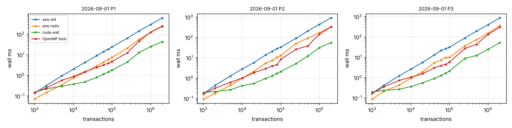
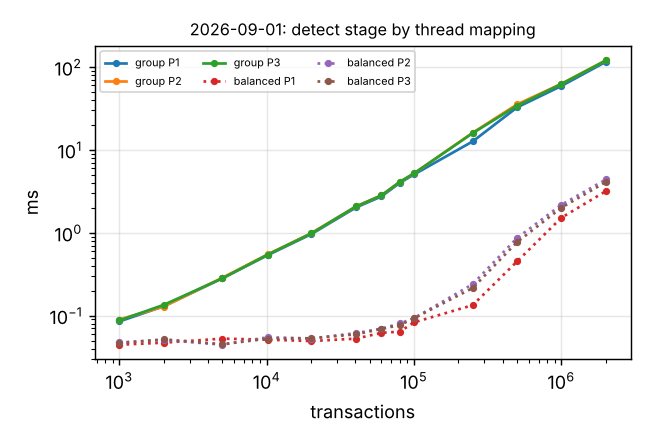
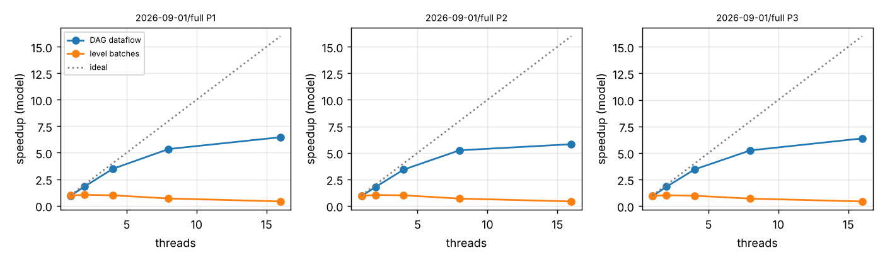

# Phases 8-10 results

## Machine (non-negotiable 4)

```
date: 2026-11-01T20:01:34Z   host: sucheth-katte-ASUS-TUF-Gaming-F15-FX507VU-FX507VU   data: dataset.csv
threads swept: 1,2,4,8,16   runs: 1 warm-up + 2 measured
Linux sucheth-katte-ASUS-TUF-Gaming-F15-FX507VU-FX507VU 7.0.0-42-generic #42~24.04.1-Ubuntu SMP PREEMPT_DYNAMIC Mon Oct 19 14:43:01 UTC 2 x86_64 x86_64 x86_64 GNU/Linux
CPU(s):                                  16
Model name:                              13th Gen Intel(R) Core(TM) i7-13620H
Thread(s) per core:                      2
Core(s) per socket:                      10
CPU(s) scaling MHz:                      68%
               total        used        free      shared  buff/cache   available
Mem:            15Gi       8.3Gi       278Mi       1.1Gi       8.1Gi       6.9Gi
name, memory.total [MiB], driver_version
NVIDIA GeForce RTX 4050 Laptop GPU, 6141 MiB, 595.99.02
Build cuda_13.2.r13.2/compiler.37953736_0
```

## Correctness gates (non-negotiable 1: no timing without correctness)

| check | result | last line |
|---|---|---|
| tests.txt | PASS | 38 tests, 0 failed checks |
| stages.txt | not run | |
| verify.txt | PASS | ALL GPU CHECKS PASSED |
| identical.txt | not run | |
| validator.txt | not run | |

## Phase 8: end to end, wall time (ms, median)

GPU = balanced detection + sequential sweep for levelling (as the handover asks), transfers and host staging included. `device` = H2D + kernels + D2H on the GPU timeline; `kernels` = stages 1-3 kernels only.

| day | n | pol | seq-std | seq-radix | OpenMP best (threads) | GPU wall | GPU device | GPU kernels | vs seq-std | vs seq-radix | vs OpenMP |
|---|---:|---|---:|---:|---:|---:|---:|---:|---:|---:|---:|
| 2026-09-01 | 1,000 | P1 | 0.14 | 0.07 | 0.14 (1) | 0.15 | 0.13 | 0.11 | 0.90x | 0.46x | 0.93x |
| 2026-09-01 | 2,000 | P1 | 0.32 | 0.15 | 0.25 (1) | 0.22 | 0.19 | 0.15 | 1.45x | 0.67x | 1.12x |
| 2026-09-01 | 5,000 | P1 | 0.95 | 0.34 | 0.58 (4) | 0.30 | 0.25 | 0.19 | 3.19x | 1.15x | 1.96x |
| 2026-09-01 | 10,176 | P1 | 2.02 | 0.78 | 0.89 (4) | 0.38 | 0.31 | 0.19 | 5.38x | 2.07x | 2.36x |
| 2026-09-01 | 20,101 | P1 | 4.28 | 1.41 | 1.52 (4) | 0.48 | 0.40 | 0.21 | 8.84x | 2.92x | 3.14x |
| 2026-09-01 | 40,366 | P1 | 9.06 | 2.87 | 2.45 (4) | 0.81 | 0.66 | 0.23 | 11.25x | 3.56x | 3.03x |
| 2026-09-01 | 60,044 | P1 | 14.22 | 4.36 | 3.15 (8) | 1.15 | 0.91 | 0.28 | 12.41x | 3.81x | 2.75x |
| 2026-09-01 | 80,100 | P1 | 18.71 | 5.89 | 3.84 (8) | 1.45 | 1.16 | 0.31 | 12.88x | 4.06x | 2.64x |
| 2026-09-01 | 100,098 | P1 | 24.20 | 7.41 | 4.71 (8) | 1.80 | 1.44 | 0.37 | 13.42x | 4.11x | 2.61x |
| 2026-09-01 | 250,058 | P1 | 64.53 | 21.17 | 12.48 (8) | 4.43 | 3.30 | 0.68 | 14.56x | 4.78x | 2.82x |
| 2026-09-01 | 500,117 | P1 | 143.67 | 54.96 | 45.52 (8) | 12.80 | 8.38 | 2.16 | 11.22x | 4.29x | 3.56x |
| 2026-09-01 | 1,000,002 | P1 | 295.35 | 122.71 | 125.90 (8) | 24.86 | 18.06 | 5.88 | 11.88x | 4.94x | 5.06x |
| 2026-09-01 | 2,013,158 | P1 | 622.35 | 232.76 | 250.47 (8) | 43.04 | 35.20 | 13.50 | 14.46x | 5.41x | 5.82x |
| 2026-09-01 | 1,000 | P2 | 0.17 | 0.09 | 0.17 (1) | 0.20 | 0.18 | 0.15 | 0.88x | 0.47x | 0.85x |
| 2026-09-01 | 2,000 | P2 | 0.44 | 0.18 | 0.32 (1) | 0.22 | 0.19 | 0.16 | 2.02x | 0.81x | 1.47x |
| 2026-09-01 | 5,000 | P2 | 1.26 | 0.45 | 0.62 (4) | 0.27 | 0.24 | 0.19 | 4.73x | 1.67x | 2.32x |
| 2026-09-01 | 10,176 | P2 | 2.83 | 1.00 | 1.01 (4) | 0.42 | 0.35 | 0.22 | 6.69x | 2.35x | 2.38x |
| 2026-09-01 | 20,101 | P2 | 5.72 | 2.13 | 1.84 (4) | 0.54 | 0.44 | 0.23 | 10.57x | 3.93x | 3.39x |
| 2026-09-01 | 40,366 | P2 | 13.49 | 5.31 | 2.89 (8) | 0.95 | 0.76 | 0.28 | 14.26x | 5.62x | 3.05x |
| 2026-09-01 | 60,044 | P2 | 20.41 | 7.40 | 3.90 (8) | 1.27 | 1.04 | 0.34 | 16.01x | 5.81x | 3.06x |
| 2026-09-01 | 80,100 | P2 | 27.54 | 10.52 | 4.56 (8) | 1.67 | 1.36 | 0.42 | 16.47x | 6.29x | 2.73x |
| 2026-09-01 | 100,098 | P2 | 32.89 | 12.70 | 8.30 (8) | 2.08 | 1.70 | 0.50 | 15.78x | 6.09x | 3.99x |
| 2026-09-01 | 250,058 | P2 | 89.59 | 50.08 | 26.03 (8) | 5.12 | 4.10 | 1.18 | 17.50x | 9.78x | 5.09x |
| 2026-09-01 | 500,117 | P2 | 203.83 | 90.22 | 37.56 (16) | 11.88 | 9.86 | 3.85 | 17.16x | 7.60x | 3.16x |
| 2026-09-01 | 1,000,002 | P2 | 431.94 | 167.87 | 141.96 (8) | 31.21 | 24.66 | 8.80 | 13.84x | 5.38x | 4.55x |
| 2026-09-01 | 2,013,158 | P2 | 904.65 | 332.27 | 327.84 (16) | 54.39 | 45.51 | 19.27 | 16.63x | 6.11x | 6.03x |
| 2026-09-01 | 1,000 | P3 | 0.17 | 0.09 | 0.17 (1) | 0.19 | 0.18 | 0.15 | 0.87x | 0.45x | 0.85x |
| 2026-09-01 | 2,000 | P3 | 0.42 | 0.21 | 0.35 (1) | 0.23 | 0.21 | 0.17 | 1.78x | 0.90x | 1.51x |
| 2026-09-01 | 5,000 | P3 | 1.21 | 0.43 | 0.73 (2) | 0.27 | 0.24 | 0.19 | 4.55x | 1.62x | 2.73x |
| 2026-09-01 | 10,176 | P3 | 2.65 | 0.93 | 1.05 (4) | 0.36 | 0.31 | 0.20 | 7.29x | 2.57x | 2.89x |
| 2026-09-01 | 20,101 | P3 | 5.54 | 1.92 | 1.54 (4) | 0.55 | 0.45 | 0.22 | 10.05x | 3.49x | 2.79x |
| 2026-09-01 | 40,366 | P3 | 12.92 | 5.31 | 3.01 (4) | 0.90 | 0.75 | 0.28 | 14.34x | 5.90x | 3.34x |
| 2026-09-01 | 60,044 | P3 | 21.56 | 7.20 | 3.90 (8) | 1.26 | 1.02 | 0.34 | 17.08x | 5.71x | 3.09x |
| 2026-09-01 | 80,100 | P3 | 26.11 | 9.72 | 4.48 (8) | 1.63 | 1.33 | 0.41 | 16.01x | 5.96x | 2.74x |
| 2026-09-01 | 100,098 | P3 | 31.54 | 9.95 | 5.75 (8) | 2.07 | 1.63 | 0.49 | 15.23x | 4.81x | 2.78x |
| 2026-09-01 | 250,058 | P3 | 87.26 | 36.22 | 27.07 (8) | 8.71 | 5.69 | 1.15 | 10.02x | 4.16x | 3.11x |
| 2026-09-01 | 500,117 | P3 | 191.73 | 71.84 | 42.80 (8) | 12.11 | 9.75 | 3.70 | 15.83x | 5.93x | 3.53x |
| 2026-09-01 | 1,000,002 | P3 | 397.38 | 151.96 | 133.42 (8) | 24.27 | 20.08 | 8.25 | 16.38x | 6.26x | 5.50x |
| 2026-09-01 | 2,013,158 | P3 | 863.06 | 359.90 | 299.28 (16) | 51.24 | 42.60 | 18.25 | 16.84x | 7.02x | 5.84x |

### Crossover (wall time, transfers charged)

Measured = smallest tested size where the GPU is faster. Model = least-squares lines t = a + b·n through each implementation's points at n ≤ 20k (the region around the crossover); the model crossover is where the lines meet, n* = (a_gpu − a_cpu) / (b_cpu − b_gpu). a_gpu is the GPU's fixed cost per call (launches, synchronisations, transfer latency), b the cost per transaction.

| day | pol | beats seq-radix at n ≥ (measured) | model n* vs seq-radix | beats OpenMP at n ≥ (measured) | model n* vs OpenMP | GPU fixed cost a (ms) |
|---|---|---:|---:|---:|---:|---:|
| 2026-09-01 | P1 | 5000 | 3,199 | 2000 | 1,081 | 0.159 |
| 2026-09-01 | P2 | 5000 | 2,493 | 2000 | 631 | 0.164 |
| 2026-09-01 | P3 | 5000 | 2,469 | 2000 | 482 | 0.186 |

### Transfer-cost arithmetic (largest super-block per day and policy)

Bytes moved: H2D = 40·n (the transaction records); D2H = 8·(n+1) row offsets + 4·m column indices (+ 4·n levels when levelling on the GPU). Measured times are cudaEvent intervals; the share is of GPU wall time. Host prep = id check + copy into the pinned staging buffer; host post = copy out of the pinned buffers.

| day | pol | n | H2D MB | D2H MB | H2D ms (pred.) | D2H ms (pred.) | transfer % of wall | host prep ms | host post ms | wall − device ms |
|---|---|---:|---:|---:|---:|---:|---:|---:|---:|---:|
| 2026-09-01 | P1 | 2,013,158 | 80.5 | 28.4 | 7.11 (–) | 3.48 (–) | 25% | – | – | 7.84 |
| 2026-09-01 | P2 | 2,013,158 | 80.5 | 31.1 | 7.46 (–) | 3.72 (–) | 21% | – | – | 8.88 |
| 2026-09-01 | P3 | 2,013,158 | 80.5 | 29.0 | 7.12 (–) | 3.25 (–) | 20% | – | – | 8.64 |

## GPU stage breakdown at the largest super-block (ms)

| day | pol | n | H2D | extract | sort | detect | csr | D2H | level (CPU sweep) | device | wall | launches | host syncs | device MB |
|---|---|---:|---:|---:|---:|---:|---:|---:|---:|---:|---:|---:|---:|---:|
| 2026-09-01 | P1 | 2,013,158 | 7.11 | 1.25 | 6.19 | 3.19 | 2.87 | 3.48 | 11.11 | 35.20 | 43.04 | 17 | 6 | 707.0 |
| 2026-09-01 | P2 | 2,013,158 | 7.46 | 1.94 | 9.14 | 4.41 | 3.78 | 3.72 | 15.05 | 45.51 | 54.39 | 17 | 6 | 967.3 |
| 2026-09-01 | P3 | 2,013,158 | 7.12 | 1.95 | 9.16 | 4.10 | 3.03 | 3.25 | 13.98 | 42.60 | 51.24 | 17 | 6 | 967.3 |

## Phase 9: skew (detection stage, three thread mappings)

Before = one thread per key group (`group`); `record` = one thread per record; after = one thread per output edge (`balanced`, load-balanced search). Imbalance = max ÷ mean work per thread, computed from the key groups (1.0 = even). Recovery = group time ÷ mapping time.

Detect time across sizes (from the factorial sweep):

| day | pol | n | largest group | group ms | record ms | balanced ms | recovery |
|---|---|---:|---:|---:|---:|---:|---:|
| 2026-09-01 | P1 | 1,000 | 204 | 0.085 | – | 0.044 | 1.91x |
| 2026-09-01 | P1 | 2,000 | 376 | 0.130 | – | 0.047 | 2.75x |
| 2026-09-01 | P1 | 5,000 | 1,008 | 0.282 | – | 0.053 | 5.34x |
| 2026-09-01 | P1 | 10,176 | 2,042 | 0.537 | – | 0.051 | 10.48x |
| 2026-09-01 | P1 | 20,101 | 3,785 | 0.964 | – | 0.049 | 19.55x |
| 2026-09-01 | P1 | 40,366 | 8,182 | 2.017 | – | 0.053 | 38.27x |
| 2026-09-01 | P1 | 60,044 | 12,120 | 2.742 | – | 0.062 | 44.30x |
| 2026-09-01 | P1 | 80,100 | 16,303 | 4.004 | – | 0.064 | 62.46x |
| 2026-09-01 | P1 | 100,098 | 20,805 | 5.056 | – | 0.083 | 61.00x |
| 2026-09-01 | P1 | 250,058 | 52,070 | 12.651 | – | 0.134 | 94.69x |
| 2026-09-01 | P1 | 500,117 | 99,623 | 32.548 | – | 0.450 | 72.31x |
| 2026-09-01 | P1 | 1,000,002 | 190,326 | 59.072 | – | 1.518 | 38.92x |
| 2026-09-01 | P1 | 2,013,158 | 388,725 | 116.086 | – | 3.191 | 36.38x |
| 2026-09-01 | P2 | 1,000 | 204 | 0.090 | – | 0.047 | 1.89x |
| 2026-09-01 | P2 | 2,000 | 376 | 0.129 | – | 0.051 | 2.53x |
| 2026-09-01 | P2 | 5,000 | 1,008 | 0.286 | – | 0.045 | 6.42x |
| 2026-09-01 | P2 | 10,176 | 2,042 | 0.547 | – | 0.055 | 9.99x |
| 2026-09-01 | P2 | 20,101 | 3,785 | 0.989 | – | 0.053 | 18.69x |
| 2026-09-01 | P2 | 40,366 | 8,182 | 2.074 | – | 0.061 | 33.79x |
| 2026-09-01 | P2 | 60,044 | 12,120 | 2.822 | – | 0.070 | 40.60x |
| 2026-09-01 | P2 | 80,100 | 16,303 | 4.110 | – | 0.080 | 51.19x |
| 2026-09-01 | P2 | 100,098 | 20,805 | 5.202 | – | 0.093 | 55.87x |
| 2026-09-01 | P2 | 250,058 | 52,070 | 16.101 | – | 0.240 | 67.20x |
| 2026-09-01 | P2 | 500,117 | 99,623 | 35.398 | – | 0.863 | 41.01x |
| 2026-09-01 | P2 | 1,000,002 | 190,326 | 62.713 | – | 2.174 | 28.85x |
| 2026-09-01 | P2 | 2,013,158 | 388,725 | 120.555 | – | 4.413 | 27.32x |
| 2026-09-01 | P3 | 1,000 | 204 | 0.087 | – | 0.047 | 1.88x |
| 2026-09-01 | P3 | 2,000 | 376 | 0.135 | – | 0.052 | 2.61x |
| 2026-09-01 | P3 | 5,000 | 1,008 | 0.282 | – | 0.045 | 6.24x |
| 2026-09-01 | P3 | 10,176 | 2,042 | 0.546 | – | 0.053 | 10.36x |
| 2026-09-01 | P3 | 20,101 | 3,785 | 0.981 | – | 0.053 | 18.41x |
| 2026-09-01 | P3 | 40,366 | 8,182 | 2.075 | – | 0.059 | 34.93x |
| 2026-09-01 | P3 | 60,044 | 12,120 | 2.821 | – | 0.069 | 40.83x |
| 2026-09-01 | P3 | 80,100 | 16,303 | 4.111 | – | 0.077 | 53.53x |
| 2026-09-01 | P3 | 100,098 | 20,805 | 5.214 | – | 0.093 | 56.06x |
| 2026-09-01 | P3 | 250,058 | 52,070 | 15.928 | – | 0.215 | 74.08x |
| 2026-09-01 | P3 | 500,117 | 99,623 | 34.125 | – | 0.770 | 44.34x |
| 2026-09-01 | P3 | 1,000,002 | 190,326 | 62.366 | – | 2.007 | 31.07x |
| 2026-09-01 | P3 | 2,013,158 | 388,725 | 120.577 | – | 4.104 | 29.38x |

## Stage 4: levelling / batching, GPU methods vs the CPU sweep

`rounds` = batches; `tail` = rounds run inside the persistent single block. Jones-Plassmann is skipped above its size cap.

| day | pol | n | method | batches | rounds | tail | launches | level ms | wall ms |
|---|---|---:|---|---:|---:|---:|---:|---:|---:|
| 2026-09-01 | P1 | 2,013,158 | sweep | 401,223 | 0 | 0 | 17 | 11.107 | 43.04 |
| 2026-09-01 | P1 | 2,013,158 | kahn | 401,223 | 401,223 | 401,191 | 84 | 390.461 | 425.35 |
| 2026-09-01 | P2 | 2,013,158 | sweep | 401,223 | 0 | 0 | 17 | 15.049 | 54.39 |
| 2026-09-01 | P2 | 2,013,158 | kahn | 401,223 | 401,223 | 401,191 | 84 | 487.540 | 532.94 |
| 2026-09-01 | P3 | 2,013,158 | sweep | 392,438 | 0 | 0 | 17 | 13.982 | 51.24 |
| 2026-09-01 | P3 | 2,013,158 | kahn | 392,438 | 392,438 | 392,374 | 149 | 445.692 | 485.41 |





## Schedule quality and the batch-execution model

Speedup = serial gas ÷ modelled makespan on W workers (gas as cost, LPT list scheduling inside a batch, batches in sequence). `bound` = per-key lower bound on batches for any schedule. `levels` preserve block order; `jp-random` may reorder.

| block | n | pol | method | batches | bound | tx/batch | W=8 | W=16 | W=32 | W=64 | W=inf |
|---|---:|---|---|---:|---:|---:|---:|---:|---:|---:|---:|
| 2026-09-01/10k/099 | 10,176 | P1 | levels | 2,058 | 2,042 | 4.9 | 2.99 | 3.16 | 3.22 | 3.23 | 3.23 |
| 2026-09-01/10k/099 | 10,176 | P1 | jp-random1 | 2,042 | 2,042 | 5.0 | 3.15 | 3.36 | 3.45 | 3.46 | 3.46 |
| 2026-09-01/10k/099 | 10,176 | P1 | jp-random2 | 2,042 | 2,042 | 5.0 | 3.30 | 3.55 | 3.63 | 3.64 | 3.64 |
| 2026-09-01/10k/099 | 10,176 | P1 | jp-random3 | 2,043 | 2,042 | 5.0 | 3.31 | 3.51 | 3.61 | 3.63 | 3.63 |
| 2026-09-01/10k/099 | 10,176 | P2 | levels | 2,058 | 2,042 | 4.9 | 2.99 | 3.16 | 3.22 | 3.23 | 3.23 |
| 2026-09-01/10k/099 | 10,176 | P2 | jp-random1 | 2,042 | 2,042 | 5.0 | 3.15 | 3.36 | 3.45 | 3.46 | 3.46 |
| 2026-09-01/10k/099 | 10,176 | P2 | jp-random2 | 2,042 | 2,042 | 5.0 | 3.30 | 3.55 | 3.63 | 3.64 | 3.64 |
| 2026-09-01/10k/099 | 10,176 | P2 | jp-random3 | 2,043 | 2,042 | 5.0 | 3.31 | 3.51 | 3.61 | 3.63 | 3.63 |
| 2026-09-01/10k/099 | 10,176 | P3 | levels | 2,058 | 2,042 | 4.9 | 2.98 | 3.16 | 3.22 | 3.23 | 3.23 |
| 2026-09-01/10k/099 | 10,176 | P3 | jp-random1 | 2,042 | 2,042 | 5.0 | 3.15 | 3.37 | 3.47 | 3.48 | 3.48 |
| 2026-09-01/10k/099 | 10,176 | P3 | jp-random2 | 2,042 | 2,042 | 5.0 | 3.29 | 3.54 | 3.63 | 3.64 | 3.64 |
| 2026-09-01/10k/099 | 10,176 | P3 | jp-random3 | 2,043 | 2,042 | 5.0 | 3.30 | 3.51 | 3.61 | 3.64 | 3.64 |
| 2026-09-01/20k/049 | 20,101 | P1 | levels | 3,891 | 3,785 | 5.2 | 3.05 | 3.27 | 3.35 | 3.36 | 3.36 |
| 2026-09-01/20k/049 | 20,101 | P1 | jp-random1 | 3,785 | 3,785 | 5.3 | 3.36 | 3.67 | 3.76 | 3.78 | 3.78 |
| 2026-09-01/20k/049 | 20,101 | P1 | jp-random2 | 3,785 | 3,785 | 5.3 | 3.24 | 3.51 | 3.61 | 3.62 | 3.62 |
| 2026-09-01/20k/049 | 20,101 | P1 | jp-random3 | 3,786 | 3,785 | 5.3 | 3.26 | 3.51 | 3.59 | 3.61 | 3.61 |
| 2026-09-01/20k/049 | 20,101 | P2 | levels | 3,891 | 3,785 | 5.2 | 3.05 | 3.27 | 3.35 | 3.36 | 3.36 |
| 2026-09-01/20k/049 | 20,101 | P2 | jp-random1 | 3,785 | 3,785 | 5.3 | 3.36 | 3.67 | 3.76 | 3.78 | 3.78 |
| 2026-09-01/20k/049 | 20,101 | P2 | jp-random2 | 3,785 | 3,785 | 5.3 | 3.24 | 3.51 | 3.61 | 3.62 | 3.62 |
| 2026-09-01/20k/049 | 20,101 | P2 | jp-random3 | 3,786 | 3,785 | 5.3 | 3.26 | 3.51 | 3.59 | 3.61 | 3.61 |
| 2026-09-01/20k/049 | 20,101 | P3 | levels | 3,891 | 3,785 | 5.2 | 3.07 | 3.29 | 3.38 | 3.39 | 3.39 |
| 2026-09-01/20k/049 | 20,101 | P3 | jp-random1 | 3,785 | 3,785 | 5.3 | 3.36 | 3.66 | 3.76 | 3.78 | 3.78 |
| 2026-09-01/20k/049 | 20,101 | P3 | jp-random2 | 3,785 | 3,785 | 5.3 | 3.25 | 3.53 | 3.62 | 3.64 | 3.64 |
| 2026-09-01/20k/049 | 20,101 | P3 | jp-random3 | 3,786 | 3,785 | 5.3 | 3.25 | 3.50 | 3.59 | 3.60 | 3.60 |
| 2026-09-01/40k/025 | 40,366 | P1 | levels | 8,268 | 8,182 | 4.9 | 2.75 | 2.90 | 2.95 | 2.96 | 2.96 |
| 2026-09-01/40k/025 | 40,366 | P1 | jp-random1 | 8,182 | 8,182 | 4.9 | 2.89 | 3.06 | 3.11 | 3.12 | 3.12 |
| 2026-09-01/40k/025 | 40,366 | P1 | jp-random2 | 8,186 | 8,182 | 4.9 | 2.87 | 3.04 | 3.09 | 3.10 | 3.10 |
| 2026-09-01/40k/025 | 40,366 | P1 | jp-random3 | 8,182 | 8,182 | 4.9 | 2.90 | 3.06 | 3.13 | 3.13 | 3.13 |
| 2026-09-01/40k/025 | 40,366 | P2 | levels | 8,268 | 8,182 | 4.9 | 2.75 | 2.90 | 2.95 | 2.96 | 2.96 |
| 2026-09-01/40k/025 | 40,366 | P2 | jp-random1 | 8,182 | 8,182 | 4.9 | 2.89 | 3.06 | 3.11 | 3.12 | 3.12 |
| 2026-09-01/40k/025 | 40,366 | P2 | jp-random2 | 8,186 | 8,182 | 4.9 | 2.87 | 3.04 | 3.09 | 3.10 | 3.10 |
| 2026-09-01/40k/025 | 40,366 | P2 | jp-random3 | 8,182 | 8,182 | 4.9 | 2.90 | 3.06 | 3.13 | 3.13 | 3.13 |
| 2026-09-01/40k/025 | 40,366 | P3 | levels | 8,268 | 8,182 | 4.9 | 2.77 | 2.93 | 2.99 | 2.99 | 2.99 |
| 2026-09-01/40k/025 | 40,366 | P3 | jp-random1 | 8,182 | 8,182 | 4.9 | 2.90 | 3.07 | 3.13 | 3.14 | 3.14 |
| 2026-09-01/40k/025 | 40,366 | P3 | jp-random2 | 8,186 | 8,182 | 4.9 | 2.88 | 3.06 | 3.12 | 3.13 | 3.13 |
| 2026-09-01/40k/025 | 40,366 | P3 | jp-random3 | 8,182 | 8,182 | 4.9 | 2.90 | 3.07 | 3.14 | 3.15 | 3.15 |
| 2026-09-01/60k/016 | 60,044 | P1 | levels | 12,311 | 12,120 | 4.9 | 2.75 | 2.89 | 2.94 | 2.94 | 2.94 |
| 2026-09-01/60k/016 | 60,044 | P1 | jp-random1 | 12,122 | 12,120 | 5.0 | 2.81 | 2.96 | 3.01 | 3.02 | 3.02 |
| 2026-09-01/60k/016 | 60,044 | P1 | jp-random2 | 12,120 | 12,120 | 5.0 | 2.82 | 2.97 | 3.01 | 3.02 | 3.02 |
| 2026-09-01/60k/016 | 60,044 | P1 | jp-random3 | 12,121 | 12,120 | 5.0 | 2.82 | 2.97 | 3.03 | 3.04 | 3.04 |
| 2026-09-01/60k/016 | 60,044 | P2 | levels | 12,311 | 12,120 | 4.9 | 2.75 | 2.89 | 2.94 | 2.94 | 2.94 |
| 2026-09-01/60k/016 | 60,044 | P2 | jp-random1 | 12,122 | 12,120 | 5.0 | 2.81 | 2.96 | 3.01 | 3.02 | 3.02 |
| 2026-09-01/60k/016 | 60,044 | P2 | jp-random2 | 12,120 | 12,120 | 5.0 | 2.82 | 2.97 | 3.01 | 3.02 | 3.02 |
| 2026-09-01/60k/016 | 60,044 | P2 | jp-random3 | 12,121 | 12,120 | 5.0 | 2.82 | 2.97 | 3.03 | 3.04 | 3.04 |
| 2026-09-01/60k/016 | 60,044 | P3 | levels | 12,308 | 12,120 | 4.9 | 2.76 | 2.91 | 2.95 | 2.96 | 2.96 |
| 2026-09-01/60k/016 | 60,044 | P3 | jp-random1 | 12,122 | 12,120 | 5.0 | 2.82 | 2.97 | 3.03 | 3.04 | 3.04 |
| 2026-09-01/60k/016 | 60,044 | P3 | jp-random2 | 12,120 | 12,120 | 5.0 | 2.82 | 2.98 | 3.03 | 3.04 | 3.04 |
| 2026-09-01/60k/016 | 60,044 | P3 | jp-random3 | 12,121 | 12,120 | 5.0 | 2.83 | 3.00 | 3.05 | 3.06 | 3.06 |
| 2026-09-01/80k/012 | 80,100 | P1 | levels | 16,538 | 16,303 | 4.8 | 2.68 | 2.81 | 2.85 | 2.86 | 2.86 |
| 2026-09-01/80k/012 | 80,100 | P1 | jp-random1 | 16,303 | 16,303 | 4.9 | 2.72 | 2.85 | 2.89 | 2.90 | 2.90 |
| 2026-09-01/80k/012 | 80,100 | P1 | jp-random2 | 16,303 | 16,303 | 4.9 | 2.79 | 2.95 | 2.99 | 3.01 | 3.01 |
| 2026-09-01/80k/012 | 80,100 | P1 | jp-random3 | 16,303 | 16,303 | 4.9 | 2.79 | 2.94 | 2.99 | 3.00 | 3.00 |
| 2026-09-01/80k/012 | 80,100 | P2 | levels | 16,538 | 16,303 | 4.8 | 2.68 | 2.81 | 2.85 | 2.86 | 2.86 |
| 2026-09-01/80k/012 | 80,100 | P2 | jp-random1 | 16,303 | 16,303 | 4.9 | 2.72 | 2.85 | 2.89 | 2.90 | 2.90 |
| 2026-09-01/80k/012 | 80,100 | P2 | jp-random2 | 16,303 | 16,303 | 4.9 | 2.79 | 2.95 | 2.99 | 3.01 | 3.01 |
| 2026-09-01/80k/012 | 80,100 | P2 | jp-random3 | 16,303 | 16,303 | 4.9 | 2.79 | 2.94 | 2.99 | 3.00 | 3.00 |
| 2026-09-01/80k/012 | 80,100 | P3 | levels | 16,535 | 16,303 | 4.8 | 2.69 | 2.83 | 2.87 | 2.88 | 2.88 |
| 2026-09-01/80k/012 | 80,100 | P3 | jp-random1 | 16,303 | 16,303 | 4.9 | 2.73 | 2.87 | 2.91 | 2.93 | 2.93 |
| 2026-09-01/80k/012 | 80,100 | P3 | jp-random2 | 16,303 | 16,303 | 4.9 | 2.81 | 2.97 | 3.02 | 3.04 | 3.04 |
| 2026-09-01/80k/012 | 80,100 | P3 | jp-random3 | 16,303 | 16,303 | 4.9 | 2.81 | 2.96 | 3.01 | 3.02 | 3.02 |
| 2026-09-01/100k/010 | 100,098 | P1 | levels | 21,013 | 20,805 | 4.8 | 2.61 | 2.71 | 2.75 | 2.76 | 2.76 |
| 2026-09-01/100k/010 | 100,098 | P1 | jp-random1 | 20,805 | 20,805 | 4.8 | 2.59 | 2.71 | 2.75 | 2.76 | 2.76 |
| 2026-09-01/100k/010 | 100,098 | P1 | jp-random2 | 20,806 | 20,805 | 4.8 | 2.68 | 2.80 | 2.84 | 2.85 | 2.85 |
| 2026-09-01/100k/010 | 100,098 | P1 | jp-random3 | 20,805 | 20,805 | 4.8 | 2.62 | 2.73 | 2.77 | 2.78 | 2.78 |
| 2026-09-01/100k/010 | 100,098 | P2 | levels | 21,013 | 20,805 | 4.8 | 2.61 | 2.71 | 2.75 | 2.76 | 2.76 |
| 2026-09-01/100k/010 | 100,098 | P2 | jp-random1 | 20,805 | 20,805 | 4.8 | 2.59 | 2.71 | 2.75 | 2.76 | 2.76 |
| 2026-09-01/100k/010 | 100,098 | P2 | jp-random2 | 20,806 | 20,805 | 4.8 | 2.68 | 2.80 | 2.84 | 2.85 | 2.85 |
| 2026-09-01/100k/010 | 100,098 | P2 | jp-random3 | 20,805 | 20,805 | 4.8 | 2.62 | 2.73 | 2.77 | 2.78 | 2.78 |
| 2026-09-01/100k/010 | 100,098 | P3 | levels | 21,013 | 20,805 | 4.8 | 2.62 | 2.74 | 2.78 | 2.79 | 2.79 |
| 2026-09-01/100k/010 | 100,098 | P3 | jp-random1 | 20,805 | 20,805 | 4.8 | 2.60 | 2.72 | 2.77 | 2.78 | 2.78 |
| 2026-09-01/100k/010 | 100,098 | P3 | jp-random2 | 20,806 | 20,805 | 4.8 | 2.68 | 2.81 | 2.86 | 2.87 | 2.87 |
| 2026-09-01/100k/010 | 100,098 | P3 | jp-random3 | 20,805 | 20,805 | 4.8 | 2.63 | 2.75 | 2.80 | 2.81 | 2.81 |
| 2026-09-01/250k/004 | 250,058 | P1 | levels | 52,720 | 52,070 | 4.7 | 2.38 | 2.46 | 2.49 | 2.50 | 2.50 |
| 2026-09-01/250k/004 | 250,058 | P2 | levels | 52,720 | 52,070 | 4.7 | 2.38 | 2.46 | 2.49 | 2.50 | 2.50 |
| 2026-09-01/250k/004 | 250,058 | P3 | levels | 52,715 | 52,070 | 4.7 | 2.39 | 2.48 | 2.51 | 2.52 | 2.52 |
| 2026-09-01/500k/002 | 500,117 | P1 | levels | 100,929 | 99,623 | 5.0 | 2.31 | 2.38 | 2.40 | 2.41 | 2.41 |
| 2026-09-01/500k/002 | 500,117 | P2 | levels | 100,929 | 99,618 | 5.0 | 2.31 | 2.38 | 2.40 | 2.41 | 2.41 |
| 2026-09-01/500k/002 | 500,117 | P3 | levels | 100,913 | 99,618 | 5.0 | 2.31 | 2.38 | 2.41 | 2.42 | 2.42 |
| 2026-09-01/1000k/001 | 1,000,002 | P1 | levels | 192,745 | 190,326 | 5.2 | 2.14 | 2.18 | 2.20 | 2.20 | 2.20 |
| 2026-09-01/1000k/001 | 1,000,002 | P2 | levels | 192,745 | 190,320 | 5.2 | 2.14 | 2.18 | 2.20 | 2.20 | 2.20 |
| 2026-09-01/1000k/001 | 1,000,002 | P3 | levels | 192,531 | 190,320 | 5.2 | 2.14 | 2.19 | 2.20 | 2.21 | 2.21 |
| 2026-09-01/full | 2,013,158 | P1 | levels | 401,223 | 388,725 | 5.0 | 1.95 | 1.97 | 1.98 | 1.99 | 1.99 |
| 2026-09-01/full | 2,013,158 | P2 | levels | 401,223 | 388,715 | 5.0 | 1.95 | 1.97 | 1.98 | 1.99 | 1.99 |
| 2026-09-01/full | 2,013,158 | P3 | levels | 392,438 | 388,715 | 5.1 | 1.96 | 1.99 | 2.00 | 2.01 | 2.01 |

## Execution MODEL: every transaction of the day

**This is a model, not an Ethereum client.** Each transaction does work proportional to its gas on a toy state of one word per state key, over its real read/write set; every parallel run must reproduce the serial run's final state and all outputs. `levels` = batch by batch with a barrier (bulk-synchronous); `DAG` = dataflow list scheduling on the dependency DAG, a standard technique (Kwok & Ahmad 1999; Graham 1969). Times are measured on this machine's CPU threads; the W = ∞ columns are model bounds.

| block | pol | n | batches | preprocessing seq-std / OpenMP / GPU wall (ms) | serial (s) | best levels (s, x) | best DAG (s, x) | preprocessing + DAG vs serial | bound levels W=∞ | bound DAG W=∞ |
|---|---|---:|---:|---|---:|---|---|---:|---:|---:|
| 2026-09-01/full | P1 | 2,013,158 | 401,223 | 632 / 212 / 43 | 3.483 | 3.418 (1.02x, 2t) | 0.539 (6.46x, 16t) | 5.98x | 1.99x | 10.93x |
| 2026-09-01/full | P2 | 2,013,158 | 401,223 | 883 / 266 / 53 | 3.489 | 3.425 (1.02x, 2t) | 0.601 (5.81x, 16t) | 5.34x | 1.99x | 10.93x |
| 2026-09-01/full | P3 | 2,013,158 | 392,438 | 816 / 261 / 51 | 3.495 | 3.450 (1.01x, 2t) | 0.549 (6.37x, 16t) | 5.83x | 2.01x | 10.94x |


