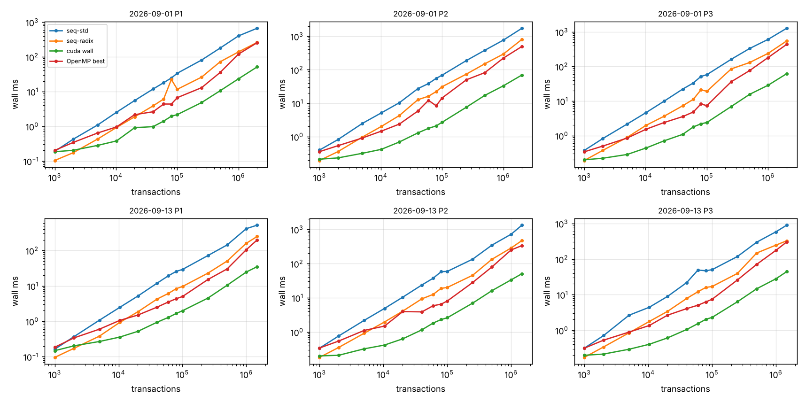
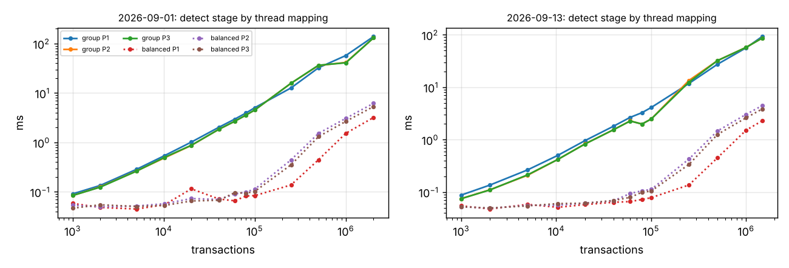
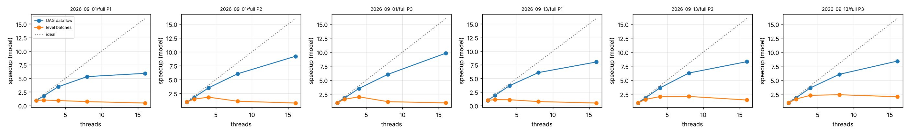

# Phases 8-10 results

## Machine (non-negotiable 4)

```
date: 2026-11-02T13:40:38Z   host: sucheth-katte-ASUS-TUF-Gaming-F15-FX507VU-FX507VU   data: datasets
threads swept: 1,2,4,8,16   runs: 1 warm-up + 2 measured
Linux sucheth-katte-ASUS-TUF-Gaming-F15-FX507VU-FX507VU 7.0.0-42-generic #42~24.04.1-Ubuntu SMP PREEMPT_DYNAMIC Mon Oct 19 14:43:01 UTC 2 x86_64 x86_64 x86_64 GNU/Linux
CPU(s):                                  16
Model name:                              13th Gen Intel(R) Core(TM) i7-13620H
Thread(s) per core:                      2
Core(s) per socket:                      10
CPU(s) scaling MHz:                      66%
               total        used        free      shared  buff/cache   available
Mem:            15Gi       7.8Gi       967Mi       935Mi       7.7Gi       7.4Gi
name, memory.total [MiB], driver_version
NVIDIA GeForce RTX 4050 Laptop GPU, 6141 MiB, 595.99.02
nvcc: not found
```

## Correctness gates (non-negotiable 1: no timing without correctness)

| check | result | last line |
|---|---|---|
| tests.txt | PASS | 38 tests, 0 failed checks |
| stages.txt | not run | |
| verify.txt | PASS | ALL GPU CHECKS PASSED |
| identical.txt | not run | |
| validator.txt | not run | |

## Phase 8: end to end, wall time (ms, median)

GPU = balanced detection + sequential sweep for levelling (as the handover asks), transfers and host staging included. `device` = H2D + kernels + D2H on the GPU timeline; `kernels` = stages 1-3 kernels only.

| day | n | pol | seq-std | seq-radix | OpenMP best (threads) | GPU wall | GPU device | GPU kernels | vs seq-std | vs seq-radix | vs OpenMP |
|---|---:|---|---:|---:|---:|---:|---:|---:|---:|---:|---:|
| 2026-09-01 | 1,000 | P1 | 0.19 | 0.10 | 0.20 (1) | 0.18 | 0.16 | 0.14 | 1.02x | 0.56x | 1.09x |
| 2026-09-01 | 2,000 | P1 | 0.42 | 0.17 | 0.34 (1) | 0.20 | 0.18 | 0.16 | 2.08x | 0.85x | 1.68x |
| 2026-09-01 | 5,000 | P1 | 1.09 | 0.43 | 0.64 (4) | 0.28 | 0.24 | 0.19 | 3.87x | 1.52x | 2.28x |
| 2026-09-01 | 10,176 | P1 | 2.53 | 0.92 | 0.95 (4) | 0.38 | 0.32 | 0.21 | 6.70x | 2.44x | 2.53x |
| 2026-09-01 | 20,101 | P1 | 5.50 | 1.87 | 2.15 (2) | 0.91 | 0.69 | 0.37 | 6.07x | 2.06x | 2.38x |
| 2026-09-01 | 40,366 | P1 | 11.86 | 3.88 | 2.62 (8) | 0.98 | 0.74 | 0.25 | 12.14x | 3.97x | 2.68x |
| 2026-09-01 | 60,044 | P1 | 18.04 | 6.11 | 4.38 (8) | 1.41 | 1.09 | 0.27 | 12.80x | 4.34x | 3.10x |
| 2026-09-01 | 80,100 | P1 | 24.65 | 22.33 | 4.37 (8) | 1.95 | 1.43 | 0.33 | 12.65x | 11.45x | 2.24x |
| 2026-09-01 | 100,098 | P1 | 33.73 | 11.63 | 6.67 (8) | 2.17 | 1.61 | 0.38 | 15.56x | 5.36x | 3.08x |
| 2026-09-01 | 250,058 | P1 | 81.15 | 26.09 | 12.96 (16) | 4.83 | 3.70 | 0.69 | 16.80x | 5.40x | 2.68x |
| 2026-09-01 | 500,117 | P1 | 178.87 | 71.97 | 35.38 (8) | 10.53 | 8.25 | 2.15 | 16.99x | 6.84x | 3.36x |
| 2026-09-01 | 1,000,002 | P1 | 402.35 | 138.98 | 120.08 (16) | 23.33 | 18.38 | 5.92 | 17.25x | 5.96x | 5.15x |
| 2026-09-01 | 2,013,158 | P1 | 667.46 | 260.96 | 255.84 (16) | 51.40 | 40.92 | 13.50 | 12.99x | 5.08x | 4.98x |
| 2026-09-01 | 1,000 | P2 | 0.40 | 0.19 | 0.36 (1) | 0.21 | 0.19 | 0.17 | 1.87x | 0.91x | 1.68x |
| 2026-09-01 | 2,000 | P2 | 0.82 | 0.36 | 0.54 (2) | 0.23 | 0.21 | 0.19 | 3.54x | 1.54x | 2.32x |
| 2026-09-01 | 5,000 | P2 | 2.48 | 0.97 | 0.91 (4) | 0.32 | 0.28 | 0.22 | 7.81x | 3.06x | 2.87x |
| 2026-09-01 | 10,176 | P2 | 5.11 | 2.01 | 1.46 (4) | 0.42 | 0.36 | 0.23 | 12.28x | 4.82x | 3.50x |
| 2026-09-01 | 20,101 | P2 | 10.31 | 4.28 | 2.37 (8) | 0.69 | 0.57 | 0.28 | 14.89x | 6.18x | 3.43x |
| 2026-09-01 | 40,366 | P2 | 27.19 | 12.71 | 5.82 (8) | 1.30 | 1.01 | 0.35 | 20.98x | 9.81x | 4.49x |
| 2026-09-01 | 60,044 | P2 | 38.50 | 16.08 | 12.13 (8) | 1.77 | 1.44 | 0.46 | 21.76x | 9.09x | 6.86x |
| 2026-09-01 | 80,100 | P2 | 54.97 | 22.16 | 8.36 (8) | 2.09 | 1.76 | 0.54 | 26.29x | 10.59x | 4.00x |
| 2026-09-01 | 100,098 | P2 | 68.49 | 30.94 | 14.29 (8) | 2.68 | 2.18 | 0.64 | 25.53x | 11.53x | 5.33x |
| 2026-09-01 | 250,058 | P2 | 187.93 | 74.00 | 49.99 (4) | 7.59 | 6.43 | 2.45 | 24.75x | 9.75x | 6.58x |
| 2026-09-01 | 500,117 | P2 | 381.46 | 150.25 | 81.69 (16) | 17.12 | 14.57 | 5.97 | 22.29x | 8.78x | 4.77x |
| 2026-09-01 | 1,000,002 | P2 | 762.48 | 292.77 | 221.27 (16) | 32.90 | 28.61 | 12.73 | 23.18x | 8.90x | 6.73x |
| 2026-09-01 | 2,013,158 | P2 | 1728.20 | 803.50 | 493.98 (8) | 69.34 | 60.07 | 26.98 | 24.92x | 11.59x | 7.12x |
| 2026-09-01 | 1,000 | P3 | 0.37 | 0.19 | 0.34 (1) | 0.20 | 0.18 | 0.17 | 1.87x | 0.96x | 1.71x |
| 2026-09-01 | 2,000 | P3 | 0.82 | 0.37 | 0.50 (4) | 0.22 | 0.20 | 0.18 | 3.71x | 1.69x | 2.25x |
| 2026-09-01 | 5,000 | P3 | 2.15 | 0.88 | 0.85 (4) | 0.28 | 0.25 | 0.20 | 7.59x | 3.12x | 2.99x |
| 2026-09-01 | 10,176 | P3 | 4.61 | 1.97 | 1.52 (4) | 0.44 | 0.36 | 0.23 | 10.58x | 4.52x | 3.49x |
| 2026-09-01 | 20,101 | P3 | 9.90 | 3.63 | 2.38 (4) | 0.70 | 0.56 | 0.29 | 14.05x | 5.15x | 3.38x |
| 2026-09-01 | 40,366 | P3 | 22.09 | 7.27 | 3.53 (8) | 1.08 | 0.90 | 0.34 | 20.42x | 6.72x | 3.27x |
| 2026-09-01 | 60,044 | P3 | 33.08 | 11.16 | 4.80 (8) | 1.77 | 1.35 | 0.46 | 18.66x | 6.30x | 2.71x |
| 2026-09-01 | 80,100 | P3 | 51.34 | 21.00 | 8.19 (8) | 2.18 | 1.64 | 0.52 | 23.54x | 9.63x | 3.76x |
| 2026-09-01 | 100,098 | P3 | 57.72 | 19.12 | 7.32 (8) | 2.39 | 1.98 | 0.60 | 24.17x | 8.00x | 3.07x |
| 2026-09-01 | 250,058 | P3 | 160.87 | 84.64 | 36.00 (16) | 6.92 | 5.77 | 2.30 | 23.25x | 12.24x | 5.20x |
| 2026-09-01 | 500,117 | P3 | 330.35 | 129.73 | 75.89 (16) | 15.57 | 12.94 | 5.59 | 21.21x | 8.33x | 4.87x |
| 2026-09-01 | 1,000,002 | P3 | 606.12 | 238.59 | 180.47 (16) | 28.54 | 24.42 | 11.39 | 21.24x | 8.36x | 6.32x |
| 2026-09-01 | 2,013,158 | P3 | 1270.45 | 546.17 | 434.86 (8) | 61.67 | 52.53 | 24.03 | 20.60x | 8.86x | 7.05x |
| 2026-09-13 | 1,000 | P1 | 0.16 | 0.10 | 0.18 (1) | 0.15 | 0.13 | 0.12 | 1.10x | 0.65x | 1.25x |
| 2026-09-13 | 2,000 | P1 | 0.37 | 0.17 | 0.34 (1) | 0.20 | 0.18 | 0.16 | 1.82x | 0.85x | 1.68x |
| 2026-09-13 | 5,000 | P1 | 1.07 | 0.38 | 0.60 (4) | 0.27 | 0.23 | 0.19 | 4.00x | 1.42x | 2.23x |
| 2026-09-13 | 10,396 | P1 | 2.46 | 0.93 | 1.05 (4) | 0.36 | 0.30 | 0.20 | 6.91x | 2.60x | 2.96x |
| 2026-09-13 | 20,096 | P1 | 5.18 | 1.86 | 1.50 (8) | 0.52 | 0.42 | 0.22 | 9.97x | 3.58x | 2.89x |
| 2026-09-13 | 40,085 | P1 | 11.94 | 4.25 | 2.51 (8) | 0.94 | 0.73 | 0.24 | 12.71x | 4.52x | 2.67x |
| 2026-09-13 | 60,129 | P1 | 19.27 | 6.11 | 3.50 (8) | 1.29 | 1.00 | 0.27 | 14.99x | 4.75x | 2.73x |
| 2026-09-13 | 80,029 | P1 | 25.70 | 8.34 | 4.34 (8) | 1.66 | 1.27 | 0.33 | 15.49x | 5.03x | 2.61x |
| 2026-09-13 | 100,174 | P1 | 29.14 | 9.60 | 5.00 (8) | 1.98 | 1.50 | 0.36 | 14.69x | 4.84x | 2.52x |
| 2026-09-13 | 250,017 | P1 | 71.81 | 22.85 | 15.11 (16) | 4.51 | 3.35 | 0.68 | 15.93x | 5.07x | 3.35x |
| 2026-09-13 | 500,110 | P1 | 143.42 | 50.27 | 30.08 (16) | 10.40 | 8.08 | 2.19 | 13.79x | 4.83x | 2.89x |
| 2026-09-13 | 1,000,145 | P1 | 414.31 | 160.10 | 105.44 (16) | 24.62 | 18.91 | 5.92 | 16.83x | 6.50x | 4.28x |
| 2026-09-13 | 1,476,230 | P1 | 519.32 | 248.63 | 198.17 (8) | 34.86 | 27.63 | 9.65 | 14.90x | 7.13x | 5.68x |
| 2026-09-13 | 1,000 | P2 | 0.34 | 0.18 | 0.34 (1) | 0.20 | 0.18 | 0.17 | 1.69x | 0.91x | 1.71x |
| 2026-09-13 | 2,000 | P2 | 0.76 | 0.35 | 0.54 (4) | 0.21 | 0.19 | 0.17 | 3.68x | 1.70x | 2.61x |
| 2026-09-13 | 5,000 | P2 | 2.17 | 0.91 | 1.10 (2) | 0.32 | 0.28 | 0.22 | 6.80x | 2.86x | 3.45x |
| 2026-09-13 | 10,396 | P2 | 4.85 | 1.95 | 1.48 (4) | 0.41 | 0.36 | 0.22 | 11.76x | 4.72x | 3.59x |
| 2026-09-13 | 20,096 | P2 | 10.38 | 4.06 | 3.93 (16) | 0.63 | 0.53 | 0.26 | 16.54x | 6.47x | 6.26x |
| 2026-09-13 | 40,085 | P2 | 23.63 | 9.30 | 3.86 (8) | 1.15 | 0.95 | 0.35 | 20.53x | 8.08x | 3.35x |
| 2026-09-13 | 60,129 | P2 | 37.18 | 12.52 | 5.83 (8) | 1.82 | 1.44 | 0.47 | 20.45x | 6.89x | 3.21x |
| 2026-09-13 | 80,029 | P2 | 57.62 | 18.74 | 6.47 (8) | 2.29 | 1.84 | 0.56 | 25.11x | 8.16x | 2.82x |
| 2026-09-13 | 100,174 | P2 | 58.92 | 19.98 | 8.03 (8) | 2.60 | 2.11 | 0.63 | 22.69x | 7.69x | 3.09x |
| 2026-09-13 | 250,017 | P2 | 134.35 | 45.42 | 27.91 (8) | 6.96 | 5.80 | 2.36 | 19.31x | 6.53x | 4.01x |
| 2026-09-13 | 500,110 | P2 | 345.00 | 132.90 | 79.47 (8) | 16.07 | 13.61 | 5.83 | 21.46x | 8.27x | 4.94x |
| 2026-09-13 | 1,000,145 | P2 | 720.12 | 285.37 | 249.47 (8) | 33.32 | 28.53 | 12.50 | 21.61x | 8.57x | 7.49x |
| 2026-09-13 | 1,476,230 | P2 | 1324.64 | 469.79 | 335.20 (16) | 50.39 | 43.16 | 19.36 | 26.29x | 9.32x | 6.65x |
| 2026-09-13 | 1,000 | P3 | 0.31 | 0.17 | 0.31 (1) | 0.20 | 0.18 | 0.17 | 1.59x | 0.87x | 1.59x |
| 2026-09-13 | 2,000 | P3 | 0.71 | 0.34 | 0.53 (4) | 0.21 | 0.19 | 0.17 | 3.31x | 1.59x | 2.46x |
| 2026-09-13 | 5,000 | P3 | 2.63 | 0.84 | 0.88 (4) | 0.29 | 0.25 | 0.21 | 9.04x | 2.89x | 3.04x |
| 2026-09-13 | 10,396 | P3 | 4.42 | 1.76 | 1.36 (4) | 0.40 | 0.35 | 0.23 | 10.98x | 4.37x | 3.37x |
| 2026-09-13 | 20,096 | P3 | 8.92 | 3.39 | 2.65 (8) | 0.61 | 0.51 | 0.26 | 14.66x | 5.57x | 4.35x |
| 2026-09-13 | 40,085 | P3 | 21.80 | 7.81 | 4.05 (8) | 1.05 | 0.86 | 0.34 | 20.78x | 7.45x | 3.86x |
| 2026-09-13 | 60,129 | P3 | 49.08 | 12.08 | 5.04 (8) | 1.53 | 1.25 | 0.43 | 31.98x | 7.87x | 3.28x |
| 2026-09-13 | 80,029 | P3 | 46.89 | 15.94 | 6.26 (8) | 2.02 | 1.62 | 0.53 | 23.16x | 7.87x | 3.09x |
| 2026-09-13 | 100,174 | P3 | 50.30 | 16.92 | 7.41 (8) | 2.29 | 1.82 | 0.60 | 21.93x | 7.38x | 3.23x |
| 2026-09-13 | 250,017 | P3 | 118.08 | 39.52 | 25.91 (4) | 6.32 | 5.13 | 2.18 | 18.68x | 6.25x | 4.10x |
| 2026-09-13 | 500,110 | P3 | 297.64 | 147.80 | 71.03 (8) | 14.62 | 12.29 | 5.54 | 20.36x | 10.11x | 4.86x |
| 2026-09-13 | 1,000,145 | P3 | 582.59 | 246.07 | 175.45 (8) | 27.88 | 23.86 | 11.17 | 20.89x | 8.83x | 6.29x |
| 2026-09-13 | 1,476,230 | P3 | 894.72 | 326.02 | 302.36 (8) | 44.32 | 37.42 | 17.05 | 20.19x | 7.36x | 6.82x |

### Crossover (wall time, transfers charged)

Measured = smallest tested size where the GPU is faster. Model = least-squares lines t = a + b·n through each implementation's points at n ≤ 20k (the region around the crossover); the model crossover is where the lines meet, n* = (a_gpu − a_cpu) / (b_cpu − b_gpu). a_gpu is the GPU's fixed cost per call (launches, synchronisations, transfer latency), b the cost per transaction.

| day | pol | beats seq-radix at n ≥ (measured) | model n* vs seq-radix | beats OpenMP at n ≥ (measured) | model n* vs OpenMP | GPU fixed cost a (ms) |
|---|---|---:|---:|---:|---:|---:|
| 2026-09-01 | P1 | 5000 | 2,432 | 1000 | 0 | 0.165 |
| 2026-09-01 | P2 | 2000 | 1,216 | 1000 | 0 | 0.192 |
| 2026-09-01 | P3 | 2000 | 1,155 | 1000 | 0 | 0.167 |
| 2026-09-13 | P1 | 5000 | 2,383 | 1000 | 248 | 0.147 |
| 2026-09-13 | P2 | 2000 | 1,184 | 1000 | 0 | 0.176 |
| 2026-09-13 | P3 | 2000 | 1,181 | 1000 | 0 | 0.174 |

### Transfer-cost arithmetic (largest super-block per day and policy)

Bytes moved: H2D = 40·n (the transaction records); D2H = 8·(n+1) row offsets + 4·m column indices (+ 4·n levels when levelling on the GPU). Measured times are cudaEvent intervals; the share is of GPU wall time. Host prep = id check + copy into the pinned staging buffer; host post = copy out of the pinned buffers.

| day | pol | n | H2D MB | D2H MB | H2D ms (pred.) | D2H ms (pred.) | transfer % of wall | host prep ms | host post ms | wall − device ms |
|---|---|---:|---:|---:|---:|---:|---:|---:|---:|---:|
| 2026-09-01 | P1 | 2,013,158 | 80.5 | 28.4 | 7.72 (–) | 3.42 (–) | 22% | – | – | 10.48 |
| 2026-09-01 | P2 | 2,013,158 | 80.5 | 31.8 | 7.39 (–) | 3.95 (–) | 16% | – | – | 9.27 |
| 2026-09-01 | P3 | 2,013,158 | 80.5 | 26.6 | 7.26 (–) | 2.91 (–) | 16% | – | – | 9.14 |
| 2026-09-13 | P1 | 1,476,230 | 59.0 | 20.9 | 5.27 (–) | 2.37 (–) | 22% | – | – | 7.23 |
| 2026-09-13 | P2 | 1,476,230 | 59.0 | 23.1 | 5.25 (–) | 2.74 (–) | 16% | – | – | 7.23 |
| 2026-09-13 | P3 | 1,476,230 | 59.0 | 19.5 | 5.28 (–) | 2.21 (–) | 17% | – | – | 6.90 |

## GPU stage breakdown at the largest super-block (ms)

| day | pol | n | H2D | extract | sort | detect | csr | D2H | level (CPU sweep) | device | wall | launches | host syncs | device MB |
|---|---|---:|---:|---:|---:|---:|---:|---:|---:|---:|---:|---:|---:|---:|
| 2026-09-01 | P1 | 2,013,158 | 7.72 | 1.26 | 6.17 | 3.20 | 2.86 | 3.42 | 16.28 | 40.92 | 51.40 | 17 | 6 | 753.9 |
| 2026-09-01 | P2 | 2,013,158 | 7.39 | 2.79 | 13.57 | 6.19 | 4.43 | 3.95 | 21.75 | 60.07 | 69.34 | 17 | 6 | 1318.1 |
| 2026-09-01 | P3 | 2,013,158 | 7.26 | 2.81 | 13.59 | 5.33 | 2.29 | 2.91 | 18.33 | 52.53 | 61.67 | 17 | 6 | 1318.1 |
| 2026-09-13 | P1 | 1,476,230 | 5.27 | 0.93 | 4.53 | 2.29 | 1.91 | 2.37 | 10.33 | 27.63 | 34.86 | 17 | 6 | 1318.5 |
| 2026-09-13 | P2 | 1,476,230 | 5.25 | 2.07 | 9.71 | 4.46 | 3.11 | 2.74 | 15.81 | 43.16 | 50.39 | 17 | 6 | 1318.5 |
| 2026-09-13 | P3 | 1,476,230 | 5.28 | 2.07 | 9.71 | 3.85 | 1.41 | 2.21 | 12.89 | 37.42 | 44.32 | 17 | 6 | 1318.5 |

## Phase 9: skew (detection stage, three thread mappings)

Before = one thread per key group (`group`); `record` = one thread per record; after = one thread per output edge (`balanced`, load-balanced search). Imbalance = max ÷ mean work per thread, computed from the key groups (1.0 = even). Recovery = group time ÷ mapping time.

Detect time across sizes (from the factorial sweep):

| day | pol | n | largest group | group ms | record ms | balanced ms | recovery |
|---|---|---:|---:|---:|---:|---:|---:|
| 2026-09-01 | P1 | 1,000 | 204 | 0.091 | – | 0.058 | 1.56x |
| 2026-09-01 | P1 | 2,000 | 376 | 0.135 | – | 0.048 | 2.78x |
| 2026-09-01 | P1 | 5,000 | 1,008 | 0.285 | – | 0.045 | 6.33x |
| 2026-09-01 | P1 | 10,176 | 2,042 | 0.541 | – | 0.055 | 9.85x |
| 2026-09-01 | P1 | 20,101 | 3,785 | 1.017 | – | 0.115 | 8.83x |
| 2026-09-01 | P1 | 40,366 | 8,182 | 2.032 | – | 0.072 | 28.34x |
| 2026-09-01 | P1 | 60,044 | 12,120 | 2.958 | – | 0.066 | 44.82x |
| 2026-09-01 | P1 | 80,100 | 16,303 | 3.950 | – | 0.083 | 47.87x |
| 2026-09-01 | P1 | 100,098 | 20,805 | 5.060 | – | 0.084 | 60.24x |
| 2026-09-01 | P1 | 250,058 | 52,070 | 12.701 | – | 0.138 | 91.90x |
| 2026-09-01 | P1 | 500,117 | 99,623 | 32.419 | – | 0.446 | 72.69x |
| 2026-09-01 | P1 | 1,000,002 | 190,326 | 57.455 | – | 1.533 | 37.47x |
| 2026-09-01 | P1 | 2,013,158 | 388,725 | 138.866 | – | 3.198 | 43.42x |
| 2026-09-01 | P2 | 1,000 | 204 | 0.085 | – | 0.054 | 1.57x |
| 2026-09-01 | P2 | 2,000 | 376 | 0.126 | – | 0.050 | 2.53x |
| 2026-09-01 | P2 | 5,000 | 1,008 | 0.264 | – | 0.052 | 5.09x |
| 2026-09-01 | P2 | 10,176 | 2,042 | 0.487 | – | 0.058 | 8.47x |
| 2026-09-01 | P2 | 20,101 | 3,785 | 0.870 | – | 0.073 | 11.87x |
| 2026-09-01 | P2 | 40,366 | 8,182 | 1.848 | – | 0.070 | 26.36x |
| 2026-09-01 | P2 | 60,044 | 12,120 | 2.674 | – | 0.090 | 29.67x |
| 2026-09-01 | P2 | 80,100 | 16,303 | 3.585 | – | 0.100 | 35.93x |
| 2026-09-01 | P2 | 100,098 | 20,805 | 4.549 | – | 0.114 | 40.01x |
| 2026-09-01 | P2 | 250,058 | 52,070 | 15.811 | – | 0.445 | 35.54x |
| 2026-09-01 | P2 | 500,117 | 99,623 | 35.960 | – | 1.522 | 23.62x |
| 2026-09-01 | P2 | 1,000,002 | 190,326 | 41.609 | – | 3.082 | 13.50x |
| 2026-09-01 | P2 | 2,013,158 | 388,725 | 130.660 | – | 6.191 | 21.11x |
| 2026-09-01 | P3 | 1,000 | 204 | 0.085 | – | 0.047 | 1.81x |
| 2026-09-01 | P3 | 2,000 | 376 | 0.124 | – | 0.055 | 2.27x |
| 2026-09-01 | P3 | 5,000 | 1,008 | 0.262 | – | 0.051 | 5.16x |
| 2026-09-01 | P3 | 10,176 | 2,042 | 0.498 | – | 0.053 | 9.36x |
| 2026-09-01 | P3 | 20,101 | 3,785 | 0.878 | – | 0.066 | 13.41x |
| 2026-09-01 | P3 | 40,366 | 8,182 | 1.847 | – | 0.068 | 27.28x |
| 2026-09-01 | P3 | 60,044 | 12,120 | 2.674 | – | 0.096 | 27.77x |
| 2026-09-01 | P3 | 80,100 | 16,303 | 3.583 | – | 0.094 | 38.04x |
| 2026-09-01 | P3 | 100,098 | 20,805 | 4.549 | – | 0.102 | 44.42x |
| 2026-09-01 | P3 | 250,058 | 52,070 | 15.791 | – | 0.353 | 44.70x |
| 2026-09-01 | P3 | 500,117 | 99,623 | 36.468 | – | 1.309 | 27.85x |
| 2026-09-01 | P3 | 1,000,002 | 190,326 | 40.940 | – | 2.675 | 15.30x |
| 2026-09-01 | P3 | 2,013,158 | 388,725 | 130.510 | – | 5.333 | 24.47x |
| 2026-09-13 | P1 | 1,000 | 218 | 0.088 | – | 0.055 | 1.60x |
| 2026-09-13 | P1 | 2,000 | 442 | 0.136 | – | 0.048 | 2.86x |
| 2026-09-13 | P1 | 5,000 | 953 | 0.266 | – | 0.058 | 4.56x |
| 2026-09-13 | P1 | 10,396 | 1,953 | 0.502 | – | 0.051 | 9.79x |
| 2026-09-13 | P1 | 20,096 | 3,915 | 0.960 | – | 0.058 | 16.60x |
| 2026-09-13 | P1 | 40,085 | 7,374 | 1.804 | – | 0.064 | 28.19x |
| 2026-09-13 | P1 | 60,129 | 10,940 | 2.664 | – | 0.066 | 40.37x |
| 2026-09-13 | P1 | 80,029 | 14,581 | 3.276 | – | 0.072 | 45.25x |
| 2026-09-13 | P1 | 100,174 | 18,230 | 4.111 | – | 0.078 | 52.51x |
| 2026-09-13 | P1 | 250,017 | 49,655 | 11.802 | – | 0.137 | 86.27x |
| 2026-09-13 | P1 | 500,110 | 96,120 | 27.478 | – | 0.452 | 60.85x |
| 2026-09-13 | P1 | 1,000,145 | 184,744 | 56.452 | – | 1.517 | 37.21x |
| 2026-09-13 | P1 | 1,476,230 | 266,865 | 92.674 | – | 2.289 | 40.48x |
| 2026-09-13 | P2 | 1,000 | 218 | 0.075 | – | 0.053 | 1.43x |
| 2026-09-13 | P2 | 2,000 | 442 | 0.111 | – | 0.049 | 2.25x |
| 2026-09-13 | P2 | 5,000 | 953 | 0.210 | – | 0.056 | 3.75x |
| 2026-09-13 | P2 | 10,396 | 1,953 | 0.420 | – | 0.056 | 7.46x |
| 2026-09-13 | P2 | 20,096 | 3,915 | 0.832 | – | 0.062 | 13.50x |
| 2026-09-13 | P2 | 40,085 | 7,374 | 1.547 | – | 0.068 | 22.72x |
| 2026-09-13 | P2 | 60,129 | 10,940 | 2.280 | – | 0.094 | 24.20x |
| 2026-09-13 | P2 | 80,029 | 14,581 | 1.988 | – | 0.106 | 18.75x |
| 2026-09-13 | P2 | 100,174 | 18,230 | 2.483 | – | 0.113 | 22.05x |
| 2026-09-13 | P2 | 250,017 | 49,655 | 13.472 | – | 0.427 | 31.55x |
| 2026-09-13 | P2 | 500,110 | 96,120 | 32.260 | – | 1.466 | 22.01x |
| 2026-09-13 | P2 | 1,000,145 | 184,744 | 57.679 | – | 3.038 | 18.98x |
| 2026-09-13 | P2 | 1,476,230 | 266,865 | 86.476 | – | 4.460 | 19.39x |
| 2026-09-13 | P3 | 1,000 | 218 | 0.075 | – | 0.053 | 1.43x |
| 2026-09-13 | P3 | 2,000 | 442 | 0.110 | – | 0.050 | 2.22x |
| 2026-09-13 | P3 | 5,000 | 953 | 0.214 | – | 0.055 | 3.90x |
| 2026-09-13 | P3 | 10,396 | 1,953 | 0.420 | – | 0.060 | 6.95x |
| 2026-09-13 | P3 | 20,096 | 3,915 | 0.827 | – | 0.061 | 13.49x |
| 2026-09-13 | P3 | 40,085 | 7,374 | 1.547 | – | 0.069 | 22.35x |
| 2026-09-13 | P3 | 60,129 | 10,940 | 2.271 | – | 0.080 | 28.57x |
| 2026-09-13 | P3 | 80,029 | 14,581 | 1.989 | – | 0.099 | 20.01x |
| 2026-09-13 | P3 | 100,174 | 18,230 | 2.477 | – | 0.105 | 23.59x |
| 2026-09-13 | P3 | 250,017 | 49,655 | 12.491 | – | 0.337 | 37.08x |
| 2026-09-13 | P3 | 500,110 | 96,120 | 32.233 | – | 1.259 | 25.60x |
| 2026-09-13 | P3 | 1,000,145 | 184,744 | 57.615 | – | 2.613 | 22.05x |
| 2026-09-13 | P3 | 1,476,230 | 266,865 | 86.408 | – | 3.846 | 22.47x |

## Stage 4: levelling / batching, GPU methods vs the CPU sweep

`rounds` = batches; `tail` = rounds run inside the persistent single block. Jones-Plassmann is skipped above its size cap.

| day | pol | n | method | batches | rounds | tail | launches | level ms | wall ms |
|---|---|---:|---|---:|---:|---:|---:|---:|---:|
| 2026-09-01 | P1 | 2,013,158 | sweep | 401,223 | 0 | 0 | 17 | 16.283 | 51.40 |
| 2026-09-01 | P1 | 2,013,158 | kahn | 401,223 | 401,223 | 401,191 | 84 | 390.919 | 427.09 |
| 2026-09-01 | P2 | 2,013,158 | sweep | 89,380 | 0 | 0 | 17 | 21.752 | 69.34 |
| 2026-09-01 | P2 | 2,013,158 | kahn | 89,380 | 89,380 | 89,348 | 84 | 190.484 | 240.19 |
| 2026-09-01 | P3 | 2,013,158 | sweep | 42,309 | 0 | 0 | 17 | 18.334 | 61.67 |
| 2026-09-01 | P3 | 2,013,158 | kahn | 42,309 | 42,309 | 42,277 | 84 | 135.905 | 186.57 |
| 2026-09-13 | P1 | 1,476,230 | sweep | 269,610 | 0 | 0 | 17 | 10.332 | 34.86 |
| 2026-09-13 | P1 | 1,476,230 | kahn | 269,610 | 269,610 | 269,578 | 84 | 254.834 | 282.98 |
| 2026-09-13 | P2 | 1,476,230 | sweep | 30,150 | 0 | 0 | 17 | 15.812 | 50.39 |
| 2026-09-13 | P2 | 1,476,230 | kahn | 30,150 | 30,150 | 30,118 | 84 | 96.943 | 134.71 |
| 2026-09-13 | P3 | 1,476,230 | sweep | 21,378 | 0 | 0 | 17 | 12.887 | 44.32 |
| 2026-09-13 | P3 | 1,476,230 | kahn | 21,378 | 21,378 | 21,346 | 84 | 80.149 | 119.78 |





## Schedule quality and the batch-execution model

Speedup = serial gas ÷ modelled makespan on W workers (gas as cost, LPT list scheduling inside a batch, batches in sequence). `bound` = per-key lower bound on batches for any schedule. `levels` preserve block order; `jp-random` may reorder.

| block | n | pol | method | batches | bound | tx/batch | W=8 | W=16 | W=32 | W=64 | W=inf |
|---|---:|---|---|---:|---:|---:|---:|---:|---:|---:|---:|
| 2026-09-01/10k/099 | 10,176 | P1 | levels | 2,058 | 2,042 | 4.9 | 2.99 | 3.16 | 3.22 | 3.23 | 3.23 |
| 2026-09-01/10k/099 | 10,176 | P1 | jp-random1 | 2,042 | 2,042 | 5.0 | 3.15 | 3.36 | 3.45 | 3.46 | 3.46 |
| 2026-09-01/10k/099 | 10,176 | P1 | jp-random2 | 2,042 | 2,042 | 5.0 | 3.30 | 3.55 | 3.63 | 3.64 | 3.64 |
| 2026-09-01/10k/099 | 10,176 | P1 | jp-random3 | 2,043 | 2,042 | 5.0 | 3.31 | 3.51 | 3.61 | 3.63 | 3.63 |
| 2026-09-01/10k/099 | 10,176 | P2 | levels | 326 | 295 | 31.2 | 5.81 | 6.93 | 7.44 | 7.55 | 7.55 |
| 2026-09-01/10k/099 | 10,176 | P2 | jp-random1 | 295 | 295 | 34.5 | 6.02 | 7.40 | 7.97 | 8.11 | 8.11 |
| 2026-09-01/10k/099 | 10,176 | P2 | jp-random2 | 295 | 295 | 34.5 | 5.98 | 7.42 | 8.04 | 8.17 | 8.17 |
| 2026-09-01/10k/099 | 10,176 | P2 | jp-random3 | 295 | 295 | 34.5 | 5.93 | 7.37 | 7.95 | 8.13 | 8.13 |
| 2026-09-01/10k/099 | 10,176 | P3 | levels | 222 | 222 | 45.8 | 5.97 | 7.25 | 7.88 | 8.11 | 8.11 |
| 2026-09-01/10k/099 | 10,176 | P3 | jp-random1 | 222 | 222 | 45.8 | 6.03 | 7.57 | 8.24 | 8.49 | 8.49 |
| 2026-09-01/10k/099 | 10,176 | P3 | jp-random2 | 222 | 222 | 45.8 | 6.00 | 7.55 | 8.28 | 8.53 | 8.53 |
| 2026-09-01/10k/099 | 10,176 | P3 | jp-random3 | 222 | 222 | 45.8 | 5.97 | 7.55 | 8.22 | 8.54 | 8.54 |
| 2026-09-01/20k/049 | 20,101 | P1 | levels | 3,891 | 3,785 | 5.2 | 3.05 | 3.27 | 3.35 | 3.36 | 3.36 |
| 2026-09-01/20k/049 | 20,101 | P1 | jp-random1 | 3,785 | 3,785 | 5.3 | 3.36 | 3.67 | 3.76 | 3.78 | 3.78 |
| 2026-09-01/20k/049 | 20,101 | P1 | jp-random2 | 3,785 | 3,785 | 5.3 | 3.24 | 3.51 | 3.61 | 3.62 | 3.62 |
| 2026-09-01/20k/049 | 20,101 | P1 | jp-random3 | 3,786 | 3,785 | 5.3 | 3.26 | 3.51 | 3.59 | 3.61 | 3.61 |
| 2026-09-01/20k/049 | 20,101 | P2 | levels | 432 | 354 | 46.5 | 5.86 | 7.26 | 7.85 | 7.98 | 7.98 |
| 2026-09-01/20k/049 | 20,101 | P2 | jp-random1 | 354 | 354 | 56.8 | 6.36 | 8.42 | 9.28 | 9.48 | 9.48 |
| 2026-09-01/20k/049 | 20,101 | P2 | jp-random2 | 355 | 354 | 56.6 | 6.29 | 8.13 | 8.93 | 9.10 | 9.10 |
| 2026-09-01/20k/049 | 20,101 | P2 | jp-random3 | 355 | 354 | 56.6 | 6.31 | 8.20 | 8.93 | 9.12 | 9.12 |
| 2026-09-01/20k/049 | 20,101 | P3 | levels | 310 | 310 | 64.8 | 6.05 | 7.69 | 8.44 | 8.70 | 8.70 |
| 2026-09-01/20k/049 | 20,101 | P3 | jp-random1 | 310 | 310 | 64.8 | 6.32 | 8.50 | 9.45 | 9.79 | 9.79 |
| 2026-09-01/20k/049 | 20,101 | P3 | jp-random2 | 310 | 310 | 64.8 | 6.24 | 8.15 | 9.05 | 9.36 | 9.36 |
| 2026-09-01/20k/049 | 20,101 | P3 | jp-random3 | 310 | 310 | 64.8 | 6.33 | 8.37 | 9.24 | 9.57 | 9.58 |
| 2026-09-01/40k/025 | 40,366 | P1 | levels | 8,268 | 8,182 | 4.9 | 2.75 | 2.90 | 2.95 | 2.96 | 2.96 |
| 2026-09-01/40k/025 | 40,366 | P1 | jp-random1 | 8,182 | 8,182 | 4.9 | 2.89 | 3.06 | 3.11 | 3.12 | 3.12 |
| 2026-09-01/40k/025 | 40,366 | P1 | jp-random2 | 8,186 | 8,182 | 4.9 | 2.87 | 3.04 | 3.09 | 3.10 | 3.10 |
| 2026-09-01/40k/025 | 40,366 | P1 | jp-random3 | 8,182 | 8,182 | 4.9 | 2.90 | 3.06 | 3.13 | 3.13 | 3.13 |
| 2026-09-01/40k/025 | 40,366 | P2 | levels | 871 | 858 | 46.3 | 5.66 | 6.78 | 7.22 | 7.30 | 7.30 |
| 2026-09-01/40k/025 | 40,366 | P2 | jp-random1 | 858 | 858 | 47.0 | 5.78 | 7.06 | 7.59 | 7.68 | 7.68 |
| 2026-09-01/40k/025 | 40,366 | P2 | jp-random2 | 858 | 858 | 47.0 | 5.71 | 6.91 | 7.43 | 7.54 | 7.54 |
| 2026-09-01/40k/025 | 40,366 | P2 | jp-random3 | 858 | 858 | 47.0 | 5.72 | 6.92 | 7.43 | 7.54 | 7.54 |
| 2026-09-01/40k/025 | 40,366 | P3 | levels | 671 | 671 | 60.2 | 5.78 | 7.12 | 7.72 | 7.91 | 7.92 |
| 2026-09-01/40k/025 | 40,366 | P3 | jp-random1 | 671 | 671 | 60.2 | 5.89 | 7.37 | 8.06 | 8.26 | 8.27 |
| 2026-09-01/40k/025 | 40,366 | P3 | jp-random2 | 671 | 671 | 60.2 | 5.76 | 7.13 | 7.78 | 7.99 | 7.99 |
| 2026-09-01/40k/025 | 40,366 | P3 | jp-random3 | 671 | 671 | 60.2 | 5.87 | 7.26 | 7.92 | 8.15 | 8.16 |
| 2026-09-01/60k/016 | 60,044 | P1 | levels | 12,311 | 12,120 | 4.9 | 2.75 | 2.89 | 2.94 | 2.94 | 2.94 |
| 2026-09-01/60k/016 | 60,044 | P1 | jp-random1 | 12,122 | 12,120 | 5.0 | 2.81 | 2.96 | 3.01 | 3.02 | 3.02 |
| 2026-09-01/60k/016 | 60,044 | P1 | jp-random2 | 12,120 | 12,120 | 5.0 | 2.82 | 2.97 | 3.01 | 3.02 | 3.02 |
| 2026-09-01/60k/016 | 60,044 | P1 | jp-random3 | 12,121 | 12,120 | 5.0 | 2.82 | 2.97 | 3.03 | 3.04 | 3.04 |
| 2026-09-01/60k/016 | 60,044 | P2 | levels | 1,420 | 1,141 | 42.3 | 5.43 | 6.48 | 6.91 | 7.00 | 7.00 |
| 2026-09-01/60k/016 | 60,044 | P2 | jp-random1 | 1,143 | 1,141 | 52.5 | 5.71 | 6.91 | 7.34 | 7.45 | 7.45 |
| 2026-09-01/60k/016 | 60,044 | P2 | jp-random2 | 1,149 | 1,141 | 52.3 | 5.73 | 6.90 | 7.31 | 7.41 | 7.42 |
| 2026-09-01/60k/016 | 60,044 | P2 | jp-random3 | 1,142 | 1,141 | 52.6 | 5.63 | 6.81 | 7.26 | 7.35 | 7.35 |
| 2026-09-01/60k/016 | 60,044 | P3 | levels | 1,105 | 1,105 | 54.3 | 5.63 | 6.95 | 7.53 | 7.68 | 7.72 |
| 2026-09-01/60k/016 | 60,044 | P3 | jp-random1 | 1,105 | 1,105 | 54.3 | 5.62 | 6.90 | 7.43 | 7.59 | 7.64 |
| 2026-09-01/60k/016 | 60,044 | P3 | jp-random2 | 1,105 | 1,105 | 54.3 | 5.73 | 7.04 | 7.54 | 7.71 | 7.76 |
| 2026-09-01/60k/016 | 60,044 | P3 | jp-random3 | 1,105 | 1,105 | 54.3 | 5.63 | 6.95 | 7.50 | 7.66 | 7.70 |
| 2026-09-01/80k/012 | 80,100 | P1 | levels | 16,538 | 16,303 | 4.8 | 2.68 | 2.81 | 2.85 | 2.86 | 2.86 |
| 2026-09-01/80k/012 | 80,100 | P1 | jp-random1 | 16,303 | 16,303 | 4.9 | 2.72 | 2.85 | 2.89 | 2.90 | 2.90 |
| 2026-09-01/80k/012 | 80,100 | P1 | jp-random2 | 16,303 | 16,303 | 4.9 | 2.79 | 2.95 | 2.99 | 3.01 | 3.01 |
| 2026-09-01/80k/012 | 80,100 | P1 | jp-random3 | 16,303 | 16,303 | 4.9 | 2.79 | 2.94 | 2.99 | 3.00 | 3.00 |
| 2026-09-01/80k/012 | 80,100 | P2 | levels | 1,835 | 1,544 | 43.7 | 5.32 | 6.29 | 6.67 | 6.76 | 6.76 |
| 2026-09-01/80k/012 | 80,100 | P2 | jp-random1 | 1,544 | 1,544 | 51.9 | 5.56 | 6.66 | 7.06 | 7.16 | 7.17 |
| 2026-09-01/80k/012 | 80,100 | P2 | jp-random2 | 1,546 | 1,544 | 51.8 | 5.61 | 6.77 | 7.19 | 7.32 | 7.33 |
| 2026-09-01/80k/012 | 80,100 | P2 | jp-random3 | 1,545 | 1,544 | 51.8 | 5.59 | 6.72 | 7.12 | 7.23 | 7.24 |
| 2026-09-01/80k/012 | 80,100 | P3 | levels | 1,362 | 1,362 | 58.8 | 5.50 | 6.74 | 7.27 | 7.42 | 7.47 |
| 2026-09-01/80k/012 | 80,100 | P3 | jp-random1 | 1,362 | 1,362 | 58.8 | 5.61 | 6.87 | 7.39 | 7.55 | 7.61 |
| 2026-09-01/80k/012 | 80,100 | P3 | jp-random2 | 1,362 | 1,362 | 58.8 | 5.60 | 6.90 | 7.43 | 7.61 | 7.67 |
| 2026-09-01/80k/012 | 80,100 | P3 | jp-random3 | 1,362 | 1,362 | 58.8 | 5.66 | 6.94 | 7.46 | 7.63 | 7.69 |
| 2026-09-01/100k/010 | 100,098 | P1 | levels | 21,013 | 20,805 | 4.8 | 2.61 | 2.71 | 2.75 | 2.76 | 2.76 |
| 2026-09-01/100k/010 | 100,098 | P1 | jp-random1 | 20,805 | 20,805 | 4.8 | 2.59 | 2.71 | 2.75 | 2.76 | 2.76 |
| 2026-09-01/100k/010 | 100,098 | P1 | jp-random2 | 20,806 | 20,805 | 4.8 | 2.68 | 2.80 | 2.84 | 2.85 | 2.85 |
| 2026-09-01/100k/010 | 100,098 | P1 | jp-random3 | 20,805 | 20,805 | 4.8 | 2.62 | 2.73 | 2.77 | 2.78 | 2.78 |
| 2026-09-01/100k/010 | 100,098 | P2 | levels | 2,181 | 2,144 | 45.9 | 5.35 | 6.18 | 6.48 | 6.57 | 6.58 |
| 2026-09-01/100k/010 | 100,098 | P2 | jp-random1 | 2,144 | 2,144 | 46.7 | 5.23 | 6.09 | 6.44 | 6.51 | 6.53 |
| 2026-09-01/100k/010 | 100,098 | P2 | jp-random2 | 2,144 | 2,144 | 46.7 | 5.21 | 6.06 | 6.37 | 6.45 | 6.46 |
| 2026-09-01/100k/010 | 100,098 | P2 | jp-random3 | 2,144 | 2,144 | 46.7 | 5.01 | 5.75 | 6.04 | 6.11 | 6.12 |
| 2026-09-01/100k/010 | 100,098 | P3 | levels | 1,733 | 1,733 | 57.8 | 5.58 | 6.68 | 7.13 | 7.28 | 7.33 |
| 2026-09-01/100k/010 | 100,098 | P3 | jp-random1 | 1,733 | 1,733 | 57.8 | 5.40 | 6.43 | 6.91 | 7.05 | 7.11 |
| 2026-09-01/100k/010 | 100,098 | P3 | jp-random2 | 1,733 | 1,733 | 57.8 | 5.36 | 6.41 | 6.84 | 6.97 | 7.02 |
| 2026-09-01/100k/010 | 100,098 | P3 | jp-random3 | 1,733 | 1,733 | 57.8 | 5.29 | 6.25 | 6.67 | 6.81 | 6.85 |
| 2026-09-01/250k/004 | 250,058 | P1 | levels | 52,720 | 52,070 | 4.7 | 2.38 | 2.46 | 2.49 | 2.50 | 2.50 |
| 2026-09-01/250k/004 | 250,058 | P2 | levels | 5,490 | 5,205 | 45.5 | 5.09 | 5.76 | 5.98 | 6.05 | 6.07 |
| 2026-09-01/250k/004 | 250,058 | P3 | levels | 4,193 | 4,193 | 59.6 | 5.52 | 6.54 | 6.96 | 7.11 | 7.18 |
| 2026-09-01/500k/002 | 500,117 | P1 | levels | 100,929 | 99,623 | 5.0 | 2.31 | 2.38 | 2.40 | 2.41 | 2.41 |
| 2026-09-01/500k/002 | 500,117 | P2 | levels | 11,744 | 9,222 | 42.6 | 4.86 | 5.38 | 5.55 | 5.59 | 5.61 |
| 2026-09-01/500k/002 | 500,117 | P3 | levels | 8,909 | 8,131 | 56.1 | 5.22 | 6.01 | 6.31 | 6.42 | 6.48 |
| 2026-09-01/1000k/001 | 1,000,002 | P1 | levels | 192,745 | 190,326 | 5.2 | 2.14 | 2.18 | 2.20 | 2.20 | 2.20 |
| 2026-09-01/1000k/001 | 1,000,002 | P2 | levels | 25,188 | 20,293 | 39.7 | 4.10 | 4.39 | 4.47 | 4.50 | 4.51 |
| 2026-09-01/1000k/001 | 1,000,002 | P3 | levels | 22,000 | 20,293 | 45.5 | 4.25 | 4.67 | 4.81 | 4.87 | 4.90 |
| 2026-09-01/full | 2,013,158 | P1 | levels | 401,223 | 388,725 | 5.0 | 1.95 | 1.97 | 1.98 | 1.99 | 1.99 |
| 2026-09-01/full | 2,013,158 | P2 | levels | 89,380 | 40,031 | 22.5 | 3.36 | 3.52 | 3.56 | 3.57 | 3.58 |
| 2026-09-01/full | 2,013,158 | P3 | levels | 42,309 | 36,974 | 47.6 | 3.86 | 4.15 | 4.26 | 4.30 | 4.33 |
| 2026-09-13/10k/073 | 10,396 | P1 | levels | 1,981 | 1,953 | 5.2 | 3.13 | 3.31 | 3.33 | 3.33 | 3.33 |
| 2026-09-13/10k/073 | 10,396 | P1 | jp-random1 | 1,954 | 1,953 | 5.3 | 3.12 | 3.24 | 3.25 | 3.25 | 3.25 |
| 2026-09-13/10k/073 | 10,396 | P1 | jp-random2 | 1,953 | 1,953 | 5.3 | 3.26 | 3.42 | 3.45 | 3.45 | 3.45 |
| 2026-09-13/10k/073 | 10,396 | P1 | jp-random3 | 1,953 | 1,953 | 5.3 | 3.25 | 3.37 | 3.42 | 3.42 | 3.42 |
| 2026-09-13/10k/073 | 10,396 | P2 | levels | 266 | 266 | 39.1 | 5.02 | 5.59 | 5.75 | 5.75 | 5.75 |
| 2026-09-13/10k/073 | 10,396 | P2 | jp-random1 | 266 | 266 | 39.1 | 5.02 | 5.52 | 5.61 | 5.62 | 5.62 |
| 2026-09-13/10k/073 | 10,396 | P2 | jp-random2 | 266 | 266 | 39.1 | 5.07 | 5.65 | 5.83 | 5.83 | 5.83 |
| 2026-09-13/10k/073 | 10,396 | P2 | jp-random3 | 266 | 266 | 39.1 | 5.32 | 5.81 | 6.02 | 6.04 | 6.04 |
| 2026-09-13/10k/073 | 10,396 | P3 | levels | 181 | 181 | 57.4 | 5.05 | 5.72 | 5.96 | 5.96 | 5.96 |
| 2026-09-13/10k/073 | 10,396 | P3 | jp-random1 | 181 | 181 | 57.4 | 5.34 | 5.96 | 6.14 | 6.14 | 6.14 |
| 2026-09-13/10k/073 | 10,396 | P3 | jp-random2 | 181 | 181 | 57.4 | 5.11 | 5.73 | 5.99 | 5.99 | 5.99 |
| 2026-09-13/10k/073 | 10,396 | P3 | jp-random3 | 181 | 181 | 57.4 | 5.37 | 5.92 | 6.18 | 6.25 | 6.25 |
| 2026-09-13/20k/036 | 20,096 | P1 | levels | 3,949 | 3,915 | 5.1 | 2.77 | 2.86 | 2.88 | 2.88 | 2.88 |
| 2026-09-13/20k/036 | 20,096 | P1 | jp-random1 | 3,915 | 3,915 | 5.1 | 2.87 | 2.97 | 3.00 | 3.00 | 3.00 |
| 2026-09-13/20k/036 | 20,096 | P1 | jp-random2 | 3,915 | 3,915 | 5.1 | 2.85 | 2.93 | 2.95 | 2.95 | 2.95 |
| 2026-09-13/20k/036 | 20,096 | P1 | jp-random3 | 3,915 | 3,915 | 5.1 | 2.86 | 2.94 | 2.97 | 2.97 | 2.97 |
| 2026-09-13/20k/036 | 20,096 | P2 | levels | 529 | 462 | 38.0 | 4.22 | 4.53 | 4.63 | 4.63 | 4.63 |
| 2026-09-13/20k/036 | 20,096 | P2 | jp-random1 | 462 | 462 | 43.5 | 4.36 | 4.73 | 4.83 | 4.83 | 4.83 |
| 2026-09-13/20k/036 | 20,096 | P2 | jp-random2 | 462 | 462 | 43.5 | 4.41 | 4.76 | 4.85 | 4.85 | 4.85 |
| 2026-09-13/20k/036 | 20,096 | P2 | jp-random3 | 462 | 462 | 43.5 | 4.33 | 4.65 | 4.75 | 4.75 | 4.75 |
| 2026-09-13/20k/036 | 20,096 | P3 | levels | 373 | 373 | 53.9 | 4.41 | 4.81 | 4.95 | 4.97 | 4.97 |
| 2026-09-13/20k/036 | 20,096 | P3 | jp-random1 | 373 | 373 | 53.9 | 4.43 | 4.85 | 5.00 | 5.02 | 5.02 |
| 2026-09-13/20k/036 | 20,096 | P3 | jp-random2 | 373 | 373 | 53.9 | 4.50 | 4.91 | 5.06 | 5.07 | 5.07 |
| 2026-09-13/20k/036 | 20,096 | P3 | jp-random3 | 373 | 373 | 53.9 | 4.47 | 4.85 | 4.98 | 5.00 | 5.00 |
| 2026-09-13/40k/018 | 40,085 | P1 | levels | 7,609 | 7,374 | 5.3 | 2.45 | 2.51 | 2.53 | 2.53 | 2.53 |
| 2026-09-13/40k/018 | 40,085 | P1 | jp-random1 | 7,374 | 7,374 | 5.4 | 2.81 | 2.90 | 2.93 | 2.94 | 2.94 |
| 2026-09-13/40k/018 | 40,085 | P1 | jp-random2 | 7,374 | 7,374 | 5.4 | 2.79 | 2.88 | 2.91 | 2.91 | 2.91 |
| 2026-09-13/40k/018 | 40,085 | P1 | jp-random3 | 7,375 | 7,374 | 5.4 | 2.70 | 2.78 | 2.80 | 2.81 | 2.81 |
| 2026-09-13/40k/018 | 40,085 | P2 | levels | 1,300 | 894 | 30.8 | 4.09 | 4.39 | 4.48 | 4.49 | 4.49 |
| 2026-09-13/40k/018 | 40,085 | P2 | jp-random1 | 894 | 894 | 44.8 | 4.24 | 4.56 | 4.68 | 4.70 | 4.70 |
| 2026-09-13/40k/018 | 40,085 | P2 | jp-random2 | 894 | 894 | 44.8 | 4.22 | 4.54 | 4.65 | 4.66 | 4.66 |
| 2026-09-13/40k/018 | 40,085 | P2 | jp-random3 | 894 | 894 | 44.8 | 4.24 | 4.55 | 4.64 | 4.66 | 4.66 |
| 2026-09-13/40k/018 | 40,085 | P3 | levels | 704 | 704 | 56.9 | 4.41 | 4.81 | 4.94 | 4.98 | 4.98 |
| 2026-09-13/40k/018 | 40,085 | P3 | jp-random1 | 704 | 704 | 56.9 | 4.41 | 4.79 | 4.94 | 4.99 | 4.99 |
| 2026-09-13/40k/018 | 40,085 | P3 | jp-random2 | 704 | 704 | 56.9 | 4.36 | 4.74 | 4.88 | 4.92 | 4.92 |
| 2026-09-13/40k/018 | 40,085 | P3 | jp-random3 | 704 | 704 | 56.9 | 4.31 | 4.67 | 4.80 | 4.85 | 4.85 |
| 2026-09-13/60k/012 | 60,129 | P1 | levels | 11,328 | 10,940 | 5.3 | 2.34 | 2.39 | 2.41 | 2.41 | 2.41 |
| 2026-09-13/60k/012 | 60,129 | P1 | jp-random1 | 10,941 | 10,940 | 5.5 | 2.73 | 2.81 | 2.84 | 2.84 | 2.84 |
| 2026-09-13/60k/012 | 60,129 | P1 | jp-random2 | 10,942 | 10,940 | 5.5 | 2.72 | 2.81 | 2.83 | 2.84 | 2.84 |
| 2026-09-13/60k/012 | 60,129 | P1 | jp-random3 | 10,943 | 10,940 | 5.5 | 2.74 | 2.82 | 2.85 | 2.86 | 2.86 |
| 2026-09-13/60k/012 | 60,129 | P2 | levels | 1,874 | 1,321 | 32.1 | 3.89 | 4.16 | 4.24 | 4.25 | 4.25 |
| 2026-09-13/60k/012 | 60,129 | P2 | jp-random1 | 1,334 | 1,321 | 45.1 | 4.17 | 4.47 | 4.57 | 4.59 | 4.59 |
| 2026-09-13/60k/012 | 60,129 | P2 | jp-random2 | 1,321 | 1,321 | 45.5 | 4.13 | 4.44 | 4.53 | 4.55 | 4.55 |
| 2026-09-13/60k/012 | 60,129 | P2 | jp-random3 | 1,322 | 1,321 | 45.5 | 4.13 | 4.44 | 4.54 | 4.56 | 4.57 |
| 2026-09-13/60k/012 | 60,129 | P3 | levels | 1,037 | 1,037 | 58.0 | 4.23 | 4.59 | 4.72 | 4.77 | 4.77 |
| 2026-09-13/60k/012 | 60,129 | P3 | jp-random1 | 1,037 | 1,037 | 58.0 | 4.29 | 4.65 | 4.78 | 4.83 | 4.83 |
| 2026-09-13/60k/012 | 60,129 | P3 | jp-random2 | 1,037 | 1,037 | 58.0 | 4.28 | 4.66 | 4.79 | 4.84 | 4.85 |
| 2026-09-13/60k/012 | 60,129 | P3 | jp-random3 | 1,037 | 1,037 | 58.0 | 4.26 | 4.64 | 4.78 | 4.82 | 4.83 |
| 2026-09-13/80k/009 | 80,029 | P1 | levels | 15,001 | 14,581 | 5.3 | 2.34 | 2.41 | 2.43 | 2.43 | 2.43 |
| 2026-09-13/80k/009 | 80,029 | P1 | jp-random1 | 14,585 | 14,581 | 5.5 | 2.73 | 2.82 | 2.85 | 2.86 | 2.86 |
| 2026-09-13/80k/009 | 80,029 | P1 | jp-random2 | 14,584 | 14,581 | 5.5 | 2.70 | 2.79 | 2.82 | 2.83 | 2.83 |
| 2026-09-13/80k/009 | 80,029 | P1 | jp-random3 | 14,582 | 14,581 | 5.5 | 2.66 | 2.75 | 2.77 | 2.78 | 2.78 |
| 2026-09-13/80k/009 | 80,029 | P2 | levels | 2,305 | 1,730 | 34.7 | 3.99 | 4.27 | 4.36 | 4.37 | 4.37 |
| 2026-09-13/80k/009 | 80,029 | P2 | jp-random1 | 1,730 | 1,730 | 46.3 | 4.26 | 4.59 | 4.71 | 4.74 | 4.74 |
| 2026-09-13/80k/009 | 80,029 | P2 | jp-random2 | 1,731 | 1,730 | 46.2 | 4.25 | 4.58 | 4.71 | 4.73 | 4.73 |
| 2026-09-13/80k/009 | 80,029 | P2 | jp-random3 | 1,730 | 1,730 | 46.3 | 4.25 | 4.57 | 4.69 | 4.71 | 4.71 |
| 2026-09-13/80k/009 | 80,029 | P3 | levels | 1,374 | 1,374 | 58.2 | 4.32 | 4.72 | 4.86 | 4.91 | 4.92 |
| 2026-09-13/80k/009 | 80,029 | P3 | jp-random1 | 1,374 | 1,374 | 58.2 | 4.42 | 4.83 | 4.99 | 5.04 | 5.05 |
| 2026-09-13/80k/009 | 80,029 | P3 | jp-random2 | 1,374 | 1,374 | 58.2 | 4.43 | 4.84 | 5.01 | 5.06 | 5.07 |
| 2026-09-13/80k/009 | 80,029 | P3 | jp-random3 | 1,374 | 1,374 | 58.2 | 4.48 | 4.90 | 5.06 | 5.11 | 5.12 |
| 2026-09-13/100k/007 | 100,174 | P1 | levels | 18,678 | 18,230 | 5.4 | 2.17 | 2.22 | 2.24 | 2.24 | 2.24 |
| 2026-09-13/100k/007 | 100,174 | P1 | jp-random1 | 18,233 | 18,230 | 5.5 | 2.64 | 2.72 | 2.74 | 2.75 | 2.75 |
| 2026-09-13/100k/007 | 100,174 | P1 | jp-random2 | 18,231 | 18,230 | 5.5 | 2.59 | 2.67 | 2.69 | 2.70 | 2.70 |
| 2026-09-13/100k/007 | 100,174 | P1 | jp-random3 | 18,231 | 18,230 | 5.5 | 2.62 | 2.70 | 2.73 | 2.73 | 2.73 |
| 2026-09-13/100k/007 | 100,174 | P2 | levels | 2,766 | 2,189 | 36.2 | 3.45 | 3.67 | 3.73 | 3.75 | 3.75 |
| 2026-09-13/100k/007 | 100,174 | P2 | jp-random1 | 2,190 | 2,189 | 45.7 | 4.08 | 4.36 | 4.45 | 4.48 | 4.48 |
| 2026-09-13/100k/007 | 100,174 | P2 | jp-random2 | 2,191 | 2,189 | 45.7 | 4.08 | 4.38 | 4.48 | 4.51 | 4.51 |
| 2026-09-13/100k/007 | 100,174 | P2 | jp-random3 | 2,191 | 2,189 | 45.7 | 4.17 | 4.49 | 4.60 | 4.63 | 4.63 |
| 2026-09-13/100k/007 | 100,174 | P3 | levels | 1,741 | 1,741 | 57.5 | 4.43 | 4.83 | 4.98 | 5.03 | 5.04 |
| 2026-09-13/100k/007 | 100,174 | P3 | jp-random1 | 1,741 | 1,741 | 57.5 | 4.32 | 4.70 | 4.84 | 4.88 | 4.89 |
| 2026-09-13/100k/007 | 100,174 | P3 | jp-random2 | 1,741 | 1,741 | 57.5 | 4.33 | 4.72 | 4.86 | 4.91 | 4.92 |
| 2026-09-13/100k/007 | 100,174 | P3 | jp-random3 | 1,741 | 1,741 | 57.5 | 4.42 | 4.82 | 4.98 | 5.02 | 5.04 |
| 2026-09-13/250k/002 | 250,017 | P1 | levels | 49,991 | 49,655 | 5.0 | 2.17 | 2.22 | 2.24 | 2.24 | 2.24 |
| 2026-09-13/250k/002 | 250,017 | P2 | levels | 5,528 | 5,488 | 45.2 | 3.90 | 4.18 | 4.26 | 4.28 | 4.29 |
| 2026-09-13/250k/002 | 250,017 | P3 | levels | 4,495 | 4,495 | 55.6 | 4.58 | 5.06 | 5.21 | 5.27 | 5.29 |
| 2026-09-13/500k/001 | 500,110 | P1 | levels | 97,360 | 96,120 | 5.1 | 2.04 | 2.08 | 2.10 | 2.10 | 2.10 |
| 2026-09-13/500k/001 | 500,110 | P2 | levels | 11,625 | 10,607 | 43.0 | 3.67 | 3.91 | 3.97 | 3.99 | 4.00 |
| 2026-09-13/500k/001 | 500,110 | P3 | levels | 8,714 | 8,714 | 57.4 | 4.27 | 4.70 | 4.83 | 4.87 | 4.90 |
| 2026-09-13/1000k/000 | 1,000,145 | P1 | levels | 186,635 | 184,744 | 5.4 | 2.01 | 2.05 | 2.06 | 2.06 | 2.06 |
| 2026-09-13/1000k/000 | 1,000,145 | P2 | levels | 21,968 | 20,068 | 45.5 | 3.51 | 3.66 | 3.71 | 3.72 | 3.73 |
| 2026-09-13/1000k/000 | 1,000,145 | P3 | levels | 16,290 | 16,290 | 61.4 | 4.03 | 4.31 | 4.40 | 4.44 | 4.46 |
| 2026-09-13/full | 1,476,230 | P1 | levels | 269,610 | 266,865 | 5.5 | 1.93 | 1.96 | 1.97 | 1.97 | 1.97 |
| 2026-09-13/full | 1,476,230 | P2 | levels | 30,150 | 26,609 | 49.0 | 3.47 | 3.61 | 3.65 | 3.66 | 3.67 |
| 2026-09-13/full | 1,476,230 | P3 | levels | 21,378 | 21,378 | 69.1 | 4.02 | 4.28 | 4.37 | 4.40 | 4.42 |

## Execution MODEL: every transaction of the day

**This is a model, not an Ethereum client.** Each transaction does work proportional to its gas on a toy state of one word per state key, over its real read/write set; every parallel run must reproduce the serial run's final state and all outputs. `levels` = batch by batch with a barrier (bulk-synchronous); `DAG` = dataflow list scheduling on the dependency DAG, a standard technique (Kwok & Ahmad 1999; Graham 1969). Times are measured on this machine's CPU threads; the W = ∞ columns are model bounds.

| block | pol | n | batches | preprocessing seq-std / OpenMP / GPU wall (ms) | serial (s) | best levels (s, x) | best DAG (s, x) | preprocessing + DAG vs serial | bound levels W=∞ | bound DAG W=∞ |
|---|---|---:|---:|---|---:|---|---|---:|---:|---:|
| 2026-09-01/full | P1 | 2,013,158 | 401,223 | 627 / 221 / 45 | 3.508 | 3.500 (1.00x, 2t) | 0.592 (5.92x, 16t) | 5.50x | 1.99x | 10.93x |
| 2026-09-01/full | P2 | 2,013,158 | 89,380 | 1252 / 414 / 65 | 3.525 | 1.932 (1.82x, 4t) | 0.383 (9.20x, 16t) | 7.87x | 3.58x | 24.78x |
| 2026-09-01/full | P3 | 2,013,158 | 42,309 | 1088 / 358 / 58 | 3.523 | 1.739 (2.03x, 4t) | 0.359 (9.82x, 16t) | 8.45x | 4.33x | 25.58x |
| 2026-09-13/full | P1 | 1,476,230 | 269,610 | 434 / 126 / 33 | 3.497 | 3.193 (1.10x, 2t) | 0.436 (8.01x, 16t) | 7.45x | 1.97x | 12.94x |
| 2026-09-13/full | P2 | 1,476,230 | 30,150 | 894 / 247 / 49 | 3.510 | 1.678 (2.09x, 8t) | 0.423 (8.30x, 16t) | 7.44x | 3.67x | 13.43x |
| 2026-09-13/full | P3 | 1,476,230 | 21,378 | 782 / 258 / 42 | 3.513 | 1.464 (2.40x, 8t) | 0.418 (8.40x, 16t) | 7.63x | 4.42x | 13.43x |


