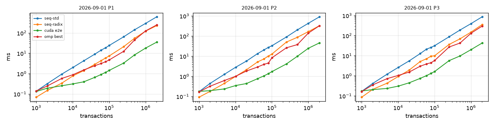
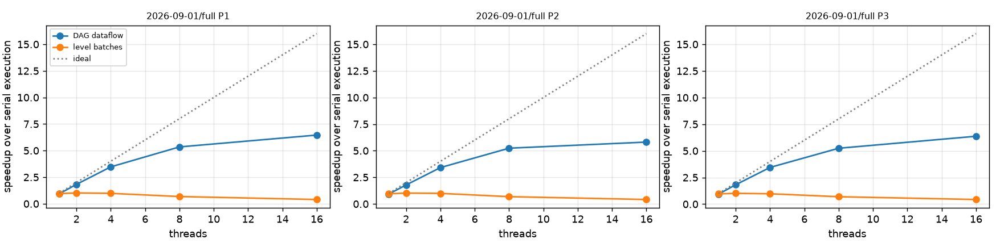

# Phase 8-10 results: GPU preprocessing pipeline

## Machine

```
date: 2026-11-01T20:01:34Z   host: sucheth-katte-ASUS-TUF-Gaming-F15-FX507VU-FX507VU   data: dataset.csv
threads swept: 1,2,4,8,16   runs: 1 warm-up + 2 measured
Linux sucheth-katte-ASUS-TUF-Gaming-F15-FX507VU-FX507VU 7.0.0-42-generic #42~24.04.1-Ubuntu SMP PREEMPT_DYNAMIC Mon Oct 19 14:43:01 UTC 2 x86_64 x86_64 x86_64 GNU/Linux
CPU(s):                                  16
Model name:                              13th Gen Intel(R) Core(TM) i7-13620H
Thread(s) per core:                      2
Core(s) per socket:                      10
CPU(s) scaling MHz:                      68%
               total        used        free      shared  buff/cache   available
Mem:            15Gi       8.3Gi       278Mi       1.1Gi       8.1Gi       6.9Gi
name, memory.total [MiB], driver_version
NVIDIA GeForce RTX 4050 Laptop GPU, 6141 MiB, 595.99.02
Build cuda_13.2.r13.2/compiler.37953736_0
```

## End-to-end time per super-block (ms, median)

GPU = balanced detection + CPU sweep, transfers included. `k-only` = GPU stages 1-3 kernels without transfers.

| scenario | n | pol | seq-std | seq-radix | omp best (t) | GPU e2e | GPU k-only | vs seq-std | vs seq-radix | vs omp |
|---|---:|---|---:|---:|---:|---:|---:|---:|---:|---:|
| 2026-09-01 | 1000 | P1 | 0.14 | 0.07 | 0.14 (1) | 0.13 | 0.11 | 1.04x | 0.53x | 1.07x |
| 2026-09-01 | 1000 | P2 | 0.17 | 0.09 | 0.17 (1) | 0.18 | 0.15 | 0.97x | 0.52x | 0.94x |
| 2026-09-01 | 1000 | P3 | 0.17 | 0.09 | 0.16 (1) | 0.18 | 0.15 | 0.96x | 0.49x | 0.94x |
| 2026-09-01 | 2000 | P1 | 0.32 | 0.15 | 0.25 (1) | 0.19 | 0.15 | 1.67x | 0.77x | 1.28x |
| 2026-09-01 | 2000 | P2 | 0.44 | 0.18 | 0.32 (1) | 0.19 | 0.16 | 2.27x | 0.91x | 1.66x |
| 2026-09-01 | 2000 | P3 | 0.42 | 0.21 | 0.35 (1) | 0.21 | 0.17 | 2.01x | 1.02x | 1.71x |
| 2026-09-01 | 5000 | P1 | 0.95 | 0.34 | 0.58 (4) | 0.25 | 0.19 | 3.72x | 1.34x | 2.28x |
| 2026-09-01 | 5000 | P2 | 1.26 | 0.45 | 0.62 (4) | 0.24 | 0.19 | 5.34x | 1.89x | 2.62x |
| 2026-09-01 | 5000 | P3 | 1.21 | 0.43 | 0.73 (2) | 0.24 | 0.19 | 5.13x | 1.83x | 3.08x |
| 2026-09-01 | 10176 | P1 | 2.02 | 0.78 | 0.89 (4) | 0.31 | 0.19 | 6.44x | 2.48x | 2.82x |
| 2026-09-01 | 10176 | P2 | 2.83 | 0.99 | 1.01 (4) | 0.35 | 0.22 | 8.13x | 2.86x | 2.89x |
| 2026-09-01 | 10176 | P3 | 2.65 | 0.93 | 1.05 (4) | 0.31 | 0.20 | 8.59x | 3.03x | 3.40x |
| 2026-09-01 | 20101 | P1 | 4.28 | 1.41 | 1.52 (4) | 0.40 | 0.21 | 10.81x | 3.57x | 3.85x |
| 2026-09-01 | 20101 | P2 | 5.72 | 2.13 | 1.83 (4) | 0.44 | 0.23 | 13.07x | 4.86x | 4.20x |
| 2026-09-01 | 20101 | P3 | 5.54 | 1.92 | 1.54 (4) | 0.45 | 0.22 | 12.32x | 4.27x | 3.42x |
| 2026-09-01 | 40366 | P1 | 9.06 | 2.87 | 2.45 (4) | 0.66 | 0.23 | 13.82x | 4.37x | 3.73x |
| 2026-09-01 | 40366 | P2 | 13.34 | 5.17 | 2.89 (8) | 0.76 | 0.28 | 17.56x | 6.80x | 3.80x |
| 2026-09-01 | 40366 | P3 | 12.80 | 5.16 | 3.01 (4) | 0.75 | 0.28 | 17.14x | 6.91x | 4.03x |
| 2026-09-01 | 60044 | P1 | 14.22 | 4.36 | 3.15 (8) | 0.91 | 0.28 | 15.64x | 4.80x | 3.47x |
| 2026-09-01 | 60044 | P2 | 20.22 | 7.23 | 3.90 (8) | 1.04 | 0.34 | 19.41x | 6.94x | 3.75x |
| 2026-09-01 | 60044 | P3 | 21.24 | 7.04 | 3.90 (8) | 1.02 | 0.34 | 20.77x | 6.89x | 3.82x |
| 2026-09-01 | 80100 | P1 | 18.71 | 5.89 | 3.84 (8) | 1.16 | 0.31 | 16.14x | 5.08x | 3.31x |
| 2026-09-01 | 80100 | P2 | 27.35 | 10.15 | 4.56 (8) | 1.36 | 0.42 | 20.18x | 7.49x | 3.37x |
| 2026-09-01 | 80100 | P3 | 25.92 | 9.49 | 4.48 (8) | 1.33 | 0.41 | 19.46x | 7.13x | 3.36x |
| 2026-09-01 | 100098 | P1 | 24.19 | 7.41 | 4.71 (8) | 1.44 | 0.37 | 16.78x | 5.14x | 3.26x |
| 2026-09-01 | 100098 | P2 | 32.88 | 12.70 | 8.30 (8) | 1.70 | 0.50 | 19.31x | 7.45x | 4.87x |
| 2026-09-01 | 100098 | P3 | 31.54 | 9.95 | 5.75 (8) | 1.63 | 0.49 | 19.35x | 6.11x | 3.53x |
| 2026-09-01 | 250058 | P1 | 64.53 | 21.17 | 12.48 (8) | 3.30 | 0.68 | 19.55x | 6.42x | 3.78x |
| 2026-09-01 | 250058 | P2 | 89.59 | 50.08 | 26.03 (8) | 4.10 | 1.18 | 21.83x | 12.20x | 6.34x |
| 2026-09-01 | 250058 | P3 | 87.26 | 36.22 | 27.06 (8) | 5.69 | 1.15 | 15.34x | 6.37x | 4.76x |
| 2026-09-01 | 500117 | P1 | 143.66 | 54.96 | 45.52 (8) | 8.38 | 2.16 | 17.15x | 6.56x | 5.43x |
| 2026-09-01 | 500117 | P2 | 201.96 | 86.62 | 37.56 (16) | 9.86 | 3.85 | 20.48x | 8.79x | 3.81x |
| 2026-09-01 | 500117 | P3 | 189.98 | 69.27 | 42.80 (8) | 9.75 | 3.70 | 19.49x | 7.11x | 4.39x |
| 2026-09-01 | 1000002 | P1 | 295.34 | 122.71 | 125.90 (8) | 18.06 | 5.88 | 16.36x | 6.80x | 6.97x |
| 2026-09-01 | 1000002 | P2 | 429.09 | 164.99 | 139.80 (8) | 24.66 | 8.80 | 17.40x | 6.69x | 5.67x |
| 2026-09-01 | 1000002 | P3 | 394.74 | 149.23 | 131.43 (8) | 20.08 | 8.25 | 19.66x | 7.43x | 6.54x |
| 2026-09-01 | 2013158 | P1 | 617.99 | 228.41 | 247.48 (8) | 35.20 | 13.50 | 17.56x | 6.49x | 7.03x |
| 2026-09-01 | 2013158 | P2 | 897.58 | 324.87 | 323.73 (16) | 45.51 | 19.27 | 19.72x | 7.14x | 7.11x |
| 2026-09-01 | 2013158 | P3 | 857.13 | 352.74 | 296.25 (16) | 42.60 | 18.25 | 20.12x | 8.28x | 6.95x |

### Crossover (smallest tested n where the GPU, transfers charged, wins)

| scenario | pol | beats seq-radix at n >= | beats best omp at n >= |
|---|---|---:|---:|
| 2026-09-01 | P1 | 5000 | 1000 |
| 2026-09-01 | P2 | 5000 | 2000 |
| 2026-09-01 | P3 | 2000 | 2000 |

## GPU stage breakdown at the largest super-block (ms)

| scenario | pol | n | H2D | extract | sort | detect | csr | D2H | level (sweep) | e2e | wall | launches | syncs | device MB |
|---|---|---:|---:|---:|---:|---:|---:|---:|---:|---:|---:|---:|---:|---:|
| 2026-09-01 | P1 | 2013158 | 7.11 | 1.25 | 6.19 | 3.19 | 2.87 | 3.48 | 11.11 | 35.20 | 43.04 | 17 | 6 | 707.0 |
| 2026-09-01 | P2 | 2013158 | 7.46 | 1.94 | 9.14 | 4.41 | 3.78 | 3.72 | 15.05 | 45.51 | 54.39 | 17 | 6 | 967.3 |
| 2026-09-01 | P3 | 2013158 | 7.12 | 1.95 | 9.16 | 4.10 | 3.03 | 3.25 | 13.98 | 42.60 | 51.24 | 17 | 6 | 967.3 |

## Phase 9: skew (detection, one thread per key vs one thread per edge)

| scenario | pol | n | largest key group | detect group (ms) | detect balanced (ms) | recovery |
|---|---|---:|---:|---:|---:|---:|
| 2026-09-01 | P1 | 2013158 | 388725 | 116.086 | 3.191 | 36.38x |
| 2026-09-01 | P2 | 2013158 | 388725 | 120.555 | 4.413 | 27.32x |
| 2026-09-01 | P3 | 2013158 | 388725 | 120.577 | 4.104 | 29.38x |

## Stage 4: levelling / batching on the GPU vs the CPU sweep

`rounds` = batches; `tail` = rounds run inside the persistent single block.

| scenario | pol | n | method | batches | rounds | tail | launches | level ms | e2e ms |
|---|---|---:|---|---:|---:|---:|---:|---:|---:|
| 2026-09-01 | P1 | 2013158 | sweep | 401223 | 0 | 0 | 17 | 11.107 | 35.20 |
| 2026-09-01 | P1 | 2013158 | kahn | 401223 | 401223 | 401191 | 84 | 390.461 | 416.62 |
| 2026-09-01 | P2 | 2013158 | sweep | 401223 | 0 | 0 | 17 | 15.049 | 45.51 |
| 2026-09-01 | P2 | 2013158 | kahn | 401223 | 401223 | 401191 | 84 | 487.540 | 520.84 |
| 2026-09-01 | P3 | 2013158 | sweep | 392438 | 0 | 0 | 17 | 13.982 | 42.60 |
| 2026-09-01 | P3 | 2013158 | kahn | 392438 | 392438 | 392374 | 149 | 445.692 | 476.39 |



## Schedule quality and simulated execution

Speedup = serial gas / simulated makespan on W workers (gas as cost, LPT inside a batch, barrier between batches). `bound` = per-key lower bound on batches for any schedule. `levels` preserve block order; `jp-random` may reorder.

| scenario | n | pol | method | batches | bound | tx/batch | W=8 | W=16 | W=32 | W=64 | W=inf |
|---|---:|---|---|---:|---:|---:|---:|---:|---:|---:|---:|
| 2026-09-01 | 10176 | P1 | levels | 2058 | 2042 | 4.9 | 2.99 | 3.16 | 3.22 | 3.23 | 3.23 |
| 2026-09-01 | 10176 | P1 | jp-random1 | 2042 | 2042 | 5.0 | 3.15 | 3.36 | 3.45 | 3.46 | 3.46 |
| 2026-09-01 | 10176 | P1 | jp-random2 | 2042 | 2042 | 5.0 | 3.30 | 3.55 | 3.63 | 3.64 | 3.64 |
| 2026-09-01 | 10176 | P1 | jp-random3 | 2043 | 2042 | 5.0 | 3.31 | 3.51 | 3.61 | 3.63 | 3.63 |
| 2026-09-01 | 10176 | P2 | levels | 2058 | 2042 | 4.9 | 2.99 | 3.16 | 3.22 | 3.23 | 3.23 |
| 2026-09-01 | 10176 | P2 | jp-random1 | 2042 | 2042 | 5.0 | 3.15 | 3.36 | 3.45 | 3.46 | 3.46 |
| 2026-09-01 | 10176 | P2 | jp-random2 | 2042 | 2042 | 5.0 | 3.30 | 3.55 | 3.63 | 3.64 | 3.64 |
| 2026-09-01 | 10176 | P2 | jp-random3 | 2043 | 2042 | 5.0 | 3.31 | 3.51 | 3.61 | 3.63 | 3.63 |
| 2026-09-01 | 10176 | P3 | levels | 2058 | 2042 | 4.9 | 2.98 | 3.16 | 3.22 | 3.23 | 3.23 |
| 2026-09-01 | 10176 | P3 | jp-random1 | 2042 | 2042 | 5.0 | 3.15 | 3.37 | 3.47 | 3.48 | 3.48 |
| 2026-09-01 | 10176 | P3 | jp-random2 | 2042 | 2042 | 5.0 | 3.29 | 3.54 | 3.63 | 3.64 | 3.64 |
| 2026-09-01 | 10176 | P3 | jp-random3 | 2043 | 2042 | 5.0 | 3.30 | 3.51 | 3.61 | 3.64 | 3.64 |
| 2026-09-01 | 20101 | P1 | levels | 3891 | 3785 | 5.2 | 3.05 | 3.27 | 3.35 | 3.36 | 3.36 |
| 2026-09-01 | 20101 | P1 | jp-random1 | 3785 | 3785 | 5.3 | 3.36 | 3.67 | 3.76 | 3.78 | 3.78 |
| 2026-09-01 | 20101 | P1 | jp-random2 | 3785 | 3785 | 5.3 | 3.24 | 3.51 | 3.61 | 3.62 | 3.62 |
| 2026-09-01 | 20101 | P1 | jp-random3 | 3786 | 3785 | 5.3 | 3.26 | 3.51 | 3.59 | 3.61 | 3.61 |
| 2026-09-01 | 20101 | P2 | levels | 3891 | 3785 | 5.2 | 3.05 | 3.27 | 3.35 | 3.36 | 3.36 |
| 2026-09-01 | 20101 | P2 | jp-random1 | 3785 | 3785 | 5.3 | 3.36 | 3.67 | 3.76 | 3.78 | 3.78 |
| 2026-09-01 | 20101 | P2 | jp-random2 | 3785 | 3785 | 5.3 | 3.24 | 3.51 | 3.61 | 3.62 | 3.62 |
| 2026-09-01 | 20101 | P2 | jp-random3 | 3786 | 3785 | 5.3 | 3.26 | 3.51 | 3.59 | 3.61 | 3.61 |
| 2026-09-01 | 20101 | P3 | levels | 3891 | 3785 | 5.2 | 3.07 | 3.29 | 3.38 | 3.39 | 3.39 |
| 2026-09-01 | 20101 | P3 | jp-random1 | 3785 | 3785 | 5.3 | 3.36 | 3.66 | 3.76 | 3.78 | 3.78 |
| 2026-09-01 | 20101 | P3 | jp-random2 | 3785 | 3785 | 5.3 | 3.25 | 3.53 | 3.62 | 3.64 | 3.64 |
| 2026-09-01 | 20101 | P3 | jp-random3 | 3786 | 3785 | 5.3 | 3.25 | 3.50 | 3.59 | 3.60 | 3.60 |
| 2026-09-01 | 40366 | P1 | levels | 8268 | 8182 | 4.9 | 2.75 | 2.90 | 2.95 | 2.96 | 2.96 |
| 2026-09-01 | 40366 | P1 | jp-random1 | 8182 | 8182 | 4.9 | 2.89 | 3.06 | 3.11 | 3.12 | 3.12 |
| 2026-09-01 | 40366 | P1 | jp-random2 | 8186 | 8182 | 4.9 | 2.87 | 3.04 | 3.09 | 3.10 | 3.10 |
| 2026-09-01 | 40366 | P1 | jp-random3 | 8182 | 8182 | 4.9 | 2.90 | 3.06 | 3.13 | 3.13 | 3.13 |
| 2026-09-01 | 40366 | P2 | levels | 8268 | 8182 | 4.9 | 2.75 | 2.90 | 2.95 | 2.96 | 2.96 |
| 2026-09-01 | 40366 | P2 | jp-random1 | 8182 | 8182 | 4.9 | 2.89 | 3.06 | 3.11 | 3.12 | 3.12 |
| 2026-09-01 | 40366 | P2 | jp-random2 | 8186 | 8182 | 4.9 | 2.87 | 3.04 | 3.09 | 3.10 | 3.10 |
| 2026-09-01 | 40366 | P2 | jp-random3 | 8182 | 8182 | 4.9 | 2.90 | 3.06 | 3.13 | 3.13 | 3.13 |
| 2026-09-01 | 40366 | P3 | levels | 8268 | 8182 | 4.9 | 2.77 | 2.93 | 2.99 | 2.99 | 2.99 |
| 2026-09-01 | 40366 | P3 | jp-random1 | 8182 | 8182 | 4.9 | 2.90 | 3.07 | 3.13 | 3.14 | 3.14 |
| 2026-09-01 | 40366 | P3 | jp-random2 | 8186 | 8182 | 4.9 | 2.88 | 3.06 | 3.12 | 3.13 | 3.13 |
| 2026-09-01 | 40366 | P3 | jp-random3 | 8182 | 8182 | 4.9 | 2.90 | 3.07 | 3.14 | 3.15 | 3.15 |
| 2026-09-01 | 60044 | P1 | levels | 12311 | 12120 | 4.9 | 2.75 | 2.89 | 2.94 | 2.94 | 2.94 |
| 2026-09-01 | 60044 | P1 | jp-random1 | 12122 | 12120 | 5.0 | 2.81 | 2.96 | 3.01 | 3.02 | 3.02 |
| 2026-09-01 | 60044 | P1 | jp-random2 | 12120 | 12120 | 5.0 | 2.82 | 2.97 | 3.01 | 3.02 | 3.02 |
| 2026-09-01 | 60044 | P1 | jp-random3 | 12121 | 12120 | 5.0 | 2.82 | 2.97 | 3.03 | 3.04 | 3.04 |
| 2026-09-01 | 60044 | P2 | levels | 12311 | 12120 | 4.9 | 2.75 | 2.89 | 2.94 | 2.94 | 2.94 |
| 2026-09-01 | 60044 | P2 | jp-random1 | 12122 | 12120 | 5.0 | 2.81 | 2.96 | 3.01 | 3.02 | 3.02 |
| 2026-09-01 | 60044 | P2 | jp-random2 | 12120 | 12120 | 5.0 | 2.82 | 2.97 | 3.01 | 3.02 | 3.02 |
| 2026-09-01 | 60044 | P2 | jp-random3 | 12121 | 12120 | 5.0 | 2.82 | 2.97 | 3.03 | 3.04 | 3.04 |
| 2026-09-01 | 60044 | P3 | levels | 12308 | 12120 | 4.9 | 2.76 | 2.91 | 2.95 | 2.96 | 2.96 |
| 2026-09-01 | 60044 | P3 | jp-random1 | 12122 | 12120 | 5.0 | 2.82 | 2.97 | 3.03 | 3.04 | 3.04 |
| 2026-09-01 | 60044 | P3 | jp-random2 | 12120 | 12120 | 5.0 | 2.82 | 2.98 | 3.03 | 3.04 | 3.04 |
| 2026-09-01 | 60044 | P3 | jp-random3 | 12121 | 12120 | 5.0 | 2.83 | 3.00 | 3.05 | 3.06 | 3.06 |
| 2026-09-01 | 80100 | P1 | levels | 16538 | 16303 | 4.8 | 2.68 | 2.81 | 2.85 | 2.86 | 2.86 |
| 2026-09-01 | 80100 | P1 | jp-random1 | 16303 | 16303 | 4.9 | 2.72 | 2.85 | 2.89 | 2.90 | 2.90 |
| 2026-09-01 | 80100 | P1 | jp-random2 | 16303 | 16303 | 4.9 | 2.79 | 2.95 | 2.99 | 3.01 | 3.01 |
| 2026-09-01 | 80100 | P1 | jp-random3 | 16303 | 16303 | 4.9 | 2.79 | 2.94 | 2.99 | 3.00 | 3.00 |
| 2026-09-01 | 80100 | P2 | levels | 16538 | 16303 | 4.8 | 2.68 | 2.81 | 2.85 | 2.86 | 2.86 |
| 2026-09-01 | 80100 | P2 | jp-random1 | 16303 | 16303 | 4.9 | 2.72 | 2.85 | 2.89 | 2.90 | 2.90 |
| 2026-09-01 | 80100 | P2 | jp-random2 | 16303 | 16303 | 4.9 | 2.79 | 2.95 | 2.99 | 3.01 | 3.01 |
| 2026-09-01 | 80100 | P2 | jp-random3 | 16303 | 16303 | 4.9 | 2.79 | 2.94 | 2.99 | 3.00 | 3.00 |
| 2026-09-01 | 80100 | P3 | levels | 16535 | 16303 | 4.8 | 2.69 | 2.83 | 2.87 | 2.88 | 2.88 |
| 2026-09-01 | 80100 | P3 | jp-random1 | 16303 | 16303 | 4.9 | 2.73 | 2.87 | 2.91 | 2.93 | 2.93 |
| 2026-09-01 | 80100 | P3 | jp-random2 | 16303 | 16303 | 4.9 | 2.81 | 2.97 | 3.02 | 3.04 | 3.04 |
| 2026-09-01 | 80100 | P3 | jp-random3 | 16303 | 16303 | 4.9 | 2.81 | 2.96 | 3.01 | 3.02 | 3.02 |
| 2026-09-01 | 100098 | P1 | levels | 21013 | 20805 | 4.8 | 2.61 | 2.71 | 2.75 | 2.76 | 2.76 |
| 2026-09-01 | 100098 | P1 | jp-random1 | 20805 | 20805 | 4.8 | 2.59 | 2.71 | 2.75 | 2.76 | 2.76 |
| 2026-09-01 | 100098 | P1 | jp-random2 | 20806 | 20805 | 4.8 | 2.68 | 2.80 | 2.84 | 2.85 | 2.85 |
| 2026-09-01 | 100098 | P1 | jp-random3 | 20805 | 20805 | 4.8 | 2.62 | 2.73 | 2.77 | 2.78 | 2.78 |
| 2026-09-01 | 100098 | P2 | levels | 21013 | 20805 | 4.8 | 2.61 | 2.71 | 2.75 | 2.76 | 2.76 |
| 2026-09-01 | 100098 | P2 | jp-random1 | 20805 | 20805 | 4.8 | 2.59 | 2.71 | 2.75 | 2.76 | 2.76 |
| 2026-09-01 | 100098 | P2 | jp-random2 | 20806 | 20805 | 4.8 | 2.68 | 2.80 | 2.84 | 2.85 | 2.85 |
| 2026-09-01 | 100098 | P2 | jp-random3 | 20805 | 20805 | 4.8 | 2.62 | 2.73 | 2.77 | 2.78 | 2.78 |
| 2026-09-01 | 100098 | P3 | levels | 21013 | 20805 | 4.8 | 2.62 | 2.74 | 2.78 | 2.79 | 2.79 |
| 2026-09-01 | 100098 | P3 | jp-random1 | 20805 | 20805 | 4.8 | 2.60 | 2.72 | 2.77 | 2.78 | 2.78 |
| 2026-09-01 | 100098 | P3 | jp-random2 | 20806 | 20805 | 4.8 | 2.68 | 2.81 | 2.86 | 2.87 | 2.87 |
| 2026-09-01 | 100098 | P3 | jp-random3 | 20805 | 20805 | 4.8 | 2.63 | 2.75 | 2.80 | 2.81 | 2.81 |
| 2026-09-01 | 250058 | P1 | levels | 52720 | 52070 | 4.7 | 2.38 | 2.46 | 2.49 | 2.50 | 2.50 |
| 2026-09-01 | 250058 | P2 | levels | 52720 | 52070 | 4.7 | 2.38 | 2.46 | 2.49 | 2.50 | 2.50 |
| 2026-09-01 | 250058 | P3 | levels | 52715 | 52070 | 4.7 | 2.39 | 2.48 | 2.51 | 2.52 | 2.52 |
| 2026-09-01 | 500117 | P1 | levels | 100929 | 99623 | 5.0 | 2.31 | 2.38 | 2.40 | 2.41 | 2.41 |
| 2026-09-01 | 500117 | P2 | levels | 100929 | 99618 | 5.0 | 2.31 | 2.38 | 2.40 | 2.41 | 2.41 |
| 2026-09-01 | 500117 | P3 | levels | 100913 | 99618 | 5.0 | 2.31 | 2.38 | 2.41 | 2.42 | 2.42 |
| 2026-09-01 | 1000002 | P1 | levels | 192745 | 190326 | 5.2 | 2.14 | 2.18 | 2.20 | 2.20 | 2.20 |
| 2026-09-01 | 1000002 | P2 | levels | 192745 | 190320 | 5.2 | 2.14 | 2.18 | 2.20 | 2.20 | 2.20 |
| 2026-09-01 | 1000002 | P3 | levels | 192531 | 190320 | 5.2 | 2.14 | 2.19 | 2.20 | 2.21 | 2.21 |
| 2026-09-01 | 2013158 | P1 | levels | 401223 | 388725 | 5.0 | 1.95 | 1.97 | 1.98 | 1.99 | 1.99 |
| 2026-09-01 | 2013158 | P2 | levels | 401223 | 388715 | 5.0 | 1.95 | 1.97 | 1.98 | 1.99 | 1.99 |
| 2026-09-01 | 2013158 | P3 | levels | 392438 | 388715 | 5.1 | 1.96 | 1.99 | 2.00 | 2.01 | 2.01 |

## Parallel execution of every transaction

Every transaction is executed (state model in `execute.hpp`); each parallel run must end in exactly the serial run's state. `levels` = batch by batch with a barrier; `DAG` = dataflow on the dependency DAG (a transaction starts when its predecessors finish). End-to-end = GPU preprocessing + best parallel execution, against plain serial execution.

| block | pol | n executed | batches | preprocessing seq-std / OpenMP / GPU (ms) | serial exec (s) | best levels (s, x) | best DAG (s, x) | end-to-end x | model levels W=inf | model DAG W=inf |
|---|---|---:|---:|---|---:|---|---|---:|---:|---:|
| 2026-09-01/full | P1 | 2,013,158 | 401,223 | 632 / 212 / 43 | 3.483 | 3.418 (1.02x, 2t) | 0.539 (6.46x, 16t) | 5.98x | 1.99x | 10.93x |
| 2026-09-01/full | P2 | 2,013,158 | 401,223 | 883 / 266 / 53 | 3.489 | 3.425 (1.02x, 2t) | 0.601 (5.81x, 16t) | 5.34x | 1.99x | 10.93x |
| 2026-09-01/full | P3 | 2,013,158 | 392,438 | 816 / 261 / 51 | 3.495 | 3.450 (1.01x, 2t) | 0.549 (6.37x, 16t) | 5.83x | 2.01x | 10.94x |


